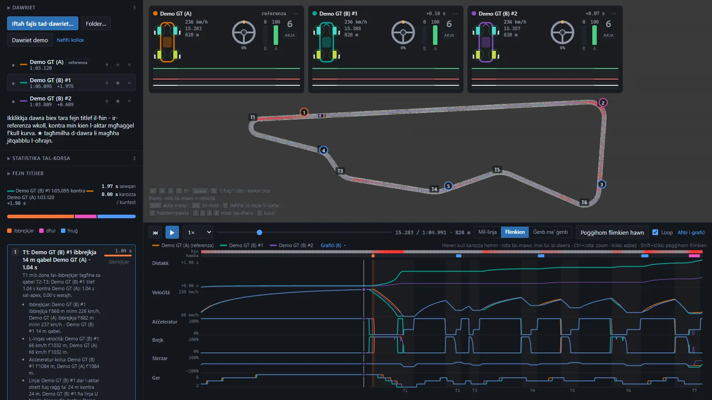

# Analiżi tat-tellieqa

Int suqt l-istess kors darbtejn. It-tab **Analiżi tat-tellieqa** iħaddem iż-żewġ sewqiet flimkien fit-3D, juri fejn ġiro wieħed kien iktar bil-mod u jgħidlek għaliex. Ma għandekx ġirjiet għadhom? Agħfas **Dawriet demo**.

It-tab iqabbel żewġ ġirjiet jew iktar ta' kors wieħed. Jaqsam il-kanvas, il-kamera u l-mudell tal-kors mgħobbi (**Sfond / livell**) mas-sħana; kollox l-ieħor huwa tiegħu: is-sidebar tiegħu u l-bar tiegħu taħt il-veduta. Kliem bħal *ġiro*, *referenza* u *apex* hemm fil-[glossarju](glossary.md).

Din il-paġna hi l-mappa tat-tab. Kull parti għandha l-paġna tagħha:

| Paġna | X'tkopri |
|---|---|
| [Tagħbija tal-ġirjiet](race-loading-laps.md) | kull format tal-fajl, folders u korsi, ismijiet tal-karozzi, dawriet demo, il-lista tal-ġirjiet, ir-referenza u l-fokus |
| [Replay u x-xena 3D](race-replay-and-scene.md) | il-bar tat-trasport, it-tliet modi tar-replay, it-tqegħid tal-karozzi f'linja, il-kamera tal-inseġwiment, linji, mappi, karozzi, tikketti, dinjiet imqallbin |
| [Grafiċi u l-HUD](race-charts-and-hud.md) | il-grafiċi tal-medda, l-għażla tal-grafiku, il-ħarsa u z-zoom, il-kards tal-karozzi, it-tabella tal-kanali |
| [Avvenimenti tal-kontroll tal-karozza](race-control-events.md) | lock-ups, wheelspin, oversteer, spins, understeer, laqtiet, tfarfir, ABS/TC, handbrake, ajru - kif jinsab kull wieħed, b'kull limitu |
| [Analiżi kantunata b'kantunata](race-corner-analysis.md) | l-allinjament skont id-distanza, kantunieri u segmenti, il-kont tal-ħin ta' kantuniera, kull kawża u l-ordni li jiġu ttestjati fiha, il-forma tal-linja u l-parir |
| [Profili tal-karozzi u tqabbil](race-car-profiles.md) | dak li kull karozza tista' tagħmel, imkejjel mill-ġirjiet tagħha; *Il-karozzi mqabbla*; dak li tiddeċiedi l-karozza f'kull kantuniera |
| [Statistika tal-korsa](race-course-statistics.md) | ħafna ġirjiet ta' kors wieħed: żbalji għal kull kantuniera u għal kull tip, il-mappa taż-żbalji, l-esportazzjoni tas-sħana, il-limiti tal-prestazzjoni |
| [Analitika tat-tellieqa: il-metodu](race-analytics.md) | ir-riċerka wara r-regoli, b'sorsi |
| [Logħob ieħor tat-tellieqa](other-games.md) | x'jagħmel il-viewer bil-ġirjiet minn kull logħba: slip u drift maħduma meta logħba ma tibgħatx dawn, dinjiet imqallbin, il-kanali addizzjonali |

## L-iskrin {#the-screen}

**Sidebar**, minn fuq għal isfel (it-taqsimiet jistgħu jingħalqu):

1. **Ġirjiet** - tella', lista, uri/aħbi, referenza, fokus, inseġwi.
   Ara [Tagħbija tal-ġirjiet](race-loading-laps.md).
2. **Statistika tal-korsa** - biss minn tliet ġirjiet mgħobbija 'l fuq.
   Ara [Statistika tal-korsa](race-course-statistics.md).
3. **Fejn titjieb** - is-sejbiet tal-ġiro ffokat, kantuniera b'kantuniera.
   Ara [Analiżi kantunata b'kantunata](race-corner-analysis.md).
4. **Kurva b'kurva** (jew *Kurva b'kurva - klassi X* meta jkunu diversi klassijiet) - l-iktar ġiro mgħaġġel minn kull kantuniera u l-linja tagħha. Jintwera b'żewġ ġirjiet jew iktar.
5. **Kontroll tal-karozza** - il-lock-ups, l-iżilqi, il-pushes u l-laqtiet tal-ġiro ffokat.
   Ara [Avvenimenti tal-kontroll tal-karozza](race-control-events.md).
6. **Il-karozzi mqabbla** (jew **Il-karozza** b'karozza waħda) - ara [Profili tal-karozzi u tqabbil](race-car-profiles.md).
7. **Veduta** - liema mappa tinpitta fuq it-triq u x'jinżel.
   Ara [Replay u x-xena 3D](race-replay-and-scene.md).
8. Il-pannelli kondiviżi **Livell** u **Kamera u xena** (mudell tal-kors, inversjoni tal-assi, kamera) - iddokumentati mas-sħana u [Kamera](camera.md).

**Il-veduta** turi l-kors, il-linji misjuqa, il-mappa, il-karozzi, it-tikketti mwaħħla mat-triq, u sa sitt kards tal-karozzi fuq lemin fuq nett (ara [Grafiċi u l-HUD](race-charts-and-hud.md)). Mingħajr ġirjiet mgħobbija jgħid "Ma hemm l-ebda ġiro mgħobbi - ħott hawn fajls ta' żewġ ġirjiet jew iktar, jew tella' d-dawriet demo mis-sidebar."

**Il-bar taħt il-veduta** fih it-trasport tar-replay u, sakemm ma jkunx moħbi, il-grafiċi tal-medda.

## Bidu malajr {#quick-start}

1. Iftaħ it-tab **Analiżi tat-tellieqa** (ħdejn **Heatmap** fil-quċċata tas-sidebar).
2. Ġib il-ġirjiet. Agħfas **Dawriet demo** biex tara x'jagħmel it-tab b'tliet ġirjiet mħolqa. Għall-ġirjiet tiegħek, irrekordjahom l-ewwel ([formati tal-fajls u rekordaturi](race-loading-laps.md#file-formats)), imbagħad agħfas **Iftaħ fajls tad-dawriet…** jew **Folder…**, jew ħott fajls jew folders fuq il-veduta.
3. L-iktar ġiro sħiħ u mgħaġġel isir ir-referenza; l-iktar ġiro bil-mod mill-oħrajn jiġi ffokat. Ikklikkja kull ġiro fil-lista biex tiffokah; ★ tagħmel ġiro referenza.
4. Aqra **Fejn titjieb**. Ikklikkja sejba: il-karozzi jitqegħdu f'linja 40 m qabelha, il-kamera tiffrenaha, ir-replay jgħaddi minnha u l-kejliet jinfetħu.
5. Poġġi l-mouse fuq il-grafiċi biex iġġib kull karozza f'dak il-metru; Shift+klikk biex titqegħedhom f'linja hemm.

## Ċwievet {#keyboard}

Waqt li t-tab tat-Tellieqa miftuħ:

| Ċavetta | Tagħmel |
|---|---|
| **K** | iħaddem / waqqaf ir-replay |
| **Home** | lura għall-bidu tar-replay |
| ċwievet tan-numri | xejn (fis-sħana jibdlu l-modalitajiet) |

Iċ-ċwievet miktubin f'kaxxa tal-kitba jew f'drop-down jiġu injorati. Iċ-ċwievet tal-kamera jaħdmu bħal fis-sħana (**W A S D**, **Space** 'il fuq, **Q** 'l isfel, **Shift** iktar mgħaġġel, **Alt** iktar bil-mod, il-mouse biex tħares; kollox f'[Kamera](camera.md)); **F** jiffrena l-ġirjiet imgħobbija (kif tagħmel it-tagħbija tal-ġirjiet).

## Ħafna ġirjiet {#many-laps}

- Il-ġirjiet kollha mgħobbija jiġu analizzati u mgħoddija; għexieren jieħdu sekonda jew tnejn.
- Wara **8** ġirjiet (`SHOW_ALL_UP_TO`), il-ġirjiet miżjuda jitpinġew biss meta jkunu r-referenza, il-ġiro ffokat, jew l-aħjar ġiro tal-klassi tal-ġiro ffokat. Il-bidla hija *Uri kollox* / *Biss dawk li qed tħares lejhom*.
- Wara **10** karozzi viżibbli (`PLAIN_PAST`), il-ġirjiet li mhux qed tħares lejhom (mhux il-fokus, mhux il-karozza mħaddma jew ir-referenza) jinżlu b'linji mnaqqsa għal punt kull 6 m minflok 1.5 m, u b'karozzi sempliċi.
- Il-grafiċi jpingu sa **8** ġirjiet; il-HUD juri sa **6** kards.
- L-istatistika tal-kors tidher minn **3** ġirjiet.

Dettalji: [Statistika tal-korsa](race-course-statistics.md#performance-with-many-laps).

## Settings tal-veduta default {#default-view-settings}

| Setting | Bażi |
|---|---|
| Mappa | Mappa tal-ħin |
| Linji misjuqa, Karozzi, Tajers u sospensjoni, Tikketti, Traċċa mill-ġirjiet | fuq |
| Il-valuri kollha fuq il-kards | mitfi |
| Daqs tal-karozza | 1× |
| Grafiċi | muri |
| Modalità tar-replay | Mill-linja |
| Veloċità tar-replay | 1× |
| Ripetizzjoni | fuq |

Xejn minn dawn ma jinħażen; ttella' mill-ġdid tibda mill-bażi. Dak li jinftakar fil-browser: il-lingwa, u l-ismijiet tal-karozzi mitgħallma mill-fajls tal-ġirjiet (ara [Tagħbija tal-ġirjiet](race-loading-laps.md#car-names)).

## Għall-iżviluppaturi {#for-developers}

### X'jiġri meta jitgħabbew il-ġirjiet {#what-happens-when-laps-are-loaded}

Kull darba li jinbidel is-sett tal-ġirjiet, ir-referenza jew il-lingwa, l-analiżi kollha ssir mill-ġdid (`analyse` fi
[`src/race/analysis.ts`](https://github.com/Holdi601/3DHeat/blob/main/src/race/analysis.ts)):

1. Kanali derivati jiżdiedu għal kull ġiro fejn il-logħba ma tibgħatx dawn: angolu tad-drift, slip tar-roti mill-veloċitajiet tar-roti, fl-ajru, art mhux iebsa, rata tal-yaw ([`derive.ts`](https://github.com/Holdi601/3DHeat/blob/main/src/race/derive.ts)).
2. Ir-referenza tintgħażel u kull ġiro jiġi ppruvat fuq it-triq tagħha u mdaħħal mill-ġdid kull 2 m ([`align.ts`](https://github.com/Holdi601/3DHeat/blob/main/src/race/align.ts)).
3. Jiġi determinat jekk id-dinja tal-logħba tkunx imqallba mill-ġirjiet ([`handedness.ts`](https://github.com/Holdi601/3DHeat/blob/main/src/race/handedness.ts)).
4. Il-kantunieri jinstabu fuq ir-referenza, u jinġabru f'segmenti minn żona ta' tifrin għal oħra li jmiss ([`segments.ts`](https://github.com/Holdi601/3DHeat/blob/main/src/race/segments.ts)).
5. Għal kull karozza: l-envelope tagħha (grip, tifrin, qawwa skont il-veloċità), il-profil tagħha, il-kurvi tat-tajers tagħha ([`envelope.ts`](https://github.com/Holdi601/3DHeat/blob/main/src/race/envelope.ts), [`profile.ts`](https://github.com/Holdi601/3DHeat/blob/main/src/race/profile.ts), [`control.ts`](https://github.com/Holdi601/3DHeat/blob/main/src/race/control.ts)).
6. Għal kull ġiro u segment: x'għamel (punt tat-tifrin, l-iktar punt bil-mod, throttle sħiħ, ...) u l-linja li sewqet ([`line.ts`](https://github.com/Holdi601/3DHeat/blob/main/src/race/line.ts)).
7. Għal kull ġiro: l-avvenimenti tal-kontroll tal-karozza tagħha, kull wieħed imqabbel mal-ġiro li jitqabbel miegħu hemm.
8. Għal kull ġiro u segment: il-kont tal-ħin kontra l-ġiro tat-tqabbil tiegħu u s-sejba bil-kliem.
9. Il-mappa tal-ħin u l-mappa tal-kawża għal kull ġiro.

It-testi jinħolqu fil-lingwa attwali; bidla tal-lingwa tmexxi l-analiżi mill-ġdid (u jbiddel l-ismijiet tad-dawriet demo). Falliment fl-analiżi jidher taħt il-buttuni **Ġirjiet** bħala żball, u l-ġirjiet jibqgħu mgħobbija.

### Fajls tas-sors {#source-files}

| Fajl | Rwol |
|---|---|
| `src/race/adapters.ts`, `ibt.ts` | il-qari tal-fajls tal-ġirjiet |
| `src/race/lap.ts`, `carNames.ts`, `synthetic.ts` | it-tip tal-ġiro, it-tismija, id-dawriet demo |
| `src/race/derive.ts`, `handedness.ts` | kanali derivati, dinjiet imqallbin |
| `src/race/align.ts`, `segments.ts`, `line.ts` | l-assi tad-distanza, il-kantunieri, il-linji |
| `src/race/analysis.ts` | kantunieri imqabbla, kawżi, sejbiet |
| `src/race/envelope.ts`, `profile.ts` | dak li karozza tista' tagħmel |
| `src/race/control.ts`, `impacts.ts` | kontroll tal-karozza, laqtiet u tfarfir |
| `src/race/stats.ts` | ħafna ġirjiet |
| `src/race/replay.ts`, `scene.ts`, `glyph.ts`, `geometry.ts` | ir-replay u t-tpinġija |
| `src/race/schema.ts`, `graphs.ts` | it-tabella tal-kanali, ir-ringieli tal-grafiċi |
| `src/ui/race/*` | is-sidebar, il-grafiċi, il-HUD, it-tikketti |
| `src/state/raceStore.ts` | l-istat tat-tab u l-arloġġ tar-replay |
