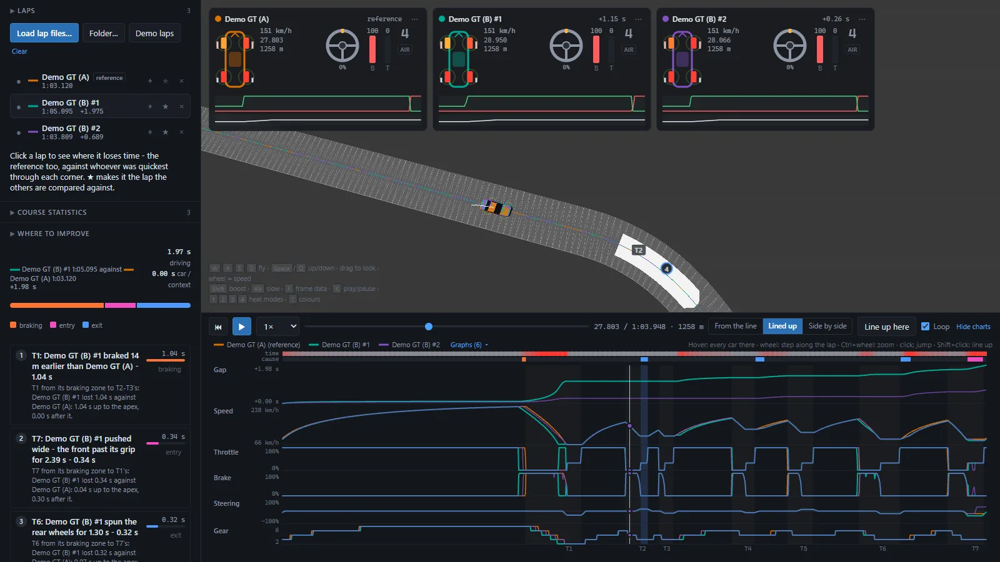

# Replay u x-xena 3D

Ilagħab id-dawriet tiegħek flimkien, bħal tellieqa, u ara fejn dawra waħda tmur 'il quddiem. Kollox li tara fil-view 3D tat-tab **Analiżi tat-tellieqa** hu deskritt hawn: il-linji misjuqa, il-kuluri miksija fuq it-triq, il-karozzi u t-tikketti.



## L-arloġġ tar-replay {#the-replay-clock}

Arloġġ wieħed imexxi kull dawra: sekondi tad-dawra **tar-referenza**. Il-magna tgħaddih kull frame waqt li tkun qed tilgħab (bil-ħin tal-frame × il-veloċità tar-replay); fl-aħħar jerġa' jmur għal 0 meta **Ripetizzjoni** tkun mixgħula, inkella jieqaf. L-arloġġ ma jinsabx intenzjonalment fil-maħżen, sabiex il-barra tal-ġenb ma terġax tinbena kull frame; il-HUD u l-grafiċi jisimgħu lilu u jaġġornaw mill-inqas darba kull frame.

**It-tul tar-replay** hu l-itwal dawra li tilħaq fuq l-arloġġ: il-ħin ta' kull dawra (nieqes l-offset tagħha f'*Flimkien*), jew il-ħin tar-referenza f'*Ġenb ma' ġenb*.

## Il-barra tat-transport {#the-transport-bar}

Taħt il-view, minn tax-xellug għal tal-lemin:

| Kontroll | Jagħmel |
|---|---|
| ⏮ | lura għall-bidu (ukoll **Home**) |
| ▶ / ❚❚ | ilagħab / waqqaf (ukoll **K**) |
| veloċità | 0.25×, 0.5×, 1×, 2×, 4× |
| slider tal-iskrubbjar | jissettja l-arloġġ direttament, f'passi ta' 0.01 s |
| arloġġ | `ħin / tul · metri`: l-arloġġ bħala ħin tad-dawra, it-tul tar-replay, u kemm 'il quddiem fuq ir-referenza tinsab il-karozza tar-referenza |
| *Mil-linja* / *Flimkien* / *Ġenb ma' ġenb* | il-mod tar-replay (hawn taħt) |
| **Poġġihom flimkien hawn** | iqiegħed kull karozza fejn tinsab ir-referenza issa, u jkompli minn hemm |
| **Ripetizzjoni** | jibda mill-ġdid fl-aħħar (mixgħul b'default) |
| **Aħbi l-grafiċi** / **Uri l-grafiċi** | il-grafiċi tad-distanza taħt il-barra |

Il-buttuni jkunu mitfija sakemm ma jkunux mgħobbija dawriet (dawra waħda tkun biżżejjed biex tilgħabha; it-tqabbil jeħtieġ tnejn).

## Modi tar-replay {#replay-modes}

Kif il-ħin ta' kull dawra jiġi mill-arloġġ:

| Mod | Il-ħin ta' kull dawra | Dak li juri |
|---|---|---|
| **Mil-linja** (`start`) | l-arloġġ innifsu | kull dawra mill-bidu tagħha: tellieqa bejniethom, id-distakk jikber kif kien jikber fuq it-triq |
| **Flimkien** (`anchor`) | l-arloġġ żejjed l-offset tad-dawra | kull karozza fl-istess post fl-istess ħin, imbagħad tħallatha tmur - x'jiġri minn dak il-punt 'il quddiem, mhux mill-bidu tad-dawra |
| **Ġenb ma' ġenb** (`locked`) | il-ħin meta d-dawra laħqet id-distanza kurrenti tar-referenza | kull karozza miżmuma fid-distanza tar-referenza tul id-dawra kollha: veloċitajiet u inputs imqabbla metru b'metru |

Uża dan meta:

- **Mil-linja**: trid tara min hu 'l quddiem u kif jikber id-distakk.
- **Flimkien**: trid taf x'jiġri f'kantuniera jew f'dritta waħda, b'kulħadd jibda fl-istess livell hemm.
- **Ġenb ma' ġenb**: trid tqabbel x'jagħmlu s-sewwieqa bil-pedali u r-rota fl-istess post fuq il-kors.

**Offsets f'*Flimkien*:** għal anchor f'`s` metri fuq ir-referenza, l-offset ta' kull dawra hu l-ħin tagħha stess f'`s` nieqes il-ħin tar-referenza f'`s`, it-tnejn imqraw mid-dawriet imqabbla (ara [assi ta' distanza waħda](race-corner-analysis.md#one-distance-axis)). Dawra li ma tkoprix `s` iżżomm offset 0. Jekk tagħżel *Flimkien* mill-buttuni tal-mod, l-anchor jitpoġġa fid-distanza kurrenti tar-referenza.

Palu abjad b'bandiera (14 m għoli) jimmarka l-anchor fil-mod *Flimkien*.

### Tqegħid flimkien {#lining-up}

| Azzjoni | Anchor | Arloġġ |
|---|---|---|
| **Poġġihom flimkien hawn** | fejn hi r-referenza issa | ma jinbidilx |
| Shift+ikklikkja fuq il-grafiċi | il-metru li ikklikkjajt | 1.5 s qabel ir-referenza tilħaqu |
| sejbien f'*Fejn tittejjeb*, badge innumerat fuq it-triq, ringiela ta' *Kantuniera b'kantuniera* b'sejbien | 40 m qabel fejn tibda l-kawża tas-sejbien | 1.5 s qabel dak il-punt; imbagħad jilgħab |
| avveniment tal-kontroll tal-karozza, tikketta ta' daqqa | 40 m qabel l-avveniment | 1.5 s qabel; imbagħad jilgħab |
| dawra fl-istatistika tal-kors | bħas-sejbien jew l-avveniment tagħha | kif hawn fuq, b'dik id-dawra fil-fokus |

Meta tħares lejn sejbien, tiġi wkoll iffrajmata mill-kamera - ballun madwar in-nofs tal-firxa tas-sejbien, bir-raġġ l-akbar minn 40 m u nofs it-tul tiegħu flimkien ma' 30 m (60 m għal avveniment) - sakemm il-kamera ma tkunx qed issegwi karozza.

### Kamera li ssegwi {#chase-camera}

⌖ fil-lista tad-dawriet tagħmel lill-kamera ssegwi dik il-karozza: 2.5 + 4 × id-daqs tal-karozza m wara hi u 0.9 + 1.1 × id-daqs tal-karozza m 'il fuq, tħares lejn id-direzzjoni tal-vjaġġ tagħha, imnaqqra 'l isfel lejn il-karozza, u mrażżna (20% tal-mixi kull frame) sabiex ma titħażżax kull mess. ⌖ darba oħra tħallieha. Il-karozza segwita tinħadem ftit iktar ċara, b'ċirku abjad fuq l-art, u l-karta tagħha tinxtegħel.

## Il-Viżta {#the-view-section}

| Kontroll | Default | Jagħmel |
|---|---|---|
| **Linji** / **Mappa taż-żmien** / **Mappa tal-kawżi** / **Mappa taż-żbalji** | Mappa taż-żmien | dak li jinħadem tul it-triq (hawn taħt); *Linji* ma jpinġi xejn |
| leġġenda | - | *jiġbed ↔ jitlef* għall-mappa taż-żmien, il-kuluri tal-kawżi għall-mappa tal-kawżi, *ftit dawriet ↔ l-aktar dawriet* għall-mappa taż-żbalji |
| **Linji misjuqa** | mixgħul | il-linja ta' kull dawra viżibbli fil-kulur tagħha |
| **Karozzi** | mixgħul | il-karozzi, u s-sorsi tal-karti tal-HUD |
| **Tajers u sospensjoni** | mixgħul | it-temperatura tal-gomma, il-ħalqiet tal-ħtikk, il-pushrods tas-sospensjoni u glyphs oħra għal kull rota, u l-fanali tas-saqaf fuq il-karozzi |
| **Tikketti** | mixgħul | ismijiet tal-kantunieri, badges innumerati, tikketti ta' daqqi, it-tikketti tal-kantunieri tal-mappa taż-żbalji |
| **Triq mid-dawriet** | mixgħul | wiċċ tat-triq għal kors li ma nġibdx mudell tiegħu (moħbi meta jkun mgħobbi mudell tal-kors fil-**Livell**) |
| **Il-valuri kollha fuq il-karti** | mitfi | kull kanal imniżżel fuq kull karta tal-HUD |
| **Forom reali tal-karozzi** | mixgħul | kull karozza bil-forma tal-counterpart tagħha (ara [Il-karozzi](#the-cars)); mitfi: il-monoposto miftuħ, li ma jaħbi xejn mit-telemetrija |
| **Daqs tal-karozza** | 1× | minn 1× sa 10× f'passi ta' 0.5; 1× hu d-daqs reali tal-karozza, twila u wiesgħa daqs kif tkun fil-logħba. Ebda ħaġa ħlief dan il-slider ma tbiddlu |

## Linji misjuqa {#driven-lines}

It-triq ta' kull dawra viżibbli permezz tal-kampjuni proprji tagħha, fil-kulur tagħha, imrossa 0.12 m taħt il-pożizzjoni rreġistrata (il-pożizzjoni rreġistrata tal-karozza hi l-punt ta' referenza tagħha, 0.28 sa 0.47 m 'il fuq mit-triq fuq kursijiet estratti ta' Forza). Punt jinżamm kull 1.5 m; b'aktar minn 10 dawriet viżibbli, dawk mhux imħarsa lejhom iżommu punt kull 6 m (kull vertiċi jmur fuq il-GPU kull frame).

## Il-mapep {#the-maps}

It-tlieta huma xrit tul it-triq **tar-referenza**, 0.2 m taħt il-pożizzjonijiet rreġistrati, quad wieħed għal kull pass tal-grilja ta' 2 m.

### Mappa taż-żmien (`where`) {#time-map-where}

Għad-dawra fil-fokus: sekondi miksuba jew mitlufa għal kull metru kontra d-dawra li titqabbel magħha f'dak il-punt (l-aħjar tal-klassi tagħha, jew għar-referenza l-aktar mgħaġġla oħra minn kull settur), mill-bidla fid-delta mqabbla għal kull pass tal-grilja, imħabbra fuq ±10 m. Aħmar fejn jitlef il-ħin, aħdar fejn jirbaħ, griż bejniethom; l-iskala tal-kuluri hi l-95 persentil tal-valuri assoluti, għalhekk il-quċċati jiġu mqattgħa u l-biċċa l-kbira tad-dawra tkun fil-firxa. 6 m wiesgħa.

### Mappa tal-kawżi (`why`) {#cause-map-why}

Għad-dawra fil-fokus: kull telf jinpitter fuq il-firxa fejn tinsab **il-kawża** tiegħu (mhux fejn jidher il-ħin), miksi bil-grupp tal-kawża, u s-sejbien l-iktar għali jirbaħ fejn jaqbżu xulxin. Wisa' `3 + 9·√(kost / l-akbar kost)` metri; fejn ma kien hemm telf, strixxa griża ta' 2 m. Is-sejbien magħżul f'*Fejn tittejjeb* jinpitter abjad.

| Grupp | Kulur | Sejbiet |
|---|---|---|
| brejkjar | oranġjo | telf tas-sewwieq fil-fażi tal-brejkjar |
| dħul | manġenta | telf tas-sewwieq fid-dħul u fin-nofs |
| ħruġ | blu | telf tas-sewwieq fil-ħruġ |
| dritta | isfar | telf tas-sewwieq fuq id-dritta |
| karozza | griż | dak li l-karozza tispjega |
| kuntest | griż skur | is-sitwazzjoni (tlaq ta' tellieqa kontra dawra bil-veloċità) |

### Mappa taż-żbalji {#mistake-map}

Kemm mid-dawriet kollha (tal-klassijiet magħżula fl-istatistika tal-kors) għamlu żball f'kull metru - ta' kull tip, jew biss dak magħżul fl-istatistika. Kull dawra tgħodd darba għal kull metru; firxa ta' kull żball tinwessa b'6 m kull naħa sabiex wieħed qasir jidher. Wisa' `3 + 10·(dawriet / l-iktar dawriet)` metri u kulur minn kannella mdardar sa oranġjo qawwi; griż 2 m fejn ebda dawra ma għamlet wieħed. Ara [Statistika tal-kors](race-course-statistics.md#the-mistake-map).

## Triq mid-dawriet {#track-from-the-laps}

Għal logħba li l-kors tagħha ma ġiex estratt, tinżamm triq taħt il-linji: kemm huma wiesgħa d-dawriet imxerrda fuq ir-referenza (offsets laterali fi 25 m jitqiesu) pluss 2 m kull naħa, mill-inqas 4 m kull naħa tal-linja tar-referenza, mimlija fuq ±8 punti tal-grilja (±16 m), bl-griż tal-asfalt u linji ħfief tat-tarf, 0.3 m taħt il-pożizzjonijiet rreġistrati. Moħbija meta jkun mgħobbi mudell ta' kors fil-**Livell**.

## Daqqiet u tfixkil fuq it-triq {#hits-and-crashes-on-the-track}

Kull daqqa u tfixkil ta' kull dawra viżibbli (ara [Avvenimenti tal-kontroll tal-karozza](race-control-events.md#hits-and-crashes)) timmarkaha fejn seħħet, kull meta jinġibdu linji jew karozzi: stilla b'ponta - aħmar għal tfixkil, kannella għal daqqa - tiqagħad fuq palu, b'ċirku bil-kulur tad-dawra f'qiegħu, ikkobbjat skont id-daqs tal-karozza (it-tfixkil akbar). Hekk kif karozza tgħaddi mill-mument ta' daqqa, ċirku ta' xokk jinfirex minnha għal 0.8 s.

## Modalità ta' għajnuna {#help-mode}

**?** ħdejn l-għażla tal-lingwa, jew il-buttuna **?** jew il-buttuna **F1**, iħalli key għal kull kulur fuq l-iskrin, fuq it-tliet tabs ([`HelpPanel.tsx`](https://github.com/Holdi601/3DHeat/blob/main/src/ui/help/HelpPanel.tsx),
[`RaceHelp.tsx`](https://github.com/Holdi601/3DHeat/blob/main/src/ui/race/RaceHelp.tsx)). L-għażla tibqa' f'dan il-browser.

- **Il-key** fil-kantuna tal-view ittella' l-kuluri għat-tab u l-mod li qed jintużaw. Kull rampa tiġi minn fejn il-view tikseb, għalhekk rampa tas-sħana li editjajt turi bħala editjata. Fuq it-tab tat-tellieqa, jitlestew biss dak li d-dawriet mgħobbija jġorru.
- **Il-karta ta' kull karozza** tikseb tabella ta' dak li hu mpinġi fuq ir-roti tagħha, bl-isem, u l-valur ta' kull rota bil-kulur li tinpinġi bih.
- **Il-karozza fil-fokus** tikseb tikketta f'kull rota li tgħid l-istess, imqiegħda 'l barra fil-kantunieri. Mitfija meta l-karozza tkun iċkken wisq fuq l-iskrin biex jidhru.

## Il-karozzi {#the-cars}

**Kull karozza fil-forma tagħha stess**, fil-kulur tad-dawra tagħha u fid-daqs reali tagħha. Il-forom ġejjin minn fajl tal-karozza, magħmul darba fuq il-magna fejn tinsab il-logħba:

```
python -m heat3d_gamefiles cars -o forza.h3dcars
```

Mingħajr wieħed, kull karozza titpinġa bħala **l-karozza proprja tal-viewer** tat-tip u l-era tagħha: berline, coupé, hatchback, estate, karozza sportiva, supercar, muscle car, off-roader, pickup, van jew microcar, kull wieħed bħala klassika (qabel 1980), tas-snin 80 u 90, jew moderna ([`carBodies.ts`](https://github.com/Holdi601/3DHeat/blob/main/src/race/carBodies.ts)). Dawn jinbnew hawn minn proporzjonijiet ġenerali: l-ebda logo, l-ebda isem ta' mudell u xejn minn fajls ta' kwalunkwe logħba, allura jiġu mal-viewer. It-tip ġej mill-isem tal-karozza, l-era mis-sena li fih; karozza li m'għandha la wieħed u lanqas l-ieħor tittieħed mill-klassi tagħha. Madwar mija ġenerazzjoni reali huma magħrufa mit-tul, il-wisa', l-għoli u l-wheelbase ippubblikati tagħhom ([`carSpecs.ts`](https://github.com/Holdi601/3DHeat/blob/main/src/race/carSpecs.ts); linja kull waħda, imdawwra), allura BMW 3 Series tal-1990 tieħu d-daqs u l-pożizzjoni ta' dik il-karozza, xorta bħala forma sempliċi mingħajr badge jew grille.

Il-fajl tal-karozza jinħoloq fuq il-magna tiegħek stess minn kopja tal-logħba tiegħek stess. Fih mudell b'dettall baxx ta' kull karozza, madwar 900 triangolu, bil-pożizzjonijiet tar-roti tagħha (ara [il-kmand `cars` tal-estrattur](https://github.com/Holdi601/3DHeat-GameFiles/blob/main/docs/commands.md#cars)). **Tagħbija tal-fajl tal-karozza...** fis-settings tal-view, jew tqegħid il-fajl fuq it-tab tat-tellieqa, jgħabbiha; tibqa' f'dan il-browser. Fiha hemm il-forom tal-logħba, allura m'hiex xi ħaġa biex tgħaddi, u l-viewer ma jbagħtx wieħed.

Liema karozza tidher għal dawra mgħobbija tiġi deċiża skont dak li jkun mgħobbi kull darba u qatt ma tinħażen, allura karozza li llum m'għandha l-ebda counterpart tiġi bil-proprja tagħha malajr kif ikun hemm fajl aktar ġdid li fih wieħed ([`carMatch.ts`](https://github.com/Holdi601/3DHeat/blob/main/src/race/carMatch.ts)):

| Il-karozza tad-dawra | Titpinġa bħala |
|---|---|
| in-numru tagħha jinsab fil-fajl għall-istess logħba | dik il-karozza nfisha |
| l-istess manifattur, u kelma tal-mudell fl-isem | dak il-mudell, l-iktar wieħed qrib fis-snin |
| l-istess manifattur, l-istess ġenerazzjoni | il-karozza ta' dak il-manifattur l-iktar qrib fis-snin |
| kull ħaġa oħra, b'fajl tal-karozzi | l-ewwel wieħed tal-istess manifattur jekk ikun hemm, inkella l-istess tip ta' karrozzerija, l-iktar qrib fis-snin |
| karozza b'ħarsa b'ruoti miftuħa, bl-isem tagħha | is-single-seater ta' hawn taħt |
| wieħed mill-ewwel tnejn ma jaqbilx, u l-viewer jaf il-karozza mid-daqs tagħha | il-karozza proprja tal-viewer f'daqs dik il-karozza reali, b'fajl jew mingħajru |
| kull ħaġa oħra mingħajr fajl | il-karozza proprja tal-viewer ta' dak it-tip u l-era |

Allura dawra minn logħba oħra ta' BMW 3 Series tal-1990 turi BMW ta' madwar dik is-sena, u karozza iktar ġdida mill-fajl turi l-qariba tagħha l-iktar qrib sakemm il-fajl jerġa' jsir. Il-tooltip ta' dawra, u l-linja taħt id-daqs tal-karozza għad-dawra fil-fokus, jgħidu x'inhi titpinġa bħala u kemm hu qrib dan.

Il-karozzi proprji tal-viewer għandhom twieqi skuri. Il-mudelli ta' fajl tal-karozza huma kulur wieħed kollu, għax il-fajl m'għandux pittura u l-ħġieġ biex jibbażaw fuqhom. Ir-roti, il-fanali tad-denb, l-attivaturi u l-glyphs tat-telemetrija hawn taħt jinpittru bħal fuq is-single-seater; il-pushrod jaħdem 'il fuq mit-tarf ta' barra tar-rota, fejn jidher, u l-wishbones jitħallew barra.

**Is-single-seater** hu monoposto miftuħ fil-kulur tad-dawra, sabiex il-quddiem ikun ovvju minn kull angolu u xejn ma jaħbi r-roti: tub, kopertura tal-magna, sidepods, kokpit b'elmu, halo, art, u ġwienaħ quddiem u wara; erba' rroti tondi, dawk ta' quddiem jiddawru bit-timone (sa 0.5 rad f'lock sħiħ), kull waħda fuq żewġ wishbones b'upright, bar tat-timone (quddiem) jew xaft tal-kowp (wara), u pushrod. Il-mudell jitnaqqas 0.3 m mill-pożizzjoni rreġistrata sabiex ir-roti tiegħu jkunu fuq it-triq, u jiskala bis-**Daqs tal-karozza**.

**Il-ġisem jiċċaqlaq fuq l-irkaptu tiegħu**: meta d-dawra jkollha l-erba' vjaġġi tas-sospensjoni, kull kantuna titbaxxa bil-vjaġġ tagħha (eżaġerat għal 0.12 m minn kompressjoni sħiħa sa tensjoni sħiħa, sabiex turi minn kamera li tissegwi), u l-ġisem jinżel, jitfa' u jdur fuq il-pjan li jgħaqqad l-erba'.

**Dak li jinpitter mit-telemetrija** (b'*Tajers u sospensjoni* mixgħul) jsegwi [it-tabella tal-kanali](race-charts-and-hud.md#the-channel-table):

| Glyph | Minn | Kif jinpitter |
|---|---|---|
| kulur tal-gomma | `tireTemp` | il-gomma innifisha, blu kiesaħ → ċjan → aħdar li qed taħdem → isfar → aħmar sħun, fuq 40-130 °C |
| ċirku tal-ħtikk | `slipRatio`, `slipAngle`, `combinedSlip`, `slipIndex` (l-akbar) | ċirku fuq l-art taħt ir-rota, aħdar bl-aderenza f'idejn, kannella fuq 0.66, aħmar fuq 1 (it-tarf tal-aderenza kif tirrapporta l-logħba); dgħajjef taħt 0.3 |
| barra tas-sospensjoni | `suspension` (0..1) | il-pushrod ikkuluriet bil-vjaġġ: blu meta jkun imdawwal, abjad f'nofs, aħmar meta jkun imgħaffeġ |
| twiġġib tal-brejk | `brakeTemp` (100-900 °C) | diska fuq il-wiċċ ta' barra tar-rota, minn skur għal oranġjo |
| faxxa tal-użu | `tireWear` (0..1) | faxxa madwar it-tarf tal-kalpistru, abjad ġdid → aħmar użat |
| barra tat-tagħbija | `wheelLoad` (0-12 000 N) | pistun ħdejn ir-rota daqs kemm hu għoli t-tagħbija |

Il-fanali tal-brejk (fanal tal-maltemp u l-endplates tal-ġwienaħ) jixegħlu bil-pedal tal-brejk. Kull kanal `lamp` li jkun mixgħul (fuq nofs il-medda tiegħu) jixgħel fanal fuq l-airbox bil-kulur tiegħu: ABS jaħdem, traction control jaħdem, DRS, limitatur tal-pit, brejk tal-id, fl-arja.

**Fil-folla** (aktar minn 10 viżibbli), il-karozzi mhux imħarsa lejhom jinpittru sempliċi: ġisem, ġwienaħ, rroti u dawl tal-brejk biss.

## Tikketti {#labels}

Imwaħħla mat-triq u mqiegħda kull frame mill-proġezzjoni tal-kamera (barra mill-ekran jew wara l-kamera, moħbija). Bil-**Tikketti** mixgħula:

| Tikketta | Fejn | Ikklikkja |
|---|---|---|
| ismijiet tal-kantunieri (`T1`, `T2` …) | fuq l-apex ta' kull kantuniera fuq ir-referenza | - |
| badges innumerati 1-5 | l-ogħla ħames telf tas-sewwieq tad-dawra fil-fokus, f'nofs il-firxa ta' kull kawża, mdawra bil-kulur tal-kawża; fuq it-tikketta tgħaddi biex tara t-titlu u l-kost | poġġi flimkien u ilagħab dak is-sejbien |
| tikketti ta' daqqa / tfixkil | fuq kull xadina tad-dawra **fil-fokus**: "Tfixkil −45 km/h" / "Daqqa −12 km/h"; fuq it-tikketta tgħaddi biex tara d-deskrizzjoni sħiħa u l-parir | poġġi flimkien u ilagħab id-daqqa |
| tikketti tal-kantunieri fuq il-mappa taż-żbalji (minflok ismijiet tal-kantunieri u badges, meta l-mappa tkun il-mappa taż-żbalji) | fuq l-apex ta' kull kantuniera: "T3 · 5/40 dħul bikri" (l-iktar żball komuni, dawriet li għamlu dak / dawriet li għamlu l-kantuniera), "T3 · 5/40" meta jkun magħżul tip wieħed, "T3 · nadif" meta ma jkun magħżul xejn; fuq it-tikketta tgħaddi biex tara t-telf tal-kantuniera u l-ħames żbalji l-iktar komuni tagħha | tiftaħ jew tagħlaq dik il-kantuniera fl-istatistika tal-kors |

## Dinjiet imqallbin {#mirrored-worlds}

Id-dinja tal-viewer hi b'id-dritta bil-Y 'il fuq: meta tarah minn fuq, karozza li d-direzzjoni tal-vjaġġ tagħha `atan2(dx, dz)` tikber tkun qed tdur lejn ix-xellug. Logħba b'dinja bl-idejn ix-xellug - Forza fostha - tidher imqallba: kull kantuniera tal-lemin tinġarr bħala kantuniera tax-xellug, il-kors u d-dawriet it-tnejn.

Id-dawriet jgħidu huma stess dan ([`handedness.ts`](https://github.com/Holdi601/3DHeat/blob/main/src/race/handedness.ts)): billi jimxu kull dawra ftit metri (3 m) f'daqqa, id-dawran tat-triq tagħha jitqabbel mal-kompressjoni tas-sospensjoni ta' barra (`suspension.FR` nieqes `suspension.FL`) u, mingħajr sospensjoni, mat-timone (pożittiv għal-lemin f'kull adapter). Dawra li tdur inqas minn π fl-totalità tagħha ma tgħid xejn; l-evidenza tgħodd meta taqbeż 2% tad-dawran. Id-dawriet jivvutaw; parità hi "ma nistgħux ngħidu".

Meta l-verdett tad-dawriet ma jaqbilx mal-inversjoni kurrenti tal-assi (għadd dispari ta' assi mqallbin fil-**Kamera u x-xena → Aqleb l-assi tad-dinja**), it-taqsima **Dawriet** tgħid dan taħt il-lista:

- il-logħba hi mqallba u xejn ma hu mqallab: "Dawn id-dawriet jerdgħu lix-xellug fejn il-kors hu mpinġi jdur lix-xellug …" bl-**Aqleb X**;
- l-assi huma mqallbin imma d-dawriet mhumiex mqallba: "L-assi mqallbin jippinġu dawn id-dawriet mqallbin …" bl-**Irrisettja l-assi**.

Il-bidla tinbidel biss fid-disinn - riflessjoni miżjuda fil-matriċi tal-veduta; id-dejta, l-analiżi u kull koordinata li l-għodod juru jibqgħu tal-logħba stess. Il-maqlub jinżamm fil-browser. L-analiżi tgħid bl-isem kurvi lejn ix-xellug jew il-lemin bl-istess kejl (dinja mhux magħrufa tittieħed bħala mqallba, bħal ta' Forza).

## Għall-iżviluppaturi {#for-developers}

Kodiċi: [`src/race/replay.ts`](https://github.com/Holdi601/3DHeat/blob/main/src/race/replay.ts),
[`src/race/scene.ts`](https://github.com/Holdi601/3DHeat/blob/main/src/race/scene.ts),
[`src/race/glyph.ts`](https://github.com/Holdi601/3DHeat/blob/main/src/race/glyph.ts),
[`src/ui/race/RaceBar.tsx`](https://github.com/Holdi601/3DHeat/blob/main/src/ui/race/RaceBar.tsx) (`Transport`),
[`src/ui/race/RaceLabels.tsx`](https://github.com/Holdi601/3DHeat/blob/main/src/ui/race/RaceLabels.tsx).

### X'inhi karozza f'mument {#what-a-car-is-at-a-moment}

`stateAt` jinterpola kull kanal bejn iż-żewġ kampjuni madwar il-ħin tad-dawra. Kanali li jaqbżu (marċa, bnadar) jieħdu l-kampjun l-iktar qrib. Dawra li spiċċat tieqaf fuq il-linja.

**Id-direzzjoni.** Id-direzzjoni tal-vjaġġ tiġi mill-pożizzjonijiet ftit metri 'l bogħod (mill-inqas 2 m kull naħa, sabiex ma jdawwar il-karozza l-ebda tmewwiġ); id-direzzjoni tal-ġisem tiġi mill-yaw tal-logħba biss ladarba tkun imwaħħla mad-direzzjoni tal-vjaġġ - sinjal u offset, bil-medja ċirkolari fuq kampjuni iktar mgħaġġla minn 10 m/s (mill-inqas 20) - u biss jekk imbagħad taqbel magħha (varjanza ċirkolari taħt 0.05, madwar 18° ta' tferfir); inkella l-ġisem jindika l-istess direzzjoni tal-vjaġġ. Dan iżomm skiv viżibbli (il-ġisem u l-vjaġġ 'il bogħod minn xulxin) mingħajr ma jafda f'konvenzjoni ta' angolu ta' logħba.

**It-timone u n-naħat.** Liema mod iddawwar it-timone pożittiv id-karozza, u liema naħa tar-roti tal-lemin tal-logħba tappartjeni għaliha, jitkejlu mid-dawra: it-timone kontra d-dawran tat-triq, u liema naħa tal-sospensjoni tikkompressa fuq il-barra tad-dawriet (mingħajr dejta tas-sospensjoni, il-logħbiet ta' Forza jittieħdu bħala mqallbin).
