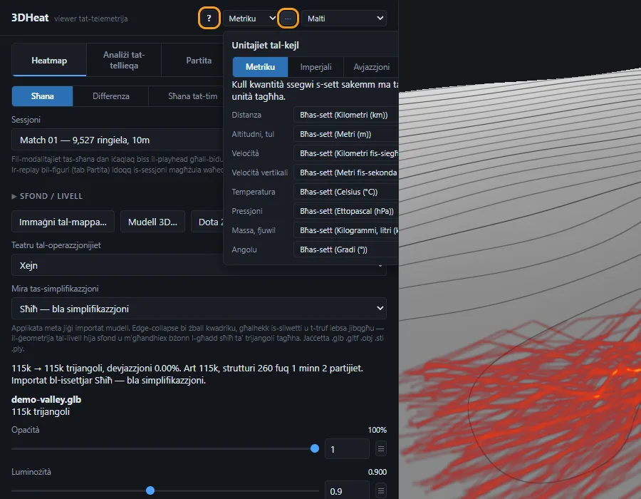
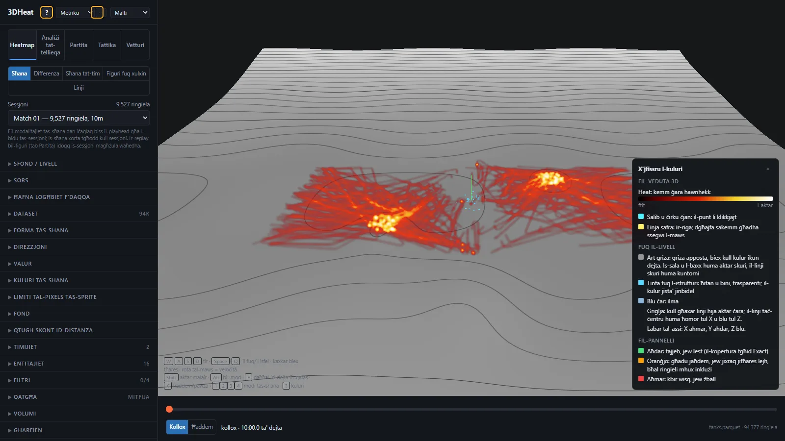
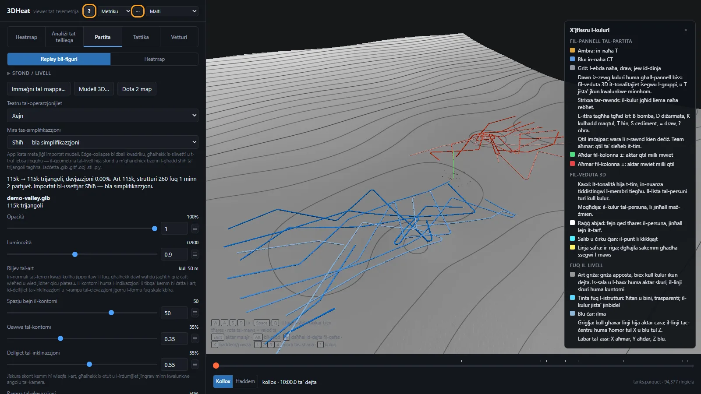

# Settings, unitajiet u ċwievet

Il-kontrolli ċkejkna fuq nett tas-sidebar jibdlu kif il-viewer jitkellem miegħek: il-lingwa, l-unitajiet (metri jew piedi, km/h jew nodi) u mod ta' għajnuna li jispjega l-kuluri. L-għażliet tiegħek jinftakru fil-browser tiegħek.

## L-header {#the-header}

Fil-quċċata tas-sidebar:

| Kontroll | X'jagħmel |
|---|---|
| **?** | Mod ta' għajnuna: x'tfisser kull kulur (ukoll `?` jew `F1`) |
| Menu **Unitajiet** | Metriku, Imperjali, Avjazzjoni jew Nawtiku |
| Buttuna **...** ħdejn **Unitajiet** | Tiftaħ "Agħżel unità għal kull kwantità": drop-down wieħed għal kull kwantità |
| Menu **Lingwa** | Il-lingwa tal-viewer: [40 lingwa](languages.md), jew dik tal-browser |

Numri li tikteb f'kaxxa jistgħu jużaw jew punt jew virgola (`0.35` jew `0,35`). Il-viewer jaqra t-tnejn u juri n-numri kif tikteb il-lingwa tal-viewer.

## Unitajiet {#units}

1. Agħżel preset fil-menu **Unitajiet**. Il-kwantitajiet kollha jinbidlu flimkien.
2. Biex tbiddel kwantità waħda biss, ikklikkja fuq il-buttuna **...** ħdejha u agħżel unità għal dik il-kwantità. Imbagħad il-menu juri `*` wara l-preset.
3. Kwantità li ma ssettjajtx tsegwi l-preset. Agħżel "Bħas-sett" biex terġa' lura.

| Kwantità | Metriku (default) | Imperjali | Avjazzjoni | Nawtiku |
|---|---|---|---|---|
| Distanza | km | mi | NM | NM |
| Altitudni, tul | m | ft | ft | m |
| Veloċità | km/h | mph | kt | kt |
| Veloċità vertikali | m/s | ft/min | ft/min | m/s |
| Temperatura | °C | °F | °C | °C |
| Pressjoni | hPa | inHg | hPa | hPa |
| Piż, fjuwil | kg, l | lb, gal | lb, gal | t, m³ |
| Angolu | gradi | gradi | gradi | gradi |

Unitajiet oħra li tista' tagħżel għal kwantità waħda: distanza km, mi, NM; veloċità km/h, m/s, kt, mph; veloċità vertikali m/s, ft/min, m/min; temperatura °C, °F, K; pressjoni hPa, inHg, mmHg, psi; piż kg, lb, t; angolu gradi jew NATO mils (6400 għaċ-ċirku). L-unitajiet huma l-istess kull fejn fil-viewer: it-tikketti, il-kards, il-grafiċi, l-istatistiċi.

## Mod ta' għajnuna {#help-mode}

Agħfas `?` jew `F1`, jew ikklikkja fuq il-buttuna **?**. Juri *What the colours mean*: leġġendi għall-view 3D, il-rampi tas-sħana, il-kuluri tat-timijiet, il-kuluri tal-livell, il-kuluri tal-istatus tal-pannelli, il-pannell tal-partita u l-view tat-tellieqa. Jibqa' mixgħul sakemm itfih. Fit-tab Match jispjega wkoll il-kuluri tal-pannell tal-partita.

## Dak li l-browser jiftakar {#what-the-browser-remembers}

Dawn is-settings jinżammu fil-browser tiegħek bejn żjara u oħra (xejn ma jintbagħat xi fejn):

- il-lingwa, l-unitajiet u l-mod ta' għajnuna;
- is-settings tal-figura, tas-simbolu, tat-tikketta, tal-kamera u tal-wiri tattiku tar-replay;
- il-veloċità tal-playback u l-mirroring;
- bookmarks għal kull reġistrazzjoni, volumes għal kull dataset, saffi tal-objettivi;
- is-settings tal-AI estern (iċ-ċavetta biss jekk tiċċekkja *Remember*).

Is-settings tas-sħana, il-filtri u l-mod jibdew mill-ġdid f'kull load. Il-lista sħiħa, iġġenerata: [Settings miżmuma](ref-settings-storage.md).

## Ċavetti li l-viewer iżomm mill-browser {#keys-the-viewer-keeps-from-the-browser}

Sessjoni b'dejta kbira teħtieġ ħin biex titgħabba, għalhekk il-viewer iwaqqaf lill-browser milli jitfgħu bi żball:

- `Ctrl`/`Cmd` + ittri li jistgħu jinstampaw, jiffrankaw, jiftħu, jerġgħu jitgħabbew, jagħlqu jew jiftħu tieqa ġdida ma jagħmlu xejn barra mill-kaxxi tat-test; `F1`, `F3`, `F5`, `F6` u `F7` ma jagħmlu xejn.
- Jekk tagħlaq jew terġa' tgħabbi t-tab b'dejta jew livell mgħobbi, jistaqsik qabel.
- Fil-full screen il-viewer jikkonfina l-ċwievet li juża (W, T, N, S, R, P, Q, Esc), sabiex il-browser ma jieħux.

Il-lista eżatta: [Ċavetti tal-browser](ref-browser-keys.md). Iċ-ċwievet kollha tal-viewer: [Referenza tat-tastiera u tal-maws](keyboard-reference.md).
