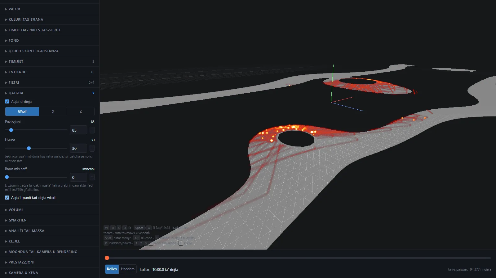

# Qatgħa

**Qatgħa** taqta' d-dinja bħal biċċa kejk, biex tkun tista' tħares ġewwa l-bini. Uża dan meta l-ħitan jaħbu s-sħana interessanti, pereżempju biex tara sular wieħed ta' bini.

## Ipprova {#try-it}

1. Agħbi livell u xi dejta, u iftaħ **Qatgħa**.
2. Immarka **Aqta' d-dinja**. L-assi huwa **Għoli**.
3. Iġbed **Pożizzjoni** 'il fuq u 'l isfel: is-saff jiċċaqlaq mil-livell.
4. Agħmel **Ħxuna** rqiqa għal pjanta tas-sular, jew wiesgħa għal "kollox taħt hawn".
5. Żomm **Barra mis-saff** fuq 0 biex titneħħa l-bqija, jew agħolih biex jibqa' traċċa ċajt.



Is-saff iqatta' **l-geometrija tal-livell u l-punti tad-dejta flimkien** - jekk taqta' l-livell biss, is-sħana tibqa' tippendi fejn kien il-bini. Huwa l-kontroparti tal-[occlusion tal-fond](depth-and-culling.md): ladarba l-livell jaħbi sew dak li jkun wara, il-ġewwa ta' bini huwa moħbi wkoll. Il-pannell jintwera meta jkun hemm x'jinqata' (dataset jew livell 3D); l-intestatura tiegħu turi l-assi waqt li jkun mixgħul, *off* inkella.

```
side view         Position = where the slab is
 ----------       Thickness = how tall the slab is
 | floor 3 |
 |=========|  <--- slab (kept)
 | floor 2 |  <--- outside: removed (or faint)
 | floor 1 |
 ----------
```

## Kontrolli {#controls}

| Kontroll | Default | Tifsira |
|---|---|---|
| **Aqta' d-dinja** | off | Iqalleb is-saff. Waqt li l-pożizzjoni tkun għadha fil-bidu tagħha 0 u l-ħxuna fil-bidu tagħha 500, meta titqalleb tmexxi dawn fin-nofs tal-assi u 15% tal-medda tiegħu. |
| Assi | **Għoli** | *Għoli* (Y), *X* jew *Z*. Meta tbiddel l-assi, is-saff jitmexxa fin-nofs tal-assi l-ġdid. |
| **Pożizzjoni** | in-nofs | Iċ-ċentru tas-saff, f'unitajiet tad-dinja, mal-medda tal-assi (500 pass). |
| **Ħxuna** | 15% tal-medda | Minn 1/500 tal-medda sa darbtejn il-medda, f'passi logaritmiċi. Taqra *past the world* ladarba tkun wiesgħa daqs il-medda: naħa waħda tilħaq 'il barra mid-dinja u dan ikun qatgħa sempliċi minflok saff. |
| **Barra mis-saff** | 0, *removed* | Kemm minn dak li jinsab barra jibqa' viżibbli, 0-100%. Traċċa ċajt ta' dak li nqata' ħafna drabi tinqara aħjar milli titneħħa għalkollox. |
| **Aqta' l-punti tad-dejta wkoll** | on | Off iħalli s-sħana sħiħa, għalhekk tidher minn ġo l-qatgħa - utli biex tara x'hemm fuq u taħt is-saff. |

Il-medda ta' assi hija dik tal-livell 3D meta jkun mgħobbi, inkella dik tad-dataset.

Il-qatgħa hija indipendenti mill-[culling tad-distanza](depth-and-culling.md#distance-culling), li jaqta' mad-direzzjoni tal-ħarsa minflok assi tad-dinja; it-tnejn jaqblu flimkien. Kull bidla f'kwalunkwe setting tal-qatgħa terġa' tibda l-akkumulazzjoni tas-sħana.

## Għall-iżviluppaturi {#for-developers}

Is-saff jiġi ttestjat fuq il-pożizzjoni tad-dinja ta' kull ringiela fil-vertex shader: ringiela barra minnu jkollha l-kontribuzzjoni tagħha immultiplikata bil-valur *Barra*, għalhekk fuq 0 tiġi miċħuda qabel ma jinpinġa xi fragment. Is-shaders tal-livell japplikaw l-istess test għal kull fragment tal-art, tal-istrutturi u tal-ilma.
