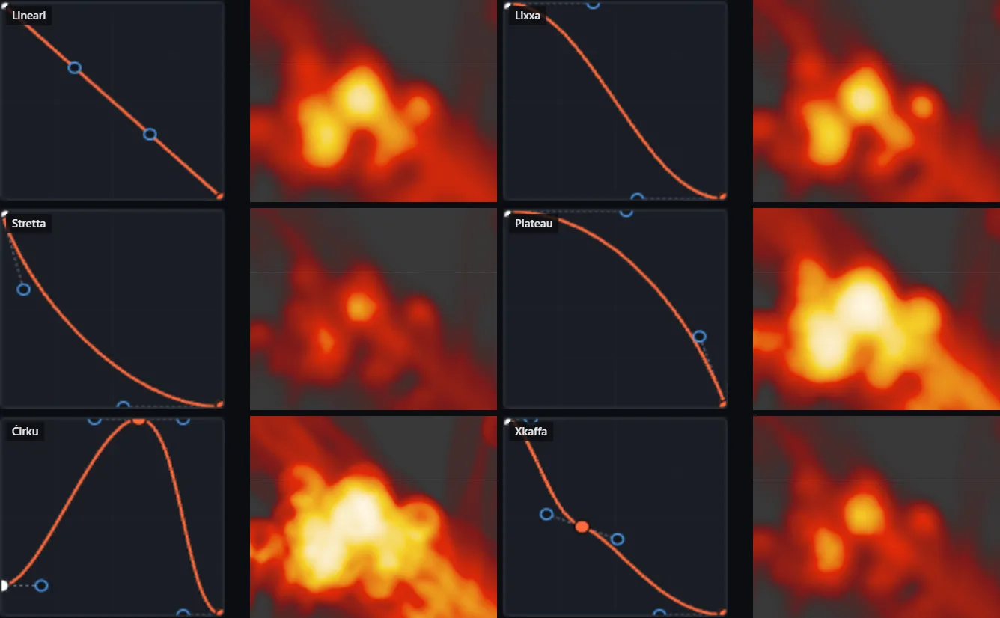

# Forma tal-sprite

Kull ringiela tinġibed bħala sprite tond li dejjem iħares lejn il-kamera. Id-daqs tiegħu u l-profil mill-ċentru sal-tarf tiegħu - ir-**rampa** - jiddeċiedu jekk punt sħun jidher bħala tikka stretta, sħaba ratba, diska jew ċirku. Dawn il-kontrolli jinsabu fit-taqsimiet **Forma tas-sħana** u **Limiti tal-pixels tas-sprite** tal-barra tal-ġenb, u japplikaw għal [Sħana](heat.md), [Differenza](difference.md), [Sħana tat-timijiet](team-heat.md) u, bħala n-nofs wisa' ta' linja, għal [Sħana tal-linji](line-heat.md).

Kull bidla f'wieħed minnhom terġa' tibda l-akkumulazzjoni (il-qasam irid jinġibed mill-ġdid bil-forma l-ġdida).

Aħseb f'kull tikka bħala blob ratab ta' dawl. Blob żgħir juri punti singoli; blob kbir jgħaqqad il-ġirien f'sħaba. Il-forma tiddeċiedi kemm hu rat it-tarf.



## Raġġ tal-sprite {#sprite-radius}

Ir-raġġ tal-sprite f'**unitajiet tad-dinja** (mikteb bħala metri). Default 6, u f'kull tagħbija l-estensjoni orizzontali tad-dejta / 120 - kbir biżżejjed biex kampjuni ġirien tul triq jitgħaqqdu f'fasxa minflok ma jidhru bħal xagħra waħda. Slider logaritmiku 0.05-2000, il-maniglja tiġbed sa 50,000.


Affarijiet 'il bogħod jidhru iżgħar, għalhekk sprite jonqos fuq l-iskrin meta tmur 'il bogħod. Taħt il-projezzjoni parallela hu l-istess kullimkien, u dan hu parti mir-raġuni għaliex il-veduta parallela hi dik it-tajba biex jitqabblu punti sħan ([Kamera](camera.md#projection)).

## Limiti tal-pixels {#pixel-clamps}

**Limiti tal-pixels tas-sprite** (magħluqa b'default) jorbtu r-raġġ fuq l-iskrin wara l-konverżjoni ta' hawn fuq.

| Kontroll | Default | Firxa (jog) | Għaliex |
|---|---|---|---|
| **Raġġ minimu f'pixels** | 1 px | 0-16 (512) | Iżomm dejta 'l bogħod milli tisparixxi taħt pixel wieħed. |
| **Raġġ massimu f'pixels** | 96 px | 2-1024, logaritmiku (8192) | Il-gwardja tal-overdraw. Sprite li jkopri N pixels jiswa N operazzjonijiet ta' blend, u raġġ mhux illimitat viċin il-kamera hu dak li jbiddel frame mgħaġġel f'wieħed bil-mod. Oltre l-għoli tal-viewport jieqaf milli jillimita xi ħaġa. |

**L-istess densità f'kull zoom** (fit-taqsima Forma tas-sħana, default mixgħul) jaħdem mal-limiti. Sprite li l-limitu jagħmlu akbar ('il bogħod) jew iżgħar (viċin) iżomm is-sħana li d-daqs veru tiegħu iżid, għalhekk kulur ifisser l-istess għadd ta' ringieli għal kull erja ta' art f'kull zoom. Meta jkun mitfi, sprite illimitat iżid il-piż sħiħ tiegħu fid-daqs illimitat tiegħu, u l-istampa tinbidel hekk kif tidħol fiha.

## L-intensità fiċ-ċentru u fit-tarf {#centre-and-edge-intensity}

Is-sħana li sprite iżid fiċ-ċentru eżatt tiegħu (**Intensità fiċ-ċentru**, default 1, 0-10, jog 1000) u fit-tarf tiegħu (**Intensità fit-tarf**, default 0, -2-10, jog 1000). Il-valur tar-rampa *t* (1 fiċ-ċentru, 0 fit-tarf, iffurmat mit-**tnaqqis** jew mill-kurva ta' hawn taħt) jitħallat bejniethom (il-formula hi taħt [Għall-iżviluppaturi](#for-developers)).

**Intensità fit-tarf negattiva** tagħmel li t-tarf jnaqqas, u dan iniqqex halo kiesaħ madwar kull punt sħun u jaqta' l-clusters kontra xulxin. Il-viżibbiltà tinkludi l-[okkluzjoni](depth-and-culling.md) u l-[qtugħ](slice.md); it-tbexxix hu t-tbexxix tal-[Ħajja](timeline.md#history); is-sinjal hu ±1 f'[Differenza](difference.md).

## Forma tar-rampa: Tnaqqis jew Kurva {#ramp-shape-falloff-or-curve}

**Forma tar-rampa** tibdel bejn żewġ modi biex tiffurma *t* madwar is-sprite. Bi *d* id-distanza mill-ċentru (0) sal-tarf (1):

### Tnaqqis {#falloff}

Jidher meta *Tnaqqis* ikun magħżul (id-default).

- **Tnaqqis** (default 1.6, 0.1-8, jog 64): `t = (1 - d) ^ falloff`. 1 hi rampa lineari dritta; ogħla tiġbed is-sħana lejn iċ-ċentru u tistrinġi l-punt sħun; taħt 1 tixxellha f'diska.
- **Rampa lixxa** (default mixgħul): tapplika kurva S ta' smoothstep għal *t*, sabiex is-sprite jitbaxxa fit-tarf tiegħu minflok jispiċċa f'tarf viżibbli.

### L-editur tal-kurva {#the-curve-editor}

Jidher meta *Kurva* tkun magħżula. Qtugħ litterali ta' sprite: id-distanza mill-ċentru matul (*ċentru* fuq ix-xellug, *tarf* fuq il-lemin), is-sħana 'il fuq. Il-kurva hi Bézier kubika b'segmenti, minn punti ta' kontroll, kull wieħed b'żewġ maniglji.

| Azzjoni | Effett |
|---|---|
| Doppju klikk fuq il-graff | Iżid punt f'dik id-distanza (miżmum bejn 0.02 u 0.98), fuq il-kurva u bil-mejl tagħha hemm, sabiex iż-żieda ma tibdel xejn sakemm tiġbedha. |
| Ġbid ta' punt | Iċċaqilqu. L-għoljiet jinżammu bejn 0 u 1. |
| Ġbid ta' ċirku żgħir | Ilwi s-segment ħdejh (jiċċaqlaq dik il-maniglja). |
| Alt-klikk jew klikk tal-lemin fuq punt | Ineħħih. L-aħħar tnejn ma jistgħux jitneħħew. |
| Buttuna ta' preset | Tissostitwixxi l-kurva bil-preset. |

L-estremi huma mqiegħda fiċ-ċentru u fit-tarf; l-għoli tagħhom xorta tiegħek.

**Presets** ([`curve.ts`](https://github.com/Holdi601/3DHeat/blob/main/src/state/curve.ts)):

| Preset | Forma | Użu |
|---|---|---|
| **Lineari** | Dritta minn 1 għal 0 | Identika għal *Tnaqqis* 1 b'*Rampa lixxa* mitfija. |
| **Lixxa** | Kurva S | Il-kurva default; dak li *Rampa lixxa* tagħti f'tnaqqis 1. |
| **Stretta** | Qalba serja, tensil fqir twil | Dejta skarsa. |
| **Plateau** | Ċatt, imbagħad tnaqqis mgħaġġel | Jinqara bħala diska minflok blob. |
| **Ċirku** | 0.15 fiċ-ċentru, 1 f'62% tar-raġġ, 0 fit-tarf | Sprite vojt: juri fejn il-mogħdijiet jgħaddu minflok fejn jieqfu. |
| **Xkaffa** | Tnaqqis f'żewġ stadji, 0.45 f'35% | Ifarraq qalba kiffa mill-madwar tagħha. |

## Iċċattja fuq il-pjan tal-art {#flatten-onto-ground-plane}

**Iċċattja fuq il-pjan tal-art** (default mitfi) jinjora l-għoli ta' kull ringiela u jpitter is-sħana kollha f'għoli wieħed - l-Y l-iktar baxx tad-dataset - il-mappa tas-sħana 2D klassika. Meta tkun mixgħula, il-fond tal-okkluzjoni u *Aħbi wara t-terren* jinqatgħu (kull punt ikun eżatt fuq il-wiċċ li jiġi ttestjat kontra), u t-taqsima Fond tgħid dan.

## Għall-iżviluppaturi {#for-developers}

### Formuli {#formulas}

Ir-raġġ fuq l-iskrin f'pixels: `radius × P[1][1] / w × viewport height / 2`, fejn `P` hi l-matriċi tal-projezzjoni u `w` hi l-fond tal-veduta tal-punt.

Is-sħana li sprite iżid:

```
heat added = mix(edge, centre, t) × sample weight × sign × fade × visibility
```

### Il-kurva {#the-curve}

Il-maniglji jinżammu orizzontalment fis-segment tagħhom stess, għalhekk il-kurva dejjem funzjoni tad-distanza: iġġib maniglja 'l bogħod ħafna minn punt li jmiss tiċċattja kontrih minflok ma tagħti lura l-kurva, li kieku tagħmel ir-riżultat jiddependi minn liema għerq sab is-solver.

### Kif tinġibed il-kurva {#how-the-curve-is-drawn}

Il-kurva tinbena f'tabella ta' 256 entry kull meta tinbidel, titgħabba bħala texture float ta' 16-bit, u tittieħed sample għal kull fragment b'filtrar lineari u inset ta' nofs texel sabiex it-tarfijiet t-tnejn jibqgħu eżatti. Is-solvar ta' Bézier għal x jeħtieġ iterazzjoni, li m'għandhiex post fl-iktar shader kiesaħ tal-programm, u wkoll fetch minn tabella huwa irħas mill-`pow()` li juża t-tnaqqis. 16-bit mhux 8-bit għax 8 bits juri bands meta eluf ta' sprites jitħalltu flimkien; half float ta' 16-bit hu filterable fil-WebGL2 bażiku, filwaqt li 32-bit jeħtieġ estensjoni.
