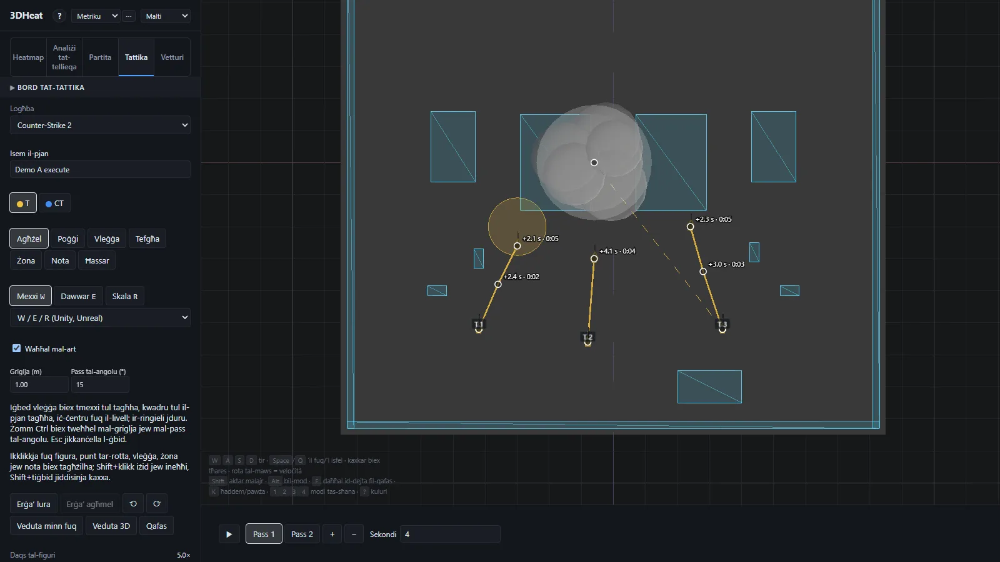

# Bord tat-tattika

It-tab **Tattika** hu bord tat-tpinġija għal pjan ta' tim: titqiegħed figuri żgħar fuq mappa, tpinġi vleġġa fejn imorru, u tagħfas ħaddem biex tarahom iseħħu. Uża dan biex tippjana rawnd jew attakk qabel tilgħab. Jaqsam il-kanvas, il-kamera u l-[livell](levels.md) mat-tabs l-oħra u ma jaqsam xejn ieħor; pjan mhuwiex data u ma jpinġi l-ebda sħana.

## L-ewwel pjan tiegħek {#your-first-plan}

1. Iftaħ it-tab **Tattika**. Agħżel il-**Logħba** (pereżempju Counter-Strike 2) u, għal Valorant, agħfas **Tella' l-mapep ta' Valorant** u agħżel **Mappa**. Jew ittella' [livell](levels.md) l-ewwel.
2. Agħżel **Naħa** (tagħti l-kulur) u agħfas **Veduta minn fuq**.
3. Agħżel **Post**, agħżel figura fil-**Figuri** (uża **Fittex figuri** biex issibha) u ikklikkja fuq il-mappa. Poġġi tnejn jew tlieta.
4. Agħżel **Vleġġa**, ikklikkja fuq figura, ikklikkja mat-triq li għandha tieħu, u agħfas **Enter** biex tgħalaq il-vleġġa.
5. Agħfas **+** taħt il-veduta biex iżżid il-pass 2. Kull figura tibda minn fejn spiċċat il-vleġġa tagħha. Ipitti iktar vleġġi hemm.
6. Agħfas **▶** (jew `K`) biex tħaddem il-pjan mill-pass murija sal-aħħar.
7. Semmi l-pjan f'**Isem il-pjan** u agħfas **Issejvja**.

## Tibda pjan {#starting-a-plan}

| Kontroll | X'jagħmel |
|---|---|
| **Logħba** | Tagħżel in-naħat u l-figuri li l-palette toffri: Counter-Strike 2 (T, CT; plejers u utility), Valorant (Attakk, Difiża; plejers u abbiltajiet ġenerali), Battlefield, Squad, Arma (infanterija, vetturi tal-art, inġenji tal-ajru, dgħajjes), DCS / War Thunder / IL-2 (jets, inġenji bil-propeller, helicopters, difiża tal-ajru, art, bastimenti, armi), u Oħrajn. Pjan li diġà għandu figuri jżomm in-naħat tiegħu meta tinbidel il-logħba. |
| **Isem il-pjan** | L-isem li taħtu jiġi mħażżen il-pjan. |
| **Mappa**, **Tella' l-mapep ta' Valorant** | Meta jkun magħżul Valorant: **Tella' l-mapep ta' Valorant** iġib il-lista tal-mapep minn [valorant-api.com](https://valorant-api.com); **Mappa** imbagħad tqiegħed il-minimappa tal-mappa magħżula bħala l-livell, imkabbra mill-fuq. Ir-ritratt jinġieb meta jinħtar u qatt ma jiġi mibgħut ma' xejn. L-avviż ta' Riot jintwera waqt li jkun fuq l-iskrin (ara hawn taħt). |
| **Naħa** | In-naħa li l-figura, il-vleġġa jew l-erja li jmiss jappartienu għaliha; tieħu l-kulur tan-naħa. |

Mingħajr livell, il-bord hu l-pjan tal-art ċatt. Ittella' livell taħt **Livell** biex tippjana fuq mappa reali: mappa ta' CS2 esportata bl-għodda ta' CS2, livell mil-librerija, jew ritratt tal-mappa.

## Għodod {#tools}

| Għodda | Klikk | Noti |
|---|---|---|
| **Agħżel** | Figura, punt ta' triq, vleġġa, erja jew nota tagħżilha. | Shift+klikk iżid jew ineħħi; Shift+iġbed ifittex kaxxa madwar dak li jmiss iżid. Il-għażla tieħu gizmo tat-trasformazzjoni (ara hawn taħt); `Delete` jew `Backspace` jneħħiha. `M` iċaqlaq il-figura magħżula għall-klikk li jmiss. |
| **Poġġi** | Iqiegħed il-figura magħżula. | Figura tinħtar mill-palette **Figuri** (b'**Fittex figuri**). Meta ma jkun hemm xejn magħżul, `R` idawwar il-figura li jmiss b'15° qabel titqiegħed (`Shift+R` għall-kontra). |
| **Vleġġa** | Kull klikk iżid punt; Enter, double click jew klikk bl-lemin jagħlaqha, Esc titfa' 'l barra. | **Imxi**, **Attakk** (ras iktar wiesgħa) jew **Għasses** (linja rqiqa f'livell tal-għajn). Vleġġa mibdija fuq figura hi r-rotta ta' dik il-figura f'dan il-pass: meta titħaddem, il-figura timxi fuqha, u l-pass li jmiss jibda minn fejn spiċċat. |
| **Tefgħa** | Min jitfa', imbagħad fejn jaqa'. | Arc mitqatta' bejn wieħed u l-ieħor, u l-utility magħżul (duħħan, dawl, molotov, ...) jidher fejn jaqa' u jibqa' minn dan il-pass 'il quddiem. |
| **Erja** | Iċ-ċentru, imbagħad it-truf. | Diska bil-kulur tan-naħa. |
| **Nota** | Fejn tmur in-nota; titlob it-test tagħha. | Turi bħala pinna, u t-test tagħha fuqha. |
| **Ħassar** | Figura, vleġġa, erja jew nota. | Jneħħiha minn dan il-pass 'il quddiem; fl-ewwel pass tiegħu, titneħħa. |

**Erġa' lura** u **Erġa' agħmel** (`Ctrl+Z`; `Ctrl+Y` jew `Ctrl+Shift+Z`) jimxu bejn kull bidla. Linja taħt il-pjan turi kemm figuri, vleġġi u passi għandu. **Veduta minn fuq** tħares 'l isfel direttament (ortografika), **Veduta 3D** terġa' tmur għall-perspettiva, **Frame** jaqbel il-pjan, jew il-livell meta l-pjan ikun vojt.

**Daqs tal-figuri** jiskala kull figura fuq il-bord; 1× hu d-daqs veru, li minn fuq 'il bogħod hu ftit pixels għal persuna.

## Timixi, idawwar u skala {#moving-turning-and-scaling}

Kollox fuq il-bord jista' jiġi mmanipulat bħal f'editur 3D: figuri, utility, markaturi, punti ta' triq waħedhom u vleġġi sħaħ, erjas u noti. Dak li jkun magħżul jieħu gizmo f'nofsu:

| Modalità | Ċwievet | Maniglji |
|---|---|---|
| **Iċċaqlaq** | W (jew G) | Vleġġa għal kull assi (X aħmar, Y aħdar u 'l fuq, Z blu) timxi fuqha; kwadru jaqsam il-pjan tiegħu; iċ-ċentru jitqiegħed fuq il-livell taħt il-punter. |
| **Idawwar** | E (jew R) | Ċirku għal kull assi jdur madwaru. Iċ-ċrieki ta' figura waħda huma l-yaw, il-pitch u r-roll tagħha stess; grupp jdur madwar l-assi tad-dinja f'nofsu. |
| **Skala** | R (jew S) | Ifarrex jew jiġbor l-għażla mill-nofs tagħha fuq assi jew kull mod; ir-raġġ ta' erja jikber miegħu. |

**Ċwievet** jibdel bejn W / E / R (Unity, Unreal) u G / R / S (Blender); iċ-ċwievet jagħżlu l-modalità biss meta jkun hemm xi ħaġa magħżula, u jtajru l-kamera meta ma jkunx hemm. Għalhekk `R` ifisser **Skala** bi ċwievet W / E / R u **Idawwar** bi ċwievet G / R / S meta jkun hemm xi ħaġa magħżula, u jdawwar il-figura li jmiss biex titqiegħed meta ma jkun hemm xejn. Iċ-ċwievet kollha tal-bord huma elenkati fir-[referenza tat-tastiera](keyboard-reference.md#tactics-board). Żomm **Ctrl** waqt li tiġbed biex tagħmel il-mossa taqbeż għall-**Grilja** (metri) jew id-dawran għall-**Pass tal-angolu**. **Waħħal mal-art** (mixgħul bi default) iqiegħed in-nies, il-vetturi, il-markaturi, il-punti ta' triq u l-erjas li jkunu timxew fuq wiċċ il-livell; inġenji tal-ajru u helicopters iżommu l-għoli tagħhom, u ġbid tul il-vleġġa Y qatt ma jaqbeż. Il-ġbid ta' maniglja qatt ma jċaqlaq il-kamera. **Esc** jikkanċella ġbid, u kull bidla hi pass wieħed ta' Erġa' lura.

Punti ta' triq jidhru bħala tikek fuq il-vleġġi tal-pass murija: ikklikkjahom biex tagħżilhom, iġbidhom biex timxihom, Delete biex teħodhom 'il barra. It-taqsima **Magħżula** turi l-post tal-għażla f'metri, il-yaw, il-pitch u r-roll ta' figura f'gradi u r-raġġ ta' erja, kull wieħed biex tikteb.

## Ħinijiet {#timing}

Ir-rotta ta' figura hi mkejla fiż-żmien: kull segment jieħu t-tul tiegħu fuq il-livell - imkejjel fuq il-wiċċ kull ftit metri, sabiex għolja jew taraġ bejn żewġ punti jitqiesu - bil-veloċità tal-**modalità** tal-moviment tagħha għal dik il-figura f'dik il-logħba, flimkien ma' kull **stennija** f'punt ta' triq. L-infanterija tqaxxar, tinxteħet, timxi (bla storbju), tiġri jew tiġri ħafna; vetturi u dgħajjes jimxu bil-mod, b'attenzjoni, normalment jew bil-gravità; inġenji tal-ajru u helicopters jitħabbru bil-mod, bil-kruċiera, f'veloċità ta' taqbida jew bil-massimu. Modalità li l-logħba ma għandhiex (CS2 ma għandux sprint) tieħu l-eqreb waħda li għandha. Kif l-inklinazzjoni ttaqqal il-mixi jiddependi fuq il-logħba: f'CS2 u Valorant jitqies biss id-distanza orizzontali, kif fil-logħba; l-mil-sims ittaqqal l-infanterija fuq l-għoljiet (funzjoni tal-mixi ta' Tobler) u l-vetturi skont il-pendil.

Il-veloċitajiet ġejjin minn tabelli għal kull logħba bis-sorsi tagħhom (ara [Veloċitajiet tal-moviment](tactics-speeds.md)): CS2 skont l-arma miżmuma, mid-definizzjonijiet tal-armi tal-logħba; Valorant skont l-arma; Battlefield, Squad, Arma u l-logħob tal-ajru skont it-tip u l-klassi tal-vettura. **Timxi bħala** jagħżel il-profil ta' figura (arma, tip ta' vettura); **Veloċità tiegħek (m/s)** jieħu post kull modalità għal dik il-figura. Il-modalitajiet jissemmew kif juri l-bord: *Jitkaxkar*, *Jinżel*, *Jimxi (bil-kwiet)*, *Jiġri*, *Sprint*; *Bil-għaqal*, *Normali*, *Rush*; *Bil-mod*, *Kruċiera*, *Ġlieda*, *Massimu*.

Kull punt ta' triq juri l-ħin mill-aħħar wieħed u l-ħin mill-bidu tal-pjan ("+3.9 s · 0:12"). Ir-rotta tal-figura magħżula tgħodd kull segment bil-modalità, it-tul, il-ħin, l-istennija u l-wasla. **Wasliet** taħt **Ħinijiet** iqiegħed kull figura b'rotta fuq linja taż-żmien waħda, l-ewwel wasla fuq nett. Bil-**Ħaddem f'ħin reali** (mixgħul bi default) pass idum sa ma tasal l-iktar rotta bil-mod, u kull figura timxi bil-veloċità tagħha; **Sekondi** imbagħad hija l-iqsar tul tal-pass. **Unitajiet tal-livell għal kull metru** jgħid x'inhu l-livell: 39.37 għal mapep ta' CS2 (unitajiet tal-logħba), 1 għal mapep f'metri.

## Qabbel ma' data tal-partita {#compare-with-match-data}

**Għabbi fajls tal-partita…** jaqra tabelli ta' partita ta' CS2 tal-mappa (il-fajls Parquet tal-għodda ta' CS2, kemm trid; biss il-kolonni meħtieġa, fl-isfond); **Uża d-data mgħobbija** jieħu d-data mgħobbija fil-viewer. Imbagħad:

- **L-ewwel wasla fuq il-mappa** tikkuluria l-mappa skont il-ħin mill-bidu tar-rawnd li fih plejer laħaq l-ewwel kull post - il-buttuna **L-aktar mgħaġġel** turi l-iktar mgħaġġel fuq ir-rawnds kollha, **Tipiku (medjan)** ir-rawnd tal-ħdax - aħdar kmieni għal aħmar tard, għal naħa waħda jew it-tnejn. Juri x'hu possibbli u meta.
- Ir-rotta magħżula titqabbel ma' dak li l-plejers kisbu mill-bidu tagħha (jew mill-bidu tar-rawnd) sal-aħħar tagħha, kull tarf disk bir-raġġ imħaddem: "L-aktar mgħaġġel osservat 14.2 s, p10 15.0 s, medjan 18.3 s fuq 41 prova; il-pjan tiegħek 15.1 s".
- Il-veloċitajiet li l-plejers verament laħqu - jiġru, jimxu, jinxtehtu, mit-tabelli tal-kolonni tal-mixi u tal-inxteħ - f'm/s.

## Passi {#steps}

Il-bar taħt il-veduta fih il-passi. Pjan jibda b'wieħed; **+** iżid wieħed, u kull figura tibda fih minn fejn spiċċa r-rotta tagħha fl-aħħar pass; **−** neħħi dak murija. **Sekondi** hu kemm idum il-pass murija meta jitħaddem. **▶** (K) jaħdem mill-pass murija sal-aħħar: il-figuri b'rotta jimxu fuqha, il-figuri mċaqalqa f'post ġdid fil-pass li jmiss jiżxu hemm, il-bqija jibqgħu wieqfa. Waqt li pass ikun murija, il-post ta' kull figura fil-pass li jmiss jinżel bħala sbieħ ċar, u l-vleġġi tal-aħħar pass jinżlu bil-mod taħt dawk ta' dan.

## Iffrankar {#saving}

It-taqsima **Fajl** fiha **Issejvja**, **Iftaħ** u **Neħħi**. **Issejvja** jikteb il-pjan bħala `<isem>.h3dplan.json` (JSON sempliċi: naħat, passi, figuri b'post f'kull pass, vleġġi, erjas, noti); **Iftaħ** jaqrah lura. Fajl ta' verżjoni oħra, jew wieħed li mhuwiex pjan, jiġi miċħud bir-raġuni. **Neħħi** jagħmel il-pjan vojt; Erġa' lura jerġgħu jġibuh lura.

## Figuri {#figures}

Kull figura tinbena mill-viewer innifsu: forom sempliċi għad-daqs ippubblikat ta' tip, bil-karatteristiċi li jagħmluha differenti mill-ġirien tagħha - ir-roti tat-triq u t-turretta ta' tank, il-kanni, il-missili u r-radars ta' vettura tad-difiża tal-ajru, il-pjan tal-ġwienaħ, id-denb u l-magni ta' inġenju tal-ajru, id-rotors u l-ġwienaħ qosra ta' helicopter. Xejn ma jittieħed minn logħba. Disinn li ħolqot logħba jintwera bħala l-figura ġenerika tal-klassi tiegħu. Ara [Figuri](figures.md#which-figure-a-unit-gets) biex tara kif id-data ssib il-figura tagħha.

## L-avviż ta' Riot {#riots-notice}

Il-mapep ta' Valorant jintwerew taħt il-politika "Legal Jibber Jabber" ta' Riot Games, li tippermetti lil proġetti komunitarji ħielsa jużawhom u titlob dan l-avviż kull fejn jidhru: *3DHeat inħoloq taħt il-politika "Legal Jibber Jabber" ta' Riot Games bl-assi li hija proprjetà ta' Riot Games. Riot Games ma tapprovax jew tisponsorja dan il-proġett.* L-abbiltajiet fuq il-bord huma forom ġenerici, mhux l-arti ta' Riot.
