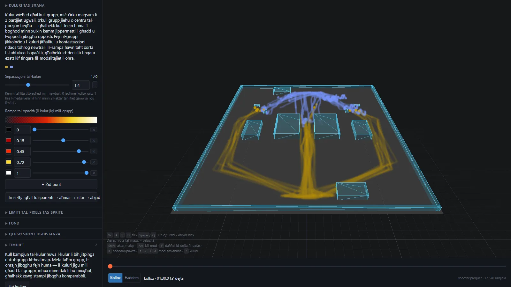

# Sħana tat-tim

Is-sħana tat-tim turi fejn kien kull tim, kull tim b'kulur tiegħu. Fejn it-timijiet jaqgħu fuq xulxin, il-kuluri jitħalltu.

**Sħana tat-tim** (ċavetta 3) hija l-qasam tad-densità ta' [Sħana](heat.md) b'kull [grupp](glossary.md) mogħti t-tonalità tiegħu. Fejn il-gruppi jaqgħu fuq xulxin, it-tonalitajiet tagħhom jitħalltu; kompetizzjoni ndaqs toħroġ newtrali. L-opaċità għadha ġġorr id-densità eżattament bħal fil-modalitajiet l-oħra, għalhekk l-istampa twieġeb *kemm* u *ta' min* fl-istess ħin. Teħtieġ kolonna ta' grupp.

Din mhijiex [Figuri fuq xulxin](box-replay.md): dik tpinġi figura waħda għal kull persuna; din hi qasam ta' sħana mikxuf bl-istess kolonna.

## Kif tuża dan {#how-to-use-it}

1. Agħfas `3` (jew agħżel **Sħana tat-tim** fil-bar tal-modalitajiet).
2. Iftaħ **Kuluri tas-sħana**. Il-kaxxi juru l-kulur ta' kull grupp; poġġi l-mouse fuq kaxxa biex tara l-isem tat-tim.
3. Jekk kollox jidher griż, għolli **Separazzjoni tal-kuluri**.
4. Neħħi l-kaxxa ta' grupp fil-[Lista tat-timijiet](teams-list.md) biex titneħħa mill-istampa; il-kuluri l-oħra jibqgħu fejn kienu.

## Kontrolli {#controls}

Fis-sezzjoni **Kuluri tas-sħana**:

| Kontroll | Bażi | Tifsira |
|---|---|---|
| Kaxxi tal-kuluri | | Il-kulur ta' kull grupp, għall-ewwel 12-il grupp, imbagħad *+N iktar*. Poġġi l-mouse biex tara l-isem tal-grupp u l-kulur. |
| **Separazzjoni tal-kuluri** | 1.4 | Kemm titbiegħed it-taħlita mill-newtrali, 0-4. 0 jagħmel kollox griż; 1 hija l-medja vera; wara madwar 2 it-taħlitiet l-iktar ċari joħorġu mill-medda tal-wiri u jiġu mqattgħin kull kanal, u dan ibiddel it-tonalità tagħhom. |
| **Rampa tal-opaċità (il-kulur jiġi mill-grupp)** | ir-rampa tas-sħana bażika | Hawn jintuża biss l-**alfa** tar-rampa: trasparenti fejn ma hemm xejn, opak fil-quċċata. Il-kuluri tagħha jiġu injorati. |

Il-kontrolli l-oħra kollha tas-sħana - forma, saturazzjoni, rispons, sħana minima, fond, qtugħ - jaħdmu bħal f'[Sħana](heat.md).

Il-[Lista tat-timijiet](teams-list.md) turi l-kulur tas-sħana tat-tim ta' kull grupp bħala l-kaxxa tiegħu f'din il-modalità. Meta tneħħi grupp, il-kuluri tal-gruppi l-oħra jibqgħu fejn kienu: it-tonalitajiet ġejjin mill-għadd sħiħ tal-gruppi, mhux minn dak li hu mixgħul, sabiex żewġ stampi jibqgħu jitqabblu.

## Il-paletta {#the-palette}

Minn [`colors.ts`](https://github.com/Holdi601/3DHeat/blob/main/src/render/colors.ts):

- Il-kuluri jgħixu fuq il-pjan tal-kulur **Oklab** f'dawl fiss (0.7) u kroma fissa (0.115), sabiex kull grupp ikun daqstant ieħor ċar u grupp aħmar ma jidhirx iktar sħun minn wieħed blu.
- B'*n* gruppi, iċ-ċirku tat-tonalitajiet jinqasam f'*n* partijiet ugwali, u grupp *i* jieħu ċ-**ċentru** tal-parti tiegħu, `(i + 0.5) / n` tal-ġir. Kull żewġ gruppi huma mbiegħda kemm jippermetti l-għadd, u l-oppost jibqa' oppost għal kwalunkwe għadd.
- Jintużaw **16** tonalitajiet differenti biss fil-massimu. B'iktar gruppi, l-ID jitqiegħdu bl-iterazzjoni tal-qsim bi-nofs (ID bil-bit maqlub: 0, ½, ¼, ¾, ⅛, …) sabiex ID ġirien ma jaqsmux tonalità; gruppi wara s-16 bilfors jaqsmu.
- Grupp li t-tikketta tiegħu tfisser "l-ebda grupp" - `0`, vojt, `none`, `unknown`, `null` jew `-1`, mingħajr ma t-tip tal-ittri jkun importanti - jinżel **griż newtrali** minflok ma jieħu biċċa miċ-ċirku. Biss l-ewwel tikketta bħal din fil-lista tal-gruppi tiġi ttrattata b'dan il-mod.

Il-Separazzjoni bażika hija 1.4 u mhux 1, għax fuq 1, taħlita ta' ħames tonalitajiet mqassma b'mod ugwali *hija* griża: korretta u mhux qarrieqa. Ftit iktar minn 1 iżomm il-każijiet ta' ugwaljanza onesti filwaqt li jagħmel qsim ta' 60/40 viżibbli.

## Kif taħdem {#how-it-works}

Il-mira tas-sħana f'din il-modalità għandha erba' kanali. Kull sprite iżid id-densità tiegħu *v* mal-ewwel kanal u *v* × il-koordinati *a* u *b* tal-Oklab tal-grupp mat-tieni u t-tielet kanal. Waqt il-kompożizzjoni, it-taħlita tal-pixel hija l-medja mpiżża bid-densità: *a* = G / R, *b* = B / R, imkabbra bil-separazzjoni tal-kuluri u kkonvertita għal sRGB fid-dawl tal-paletta. Il-qsim bid-densità akkumulata iżomm it-tonalità indipendenti minn kemm hemm data, u dan hu l-għala kull kontroll tad-densità jibqa' jaġixxi fuq l-opaċità biss.

Il-mira b'erba' kanali tiswa erba' darbiet il-memorja tal-GPU tal-mira sħana b'kanal wieħed fl-istess riżoluzzjoni.
