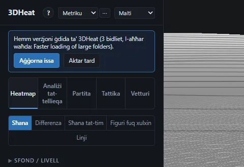

# Aġġornamenti

Il-viewer jgħidlek meta jkun hemm verżjoni aktar ġdida, u jaġġorna lilu nnifsu biss meta tgħid iva. Xejn ma jinbidel fuq il-kompjuter tiegħek mingħajr it-tweġiba tiegħek.

## Aġġorna l-viewer {#update-the-viewer}

1. **Fil-paġna.** Meta jkun hemm verżjoni aktar ġdida, kaxxa tidher taħt l-isem fuq nett fis-sidebar: "Hemm verżjoni aktar ġdida tal-3DHeat". Ikklikkja **Aġġorna issa**. Il-paġna terġa' titgħabba waħedha meta jispiċċa. **Aktar tard** iħeba l-kaxxa sakemm terġa' tgħabbi l-paġna.
2. **Jekk jgħid li trid tmexxi restart.bat**, agħlaq it-tieqa tas-server (it-tieqa sewda li fetaħ `start.bat`) u kklikkja darbtejn fuq `restart.bat`.
3. **Meta tibda l-viewer.** `start.bat` jiċċekkja wkoll. Jekk ikun hemm verżjoni aktar ġdida jistaqsi **Aġġorna issa? [Y/N]**. Agħfas `Y` biex taġġorna. Agħfas `N`, jew stenna 60 sekonda mingħajr ma tweġeb, biex titlaq il-verżjoni li għandek.



Kopja b'bidliet tiegħek qatt ma tiġi aġġornata għalik; il-kaxxa tgħidlek biss li hemm aġġornament jistenna, u tgħid li għandek tagħmel commit jew stash tal-bidliet tiegħek u tmexxi `git pull`. Kopja li ma ġietx installata bil-git (fajl zip, pereżempju) ma turi xejn.

Kif jaħdem iċ-ċekk, pass pass:

```
paġna ---(wara 4 s, imbagħad kull 6 sigħat)---> server tal-iżvilupp ---> git fetch
   wara?  le  -> ma jintwera xejn
          iva -> bidliet jew commits tiegħek?  iva -> jgħidlek biss
                                               le  -> [Aġġorna issa] -> git pull
                                                      -> terġa' tgħabba, jew "mexxi restart.bat"
```

## Ir-regoli tas-sikurezza {#the-safety-rules}

- **Fast-forward biss** (`git pull --ff-only`): aġġornament qatt ma jgħaqqad, ma jerġax jibbaża jew jikteb mill-ġdid xejn.
- **L-ebda bidla lokali**: kopja b'bidliet mhux imqiegħda f'commit fuq fajls tracked (`git status --porcelain --untracked-files=no` mhux vojt) qatt ma tiġi aġġornata awtomatikament - ix-xogħol ta' ħadd ma jmissux aġġornament jgħaffġu. Tiġi biss mgħarrfa li hemm aġġornament jistenna. Fajls untracked (dejta, esportazzjonijiet) ma jitqisux bħala bidliet.
- **L-ebda commits lokali**: kopja b'commits li l-upstream ma għandux ("diverġenti") ma tiġix aġġornata - fast-forward ma jistax iġibha 'l fuq, u l-għaqda hija għal `git pull` bl-idejn. Il-paġna u `start.bat` jgħidu dan bl-istess kliem, u `start.bat` jitlaq il-verżjoni li hemm.
- **Mill-paġna nnifisha biss**: it-talba ta' aġġornament tas-server tal-iżvilupp trid iġġib header speċjali u, meta l-browser jibgħat `Origin`, tiġi mill-host tas-server innifsu (hawn taħt).
- Biss checkout ta' git b'branch upstream qatt jiġi aġġornat; kull ħaġa oħra (kopja bla `.git`, bla git installat, build statiku) titħalla waħedha u ma tgħid xejn.

## X'jagħmel start.bat {#what-startbat-does}

`start.bat` (ikklikkjah darbtejn; it-tieqa hija s-server) jagħmel, fl-ordni:

1. Isib Node.js - fuq `PATH`, inkella f'`%ProgramFiles%\nodejs`, `%ProgramFiles(x86)%\nodejs` jew `%LOCALAPPDATA%\Programs\nodejs` - u joffri li jinstallah b'`winget install -e --id OpenJS.NodeJS.LTS` meta jkun nieqes (jistaqsi, Y/N; wara jrid jerġa' jinfetaħ it-tieqa sabiex Windows jieħu l-`PATH` il-ġdid).
2. **Aġġornamenti**, meta git ikun installat u l-folder ikollu `.git`:
   - `git fetch --quiet` (l-ebda network jew l-ebda upstream: jitħalla barra bla ma jgħid xejn);
   - jgħodd `git rev-list --count HEAD..@{u}`; xejn wara: ma jgħid xejn;
   - bidliet lokali: "Hemm verżjoni aktar ġdida tal-3DHeat (N bidliet), imma din il-kopja għandha bidliet lokali, għalhekk ma tiġix aġġornata. Agħmel commit jew stash tagħhom, imbagħad mexxi git pull." - u jitlaq il-verżjoni li hemm;
   - commits tagħha stess (`git rev-list --count @{u}..HEAD` mhux 0): "Hemm verżjoni aktar ġdida tal-3DHeat (N bidliet), imma din il-kopja għandha commits tagħha stess li l-verżjoni l-aktar ġdida ma għandhiex, għalhekk ma tiġix aġġornata. Aġġornaha b'git pull." - u jitlaq il-verżjoni li hemm;
   - inkella "Hemm verżjoni aktar ġdida tal-3DHeat (N bidliet)." u l-mistoqsija **Aġġorna issa? [Y/N]**. `N`, jew l-ebda tweġiba għal 60 sekonda, jistampa "Mhux aġġornat; qed nibda l-verżjoni li għandek." u jitlaq il-verżjoni li hemm. Fuq `Y`: "Qed naġġorna...", jgħid jekk `package.json` jew `package-lock.json` jinbdlux, imexxi `git pull --ff-only` (jekk dan għadu jfalli - pereżempju n-network: "L-aġġornament ma għadda; qed nibda l-verżjoni li għandek."), imbagħad `git submodule update --init` (l-għodod iffissati, ara [iż-żamma tad-dokumentazzjoni](maintaining.md#the-tools-under-exporters)), imbagħad `npm install` meta l-fajls tal-pakkett jinbdlu u `node_modules` ikun hemm, u "Aġġornat."
3. Ma jħallix tibda server tieni: meta diġà jkun hemm xi ħaġa li tisma' fuq il-port **5273** jgħid dan u jindika lil `restart.bat` / `stop.bat`.
4. Fl-ewwel tmexxija (ma jkun hemm l-ebda `node_modules`), jistaqsi qabel ma jniżżel id-dipendenzi (madwar 300 MB f'`node_modules\`, xejn fuq is-sistema kollha).
5. Jibda s-server tal-iżvilupp fuq `127.0.0.1:5273` (`--strictPort`) u jiftaħ il-browser meta jkun lest.

`restart.bat` iwaqqaf is-server (bil-port) u jerġa' jmexxi `start.bat`, għalhekk jistaqsi l-istess mistoqsija. `stop.bat` iwaqqaf biss.

## Għall-iżviluppaturi {#for-developers}

### Waqt li jaħdem: ir-rotta tal-aġġornament {#while-it-runs-the-update-route}

Is-server tal-iżvilupp (plugin ta' Vite `heat3d-self-update` f'`vite.config.ts`) jservi `/__heat3d/update`. Jeżisti biss fuq is-server tal-iżvilupp - mhux f'build statiku u lanqas f'`vite preview`.

**`GET /__heat3d/update`** iwieġeb jekk il-checkout ikunx wara:

```json
{ "checkout": true, "upstream": "origin/main", "behind": 3, "ahead": 0, "dirty": false, "latest": "the newest commit's subject" }
```

- `checkout: false` meta l-folder ma jkunx checkout ta' git;
- jimxi `git fetch --quiet` **kull 30 minuta biss** (it-talbiet bejniethom iwieġbu minn dak l-aħħar li tfetaħ);
- `behind` / `ahead` minn `git rev-list --count HEAD..@{u}` / `@{u}..HEAD`, `dirty` minn `git status --porcelain --untracked-files=no`, `latest` is-suġġett tal-aħħar commit tal-upstream;
- b'ebda branch upstream, `upstream: null` u `behind: 0`.

**`POST /__heat3d/update/apply`** iġib il-checkout 'il fuq:

1. Miċħud b'`403 { ok: false, reason: "forbidden" }` sakemm it-talba ma jkollhiex l-header `X-Heat3d-Update: 1` u, meta tkun fiha `Origin`, l-host ta' dak l-origin ikun l-`Host` tat-talba. Formola cross-site ma tistax tibgħat header speċjali mingħajr preflight ta' CORS, li dan is-server qatt ma jagħti.
2. Xejn x'isir (mhux checkout, l-ebda upstream, mhux wara): `{ ok: true, updated: false }`.
3. Bidliet lokali: `{ ok: false, reason: "dirty" }`; commits lokali: `{ ok: false, reason: "diverged" }`.
4. Altrimenti: jinnota l-fajls li jinbdlu (`git diff --name-only HEAD @{u}`), `git pull --ff-only` (timeout ta' 2 minuti), `git submodule update --init` (il-falliment jitħalla barra), `npm install` meta `package.json` jew `package-lock.json` jinbdlu (timeout ta' 15-il minuta), u jwieġeb `{ ok: true, updated: true, restart }` - `restart` jgħid għalfejn is-server li qed jaħdem ma jistax jieħu l-aġġornament: `"dependencies"` meta jkunu reinstallati, `"config"` meta jinbdel biss fajl `vite.config`, `false` meta xejn ma jeħtieġ restart.
5. Kmand ta' git jew npm li jfalli jwieġeb `{ ok: false, reason: "<l-iżball, sa 300 karattru>" }`.

It-tweġibiet huma JSON bi `Cache-Control: no-store`. Is-server jisma' fuq `127.0.0.1` biss, għalhekk ir-rotta ma tintlaħaqx mill-network.

### L-avviż fil-paġna {#the-notice-in-the-page}

`UpdateBanner`, taħt l-isem fuq nett fis-sidebar:

- Jistaqsi lir-rotta **4 sekondi** wara li titgħabba l-paġna (mhux fl-ewwel sekondi: il-paġna għandha dataset x'titgħabba u GPU x'tibda) u mill-ġdid **kull 6 sigħat** filwaqt li l-paġna tibqa' miftuħa.
- Juri **xejn** meta ma jkunx hemm dik ir-rotta (build statiku), il-folder ma jkunx checkout, jew xejn ma jkun aktar ġdid - avviż fuq kull tnedija jitgħallem bi tgħix biha.
- Wara, bl-ebda bidla lokali: "Hemm verżjoni aktar ġdida tal-3DHeat (N bidliet, l-aktar ġdida: <suġġett>)." b'**Aġġorna issa** u **Aktar tard** (*Aktar tard* iħeba sakemm terġa' tgħabba l-paġna).
- Wara, b'bidliet lokali: l-istess sentenza u "Din il-kopja għandha bidliet lokali, għalhekk ma tiġix aġġornata awtomatikament; agħmel commit jew stash tagħhom, imbagħad mexxi git pull." - l-ebda buttuna.
- **Aġġorna issa** jibgħat lil `/apply` ("Qed naġġorna..."). Imbagħad:
  - "Aġġornat. Il-paġna terġa' titgħabba." - u terġa' titgħabba 1.5 s wara (is-server diġà jservi l-fajls il-ġodda);
  - meta d-dipendenzi jkunu reinstallati: "Aġġornat. Id-dipendenzi tiegħu nbdlu: agħlaq it-tieqa tas-server u mexxi **restart.bat** biex tlesti."
  - meta s-settings tas-server biss jinbdlu: "Aġġornat. Is-settings tas-server tiegħu nbdlu: agħlaq it-tieqa tas-server u mexxi **restart.bat** biex tlesti."
  - ma jkun hemm xejn x'jiġi miġjub wara kollox (`updated: false` - il-kopja diġà tqajmet fl-intervall, minn `start.bat` per eżempju): "Xejn x'jiġi aġġornat: din il-kopja diġà hija l-verżjoni l-aktar ġdida." - u l-ebda terġa' titgħabba;
  - miċħud: is-sentenza tal-*dirty*, jew "Din il-kopja għandha commits tagħha stess li l-verżjoni l-aktar ġdida ma għandhiex; aġġornaha b'git pull.", jew "L-aġġornament ma għadda: <raġuni>".
