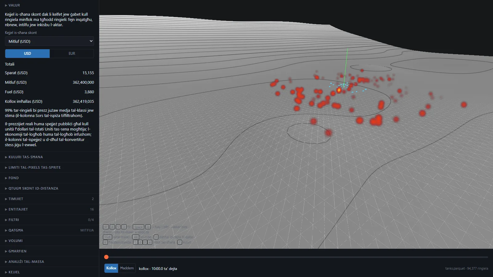

# Piż tal-valuri

Kull sparatura, munizzjoni, vettura mitlufa u litru ta' fjuwil għandu prezz. Il-viewer jaħdem x'kostah jew x'miksub kull ringiela u jista' jkejjel is-sħana skont dan, għalhekk il-mappa turi **fejn mar il-flus** minflok fejn huma r-ringieli.

## Kif tużah {#how-to-use-it}

1. Agħbi dejta b'avvenimenti (sparar, qtil, mewt) u b'ismijiet ta' vetturi jew armi.
2. Iftaħ **Valur** fis-sidebar tas-Sħana.
3. Agħżel **Kejjel is-sħana skont**, per eżempju *Mitluf (USD)*. Issa s-sħana żżid il-prezz ta' kull ringiela minflok 1.
4. Aqra **Totali**: is-somma ta' kull kolonna tal-valur għal dak li qed juri (il-filtri u t-tieqa tal-ħin japplikaw).
5. Fejn il-prezzijiet huma flus reali, jidher swiċċ **USD / EUR**.

Agħżel l-ewwel dħul vojt tal-menu biex terġa' tgħodd ir-ringieli.

## X'jista' jitkejjel {#what-can-be-weighed}

Il-kolonni tal-valur jiżdiedu meta tgħabba d-dejta, wieħed għal kull tip u munita:

| Tip | Ringieli li jmorru fihom | Kif jiġi prezzjat |
|---|---|---|
| **Sparat** | sparar u tnedija | l-arma, inkella medja għat-tip tal-munizzjon |
| **Nefaq** | xiri, spawning | kolonni tal-flus tal-logħba (per eżempju il-menu tax-xiri ta' shooter) |
| **Mitluf** | mwiet, meqruda | il-vettura tiegħu stess, inkella l-medja tal-klassi tagħha |
| **Meqruda** | qtil | il-vettura tal-mira |
| **Dannu kkawżat** | kolpijiet | sehem mill-valur tal-mira |
| **Fjuwil** | pożizzjonijiet | il-fjuwil użat, minn kolonna tal-fjuwil jew stmat mill-klassi u l-ħin |
| **Kollox imħallas** | | sparat + nefaq + mitluf + fjuwil |
| **Miksub** | premjijiet | il-kolonni tal-premjijiet tal-logħba stess (`earn_…`) |
| **Nett** | | miksub nieqes l-imħallas; jinpinġa bħala sħana bis-sinjal (rampa pożittiva fejn inkiseb iktar, negattiva fejn tħallas iktar) |

L-ismijiet tal-kolonni huma `cost_<kind>_<currency>`, `earn_<currency>` u `net_<currency>`. Konverter li jaf il-munita tal-logħba stess (per eżempju konverter tar-replay li jikteb f'kredits tal-logħba) jirbaħ fuq it-tabelli tal-prezzijiet mibnija fih.

## It-tabelli tal-prezzijiet {#the-price-tables}

| Tabella | Munita |
|---|---|
| Militari reali: missili, bombi, rounds, kontromiżuri, ajruplani, elikotteri, vetturi tal-art, bastimenti, fjuwil | USD (EUR = USD × 0.92, il-`EUR_PER_USD` issettjat fi [`cost.ts`](https://github.com/Holdi601/3DHeat/blob/main/src/data/cost.ts); mhuwiex rata live) |
| Menus tax-xiri tal-shooters u premjijiet tal-kills | il-credits tal-logħba |
| Logħob tat-tankijiet u tal-bastimenti | il-credits tal-logħba |
| Logħob strateġiċi (diversi riżorsi) | kolonna waħda għal kull riżorsa u waħda kkombinata |
| Logħob tal-gwerra | punti |

Il-logħba tiġi rikonoxxuta mill-ismijiet fid-dejta. Il-prezzijiet reali ġejjin minn sorsi pubbliċi (dokumenti tal-baġit, enċiklopediji) jew huma mmarkati bħala stimi; ma jiġux aġġustati għall-inflazzjoni. Il-lista ġġenerata tat-tabelli hija fuq [Tabelli tal-valur](ref-value-tables.md).

## Stimi {#estimates}

Il-kolonna tal-kategorija żejda **Sors tal-ispiża** tgħid kif ġie prezzjat kull ringiela: `table`, `class average`, `estimate` jew `none`. It-taqsima Valur turi liema sehem mir-ringieli bi prezz huma medji jew stimi. Biex iżżomm biss ringieli bil-prezz eżatt, neħħi l-għażla ta' *estimate* u *class average* taħt **Sors tal-ispiża** fil-[Filtri](filters.md).

## Fejn oħra jidher il-valur {#where-else-value-shows}

- [Insights](insights.md): sejbiet *Costly ground* u *Earning ground*.
- [Breakdown](breakdown.md): flus Miksub, Mitluf u Nett għal kull tim, plejer jew arma.
- [Volumi](volumes.md): kolonni tal-valur fl-istatistiċi u fil-paragun.
