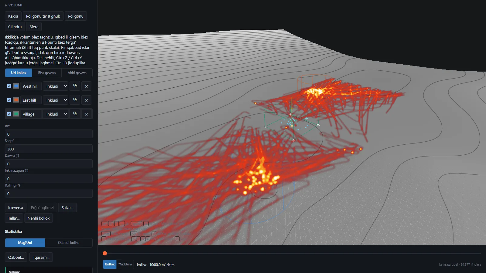
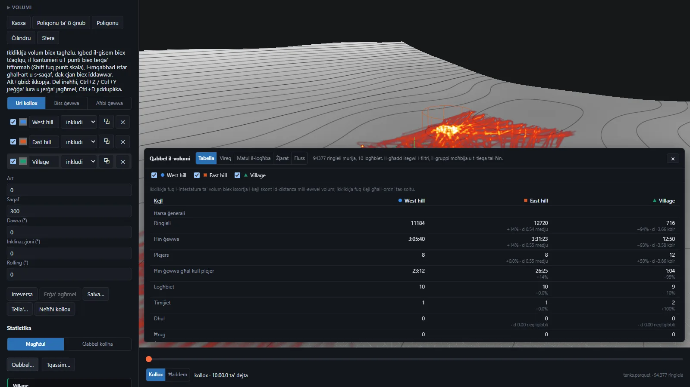
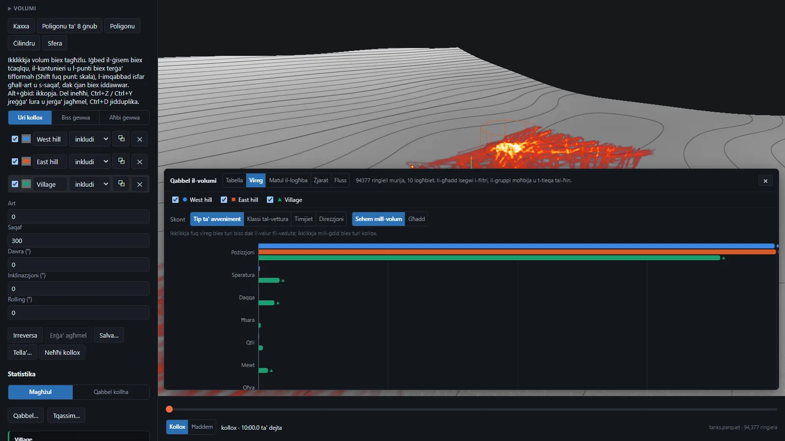

# Volumi u tqabbil

**Volum** hu kaxxa (jew ċilindru, jew sfera) invisibbli li tpitti madwar post, biex tistaqsi: x'ġara hawn ġewwa? Uża dan biex tgħodd il-kills f'pont, biex tqabbel żewġ għoljiet, jew biex turi biss l-attività f'żona waħda.

```
 veduta mill-fuq         Tpitti forma ->  il-viewer jgħodd
 +------------+           dak li hemm ġewwa:
 |   ( A )    |            ringieli, plejers, kills, ħin ...
 |        [B] |           Qabbel A ma' B, ġenb ġenb.
 +------------+
```



Il-volumi jkejlu dak li jiġri ġewwa fihom, jiffiltraw il-veduta għalihom, jesportaw ir-ringieli tagħhom, u jistgħu jitqabblu ġenb ġenb. Ara wkoll il-[glossarju](glossary.md) għal ringiela, persuna u partita.

## Ipitti volum {#draw-a-volume}

1. Iftaħ **Volumi** fis-sidebar.
2. Agħżel għodda u ipitti fil-veduta 3D jew fuq il-mappa 2D. L-art u s-saqaf jibdew mid-data ta' taħtu. Esc jikkanċella.
3. Ikklikkja l-volum biex tagħżlu; l-**Statistika** tiegħu tidher.

| Għodda | Kif tipitti |
|---|---|
| **Kaxxa** | Iġbed rettangolu (Shift: kwadru). Klikk wieħed jqiegħed kaxxa bażika. |
| **n-gon** | Iġbed miċ-ċentru (Shift iżommu regolari). *Kantunieri* jagħti n, minn 3 sa 64 (bażi 8, allura l-buttuna taqra **8-gon**). |
| **Poligonu** | Ikklikkja l-kantunieri; agħlaq b'double-click, Enter jew klikk fuq l-ewwel kantuniera. Backspace jneħħi l-aħħar kantuniera. |
| **Ċilindru** | Iġbed ir-raġġ. |
| **Sfera** | Iġbed ir-raġġ; toqgħod fuq l-art. |

## Editja {#edit}

- Ikklikkja volum biex tagħżlu. Iġbed il-ġisem tiegħu biex timxih, il-kantunieri biex tibdel il-forma tiegħu (Shift fuq kantuniera jiskala).
- Il-maniglji **isfar** jagħmlu l-art u s-saqaf, il-maniglja **ċjan** tdawwru.
- Alt+iġbed jikopja, Del jneħħi, Ctrl+Z / Ctrl+Y jerġgħu lura u jerġgħu jagħmlu, Ctrl+D jagħmel kopja. **Neħħi kollox** jitfa' kull volum.
- Valuri eżatti: Art, Saqaf, Dawran / Pitch / Roll (kaxxi), Raġġ (sfieri, ċilindri).

Kull ringiela tal-volum għandha kaxxa tal-wiri, kulur, isem, **inkludi** jew **esklludi**, duplika u neħħi. Il-volumi jinżammu fil-browser għal kull dataset, u **Issejvja...** / **Għabbi...** jikteb u jaqra fajl `volumes.json`.

## Iffiltra l-veduta {#filter-the-view}

| Filtru | Effett |
|---|---|
| **Uri kollox** (bażi) | Il-volumi jkejlu biss. |
| **Biss ġewwa** | Is-sħana, ir-replay u l-[analiżi tal-kolpijiet](hit-analysis.md) jpingu biss dak li hu ġewwa l-volumi inklużi u barra mill-volumi esklużi. |
| **Aħbi ġewwa** | Il-kontra. |

Il-filtru tal-GPU jieħu sa 8 volumi b'64 punt ta' kontorn f'kollox; "!" timmarka volum li jmur 'il hinn minn dan. L-istatistika u l-esportazzjoni xorta jgħoddu dan.

## Statistika {#statistics}

Iż-żona tal-**Statistika** tsegwi l-filtri, it-tieqa taż-żmien u l-gruppi moħbija. *Magħżul* juri l-volum magħżul, *Qabbel kollox* iqiegħed kull volum ġenb ġenb. Turi:

- **Ringieli ġewwa (murija)** u **Ringieli ġewwa (id-data kollha)**, **Plejers**, **Timijiet**, **Logħbiet**, **Ħin ġewwa**, **Dħul / ħruġ**, **Quċċata tas-sħana**, **Sħana medja**, **Volum / marka** u istogramma **Meta**;
- għal kull kolonna: kategoriji b'**Lift** (sehem ġewwa maqsum bis-sehem fid-data kollha murija), u numri b'medda, medjan u l-5-95 percentili.

**Statistika bħala CSV / JSON** jissejvjaha. **Esporta d-data ġewwa** jikteb ir-ringieli ġewwa bħala CSV jew Parquet (*Biss ir-ringieli murija* ikun imxegħel bi default), volum wieħed jew kollha b'kolonna li tgħid liema volum fih kull ringiela.

## Qabbel volumi {#compare-volumes}

Bi tnejn jew iktar volumi murija, agħfas **Qabbel...**.

1. Ipitti tliet volumi, pereżempju Għolja tal-Punent, Għolja tal-Lvant u Raħal.
2. Agħfas **Qabbel...** taħt Statistika.
3. Fi **Tabella**, aqra d-differenza ta' kull valur mill-ewwel volum.
4. Aqleb għal **Vireg** biex tara s-sehmijiet bħala vireg.



| Veduta | Turi |
|---|---|
| **Tabella** | Ringieli, ħin ġewwa, plejers, logħbiet, timijiet, dħul, ħruġ, żjarat, tul taż-żjara, kills, mwiet, kills għal kull mewt, kills għal kull minuta, ħin għal kull plejer, kolonni tal-valur; magħquda skont l-avvenimenti, il-klassi tal-vettura, plejer jew AI, it-tim u d-direzzjoni. Kull valur juri d-differenza tiegħu mill-ewwel volum u effect size (negliġibbli, żgħir, medju, kbir). Ikklikkja l-intestatura ta' volum biex titfa' skont id-distanza mill-ewwel. |
| **Vireg** | Għadd jew sehem skont l-avveniment, il-klassi, l-attur, it-tim jew id-direzzjoni. Ikklikkja vireg biex tiffiltra l-veduta għalih. |
| **Matul il-logħba** | Grafiku wieħed għal kull volum matul id-minuti tal-logħba: preżenza, ringieli jew kills. Ikklikkja biex timxi għal hemm. |
| **Żjarat** | Plots tal-kaxxa u tal-violin tad-dewmien taż-żjarat (skala logaritmika). |
| **Fluss** | Fejn jiġu t-traċċi wara li jitilqu minn kull volum: matriċi ta' tranżizzjonijiet jew xridiet ta' fluss. |



## Tips {#tips}

- Ibda minn sejba: f'[Għarfien](insights.md), **Volum hawn** iżid ċilindru madwar il-post tas-sejba.
- **Tqassim...** jiftaħ il-[Tqassim](breakdown.md) għall-volum magħżul: min u x'jagħmel l-aħjar ġewwa.
- [Sħana direzzjonali](directional-heat.md) tista' tpoġġi f'grafiku d-direzzjonijiet ġewwa l-volum magħżul.
- It-[tab Vetturi](hit-analysis.md#restrict-to-an-area) juża l-istess volumi bħala l-filtru taż-żona tiegħu.
