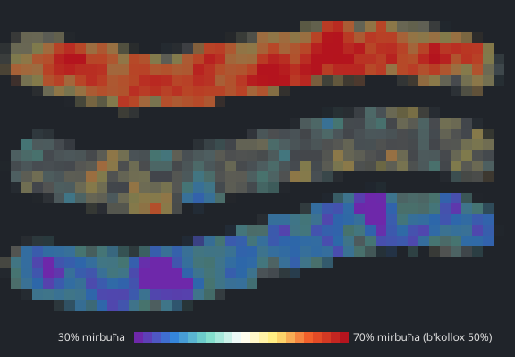

# Rata ta' rebħ: kemm-il darba post, rotta jew mossa jirbħu

Fejn jieqaf plejer, lejn fejn imur, minn fejn jitfa' l-granati tiegħu - u kemm-il darba n-naħa tiegħu mbagħad tirbaħ ir-rawnd. Il-**mappa tar-rata ta' rebħ** tikkulura kull post skont is-sehem tar-ringieli hemmhekk li jappartjenu lil rawnds li rebħet in-naħa tar-ringiela, imqabbel mas-sehem fuq dak kollu li jidher: sħun fejn huwa ogħla, kiesaħ fejn huwa aktar baxx, xejn fejn huwa l-istess.

*L-istampa hija dejta invenzjoni: tliet rotot fuq livell vojt, b'68%, 50% u 33% tar-ringieli tagħhom f'rawnds mirbuħa.*

Teħtieġ dejta li tgħid min rebaħ: il-[kolonni tar-riżultat](data-formats.md#outcome-columns) (`won`, `matchWon`, `roundEndReason`). Il-konvertituri ta' CS2 u War Thunder jiktbuhom, u l-konvertitur ta' Tacview għall-kampanji ta' server tad-DCS ([Servers tad-DCS](tacview-acmi.md#dcs-servers-who-won-and-how-each-sortie-ended)); kwalunkwe fajl jista' jkollhom.

## Ipprova {#try-it}

1. Għabbi partiti b'kolonna tar-riżultat u agħfas `2` (**Differenza**).
2. Fil-**Qasma tad-differenza**, agħfas **Rata ta’ rebħ għal kull rawnd** (jew **Rata ta’ rebħ għal kull partita**). Tpoġġi r-rawnds mirbuħa fuq **+** u dawk mitlufa fuq **−** u taqleb il-pannell għal **Sehem ta’ +**.
3. Aqra l-kuluri. Il-pannell jgħid is-sehem totali: *B’kollox 52.0% ta’ 1,200,000 ringiela huma fuq +.*
4. Naqqasha bil-[filtri](filters.md): naħa waħda (T jew CT), tip wieħed ta' avveniment (*Pożizzjoni* għal fejn waqfu n-nies, *Sparatura* jew *Tluq (missila, rokit, bomba)* għal minn fejn sparaw jew xeħtu), xiri wieħed, mappa waħda.

Post sħun b'ringieli ta' *Pożizzjoni* huwa post fejn dawk li żammewh kienu jirbħu r-rawnd aktar spiss. B'ringieli ta' *Qtil* huwa post fejn il-qtil li sar wassal għal rawnds mirbuħa.

## L-issettjar {#the-settings}

| Issettjar | X'jagħmel | Default |
|---|---|---|
| **Differenza** / **Sehem ta’ +** | id-differenza nnifisha, jew is-sehem tan-naħa + mir-ringieli taż-żewġ naħat | Differenza |
| **Kulur sħiħ f’** | kemm 'il fuq jew 'l isfel mis-sehem totali post jintwera b'kulur sħiħ, f'punti | ± 20 punt |
| **L-inqas ringieli biex jinkulura post** | post b'inqas ringieli ma jiġix ikkulurit; il-kulur jidher bil-mod minn nofs dan in-numru | 12 |
| **Ġbid lejn is-sehem totali (ringieli)** | kull post jibda b'dawn il-ringieli fis-sehem totali, biex post b'3 ringieli, kollha mirbuħa, ma jintweriex bħala 100% | 12 |

It-tlieta jaħdmu fuq l-istampa lesta: meta tkaxkarhom, l-akkumulazzjoni qatt ma terġa' tibda.

Is-sehem jista' jkun ta' kwalunkwe qasma, mhux biss tar-rebħiet: *Sehem ta’ +* b'qasma skont in-naħa juri fejn it-T kienu l-parti l-akbar tal-preżenza, u b'qasma skont il-fajls ta' żewġ mapep, fejn ir-ringieli ta' fajl wieħed jegħlbu lil dawk tal-ieħor.

## Ringieli, mhux rawnds {#rows-not-rounds}

Il-mappa tgħodd ringieli. Plejer li joqgħod f'post wieħed għal għoxrin sekonda jżid ringiela ma' kull kampjun, kollha mill-istess rawnd. Għalhekk il-prova f'post hija r-ringieli qribu, mhux ir-rawnds. Għalhekk il-minimu u l-ġbid huma f'ringieli, u għalhekk huma akbar minn rawnd wieħed.

Għar-rawnds infushom:

- **[Tqassim](breakdown.md)** fuq punt, il-veduta jew volum: *Rebħiet %* jgħodd ir-rawnd ta' kull plejer darba, miġbud lejn ir-rata totali tal-post bl-istess mod (4 rawnds).
- L-istatistika tal-**[Volumi](volumes.md)**: *Rata ta’ rebħ* - ir-rawnds bi plejer ġewwa l-volum, kull wieħed darba, miġbuda lejn ir-rata fuq dak kollu li jidher, bin-numri.

## Filtri tar-riżultat {#outcome-filters}

Il-pannell [Filtri](filters.md) juri l-kolonni tar-riżultat eżatt wara l-kolonni tal-viewer stess: **Riżultat tar-rawnd** u **Riżultat tal-partita** (*Kwalunkwe*, *Mirbuħ*, *Mitluf*) u **Kif intemm ir-rawnd** (eliminazzjoni, il-bomba splodiet, il-bomba ġiet diżattivata, il-ħin skada, ċediment, draw, għan, żoni miżmuma, biljetti mitlufa, il-vetturi kollha mitlufa), fil-lingwa tal-viewer.

## Għall-iżviluppaturi {#for-developers}

Il-pass tas-sħana jikteb tliet somom fil-mira b'erba' kanali li tuża s-sħana tat-timijiet: is-sħana `R = Σ|v|`, is-sħana tan-naħa + `P` u `S = Σ v²/w`, b'`w` il-piż tal-pass (il-piż tal-kampjunar immultiplikat bil-gain tal-frame). Il-kompożizzjoni taqra s-sehem `P/R` (medja ppeżata bil-kernel) u r-ringieli li fuqhom jistrieħ, `n = R²/S` (id-daqs effettiv tal-kampjun ta' Kish), tiġbed is-sehem lejn dak totali, `p = (n·P/R + m·r0)/(n + m)`, u tikkulura `p - r0` fuq il-medda bir-rampi tad-differenza.

`n` jikkanċella kull fattur komuni għar-ringieli f'pixel - il-gain tal-frame, il-piż tal-kampjunar, il-piż taż-żona ta' sprite limitat - għalhekk l-istampa hija l-istess f'kull zoom u densità tal-kampjunar, u l-frames ta' kull k-il ringiela jingħaqdu fl-intier mingħajr ma jaqbżu l-kuluri. Is-sehem totali jiġi mill-għadd tan-naħat fuq is-CPU, sa għaxra ta' fil-mija; xejn ma jinqara lura mill-GPU. L-aritmetika u l-verifiki tagħha: [`render/rateMap.ts`](https://github.com/Holdi601/3DHeat/blob/main/src/render/rateMap.ts) u t-test tiegħu.

Jiswa daqs is-sħana tat-timijiet: il-mira b'erba' kanali timmultiplika b'erbgħa l-bandwidth tal-blending tal-pass tas-sħana, biss sakemm *Sehem ta’ +* ikun mixgħul.
