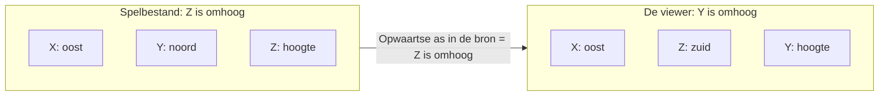

# Assen, eenheden en tijd

Spellen en kaarten zijn het niet eens over welke kant omhoog is, hoe lang een eenheid is, of hoe tijd wordt geschreven. Deze pagina laat de drie instellingen zien die ervoor zorgen dat je data staat, de juiste schaal heeft en op de juiste manier speelt.

Als je kaart staat als een muur in plaats van als een vloer, zet dan **Opwaartse as in de bron** om.

Met de verkeerde **Opwaartse as in de bron** staat de kaart als een muur; met de juiste ligt hij als een vloer.

## De wereld waarin de viewer tekent {#the-world-the-viewer-draws-in}

De wereld van de viewer is **Y-omhoog**: X en Z vormen het grondvlak, Y is de hoogte. De meeste game-engines zijn **Z-omhoog**: voor hen vormen X en Y de grond en is Z de hoogte. Sommige engines zijn ook gespiegeld (linkshandig). De koppeling zegt hoe de assen van het bestand worden omgezet naar die van de viewer. (Technisch gezien is de viewer rechtshandig, de conventie van three.js.)

### Opwaartse as {#up-axis}

**Opwaartse as in de bron** in de [Kolomkoppeling](column-mapping.md):

| Instelling | Bestand (x, y, z) wordt wereld (X, Y, Z) |
|---|---|
| *Z is omhoog (de meeste game-engines)* - de standaard | (x, **z**, **y**): de Z van het bestand wordt de hoogte en de Y van het bestand wordt de Z van de wereld |
| *Y is omhoog (grafische conventie)* | (x, y, z) ongewijzigd |

Bij Z-omhoog-data worden de drie reeksen opnieuw gelabeld in plaats van gekopieerd ([`remapAxesInPlace`](https://github.com/Holdi601/3DHeat/blob/main/src/data/ingest.ts)), wat honderden megabytes bespaart bij grote laadacties. De gok wordt uit het monster gemaakt: welke van de Y- en Z-kolommen de kleinste spreiding heeft, is omhoog.

### Spiegelingen {#flips}

**Flip X**, **Flip Y**, **Flip Z** keren de *as van het bestand* met die naam om, vóór het opnieuw labelen - dus bij Z-omhoog keert *Flip Y* om wat uiteindelijk de Z van de wereld wordt. Een spiegeling verandert de geladen data: coördinaten die de [liniaal](measure.md) toont, de doorsnede en de camerapositie zijn de gespiegelde.

Om een gespiegelde wereld de goede kant op te tekenen **zonder** de data te veranderen, gebruik je in plaats daarvan **Camera en scène → Wereldas omkeren** ([Camera](camera.md#invert-world-axis)). Dat is de betere keuze voor games waarvan de wereld linkshandig is, omdat elke coördinaat die de hulpmiddelen tonen de eigen coördinaat van het spel blijft.

### Eenheidsschaal {#unit-scale}

**Eenheidsschaal** vermenigvuldigt elke positie. *1 (m)* zet 1, *0,01 (cm→m)* zet 0,01 (eenheden van Unreal Engine zijn centimeters, dus gebruik 0,01; eenheden van de Source-engine zijn inches, dus gebruik 0,0254; geen van beide zijn meters), en het vak accepteert elke waarde. Een getypte 0 of een waarde die geen getal is, wordt vervangen door 1.

De viewer labelt afstanden in meters (spriteradius, afknipafstanden, de liniaal, vliegsnelheid), wat alleen klopt als de geschaalde wereldeenheid een meter is. Er breekt niets als dat niet zo is; de labels zeggen dan gewoon "m" voor wat de eenheid ook is.

## Tijd {#time}

### Tijdeenheden {#time-units}

Vuistregel: waarden als 17000000000 (tien of meer cijfers) zijn een Unix-tijdstempel; waarden als 0, 0,25, 0,5 zijn seconden vanaf het begin.

| Tijdeenheid (menulabel) | Gelezen als | Getoonde kloktijd |
|---|---|---|
| *Seconden (relatief)* | waarde × 1 s | nee |
| *Milliseconden (relatief)* | waarde × 0,001 s | nee |
| *Microseconden (relatief)* | waarde × 10^-6 s | nee |
| *Nanoseconden (relatief)* | waarde × 10^-9 s | nee |
| *Unix-tijdstempel (s)* | seconden sinds 1970-01-01 UTC | ja |
| *Unix-tijdstempel (ms)* | milliseconden sinds 1970-01-01 UTC | ja |
| *ISO-8601-datumtekst* | tekst zoals `2026-03-14T18:02:11.250Z`, verwerkt met de `Date.parse` van de browser | ja |

Bij een absolute eenheid (de laatste drie) houdt de dataset het kloktijdmoment van de vroegste rij vast, en toont de tijdlijn naast de afspeelkop de huidige UTC-tijd van de dag (`HH:MM:SSZ`).

**Parquet-kolommen `TIMESTAMP` en `DATE`** worden als echte momenten gedecodeerd, dus hun eenheidsinstelling wordt genegeerd en het paneel zegt dat. Een `DATE`-kolom is een hele dag: elke rij van een dag deelt één moment, en het afspelen springt per dag, waarvoor het paneel waarschuwt.

**ISO-8601-tekst werkt in CSV en Parquet op dezelfde manier.** Een tekstkolom met tijd en de ISO-eenheid wordt één keer per verschillende tekst verwerkt; als er geen enkele te verwerken is, mislukt het laden met *Geen verwerkbare ISO-8601-tijdstempels in de gekoppelde tijdkolom.* - en de koppeling weigert al te starten als geen van de bemonsterde waarden verwerkbaar is. Een Parquet-kolom `TIMESTAMP` wordt als tijdstempel gelezen, wat de eenheid ook is, en een numerieke Parquet-kolom met de ISO-eenheid wordt gelezen als Unix-milliseconden. Een tekstkolom met tijd en een numerieke eenheid wordt vóór het laden geweigerd: elke waarde zou als NaN gelezen worden.

### Hoe tijd wordt opgeslagen {#how-time-is-stored}

Terwijl bestanden worden samengevoegd, zijn tijden 64-bits seconden, zodat een absoluut tijdstip zijn detail onder de seconde behoudt. Als alle bestanden binnen zijn, wordt de vroegste tijd van de hele selectie 0 en slaat elke rij 32-bits seconden daarvanaf op. Een 32-bits float heeft 24 bits mantisse: tijdsbereiken tot ongeveer anderhalve dag worden tot beter dan 1/100 s opgelost, bereiken van een half jaar tot ongeveer een seconde. Een rij waarvan de tijd ontbreekt of geen getal is, wordt op 0 gezet, het begin.

De rijen worden daarna op tijd gesorteerd, en dat maakt de tijdlijn goedkoop: een tijdvenster wordt met twee binaire zoekacties gevonden (zie [Bemonstering en budgetten](sampling-and-budgets.md)).

### Verstreken tijd tegenover kloktijd {#elapsed-time-versus-wall-clock}

Een tijdkolom zoals `match_time` of `round_time` telt vanaf het eigen begin van elke match. Als je die kiest, komt elke match op één gedeelde as te staan - goed om te vergelijken wat er in minuut 3 van elke match gebeurt - en het paneel wijst dat aan. Een kloktijdkolom toont de matches in de volgorde waarin ze echt gebeurden, overlappend waar ze overlapten.

## Kijkrichting {#look-direction}

De kijkrichting wordt alleen gebruikt door [boxreplay](box-replay.md) (de stralen van elk blok). Ze wordt opgeslagen als twee hoeken, gier en stamp, in radialen.

- **Kolommen voor gier- en stamphoek** worden gelezen zoals ze zijn, omgezet van graden als *Graden* is gekozen. Ze worden niet aangepast voor de opwaartse as of de spiegelingen.
- **Kolommen voor richtingsvector** gaan door dezelfde opnieuw labeling en spiegelingen als de posities, en worden daarna gier = atan2(x, -z) en stamp = atan2(y, √(x² + z²)) in wereldassen, zodat de straal ook in een gespiegelde bronwereld wijst waar het blok heen kijkt.

Als kolommen voor gier en stamp na een spiegeling, een richtingsvector of aangepaste hoeken de verkeerde kant op wijzen, is dat de oorzaak die je moet nakijken.
