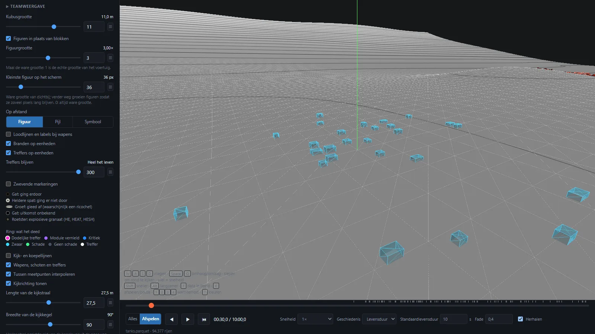

# Figurenoverlay (boxreplay)

Een kleine film: één figuur voor elke persoon, die beweegt terwijl de tijd loopt, met een spoor erachter.

De modus heet **Figurenoverlay** in de modusbalk. Deze pagina heette vroeger "boxreplay", omdat elke persoon een blok was voordat er figuren bestonden; "figurenreplay" en "boxreplay" betekenen hetzelfde. **Figurenoverlay** heeft geen cijfertoets: kies hem in de modusbalk. Hij tekent één figuur (of blok) per [persoon](glossary.md), die langs de [tijdlijn](timeline.md) beweegt, met optioneel kijkstralen en sporen. Het is afspelen in plaats van dichtheid: *wie was waar, wanneer*. Hij heeft een kolom met personen nodig; zonder kolom met tijd wordt elk monster tegelijk getekend.

## Zo gebruik je het {#how-to-use-it}

1. Laad data met een kolom voor personen en een kolom voor tijd.
2. Kies **Figurenoverlay** in de modusbalk.
3. Zet de tijdlijn op **Afspelen** en druk op afspelen (`K`).
4. Open **Teamweergave** om de **Spoorlengte**, de figuurgrootte of de kijkstralen te wijzigen.

In deze modus wordt geen warmte getekend, en het adaptieve spritebudget ligt stil.

Standaard wordt elke persoon getekend als de figuur van wat hij is, in plaats van als een blok - zie [Figuren](figures.md) voor welke figuur een eenheid krijgt, en [Wedstrijdreplay](match-replay.md) voor labels, de volgcamera, meten tussen twee eenheden en de gebeurtenislijst.

## Het paneel Teamweergave {#the-team-viewer-panel}

Wordt in deze modus getoond in plaats van de warmtepanelen.

| Regelaar | Standaard | Bereik (schuifregelaar) | Betekenis |
|---|---|---|---|
| **Figuren in plaats van blokken** | aan | | Elke persoon als de figuur van wat hij is: een soldaat te voet, de tank of het vliegtuig die de data noemt. Wat de data er niet over zegt, blijft een blok. |
| **Figuurgrootte** | 1× | | 1× is de echte grootte. |
| **Kleinste figuur op het scherm** | 36 px | 0 = altijd de echte grootte | De echte grootte van dichtbij; verder weg groeien figuren zodat ze deze lengte in pixels houden. |
| **Wapens, schoten en treffers** | aan | | Wapens in de lucht met rook, tracers, inslagen, treffers en kills. Tracers afgeleid uit een treffer zijn gestreept. |
| **Kubusgrootte** | grootte van de entiteit, of omvang / 500, bij het laden | 0,05-200 m, logaritmisch (5000) | Zijde van elk blok. Zie [grootte van de entiteit](sessions-persons-groups.md#entity-size). |
| **Tussen meetpunten interpoleren** | aan | | Tussen twee meetpunten van dezelfde persoon in dezelfde sessie plaats je het blok evenredig daartussen. Nooit over een sessiegrens heen. |
| **Kijkrichting tonen** | aan | | Een straal vanaf elk blok in de kijkrichting van de persoon (heeft [kijkkolommen](axes-units-and-time.md#look-direction) nodig). |
| **Lengte van de kijkstraal** | grootte van de entiteit × 4, of omvang / 200, bij het laden | 0,5-500 m, logaritmisch (20.000) | Getoond terwijl kijkrichting aan staat. |
| **Spoorlengte** | 8 s | 0-300 s (86.400); 0 = uit | Seconden geschiedenis die achter elke persoon wordt getekend. |
| **Elk ruw meetpunt tekenen** | uit | | Een blok per opgeslagen meetpunt in het venster, in plaats van één geïnterpoleerd blok per persoon. Wordt uitgedund om interactief te blijven. |

De hints in het paneel leggen uit dat interpolatie en sporen alleen meetpunten binnen één sessie verbinden, en, als de lading [gedeelde namen](sessions-persons-groups.md#names-worn-by-several-things-at-once) heeft, hoeveel namen als losse meetpunten worden getekend.

## De sessie die wordt afgespeeld {#the-session-being-played}

Met een kolom voor sessies bepaalt de keuzelijst **Sessie** bovenaan de zijbalk ([Sessies](sessions-persons-groups.md#the-session-picker)) welke match wordt afgespeeld. De drukste wordt bij het laden gekozen. Alleen rijen van die sessie worden blokken en sporen, en de tijdlijn loopt over het bereik van die sessie in plaats van over de hele dataset. *Alle sessies* speelt elke sessie tegelijk af, waarbij meetpunten nog steeds nooit over sessies heen worden verbonden.

## Wat wanneer wordt getekend {#what-is-drawn-when}

Van [`TrackCursor`](https://github.com/Holdi601/3DHeat/blob/main/src/data/tracks.ts):

**Live blokken** (modus Afspelen, ruwe meetpunten uit). Voor elke zichtbare persoon hun laatste meetpunt op of vóór de afspeelkop:

- Heeft de persoon een volgend meetpunt, staat het in dezelfde sessie, en is de naam niet gedeeld, dan wordt het blok tussen de twee meetpunten geplaatst, evenredig met de tijd, met de gier geïnterpoleerd langs de korte kant en de stamp lineair (als *Interpoleren* aan staat).
- Anders blijft het blok op het laatste meetpunt staan voor de **Standaardlevensduur** van de tijdlijn (standaard 10 s) en wordt het daarna weggehaald, zodat uitgeschakelde spelers niet blijven hangen.

**Modus Alles** negeert de afspeelkop en tekent elk meetpunt in het bereik als blok.

**Ruwe meetpunten** tekent een blok per opgeslagen meetpunt in het venster: de *Spanne* bij de geschiedenis *Venster*, anders alles tot de afspeelkop. Maximaal 65.536 blokken; bij meer meetpunten wordt elke *k*-de getekend.

**Sporen** (als de spoorlengte boven 0 ligt en ruwe meetpunten niet worden getekend): een lijn tussen elk paar opeenvolgende meetpunten van een persoon binnen de laatste *spoorlengte* seconden tot de afspeelkop, die met de leeftijd vervaagt van 80% dekking naar transparant. Een spoor stopt bij een sessiewisseling en wordt niet getekend voor gedeelde namen. Maximaal 131.072 hoekpunten; bij meer worden rijen gelijkmatig overgeslagen.

**Wie zichtbaar is:** een persoon is verborgen wanneer zijn groep is uitgevinkt in de [Teamlijst](teams-list.md) (zijn groep is die van zijn eerste rij), wanneer een groepsfilter hem uitsluit, of wanneer het paneel [Entiteiten](entities.md) een selectie heeft die hem niet bevat. [Kolomfilters](filters.md) gelden niet voor blokken.

## Kleuren {#colours}

Eén tintfamilie per groep en één schakering per lid, zodat je in één oogopslag ziet aan welke kant iemand staat ([`teamMemberColor`](https://github.com/Holdi601/3DHeat/blob/main/src/render/colors.ts)). De groepstinten doorlopen een vaste lijst van tien - blauw, rood, groen, amber, violet, cyaan, magenta, limoen, oranje, indigo - en de leden van een groep zijn gespreid over een helderheid van 42-76% en een verzadiging van 90-65%.

## Opmerkingen {#notes}

- De figuurlaag bouwt zijn figuren alleen opnieuw op als er iets verandert; een stilstaand frame tekent de laatste opnieuw.
- De regel *Kubussen* van de [statistiekenlaag](performance-and-stats.md) telt de blokken op het scherm.
- De figuurlaag tekent in dezelfde scène als het niveau, dus [scherptediepte](camera.md#depth-of-field) vervaagt de blokken maar nooit de warmte.
