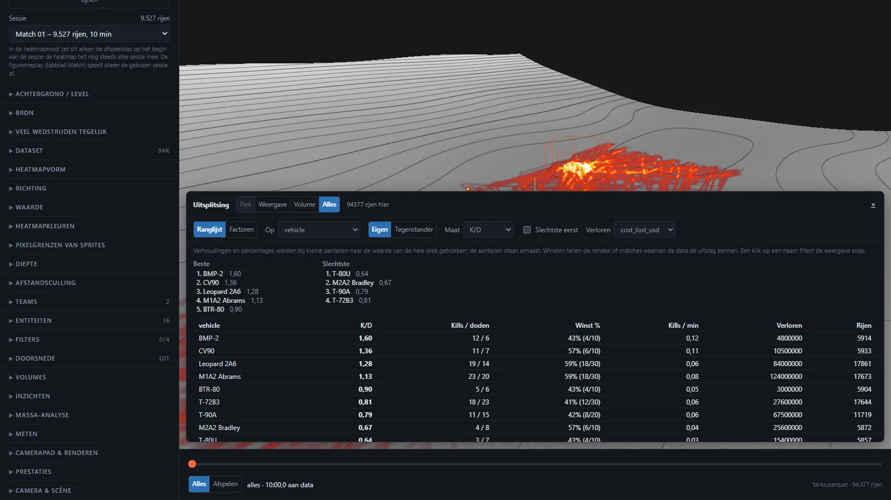
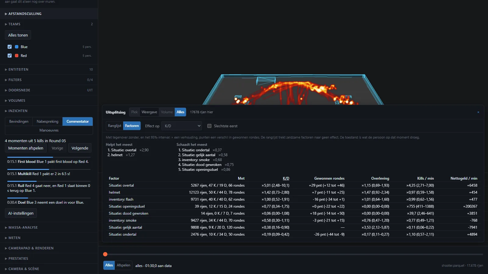

# Uitsplitsing: wie en wat doet het waar het beste

De **Uitsplitsing** beantwoordt één vraag: welk voertuig, welke speler of welk wapen doet het hier het best? Gebruik hem om de tank te vinden die bij de brug wint, of om te zien of een helm echt helpt.

Hij rangschikt wat er op één plek gebeurt (een gekozen punt, de weergave, een volume of alles dat getoond wordt) op elke categorie, en meet elke toestandsfactor met tegenover zonder.

## Probeer het {#try-it}

1. Laad een match met kills en doden, en open **Volumes**.
2. Teken een volume rond de plek die je interesseert en selecteer het.
3. Druk op **Uitsplitsing…** onder Statistieken.
4. Kies onder **Op** *Voertuig*, en kies de maatstaf *K/D* (kills per dood).
5. Lees de lijst, de beste eerst. Druk op **Slechtste eerst** om hem om te draaien. Klik op een naam om de weergave daartoe te filteren; klik nogmaals om het los te laten.

## Openen {#open-it}

| Vanuit | Gebied waarmee het begint |
| --- | --- |
| **Uitsplitsing…** in [Volumes](volumes.md) (Statistieken) | het gekozen volume |
| **Uitsplitsing hier** op de selectiekaart, na het klikken op een punt | een bol rond dat punt (**Straal**, standaard 3% van de omvang van de data) |
| het gesplitste paneel **Verschil** | de weergave |

De kop schakelt het gebied: **Plek**, **Weergave** (wat de camera zag bij de laatste telling; **Opnieuw tellen** na verplaatsen), **Volume** (kies er een) of **Alles**. Het telt op de achtergrond; de statusregel zegt hoeveel rijen er in het gebied zitten.

## Rangschikken {#ranking}

Kies waarop je rangschikt en een maatstaf:

| Maatstaf | Wat het is |
| --- | --- |
| A, B | rijen aan elke kant van de verschilkaart, gesplitst zoals de warmte ze splitst |
| A / B, A - B, A / (A + B) | de twee lagen tegen elkaar |
| K/D | kills tegen doden |
| Winst % | gewonnen rondes (of matches), waar de data zegt wie won |
| Kills / min | kills per minuut aanwezig (de hiaten tussen de bewegingsmonsters) |
| Verdiend, Verloren, Netto geld | sommen van de kolommen `earn_*` en `cost_*`; een keuzelijst kiest de valuta |

Kills, doden, aanwezigheid, overwinningen en geld tellen elke rij die de weergave op die plek toont, aan beide kanten van de splitsing of geen van beide.

Verhoudingen en snelheden worden naar de waarde van de hele plek toe getrokken als de aantallen klein zijn, zodat 2 kills in 1 leven niet bovenaan de lijst komt. De aantallen worden ernaast getoond.

Je kunt rangschikken op de groepen, spelers en matches, elke categoriekolom (een voertuig, een wapen, een kant, een aanschaftype, een agent of een uitrusting), elke getalkolom in klassen (pantser, de waarde van een uitrusting), de **klasse** van een wapenkolom (geweer, sluipschutter, smg, pistool...) en hoeveel stuks **hulpmiddelen** een lijstkolom zoals `inventory` bevat.

**Eigen** rangschikt op de eigen waarde van de rij. **Tegenstander** rangschikt op de waarde van de andere partij: het wapen van het slachtoffer bij een kill, dat van de moordenaar bij een dood (heeft een kolom `other` / `victim` nodig die hen noemt).

## Toestand op het moment {#state-at-the-time}

De waarde van een rij is haar eigen waarde, tenzij de rij geen logt (een gebeurtenisrij zonder uitrusting) of het een dood is (waarvan de wapenkolom het wapen van de moordenaar kan noemen); dan is het wat dezelfde persoon het laatst bij zich had eerder in de match.

## Factoren: met tegenover zonder {#factors-with-against-without}

Schakel van **Ranglijst** naar **Factoren**, kies **Effect op**, en lees *Helpt het meest* en *Schaadt het meest*:

Het effect van elke factor op K/D, gewonnen rondes, overleving (minuten per dood), kills per minuut en netto geld per minuut, met een interval van 95%: verhoudingen als x, gewonnen rondes als een verschil in punten. De ranglijst trekt elke schatting naar geen effect toe, naar gelang de eigen onzekerheid, dus een zeldzame factor heeft een duidelijk effect nodig om hoog te scoren; het getoonde interval is het niet-getrokken interval.

Data met rondes voegt de **situaties** van nabij gevecht toe ([Nabij gevecht en rondes](close-quarters.md)), eenmaal berekend per dataset: *verblind* (de `state_flashed` van de rij, of een flits van een vijand binnen 15 m in de laatste 3 s), *dood geruild*, *openingsduel*, en *man meer*, *gelijke aantallen* of *man minder* (spelers in leven aan de kant van de rij tegenover de vijand). Een dood telt in de situatie waarin het slachtoffer zich vlak ervoor bevond.

Er worden maximaal 256 factoren in één doorgang gemeten.

## Voor ontwikkelaars {#for-developers}

### Kleine steekproeven naar het midden trekken {#pulling-small-samples}

De rangschikkingswaarde is `(n + m*r0) / (d + m)`: `n` en `d` zijn de aantallen, `r0` de verhouding van de hele plek en `m` het gewicht van dat voorafgaande gegeven.

### Voor auteurs van converters: factorkolommen benoemen {#for-converter-authors-naming-factor-columns}

Een converter voegt een factor toe door zijn kolom te benoemen:

| Kolom | Factor |
| --- | --- |
| `state_<naam>` getal | aan zolang het niet nul is (`state_scoped`, `state_suppressor`) |
| `state_<naam>` categorie | één factor per waarde (`state_ammo` = AP, HE...) |
| `active_<naam>` | hetzelfde, voor iets dat recent is ingeschakeld of gebruikt: een vaardigheid, een ultimate, een gadget, een buff (`active_ult`, `active_stim`) |
| lijstkolom (`inventory`, `loadout`, `perks`, `abilities`, `attachments`, `modules`, `buffs`, `debuffs`, `upgrades`, of een naam `state_`/`active_` die op `s` eindigt) | één factor per item van een waarde `a\|b\|c` |
| vlaggen van uitrusting die al gangbaar zijn (`helmet`, `defuser`, `armor`, `scoped`, `airborne`, `duck`, `flashed`...) | aan zolang het niet nul is |
| `ammoType`, `shellType`, `ammoName` | de laatst afgevuurde munitie |

Resultaten: een kolom `won` met 0/1 (de kant van de rij won de ronde of match) en een kolom `round`, de [uitslagkolommen](data-formats.md#outcome-columns); als een bestand zowel `won` als `matchWon` heeft, telt *Winst %* rondes. Geld: `earn_<valuta>` en `cost_<soort>_<valuta>`; een inkomen per soort alleen (`earn_round_cs2`, de exacte rondebeloningen van een converter) vervangt alleen het inkomen van het kostenmodel voor die soort (`round` dekt ook plantingen en ontmantelingen), en het model prijst de rest.

De koppeling laadt deze kolommen zelf, naast de eigen lijst van het bestand: elke `state_*`-, `active_*`-, `won`-, `round`- en lijstkolom, behalve die welke de statistiek van een Parquet-bestand als één waarde overal toont (elke geladen kolom kost 4 bytes per rij).
