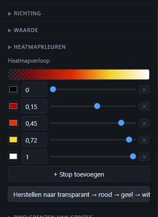

# Kleur en belichting

Met deze instellingen bepaal je welke hoeveelheid warmte welke kleur krijgt. **Verzadigingspunt** is hoeveel warmte als witgloeiend telt.

## Snelle oplossingen {#quick-fixes}

- Alles is wit: verhoog **Verzadigingspunt**, of druk op **Belichting automatisch uit het veld**.
- Niets is zichtbaar: verlaag **Verzadigingspunt**, of druk op **Belichting automatisch uit het veld**.
- Er zijn maar een paar losse stippen te zien: zet **Minimale intensiteit** hoger.

Elke instelling op deze pagina werkt wanneer de warmte in een kleur wordt omgezet. Als je een van deze instellingen verschuift, wordt het beeld dus meteen opnieuw getekend en **begint de accumulatie nooit opnieuw**.

## Verzadigingspunt {#saturation-point}

**Verzadigingspunt** (gedeelte Heatmapvorm): de geaccumuleerde warmte die bij de bovenkant van de kleurenrampe hoort (bij de lineaire respons; zie hieronder voor de andere). Logaritmische schuifregelaar van 0,1 tot 4000, het handvat sleep je tot 10.000.000, omdat geaccumuleerde warmte meegroeit met het aantal rijen. Standaard 24; bij elke keer dat je laadt wordt eerst een **analytische schatting** gemaakt en daarna **gemeten** uit het beeld.

Het juiste getal raden maakt het verschil tussen een warmtekaart en een leeg (of wit) scherm. Het kan niet betrouwbaar worden afgeleid, want telemetrie klontert zo sterk - een spawn, een deur, een knelpunt - dat de verhouding tussen piek- en gemiddelde dichtheid per dataset en per camerahoek een factor tien kan verschillen.

## Automatische belichting {#auto-exposure}

**Belichting automatisch uit het veld** meet het veld dat de shader echt heeft gemaakt. Het negeert lege pixels, neemt het 98e percentiel van de verlichte pixels en zet dat op 85% van de weg naar het verzadigingspunt. Zo blijft de bovenkant van de rampe over voor de echte pieken.

Het paneel toont dan *gemeten X% van het beeld; 98e percentiel R ligt bij de bovenkant van de rampe*. Bij de *Verzadigende* respons komt een waarde op 85% van het verzadigingspunt uit op ongeveer 69% van de rampe in plaats van 85%.

Het draait ook **automatisch**:

- 8 gerenderde frames nadat een dataset is geladen;
- 8 frames nadat de [filters](filters.md) zijn veranderd (als je elke positie terugbrengt tot honderd gebeurtenissen, verandert de dichtheid met een factor van vele tientallen);
- 8 frames nadat je van puntwarmte naar [lijnwarmte](line-heat.md) bent overgeschakeld, of nadat je de routes van de lijnwarmte hebt gewijzigd, omdat een lijn per monster veel minder warmte legt dan een sprite.

Als er niets verlicht is, laat de automatische run de verzadiging ongemoeid; de knop valt dan terug op de analytische schatting en meldt *niets verlicht om te meten - analytische schatting gebruikt*.

### De weergave volgen {#follow-the-view}

**De weergave volgen** (gedeelte Heatmapvorm, standaard aan) meet opnieuw elke keer dat de camera tot rust komt. Zo gebruikt een gebied waar je naartoe vliegt de hele kleurenrampe, in plaats van de schaal die voor de hele kaart is gemeten. Kleine veranderingen worden genegeerd en de schaal glijdt in plaats van te springen. Het werkt in de vier warmtemodi, niet in de figuurlaag.

Zet het uit om de schaal vast te zetten en plekken op één schaal te vergelijken. Als je **Verzadigingspunt** met de hand verschuift, wordt de schaal ook vastgezet.

## Dichtheidsrespons {#density-response}

**Dichtheidsrespons** - hoe *k* (warmte / verzadigingspunt) op de rampe wordt afgebeeld:

| Respons | Formule | Gebruik |
|---|---|---|
| **Verzadigend** (standaard) | t = 1 - e^(-k) | Nadert asymptotisch de bovenkant van de rampe, zoals gestapelde transparante sprites dat doen. Niets wordt ooit afgekapt tot vlak wit, wat hem de veilige standaard maakt bij onbekende data. |
| **Lineair** | t = k | De enige afbeelding waarbij gelijke kleur gelijk aantal betekent. Gebruik die om twee datasets of twee tijdvensters te vergelijken. |
| **Log** | t = log₂(1 + 7k) / 3 | Perst een lange staart samen, zodat één extreme hotspot niet al het andere naar de onderkant van de rampe drukt. Maakt schaarse gebieden helderder. |

## Minimale intensiteit {#minimum-heat}

**Minimale intensiteit** (standaard uit, 0-100%): elke pixel met enige warmte wordt tot minimaal dit punt van de rampe opgetild. Zet het omhoog en de sprite-straal omlaag om te zien *waar iets ooit gebeurde* - losse datapunten worden duidelijk zichtbaar in plaats van net boven transparant te blijven zitten. Laat het uit als je de dichtheid beoordeelt, want het maakt de onderkant van de rampe bewust vlak. De drempel (k > 0,0001) houdt werkelijk lege pixels leeg.

## De editor van de kleurenrampe {#the-ramp-editor}

In het gedeelte **Heatmapkleuren**. Het label zegt waarvoor de rampe dient: *Heatmapverloop* in Warmte en Lijnen, *Positief (additieve teams)* in Verschil, *Dekkingsverloop (kleur komt van de groep)* in [Teamwarmte](team-heat.md), waar alleen de alfa wordt gebruikt.



De balk bovenaan toont een voorbeeld van de rampe. Daaronder staat één rij per stop:

| Onderdeel | Betekenis |
|---|---|
| Kleurvak | De kleur van de stop (de kleurkiezer van de browser). |
| Getal | De positie van de stop langs de rampe, 0 tot 1 (0 = geen warmte). |
| Schuifregelaar | De dekking van de stop, 0-100%. |
| ✕ | Verwijdert de stop; uitgeschakeld als er nog maar twee over zijn. |

**+ Stop toevoegen** voegt een stop toe halverwege de laatste twee stops, met de kleur en dekking van de laatste stop. **Herstellen naar transparant → rood → geel → wit** zet de standaard terug.

De stops mogen in elke volgorde staan; ze worden gesorteerd wanneer de rampe wordt opgebouwd. De **alfa** bepaalt hoe de warmte over de scène wordt gemengd, daarom is het nulpunt van de standaardrampe volledig transparant.

### De standaardrampes {#the-default-ramps}

| Positie | Positief (Warmte, Lijnen, Verschil +) | Negatief (Verschil −) |
|---|---|---|
| 0,00 | zwart, alfa 0 | zwart, alfa 0 |
| 0,15 | rgb(180, 0, 0), alfa 0,55 | rgb(0, 170, 60), alfa 0,55 |
| 0,45 | rgb(255, 40, 0), alfa 0,85 | rgb(0, 190, 200), alfa 0,85 |
| 0,72 | rgb(255, 220, 40), alfa 0,95 | rgb(40, 80, 255), alfa 0,95 |
| 1,00 | wit, alfa 1 | rgb(170, 60, 255), alfa 1 |

## Terwijl de camera beweegt {#while-the-camera-moves}

Wanneer de camera beweegt, begint de accumulatie elk frame opnieuw. Met **Elke rij in elk frame tekenen** aan (de standaard) is elk bewegend frame nog steeds exact; staat het uit, dan toont een bewegend frame één bemonsterde schatting - helderdere, gewichtsgeschaalde klonten - die naar het gladdere ware beeld convergeert zodra je stopt. Dat is te verwachten; zie [Accumulatie](accumulation.md).

## Voor ontwikkelaars {#for-developers}

### De compositiestap {#the-composite-pass}

Nadat de warmte is geaccumuleerd, wordt de waarde van elke pixel in één compositiestap in een kleur omgezet ([`COMPOSITE_FS`](https://github.com/Holdi601/3DHeat/blob/main/src/render/webgl2/shaders.ts)). De stappen zijn:

```
k = |warmte| / verzadigingspunt
t = respons(k)                          begrensd tot 0..1
als minimale intensiteit > 0 en k > 0,0001:  t = minimum + (1 - minimum) × t
kleur, alfa = rampe(t)                  (de negatieve rampe als warmte < 0, alleen bij Verschil)
pixel = mix(scène, kleur, alfa)
```

### De analytische schatting {#the-analytic-estimate}

**De analytische schatting** ([`estimateSaturation`](https://github.com/Holdi601/3DHeat/blob/main/src/data/calibrate.ts)) gaat ervan uit dat de rijen zich over de X-Z-voetafdruk van de data verspreiden: gemiddelde warmte = rijen × (π r² / oppervlakte van de voetafdruk) × 1/3 × middenintensiteit (1/3 is het schijfgemiddelde van een lineaire helling), vermenigvuldigd met een aangenomen piek-gemiddelde-verhouding van 25, begrensd tot 0,1-1.000.000. Ze hoeft alleen binnen een factor tien goed te zijn.

### Meten {#metering}

[`exposure.ts`](https://github.com/Holdi601/3DHeat/blob/main/src/render/exposure.ts):

1. het warmtedoel wordt van de GPU teruggelezen, met steekproeven van maximaal 40.000 waarden;
2. lege pixels (warmte ≤ 0,0001) worden weggegooid - het grootste deel van een warmteveld is leeg, en als je die meemiddelt, wordt alles te donker, zoals een belichtingsmeter die op een zwarte achtergrond is gericht;
3. het 98e percentiel van de verlichte pixels is de referentie;
4. het verzadigingspunt wordt referentie / 0,85, zodat de referentie op 85% van de weg naar het verzadigingspunt ligt en de bovenkant van de rampe voor de echte pieken bewaard blijft.

### De kleurtabel {#the-colour-table}

De rampe wordt gebakken in een RGBA-tabel van 256 × 2 (positieve rampe in de eerste rij, negatieve in de tweede) ([`buildColorLut`](https://github.com/Holdi601/3DHeat/blob/main/src/render/colors.ts)). Kleuren worden geïnterpoleerd in lineair licht en opgeslagen als sRGB; de dekking wordt lineair geïnterpoleerd.
