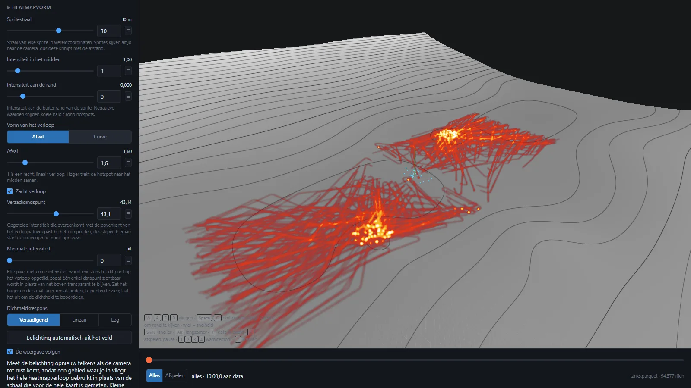
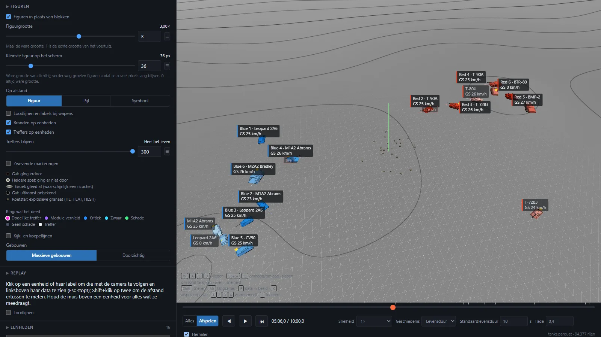

# Demodata: probeer de viewer in vijf minuten



Nog geen eigen data? De repository maakt wat. Alles erin is verzonnen: een dal, een werf, en wedstrijden van drie verzonnen spelstijlen met spelers die *Blue 1* of *Red 3* heten. De afbeeldingen op deze site zijn er allemaal mee gemaakt.

## Maak het {#make-it}

```bash
node tools/demo-data.mjs
```

Dit schrijft naar `tools/.shots/demo/`:

| Bestand | Wat het is |
|---|---|
| `demo-valley.glb` | een dal van 12 km met twee heuvels en een dorp, als 3D-niveau |
| `demo-yard.glb` | een werf van 160 m met een muur eromheen en gebouwen, als 3D-niveau |
| `tanks.parquet` | 10 tankwedstrijden, 8 tegen 8: beweging, schoten, treffers met de plek op de romp, branden, kills, wrakken, torenrichting, winnaars |
| `tanks/match-NN.parquet` | dezelfde wedstrijden, elk in een eigen bestand, voor [veel wedstrijden tegelijk](many-matches.md) |
| `air.parquet` | een luchtgevecht van 4 tegen 4 met raketten, flares, kills en misses |
| `shooter.parquet` | 12 rondes van 5 tegen 5 te voet: schoten, kills, een plaatsing, verdiende en uitgegeven credits, helmen en hulpmiddelen |
| `mass/` | een map met kleine `.3dheat`-wedstrijden, voor [massa-analyse](mass-analysis.md) |
| een reeks racerondes | twee rondes van één wagen op een verzonnen baan, voor [Race-analyse](race-analysis.md) |

Elke tabel noemt zijn eigen kolommen in de voettekst, dus hij laadt zonder enige toewijzing.

## Probeer het {#try-it}

1. Start de viewer (`start.bat` op Windows, of eenmalig `npm install` en daarna `npm run dev` op elk systeem) en open `http://127.0.0.1:5273/`.
2. **Achtergrond / level → 3D-model…** en kies `demo-valley.glb`.
3. **Bron → Bestanden…** en kies `tanks.parquet`.
4. Druk op `F` om de data in beeld te brengen. Je ziet de [warmte](heat.md) van tien wedstrijden.
5. Probeer de modusbalk: **Verschil** (Blue tegenover Red), **Teamwarmte**, **Lijnen**.
6. Open **Inzichten** (in de zijbalk van Heatmap): het vindt de plekken waar veel meer geschoten, geraakt en vernietigd werd dan elders - rond de twee heuvels.
7. Open het tabblad **Match**; kies onder **Matches in de replay** *Match 01*; druk op **Afspelen** op de tijdlijn: de [replay](match-replay.md).



Voor het schietspel laad je `demo-yard.glb` en `shooter.parquet`; voor het luchtgevecht `air.parquet` (de figuren zijn makkelijker te zien bij **Figuurgrootte** 4, een schuifregelaar in het paneel **Teamweergave** van de zijbalk van Heatmap).

## De schermafbeeldingen {#the-screenshots}

De afbeeldingen van de site worden door een script uit deze data gemaakt, in elke taal van de viewer:

```bash
node tools/demo-data.mjs
HEAT3D_FIGURE_PACK=none npx vite --port 5321 --strictPort --host 127.0.0.1   # PowerShell: $env:HEAT3D_FIGURE_PACK="none"; npx vite ...
node tools/docs-shots.mjs --lang en
```

De schermafbeeldingenserver draait zonder lokaal figuurpakket, dus alleen de openbare figuurcatalogus wordt getoond. Afbeeldingen gaan naar `docs/assets/img/<lang>/`. Zie [De documentatie onderhouden](maintaining.md).
