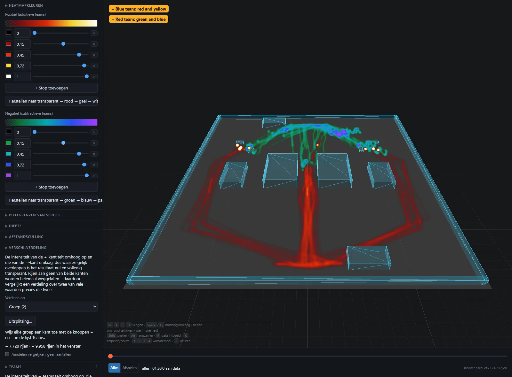

# Verschil

Rood waar team A meer was, groen-blauw waar team B meer was, niets waar ze gelijk waren.

**Verschil** (toets 2) is gekleurde warmte met een teken. Rijen van de ene populatie tellen warmte op; rijen van een andere trekken ervan af. Waar de twee gelijkmatig overlappen, is het resultaat nul en volledig transparant; waar er één overheerst, toont het in de kleuren van die kant - standaard warm (transparant → rood → geel → wit) voor de **+**-kant en koel (transparant → groen → blauw → paars) voor de **−**-kant.

## Gebruik {#how-to-use-it}

1. Druk op `2` (of kies **Verschil** in de modusbalk).
2. Open **Verschilverdeling** in de zijbalk.
3. Kies wat je **Verdelen op**: meestal *Groepen*.
4. Zet de ene groep (of waarde) op **+** en een andere op **−**.
5. Lees de kleuren: warm betekent de +-kant, koel betekent de −-kant. Het paneel waarschuwt als een kant geen rijen heeft (zie [Meldingen die je kunt zien](#messages-you-may-see)).

*Welke* twee populaties is de hele vraag, dus de verdeling kan op elke bewaarde kolom zijn, niet alleen op groepen. Rijen die op **geen van beide** kanten vallen, worden **weggelaten**, niet als nul geteld: dat maakt dat een verdeling over twee van veel waarden precies die twee vergelijkt, en het werkt samen met de [filters](filters.md) - filter eerst op één kaart, verdeel die daarna op build.

De modus heeft twee kanten nodig: een groepskolom met minstens twee groepen, of een verdeling over een kolom die bewaard is voor filteren. Bij data met minder dan twee groepen start een load met een kolomverdeling - eerst de kolom *Source file* van een load van meerdere bestanden, anders de eerste categoriekolom met twee waarden, anders de eerste numerieke kolom met een spanne - zodat *twee laadacties vergelijken* ook werkt op data zonder groepen. Alleen data zonder één van beide maakt de modus onbeschikbaar; dat geldt ook voor een kolomverdeling waarbij een kant leeg blijft.

## Het paneel Verschilverdeling {#the-difference-split-panel}

Getoond in de modus Verschil, onder de warmtepanelen.

**Verdelen op** biedt:

| Optie | Getoond als | Verdelingsregel |
|---|---|---|
| Groepen | *Groep (N)* (als er een groepskolom is) | Elke groep op +, − of geen, ingesteld in de [Teamlijst](teams-list.md) |
| Een categoriekolom | *kolom (N waarden)* | Waarden op +, − of geen |
| Een numerieke kolom | *kolom (numeriek)* | Een waardebereik voor elke kant |
| Het bronbestand | *Source file - twee laadacties vergelijken* (als er meerdere bestanden geladen zijn) | Bestanden op +, − of geen |

Alleen kolommen die bij het laden onder *Bewaren om te filteren* bewaard zijn, worden aangeboden.

### Aandelen vergelijken, geen aantallen {#compare-shares-not-counts}

**Aandelen vergelijken, geen aantallen** (standaard uit) weegt elke kant met één gedeeld door het eigen aantal rijen, zodat een kant met vijf keer zoveel rijen niet alleen op aantallen wint. De kleur toont dan waar elke kant evenredig vaker voorkomt dan de andere. Gebruik het als de twee kanten heel verschillende hoeveelheden data hebben, bijvoorbeeld twee sessies van verschillende lengte.

### Meldingen die je kunt zien {#messages-you-may-see}

Het paneel waarschuwt als het beeld geen echt verschil is:

| Melding | Betekenis |
|---|---|
| *N + / M −* (of *N + / M − / K ongebruikt*) | Hoeveel waarden aan elke kant liggen (en aan geen van beide). |
| Geen rij in het venster is aan de **+**-kant | Alleen de **−**-kant wordt getekend. Verschuif het tijdvenster of verander de verdeling. |
| Geen rij in het venster is aan de **−**-kant | Alleen de **+**-kant wordt getekend. |
| Geen enkele waarde ligt aan een kant | Het verschil tekent niets. Zet minstens één waarde op **+** of **−**. |
| *kolom* kan zo niet verdeeld worden | De gekozen kolom past niet bij de verdeling. Kies de kolom opnieuw. |
| De verdelingskolom paste niet in het GPU-geheugen voor N van M delen | Die rijen worden niet getekend. Verhoog het GPU-budget onder Prestaties → Budgetten voor bronnen, of laad minder rijen. |

### Per groep {#by-group}

Het paneel wijst alleen naar de [Teamlijst](teams-list.md), waar elke groep een **+**- en een **−**-knop heeft. Bij elke load wordt de eerste helft van de groepen (naar boven afgerond) op +, de rest op −; **Gelijk verdelen** in de Teamlijst doet dat opnieuw. Een groep aan geen van beide kanten, of verborgen met zijn vinkje, draagt niets bij.

### Per categoriewaarden {#by-category-values}

| Onderdeel | Betekenis |
|---|---|
| `a + / b − / c ongebruikt` | Hoeveel waarden aan elke kant liggen en aan geen van beide. |
| **Wissen** | Zet elke waarde aan geen van beide kanten. |
| Waardenlijst | Elke waarde met een **+**- en een **−**-knop (klik de actieve nogmaals om hem van die kant af te halen). Een lege waarde staat vermeld als *(ontbreekt)*. |
| Opmerking over de limiet | Alleen de eerste 200 waarden worden vermeld: *De eerste 200 van N waarden worden getoond. Een zo brede kolom kun je beter eerst met een filter versmallen, of verdelen op bereik als de waarden geordend zijn.* |

Bij het kiezen van de kolom komt de eerste waarde op + en de tweede op −. Als geen van beide kanten waarden heeft, valt de verdeling terug op groepen in plaats van een leeg beeld te tonen. *Source file* werkt op dezelfde manier, één waarde per bestand - zo vergelijk je twee exports, twee testruns of twee builds.

### Per bereik {#by-range}

| Onderdeel | Betekenis |
|---|---|
| Hint | Het minimum en maximum van de kolom. |
| **Positief bereik (+)**, **van** / **tot** | Rijen met een waarde in dit bereik, inclusief aan beide einden, tellen op. |
| **Negatief bereik (−)**, **van** / **tot** | Rijen in dit bereik trekken af. |
| **In het midden verdelen** | Zet + op [minimum, midden] en − op [midden, maximum] - wat het kiezen van de kolom ook doet. |

Een waarde in beide bereiken telt als +. De bereiken hoeven de kolom niet te dekken; waarden in geen van beide worden weggelaten. *De eerste twee minuten tegen de laatste twee* is een bereikverdeling op een tijdachtige kolom.

## Aandeel +: de winstpercentagekaart {#share-of--the-win-rate-map}

**Verschil** / **Aandeel +** bovenaan het paneel kiest wat er getekend wordt. *Aandeel +* kleurt elke plek naar het aandeel van de +-kant in de rijen van beide kanten daar, vergeleken met dat aandeel over alles wat getoond wordt: warm erboven, koel eronder, niets waar het gelijk is, en niets waar een plek te weinig rijen heeft. Met de gewonnen rondes op + en de verloren rondes op − is het een winstpercentagekaart. **Winstpercentage per ronde** en **Winstpercentage per wedstrijd** stellen dat in één klik in als de gegevens [uitslagkolommen](data-formats.md#outcome-columns) hebben. Zie [Winstpercentage](win-rate.md).

## Kleuren {#colours}

De sectie **Heatmapkleuren** toont in deze modus twee kleurbalkbewerkers: **Positief (additieve teams)** en **Negatief (subtractieve teams)**, elk met een eigen resetknop (*Herstel naar transparant → rood → geel → wit*, *Herstel naar transparant → groen → blauw → paars*). De samenstelling neemt de absolute waarde van de netto warmte door het [verzadigingspunt en de respons](colour-and-exposure.md), en kiest de negatieve kleurbalk waar het netto onder nul ligt. Zie [Kleur en belichting](colour-and-exposure.md#the-ramp-editor).

Gebruik de *Lineaire* dichtheidsrespons als de grootte van het verschil telt: het is de enige respons waarin gelijke kleur gelijk aantal betekent.

## Voor ontwikkelaars {#for-developers}

Elke rij krijgt een teken van +1, -1 of 0 in de vertex-shader ([`POINT_HEAT_VS`](https://github.com/Holdi601/3DHeat/blob/main/src/render/webgl2/shaders.ts)); een 0 verwerpt de rij voordat er een fragment getekend wordt.

- Bij groepen komt het teken uit een groepstabel van 4.096 ingangen, geïndexeerd op het groeps-id van de rij (het groeps-id zit in het vierde kanaal van het positietexel van de rij).
- Bij categorieën komt het teken uit een tweede tabel van 4.096 ingangen, per categoriewaarde gevuld, en de waarde van de rij wordt gelezen uit de filtertexture van de kolom; een waarde voorbij het einde van de tabel wordt op beide backends verworpen.
- Bij bereiken wordt de waarde van de rij vergeleken met de twee bereiken.

Het veranderen van de verdeling start de accumulatie opnieuw.

**Verborgen groepen blijven verborgen bij elke verdeling.** Onder een verdeling op een kolom draagt de groepstabel geen tekens meer; ze bevat 1 voor een getoonde groep en 0 voor een verborgen groep ([`frameSignTables`](https://github.com/Holdi601/3DHeat/blob/main/src/render/filterTables.ts)), en beide tabellen komen samen bij de shader aan - twee rijen van één tekentexture op WebGL2, twee helften van één opslagbuffer op WebGPU. Een rij wordt alleen getekend als haar groep getoond wordt *en* haar kolomwaarde aan een kant ligt. Een groep die in de [Teamlijst](teams-list.md) uitgevinkt is, of door de zijdefocus van het tabblad Match weggelaten is, draagt dus niets bij, hoe het verschil ook verdeeld wordt.
