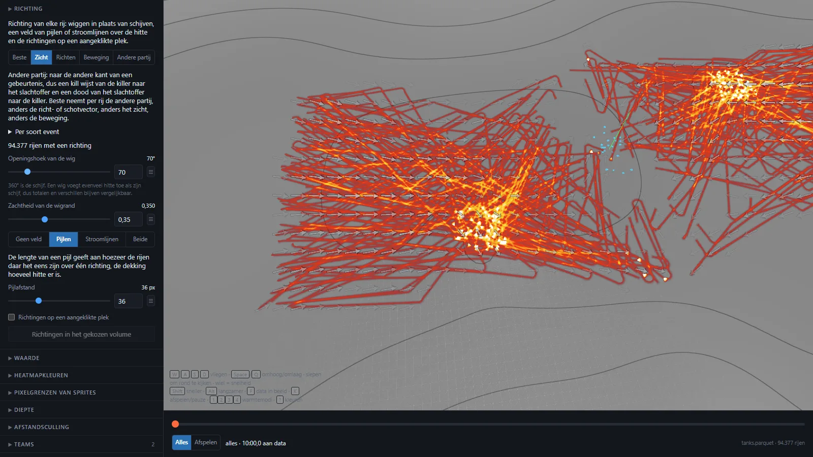

# Richtingswarmte

Gewone warmte zegt **waar** dingen gebeuren. Richtingswarmte zegt ook **welke kant op**: naar welke kant mensen keken, richtten of bewogen, of waar de andere kant van een gevecht was.

Een gewone sprite is een volledige schijf (360 graden). Met een **Openingshoek van de wig** van 70 graden wordt dezelfde sprite een smalle wig die wijst waar de rij naar keek, en telt hij dezelfde totale warmte op.

## Zo gebruik je het {#how-to-use-it}

1. Laad data met een richting erin (zie [Wat een rij een richting geeft](#what-gives-a-row-a-direction)).
2. Kies **Warmte**, **Verschil** of **Teamwarmte** in de modusbalk.
3. Open het gedeelte **Richting** in de zijbalk.
4. Kies een **bron** (welke richting je gebruikt), en zet daarna het tekenen aan:
   - zet **Openingshoek van de wig** onder 360° om elke rij als een wig te tekenen die naar haar kant wijst, in plaats van als een schijf;
   - kies een **Veld** om pijlen of stroomlijnen over de warmte te tekenen;
   - vink **Richtingen op een aangeklikte plek** aan en klik op de warmte om een poolgrafiek van die plek te krijgen.

De statusregel zegt hoeveel rijen een richting hebben uit de gekozen bron.

## Instellingen {#settings}

| Instelling | Standaard | Wat het doet |
|---|---|---|
| Bron: **Beste**, **Weergave**, **Richten**, **Beweging**, **Andere partij** | Beste | Welke richting elke rij krijgt. *Beste* neemt per rij de andere partij, anders het richten, anders de weergave, anders de beweging. |
| **Per soort gebeurtenis** | zoals hierboven | Een andere bron voor elke soort gebeurtenis, bijvoorbeeld *Andere partij* voor kills en *Weergave* voor posities. Wordt getoond als de data een kolom gebeurtenissen heeft met hoogstens 40 waarden. |
| **Openingshoek van de wig** | 360° | 360° is de gewone schijf (uit). Kleiner is een smallere wig. Een wig telt evenveel warmte op als zijn schijf, dus totalen en verschillen blijven vergelijkbaar. |
| **Zachtheid van de wigrand** | 0,35 | 0 is een wig met scherpe randen, 1 een zachte waaier. |
| **Veld**: Geen veld, Pijlen, Stroomlijnen, Beide | Geen veld | Pijlen: de lengte van een pijl is hoeveel de rijen daar het over één richting eens zijn, zijn dekking hoeveel warmte er is. Pijlen verschijnen alleen waar warmte is. |
| **Pijlafstand** | 28 px | Afstand tussen pijlen op het scherm. |
| **Stroomlijnen animeren** | aan | Stroomlijnen stromen terwijl dit aan staat. |
| **Richtingen op een aangeklikte plek** | uit | Klik op de warmte om de richtingen daar te zien (hieronder). |
| **Richtingen in het gekozen volume** | | Dezelfde grafiek voor alles binnen het gekozen [volume](volumes.md). |

## De poolgrafiek op een plek {#the-polar-chart-at-a-spot}

Met **Richtingen op een aangeklikte plek** aan klik je op de warmte. De rijen dicht bij dat punt (binnen 1,5 spriteradius) worden verzameld in een roos van 24 segmenten van 15°:

- **oranje** bloembladen: uitgaande richtingen (waar de rijen naartoe wijzen);
- **blauwe** bloembladen: inkomende richtingen (waar ze vandaan kwamen);
- de **oppervlakte** van een bloemblad groeit met het aantal; een pijl toont de hoofdrichting;
- de regels onder de grafiek geven de hoofdpeiling, hoe sterk de rijen het eens zijn (R, 0 tot 1), de spreiding in graden, en het aantal rijen.

0° staat boven op de grafiek, wat de wereld −Z is (noord bij Tacview-opnamen). De plek wordt ook in de 3D-weergave gemarkeerd met een pijl en een ring.

## Wat een rij een richting geeft {#what-gives-a-row-a-direction}

| Bron | Nodig in de data |
|---|---|
| Weergave | een kolom gier (toegewezen als kijkrichting): `yaw`, `heading`, `azimuth`, `view_yaw`, `rot_z` |
| Richten | paren van getallen zoals `aim_x`/`aim_y`, `shot_x`/`shot_y`, `fire_x`/`fire_y`, `hit_dir_x`/`hit_dir_y` (een optionele `…_z`) |
| Beweging | niets extra: de stap vanaf het vorige monster van dezelfde persoon (hoogstens 10 s eerder, zelfde sessie) |
| Andere partij | een kolom die de andere kant van een gebeurtenis noemt (`other`, `victim`, `target`, `killer`, `attacker`, `shooter`, `other_player` ...) waarvan de waarden namen van personen zijn; een kill wijst van moordenaar naar slachtoffer, een dood van slachtoffer naar moordenaar |

## Tips {#tips}

- Wiggen hebben enige grootte op het scherm nodig; onder een paar pixels worden ze weer als schijven getekend.
- Gebruik *Andere partij* bij killrijen om te zien **vanwaar** gevechten werden gewonnen, en *Weergave* bij positierijen om te zien **waar mensen kijken**.
- Met **Verschil** wijzen de wiggen van de twee kanten elk naar hun eigen richting, zodat omstreden vuurlijnen opvallen.
