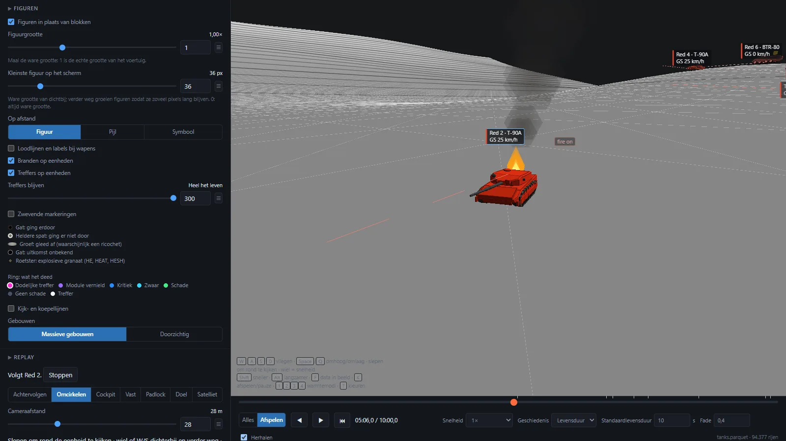

# Figuren

Een **figuur** is een klein 3D-model van wat een eenheid echt was: een tank, een straaljager, een schip, een soldaat. De [replay](match-replay.md) tekent elke eenheid als zijn figuur op ware grootte, in plaats van als een gewone doos.

Er zijn ongeveer 2.000 benoemde voertuigen, vliegtuigen, schepen, wapens en soldaten, allemaal gebouwd door de viewer zelf.

## Wat er in de catalogus zit {#what-is-in-the-catalogue}

| Domein | Voorbeelden |
|---|---|
| Mensen | soldaat staand, geknield, liggend; sluipschutter, antitank, medicus, bemanning |
| Grond | tanks, infanteriegevechtsvoertuigen, luchtverdediging, artillerie, vrachtwagens en auto's, treinen en trams |
| Lucht | jagers, aanvalsvliegtuigen, bommenwerpers, transporttoestellen, helikopters, van tweedekkers tot moderne straaljagers |
| Zee | oorlogsschepen per klasse, vliegdekschepen, onderzeeërs, boten, koopvaardijschepen |
| Wapens | raketten, vuurpijlen, bommen, torpedo's, flares en chaff |
| Markeringen | rook-, flits- en brandgranaten, geplaatste bommen, vlaggen, spawns, waypoints |
| Nabije gevechten | soldaten in plate carriers met een aanvalsgeweer, machinepistool, shotgun, DMR, LMG, pistool of schild; drones, camera's, prikkeldraad, schilden, muurversterking, barricades, breekladingen, vallen, ramen, granaten, de defuser |

## Hoe de figuren worden gemaakt {#how-the-figures-are-made}

- **Gebouwd uit gepubliceerde afmetingen.** De meeste figuren worden gemaakt door de eigen figurenbouwer van de viewer, uit openbare getallen: lengte, breedte, hoogte, wegwielen, toren en kanon, vleugels en staart. Hun vorm wordt daarna afgesteld op openbare foto's, tekeningen en gepubliceerde afmetingen. Er worden geen modellen van een spel gebruikt.
- **Vrije modellen.** Een paar figuren gebruiken vrije 3D-modellen (CC0 of CC BY) waar die waarheidsgetrouwer zijn, soms gecombineerd met de gebouwde romp. Auteurs van CC BY-werken worden vermeld op [Naamsvermeldingen figuren](figure-credits.md); CC0-werken hebben geen naamsvermelding nodig en staan daar niet in de lijst.
- Elke figuur heeft een volledige, een grove en een verre versie (detailniveaus, LOD), zodat er duizenden tegelijk kunnen worden getekend.

## Welke figuur een eenheid krijgt {#which-figure-a-unit-gets}

De viewer kijkt naar de eigen kolommen van de data:

1. **Namen** - kolommen die *Name*, *Vehicle*, *Unit*, *Unit type*, *Model*, *Aircraft*, *Plane*, *Tank*, *Ship*, *Craft*, *Loadout*, *Kit* of *Figure* heten - worden vergeleken met de catalogus: exact, via ongeveer 4.000 aliassen (eenheids-id's van meerdere spellen), op het langste bekende begin (`F-16C_50` is de F-16C), of op de kortste figuurnaam die ermee begint.
2. Een naam waarvan de figuur niet bij het **type** van de eenheid past, wordt niet gebruikt (een vrachtwagen die *Typhoon* heet, is niet de jager).
3. **Typen** - kolommen die *Type*, *Class*, *Kind*, *Category*, *Icon*, *Role* of *Domain* heten - geven een klassefiguur: Tacview-tags (`Air+FixedWing`, `Ground+Heavy+Armor+Vehicle+Tank`, `Sea+Watercraft+Warship`, `Weapon+Missile`), kaartsymbolen, of gewone woorden (tank, helikopter, infanterie).
4. Data met geen van beide is data van mensen: iedereen is een soldaat.

De makkelijkste manier om de juiste figuren te krijgen is dus een kolom `vehicle` met de echte namen, of een kolom `type` met Tacview-tags.

**Mijn eenheid verschijnt als een doos of een soldaat.** Voeg een kolom `vehicle` toe met de echte naam, of een kolom `type` met een Tacview-tag. Wijs de eenheid aan om te zien welke naam is gevonden. Data die zulke kolommen heeft maar niets over een eenheid zegt, laat die als doos staan; data zonder beide wordt als soldaten getekend.

## Figuren voor nabije gevechten (Rainbow Six Siege) {#close-quarters-figures-rainbow-six-siege}

Tabellen die zijn opgebouwd zoals die van de Rainbow Six Siege-replaylezer (kolommen `operator`, `pawn`, `primaryClass`, `side`) krijgen eigen figuren:

- **Spelers** zijn hun operator: elk van de 78 operators heeft een eigen figuur, ongeveer 1,8 m lang, in eigen kleren. Twee of drie kleuren voor jas, broek en uitrusting volgen hun gewone publieke uiterlijk (zwart, olijf, zandkleur, stadsgrijs, wit, marineblauw, met rode, oranje of petrolblauwe uitrusting). Ze hebben ook eigen vormen, een derde groter dan in het echt waar die van bovenaf te zien moeten zijn: hoofddeksel (helmen, een vizier of zware helm, petten, mutsen, baretten, een brede jungle- of bonthoed, capuchons, sjaals, haar), het gezicht (veiligheidsbril, gasmasker, bril, masker, baard, bril met drie lenzen), een lichte, middelzware of zware bouw (zware zijn breed, met grote schouderplaten en een kraag), een lange jas of een pak, een ghillie-pak, wat ze op hun rug dragen (een hamer, ladingen, drones, jerrycans, een brandstoftank, een lanceerbuis, een kruisboog, panelen, een stoorzender, een schild) of aan hun arm (een werper, een metalen arm), hun eigen schild (een hoog schild, een oproerschild, een met lampen) en een accentkleur op de schouders. Ze houden de klasse van hun hoofdwapen vast. Een operator die de viewer niet kent, is een gewone soldaat in een plate carrier in de kleur van het team.
- **De kant** is los van de kleren te zien: een ring op de grond onder elke operator, **amber voor aanval, lichtcyaan voor verdediging**, met de kleur van het team erin, en arm- en hoofdbanden in dezelfde kleur. Een kolom `stance` (stand, crouch, prone) geeft hun houding; zonder die kolom staan ze.
- **Uit elkaar te houden op replay-afstand:** getekend op 48 pixels hoog, van bovenaf en van driekwart, verschillen elke twee operators van een kant door een duidelijk kleurverschil of een andere vorm (gecontroleerd door de tests van de viewer).
- **Labels** noemen de speler en de operator die op dat moment gespeeld wordt, met de rol van de operator als symbool: ✸ harde breacher, ⚒ zachte breacher, ➤ entry, ✦ fragger, ✚ support, ⬟ schild, ◉ informatie, ◇ flex, ↺ flankbewaker, ⚓ anker, ✕ vallenzetter, ⇄ roamer, ↯ anti-gadget, ▣ anti-breach.
- **Drones** zijn een werpbare drone op twee wielen, ongeveer 30 cm breed. Elke drone is een eigen spoor, genoemd naar de eigenaar ("Ash · drone 2").
- **Geplaatste gadgets** staan waar ze zijn neergezet, vanaf dat moment tot het einde van de ronde. Elk is de figuur van wat het doet: een camera, prikkeldraad, een uitklapbaar schild, een breeklading, een harde breeklading, een kleine kleeflading, een vloerval, een claymore met zijn struikellaser, een eenrichtingsraam, een pantserpaneel, een granaat, een gasbus, een stoorzender, een sensor, een laserpoort, een bevoorradingskist. Eén figuur dient voor elk gadget dat hetzelfde werk doet. Een gadget waarvan de data de soort niet noemt, is een klein apparaat met een lampje.
- **De defuser** staat 45 seconden lang waar hij geplant is.

Elke drone en elk gadget wordt een eigen spoor als het bestand laadt. Zo blijft de figuur van de speler op zijn lichaam. De operators zijn vereenvoudigde vormen naar hun publieke beschrijvingen en afbeeldingen (wat ze dragen, het apparaat dat hun vaardigheid is). De gadgets zijn gevormd naar wat ze doen. Dit zijn allemaal eigen ontwerpen van de viewer op de echte grootte van het ding (een claymore ongeveer 22 cm breed, een paneel zo groot als een deur, 1 m bij 2,1 m), geen modellen uit het spel.

## Instellingen {#settings}

Het gedeelte **Figuren** van de zijbalk van de replay stelt de grootte in, de kleinste grootte op het scherm, wat verre eenheden worden (figuur, pijl, symbool), en de effecten die erop worden getekend. Zie [Wedstrijdreplay](match-replay.md#figures). Rook, vuur en andere effecten met een tijdslimiet: [Figuren in de figurenoverlay](figure-replay.md).

## Een optioneel lokaal figurenpakket {#an-optional-local-figure-pack}

Je kunt op je eigen computer een optioneel pakket met eigen figuren bewaren. De figuren daarin nemen de plaats in van catalogusfiguren met dezelfde namen. Het maakt nooit deel uit van de repository of een gepubliceerde build; zonder pakket verandert er niets.
