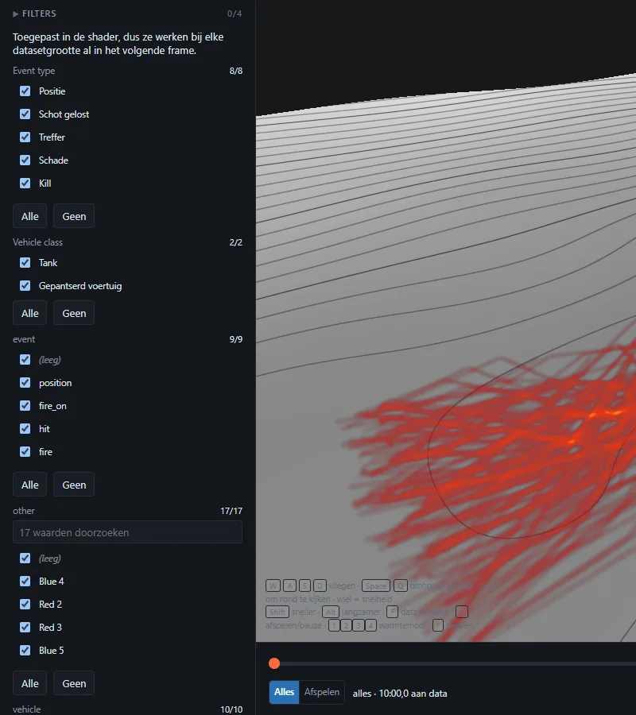
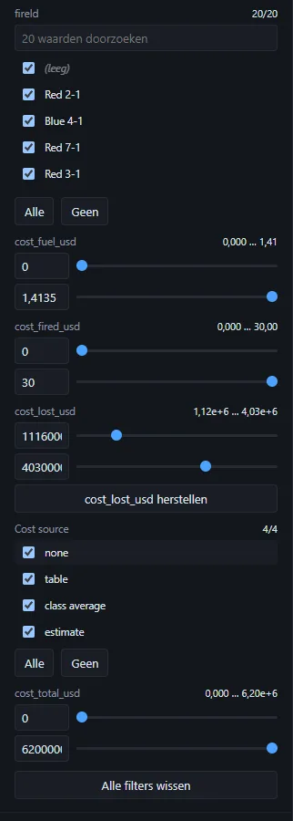

# Filters

**Filters** verbergen de rijen waar je niet om geeft, zoals één voertuigklasse of één soort gebeurtenis, en het beeld past zich meteen aan. Het paneel toont de kolommen die bij het laden onder *Bewaren voor filteren* ([Kolomtoewijzing](column-mapping.md)) zijn gehouden, plus *Bronbestand* als er meerdere bestanden geladen zijn.

## Probeer het {#try-it}

1. Laad een dataset en open **Filters** in de zijbalk.
2. Vink onder **Voertuigklasse** *Tank* uit. Het beeld verandert meteen.
3. Druk op **Alle filters wissen** om het ongedaan te maken.

De eerste rijen zijn de eigen kolommen van de viewer (hieronder). De rijen daarna komen uit je bestand.

## Kolommen die de viewer toevoegt {#columns-the-viewer-adds}

Bij het laden berekent de viewer vier eigen kolommen en zet ze **eerst** in de lijst, met namen en waarden in jouw taal, zodat hetzelfde filter voor elk spel en elke databron werkt:

| Kolom | Waarden | Berekend uit |
|---|---|---|
| **Soort gebeurtenis** | 23 soorten: Positie, Schot afgevuurd, Lancering (raket, missiel, bom), Treffer, Mis (wapen eindigde bij geen enkel doel), Explosie, Schade, Kill, Dood, Vernietigd, Crash, Uitwerpen / noodsprong, Spawn, Despawn, Opstijgen, Landen, Grondcontact, Stilstaan op de grond, Herbewapenen / bijtanken, Capture / doel, Lokmiddel, Bericht, Overig | een kolom met de naam `event`, `events`, `event_type` of `event_name`; de eigen woorden van elk spel (`shot`, `burst`, `fired`, `struck`, `flare`, `plant` ...) worden naar deze soorten gezet. De volledige tabel: [Gebeurtenistypen en -klassen](ref-event-types.md). |
| **Speler of AI** | Speler, AI | een kolom `ai`, `is_ai`, `bot` of `actor`; anders `is_player` / `human`; anders een account-id (`user_id`, `steam_id`; leeg of 0 is AI); bij Tacview-opnamen of het object een piloot heeft |
| **Voertuigklasse** | 17 klassen: Jager, Aanvalsvliegtuig, Bommenwerper, Ander vliegtuig, Helikopter, Tank, Gepantserd voertuig, Luchtverdediging, Artillerie, Vrachtwagen / auto, Schip, Onderzeeboot, Infanterie, Wapen, Lokmiddel, Constructie, Overig | de naam van het voertuig of de eenheid (vergeleken met de [figuurcatalogus](figures.md)) en typekolommen |
| **Doelklasse** | dezelfde klassen | het voertuig van de andere partij (`other_vehicle`, `target_vehicle`, `victim_type` ...) |

Direct daarna komen de [uitslagkolommen](data-formats.md#outcome-columns), als de gegevens ze hebben: **Rondeuitslag** en **Wedstrijduitslag** (*Alle*, *Gewonnen*, *Verloren*) en **Hoe de ronde eindigde**, met de waarden in jouw taal. Filter erop, of verdeel de warmte erop als [winstpercentagekaart](win-rate.md).

Alleen de soorten die voorkomen worden getoond. Waardekolommen (`cost_*`, `earn_*`, `net_*` en *Kostenbron*, zie [Waardeweging](value-weighting.md)) zijn filterbaar zoals elke getalkolom: vink bijvoorbeeld *schatting* uit onder *Kostenbron* om alleen geprijsde rijen over te houden.

Een categorielijst met meer dan 12 waarden krijgt een zoekvak (*n waarden zoeken*) en een knop **Alleen deze** die precies de passende waarden toestaat.

Welke kolommen filterbaar zijn wordt bij het laden bepaald, omdat ze dan gelezen moeten worden. Zonder bewaarde kolom zegt het paneel dat, en verwijst naar *Bewaren voor filteren*.

## Getalkolommen (bereik) {#numeric-columns-range}

| Onderdeel | Betekenis |
|---|---|
| Naam, en `min ... max` | De kolom, en het huidige bereik (het volledige bereik van de kolom zolang er geen filter is ingesteld). |
| Eerste rij: getalvak en schuiver | De ondergrens. Slepen van de schuiver boven de bovengrens duwt de bovengrens mee. |
| Tweede rij: getalvak en schuiver | De bovengrens. Slepen onder de ondergrens duwt die ook mee. |
| **Herstel *kolom*** | Verwijdert dit filter. |

De schuivers lopen van het minimum tot het maximum van de kolom in 1.000 stappen; de getalvakken accepteren elke waarde. Een rij past als haar waarde binnen het bereik ligt, beide uiteinden inbegrepen. Grote waarden worden in exponentvorm getoond (`1.23e6`).

## Categoriekolommen {#category-columns}

| Onderdeel | Betekenis |
|---|---|
| Naam, en `toegestaan/totaal` | De kolom, en hoeveel van de waarden zijn toegestaan. |
| Waardelijst | Een selectievakje per waarde; een lege waarde wordt getoond als *(leeg)*. |
| **Alles** / **Geen** | Elke waarde toestaan / geen enkele waarde toestaan. |

Alle waarden toestaan verwijdert het filter.

## Regels {#rules}

- **Vier filters tegelijk.** De kop toont `actief/4`. Een vijfde filter wordt niet toegepast, en het paneel zegt dat. Een selectie in [Entiteiten](entities.md) (of de spelersfocus van het tabblad Match) gebruikt er ook één van de vier. Een filter dat de hele kolom dekt gebruikt er geen.
- **Een categoriekolom heeft hoogstens 4.096 waarden**; een bredere wordt bij het laden niet bewaard.
- **Filters werken samen met EN**, en met de zichtbaarheid van teams, de verschilverdeling, het tijdvenster, de afstandsculling en de [snede](slice.md).
- **Een filter wijzigen start de accumulatie opnieuw en meet de belichting enkele beelden later opnieuw**, omdat filteren de dichtheid sterk kan veranderen ([Kleur en belichting](colour-and-exposure.md#auto-exposure)).
- **Alle filters wissen** verwijdert elk kolomfilter. Teamzichtbaarheid en elders ingestelde spelerselecties blijven behouden.
- Kolomfilters veranderen de warmtemodi. Ze veranderen niet de figuren van de [figuurreplay](box-replay.md), die de teamzichtbaarheid en de selectie van Entiteiten volgen. De selectie van Entiteiten verandert beide.
- In [lijnwarmte](line-heat.md) wordt een filter getest op de rij waar elk segment *eindigt*.
- Bij elke nieuwe dataset worden alle filters gewist.

## Voor ontwikkelaars {#for-developers}

**Slots.** Elk actief filter neemt één van vier GPU-slots in ([`MAX_FILTER_SLOTS`](https://github.com/Holdi601/3DHeat/blob/main/src/render/types.ts)), een textuur van 4 bytes per rij. Slots gaan naar de filters in de volgorde waarin ze voor het laatst zijn gewijzigd ([`filterSlots`](https://github.com/Holdi601/3DHeat/blob/main/src/render/filterTables.ts), gedeeld door de shader en beide panelen). Voorbij vier zegt een fout *Only the first 4 filters are applied. Clear one - the rest are being ignored, not silently combined*, en de namen van de extra filters luiden *kolom (not applied)*. Filters worden per rij in de vertex-shader uitgevoerd, dus het wijzigen van een drempel vraagt geen nieuwe parse en geen nieuwe upload.

**Filters die het paneel niet toont.** Er bestaan nog twee soorten in de applicatiestatus ([`FilterSpec`](https://github.com/Holdi601/3DHeat/blob/main/src/state/types.ts)):

- een **groepen**-filter, ingesteld door het tabblad Match wanneer het één kant focust. Het verbergt de andere groepen in elke modus, ook een [verschil](difference.md)-verdeling op een kolom.
- een **personen**-filter, ingesteld door het paneel [Entiteiten](entities.md) en door het tabblad Match wanneer het één speler focust. Het beperkt de figuurreplay en de warmtemodi. In de warmte is het een categoriefilter over de persoon-id's en neemt het één van de vier slots in. Het masker bevat 65.536 id's ([`FILTER_MASK_CAPACITY`](https://github.com/Holdi601/3DHeat/blob/main/src/render/types.ts)); een persoon daarboven wordt niet in de warmte getekend zolang het filter actief is, ook niet als hij geselecteerd is. De figuurreplay toont ze nog wel.
