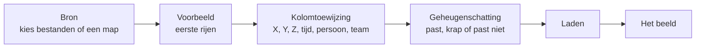

# Gegevens binnenhalen

Voordat 3DHeat iets kan tekenen heeft het een tabel nodig: elke rij zegt waar iets was en, als je dat hebt, wanneer en wie. Dit deel laat zien hoe een bestand een beeld wordt. Nog geen data? Probeer de [demodata](demo-data.md).

**Doe dit nu:**

1. Open in de zijbalk van Heatmap **Bron** en druk op **Bestanden…** (of zet een bestand of map op het slepen-gebied).
2. Kijk naar **Kolomtoewijzing**: de vakjes zijn meestal al ingevuld.
3. Controleer of de **Geheugenschatting** *past* zegt.
4. Druk op **Laden**.

Alles wat het tabblad Heatmap toont komt uit één **dataset**: een tabel met rijen, elk met een positie en, optioneel, een tijd, een persoon, een groep, een sessie, een kijkrichting en een willekeurig aantal extra kolommen die bewaard worden voor filters. Dit deel legt uit hoe een dataset wordt gemaakt.

## Het pad van bestanden naar beeld {#the-path-from-files-to-picture}

1. **Kies bestanden** in het paneel **Bron** - één bestand, meerdere, een mappenboom, of door ze te slepen. Parquet, CSV, Tacview, GPS-tracks en meer worden geaccepteerd; de ene volledige lijst staat in [Gegevensformaten](data-formats.md#files). Zie [Bestanden laden](loading-files.md).
2. **Voorbeeld.** Het eerste bestand van de selectie wordt geopend: de kolomnamen, de eerste 50 rijen, welke kolommen numeriek lijken, en (Parquet) het logische type van elke kolom en de eigen leesinstructies van het bestand, het `heat3d`-footerveld.
3. **Automatisch toewijzen.** Kolommen worden aan rollen toegewezen - X, Y, Z, tijd, persoon, sessie, groep, kijkrichting - en een handvol wordt bewaard voor filters. Elke gok wordt getoond in het paneel **Kolomtoewijzing** en kan worden gewijzigd. Zie [Kolomtoewijzing](column-mapping.md) en [Assen, eenheden en tijd](axes-units-and-time.md).
4. **Tellen.** Het aantal rijen van elk bestand wordt gelezen (exact uit Parquet-footers, geschat voor CSV), zodat het paneel al voor het laden kan zeggen hoeveel geheugen het laden nodig heeft en of het past. Past het niet, dan stelt het voor elke *N*de rij te laden. Zie [Geheugen en budgetten](memory-and-budgets.md).
5. **Laden.** Een achtergrondworker verwerkt alleen de toegewezen kolommen van elk bestand - meerdere bestanden tegelijk, tot het budget van de [parserthreads](memory-and-budgets.md#parser-threads) - en voegt ze, in de volgorde van de selectie, samen tot één dataset: één gedeeld woordenboek van personen, groepen en sessies over alle bestanden, één gemeenschappelijk tijdnulpunt, alle rijen gesorteerd op tijd. Zie [Sessies, personen en groepen](sessions-persons-groups.md).
6. **Uploaden.** De hoofdthread meldt "Uploading N rows to the GPU" voor één beeld, en pakt daarna de rijen in het GPU-geheugen binnen het GPU-budget. Zie [GPU-geheugenverblijf](gpu-memory.md).
7. **Eerste beeld.** De camera brengt de data in beeld, de spriteradius en verzadiging worden ingesteld op basis van de omvang van de data en het aantal rijen, en na 8 getekende beelden wordt de verzadiging uit het beeld zelf gemeten ([Kleur en belichting](colour-and-exposure.md)).

## Eisen, gecontroleerd vóór een laadactie {#requirements-checked-before-a-load}

| Eis | Wat er gebeurt zonder |
|---|---|
| **Minstens twee van X / Y / Z** | Laden wordt geweigerd. Met precies twee is de derde as 0 en wordt de data als vlak plat in de 3D-scène getekend - wat een bovenaanzicht-warmtekaart nodig heeft. |
| Een tijdkolom | Optioneel. Zonder deze is de tijdlijn uitgeschakeld, blijft de weergave in de modus **Alles**, en de zijbalk zegt dat. |
| Een kolom met personen | Optioneel. Nodig voor de [figurenoverlay](box-replay.md) (een figuur voor elke persoon), [lijnwarmte](line-heat.md) (het pad dat elke persoon liep), interpolatie, sporen en de geschiedenis **Levensduur**. |
| Een groepskolom | Optioneel. Nodig voor [teamwarmte](team-heat.md) en voor de modus [verschil](difference.md) (minstens twee groepen). |

Een modus die de geladen data niet aankan staat grijs in de modusbalk; als je erop wijst zegt een tooltip waarom.

## Zonder eigen data {#without-your-own-data}

Het paneel **Dataset** (onder **Bron**) heeft een [synthetische generator](synthetic-generator.md) die een dataset van de vorm van een battle royale maakt, van elke omvang. Handig om de viewer uit te proberen en om te testen wat een machine aankan.

## Pagina's in dit deel {#pages-in-this-section}

- [Bestanden laden](loading-files.md) - kiezers, mappen, slepen en neerzetten, samenvoegen van meerdere bestanden, de bewegingsbestandregel, voortgang en annuleren
- [Kolomtoewijzing](column-mapping.md) - elk veld van het toewijzingspaneel, hoe automatisch toewijzen gokt, de `heat3d`-hints
- [Assen, eenheden en tijd](axes-units-and-time.md) - opwaartse as, spiegelingen, eenheidsschaal, tijdeenheden, kijkrichting
- [Sessies, personen en groepen](sessions-persons-groups.md) - wat elk doet, de grenzen, gedeelde namen, entiteitsgrootte, het paneel Dataset
- [Synthetische generator](synthetic-generator.md)
- [Geheugen en budgetten](memory-and-budgets.md) - het geheugenmodel, de passcontrole, decimeren, de sorteerlimiet, resourcebudgetten
