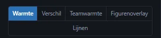

# Warmtemodi

Elke stip voegt een klein gloed toe, de gloeden stapelen zich op, en de stapel wordt met kleuren geverfd. De modi zijn vijf manieren om het te verven, en elke beantwoordt één vraag.

De modusbalk bovenaan de zijbalk van het tabblad Heatmap kiest hoe de [dataset](glossary.md) wordt getekend. Toetsen 1-4 kiezen Warmte, Verschil, Teamwarmte en Lijnen. Figurenoverlay heeft geen toets.

| Modus | Vraag die het beantwoordt |
|---|---|
| **Warmte** | Waar gebeurde het, en hoeveel? |
| **Verschil** | Welke kant deed het vaker? |
| **Teamwarmte** | Van wie was het? |
| **Lijnen** | In welke richting gingen de mensen? |
| **Figurenoverlay** | Wie was waar, en wanneer? |

| Modus (label in de balk) | Toets | Wat het tekent | Nodig |
|---|---|---|---|
| **Warmte** | 1 | Additieve dichtheid: elke zichtbare rij voegt een camera-gericht radiaal sprite toe. [Warmte](heat.md) | een dataset |
| **Verschil** | 2 | Gerichte dichtheid: de ene populatie telt op, een andere trekt af. [Verschil](difference.md) | twee kanten: minstens twee groepen, of een splitsing over een bewaarde kolom |
| **Teamwarmte** | 3 | Dichtheid gekleurd per groep: een tint per groep, gemengd waar groepen overlappen. [Teamwarmte](team-heat.md) | een groepskolom |
| **Figurenoverlay** | - | Een figuur (of doos) per persoon, bewegend langs de tijdlijn: de replay. [Figurenoverlay](box-replay.md), [Wedstrijdreplay](match-replay.md) | een kolom met personen |
| **Lijnen** | 4 | Lijnwarmte: een lijn van elk meetpunt van een persoon naar hun volgende, warmte die zijwaarts wegvalt. [Lijnwarmte](line-heat.md) | een kolom met personen en een tijdkolom |

Een modus die de data niet aankan staat grijs, en de tooltip geeft de reden, bijvoorbeeld *Niet beschikbaar - de modus Verschil heeft twee groepen of een bewaarde kolom om op te splitsen nodig; deze data heeft één groep.* Als een nieuwe dataset de huidige modus niet aankan, valt de weergave terug op **Warmte**.

Toetsen 1-4 worden op dezelfde manier tegen de data gecontroleerd: een toets voor een grijze modus doet niets.

## Welke panelen elke modus toont {#which-panels-each-mode-shows}

| Paneel | Warmte | Verschil | Teamwarmte | Figurenoverlay | Lijnen |
|---|---|---|---|---|---|
| Routes ([lijnwarmte](line-heat.md)) | | | | | ja |
| Warmtevorm (met **De weergave volgen** en **Gelijke dichtheid bij elke zoom**), Warmtekleuren, Spritepixelgrenzen, Diepte, Afstandsculling | ja | ja | ja | | ja |
| Richting ([richtingswarmte](directional-heat.md)), Waarde ([waardeweging](value-weighting.md)) | ja | ja | ja | | ja |
| Teamweergave ([figurenoverlay](box-replay.md)) | | | | ja | |
| Verschilsplitsing ([verschil](difference.md)) | | ja | | | |
| [Teams](teams-list.md), [Entiteiten](entities.md), [Filters](filters.md), Achtergrond / level, [Snede](slice.md), [Meten](measure.md), Camerapad & renderen, Prestaties, Camera & scène | ja | ja | ja | ja | ja |

## Wat elke warmtemodus gemeen heeft {#what-every-heat-mode-shares}

Alle vier warmtemodi (alles behalve de figurenoverlay) zijn dezelfde machine met andere invoer ([`engine.ts`](https://github.com/Holdi601/3DHeat/blob/main/src/render/engine.ts)):

1. **Welke rijen.** Het [tijdlijnvenster](timeline.md) kiest een aaneengesloten reeks op tijd gesorteerde rijen; [filters](filters.md), groepszichtbaarheid, de verschilsplitsing, [afstandsculling](depth-and-culling.md#distance-culling) en de [snede](slice.md) beslissen per rij, in de vertex-shader, of en hoe sterk elke rij meetelt.
2. **Splatting.** Elke meetellende rij wordt als sprite (of, in de modus Lijnen, als segment) getekend in een drijvendekomma-**warmtedoel**, waarbij de rampwaarde wordt opgeteld. Een gestratificeerde steekproef van de rijen wordt getekend wanneer er meer zijn dan één beeld zich kan veroorloven, gewogen om dat te compenseren. Zie [Bemonstering en budgetten](sampling-and-budgets.md).
3. **Accumulatie.** Zolang er niets verandert, worden beelden samengevoegd totdat elke rij precies één keer heeft meegeteld. Zie [Accumulatie](accumulation.md).
4. **Samenstelling.** De geaccumuleerde waarde in elke pixel wordt gedeeld door het **verzadigingspunt**, gevormd door de **dichtheidsrespons**, opgetild door de **minimale warmte**, en opgezocht in de **kleurenrampe**, waarvan de alfa het over de scène mengt. Zie [Kleur en belichting](colour-and-exposure.md).

Alles in stap 4 wordt toegepast bij het samenstellen, dus het slepen van die regelaars start de accumulatie nooit opnieuw; alles in stap 1-2 wel.

## Pagina's in dit deel {#pages-in-this-section}

- [Warmte](heat.md) - de gewone warmtemodus, en het overzicht van zijn panelen
  - [Vorm van sprite](sprite-shape.md) - radius, intensiteiten, verloop, de curve-editor, pixelgrenzen, afvlakken
  - [Kleur en belichting](colour-and-exposure.md) - rampeditor, verzadigingspunt, automatische belichting, minimale warmte, dichtheidsrespons
  - [Diepte en culling](depth-and-culling.md) - occlusie door het niveau, verbergen achter terrein, afstandsculling
- [Verschil](difference.md) - de verschilsplitsing
- [Teamwarmte](team-heat.md)
- [Lijnwarmte](line-heat.md) - routes
- [Figurenoverlay](box-replay.md) - de replaymodus (het bestand heet nog steeds box replay)
- [Richtingswarmte](directional-heat.md)
- [Waardeweging](value-weighting.md)
