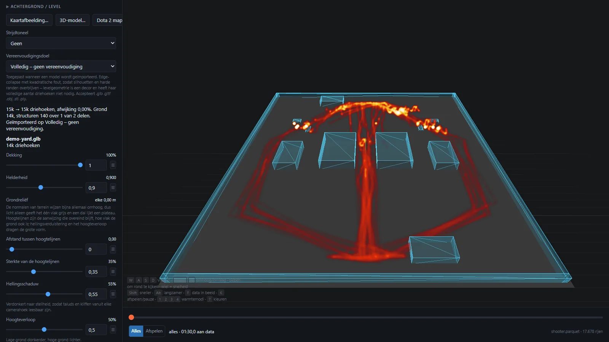
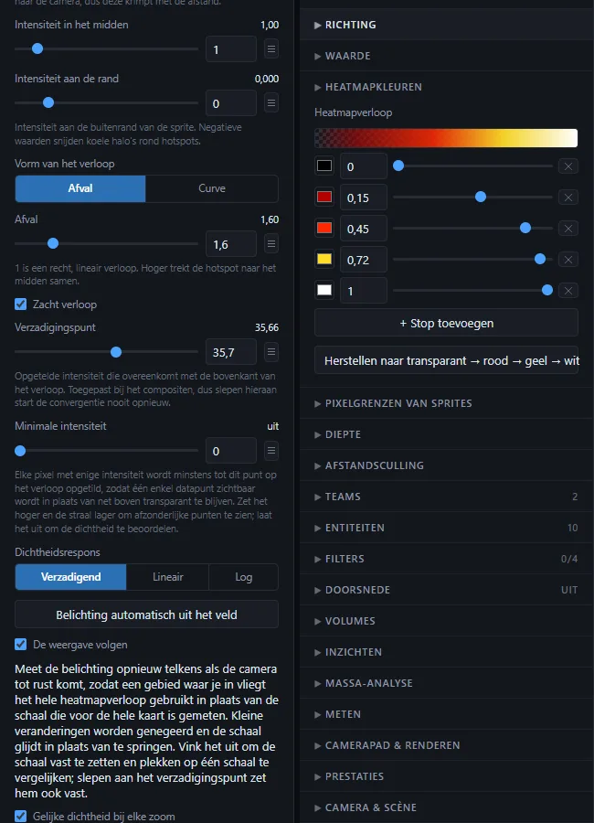

# Warmte

Warmte kleurt de plekken waar veel gebeurde: rood waar het een beetje gebeurde, witgloeiend waar het veel gebeurde. Het beantwoordt de vraag "waar gebeurt dit, en hoeveel".

**Warmte** (toets 1) is de standaardmodus. Elke zichtbare [rij](glossary.md) draagt een camera-gericht rond [sprite](glossary.md) bij; overlappende sprites tellen op in een buffer met drijvende komma; de som wordt via een kleurenrampe omgezet - standaard transparant → rood → geel → wit - en over de scène getekend.

De afbeelding toont de warmte van een schietronde op een niveau met gebouwen: hete plekken zitten in de kamers en op de trappen, niet alleen op de grond.

## Zo gebruik je het {#how-to-use-it}

1. Laad data en druk op `1` (of kies **Warmte** in de modusbalk).
2. Als alles wit of leeg is, druk dan op **Belichting automatisch uit het veld** in het gedeelte **Heatmapvorm**.
3. Verander **Spritestraal** tot naburige stippen tot banden samensmelten: kleiner toont losse plekken, groter toont gebieden.
4. Open **Heatmapkleuren** om de kleuren te wijzigen, of **Diepte** zodat heuvels en muren de warmte erachter verbergen.

Dezelfde panelen vormen [Verschil](difference.md), [Teamwarmte](team-heat.md) en [Lijnwarmte](line-heat.md); ze verschillen in wat er wordt opgeteld (met teken, in kleur, of langs lijnen), niet in hoe.

## De panelen en hun standaarden {#the-panels-and-their-defaults}

Elke regelaar wordt op zijn eigen pagina uitgelegd; de kolom Details linkt ernaartoe. Schuifregelaars hebben een getypt vak ernaast en een slephandvat (het kleine handvat rechts: omhoog of omlaag slepen, verder is sneller, Shift voor fijne regeling); waar het spoor van een schuifregelaar eindigt vóór een echte grens, kan het handvat er voorbij duwen tot de *schuifplafond* die hier staat. Waarden met *bij laden* worden voor elke nieuwe dataset opnieuw berekend.

### Heatmapvorm (open) {#heat-shape-open}

| Regelaar | Standaard | Bereik (schuifplafond) | Details |
|---|---|---|---|
| **Spritestraal** | 6 m; bij laden omvang / 120 | 0,05-2000 m, logaritmisch (50.000) | [Vorm van sprite](sprite-shape.md#sprite-radius) |
| **Intensiteit in het midden** | 1 | 0-10 (1000) | [Vorm van sprite](sprite-shape.md#centre-and-edge-intensity) |
| **Intensiteit aan de rand** | 0 | -2-10 (1000) | [Vorm van sprite](sprite-shape.md#centre-and-edge-intensity) |
| **Vorm van het verloop** | *Afval* | *Afval* / *Curve* | [Vorm van sprite](sprite-shape.md#ramp-shape-falloff-or-curve) |
| **Afval** (alleen bij Afval) | 1,6 | 0,1-8 (64) | [Vorm van sprite](sprite-shape.md#falloff) |
| **Zacht verloop** (alleen bij Afval) | aan | | [Vorm van sprite](sprite-shape.md#falloff) |
| Curve-editor (alleen bij Curve) | preset *Zacht* | | [Vorm van sprite](sprite-shape.md#the-curve-editor) |
| **Verzadigingspunt** | 24; bij laden een schatting, daarna gemeten | 0,1-4000, logaritmisch (10.000.000) | [Kleur en belichting](colour-and-exposure.md#saturation-point) |
| **Minimale intensiteit** | uit (0) | 0-100% | [Kleur en belichting](colour-and-exposure.md#minimum-heat) |
| **Dichtheidsrespons** | *Verzadigend* | *Verzadigend* / *Lineair* / *Log* | [Kleur en belichting](colour-and-exposure.md#density-response) |
| **Belichting automatisch uit het veld** | | knop | [Kleur en belichting](colour-and-exposure.md#auto-exposure) |
| **De weergave volgen** | aan | | Meet de belichting opnieuw elke keer dat de camera tot rust komt, zodat een gebied waar je in vliegt de hele kleurenrampe gebruikt. Kleine wijzigingen worden genegeerd en de schaal glijdt. Zet het uit, of sleep **Verzadigingspunt**, om de schaal vast te zetten en plekken op één schaal te vergelijken. [Kleur en belichting](colour-and-exposure.md#follow-the-view) |
| **Gelijke dichtheid bij elke zoom** | aan | | Een kleur betekent hetzelfde aantal rijen per oppervlak grond, hoe dichtbij je ook bent. Een sprite die de pixelgrenzen vergroten (ver weg) of verkleinen (van dichtbij) houdt de warmte die zijn echte grootte zou toevoegen, dus een beeld dat van ver is belicht, vervaagt niet als je erin vliegt. Uit: een geklemde sprite voegt zijn volle gewicht toe op zijn geklemde grootte. [Vorm van sprite](sprite-shape.md#pixel-clamps) |
| **Plat op het grondvlak** | uit | | [Vorm van sprite](sprite-shape.md#flatten-onto-ground-plane) |

### Heatmapkleuren (dicht) {#heat-colours-closed}

| Regelaar | Standaard | Details |
|---|---|---|
| Groepsstalen en **Kleurscheiding** (alleen Teamwarmte) | 1,4 | [Teamwarmte](team-heat.md) |
| Editor **Heatmapverloop** (*Positief (additieve teams)* bij Verschil, *Dekkingsverloop* bij Teamwarmte) | transparant → rood → geel → wit | [Kleur en belichting](colour-and-exposure.md#the-ramp-editor) |
| **Herstellen naar transparant → rood → geel → wit** | | |
| Verloop **Negatief (subtractieve teams)** (alleen Verschil) | transparant → groen → blauw → paars | [Verschil](difference.md#colours) |

### Pixelgrenzen van sprites (dicht) {#sprite-pixel-clamps-closed}

| Regelaar | Standaard | Bereik (schuifplafond) | Details |
|---|---|---|---|
| **Min. pixelstraal** | 1 px | 0-16 (512) | [Vorm van sprite](sprite-shape.md#pixel-clamps) |
| **Max. pixelstraal** | 96 px | 2-1024, logaritmisch (8192) | [Vorm van sprite](sprite-shape.md#pixel-clamps) |

### Diepte (open) {#depth-open}

| Regelaar | Standaard | Details |
|---|---|---|
| **Verbergen achter terrein** | aan | [Diepte en afknippen](depth-and-culling.md#hide-behind-terrain) |
| **Verborgen achter geometrie** | 0,8 (*80% donkerder*) | [Diepte en afknippen](depth-and-culling.md#hidden-behind-geometry) |

### Afstandsculling (dicht) {#distance-culling-closed}

| Regelaar | Standaard | Bereik (schuifplafond) | Details |
|---|---|---|---|
| **Nabij** | uit (0) | 0,5-5000 m, logaritmisch, onderkant van de baan = uit (200.000) | [Diepte en afknippen](depth-and-culling.md#distance-culling) |
| **Ver** | uit (0) | 1-200.000 m, logaritmisch, onderkant = uit (10.000.000) | [Diepte en afknippen](depth-and-culling.md#distance-culling) |
| **Afsnijden op een vlak** | aan | | [Diepte en afknippen](depth-and-culling.md#distance-culling) |
| **Ook het level afsnijden** | aan | | [Diepte en afknippen](depth-and-culling.md#distance-culling) |

Toetsen: `[` en `]` duwen de verre grens naar binnen en naar buiten, `\` zet hem aan of uit ([Diepte en afknippen](depth-and-culling.md#keyboard)).

### Richting en Waarde {#direction-and-value}

Twee extra gedeelten staan onder Heatmapvorm. **Richting** tekent elke rij als wig en voegt pijlen toe: zie [Richtingswarmte](directional-heat.md). **Waarde** weegt de warmte naar wat elke rij kostte of opleverde: zie [Waardeweging](value-weighting.md).

## Wat wordt bewaard {#what-is-saved}

De warmte-instellingen hierboven worden niet tussen sessies bewaard: als je de pagina herlaadt, komen de standaarden terug. Twee dingen worden in de browser bewaard: de laatste afspeelsnelheid (`heat3d.speed`, zie [Tijdlijn](timeline.md)) en de instellingen van de verre figuren van de [figuurlaag](box-replay.md) (stijl van de symbolen, grootte, treffermarkeringen enzovoort). Dat geldt ook voor de taal, de [omgekeerde wereldassen](camera.md#invert-world-axis), de onthouden autonamen van het tabblad Race en de [niveaubibliotheek](level-library.md). De volledige lijst staat op [Opgeslagen instellingen](ref-settings-storage.md).
