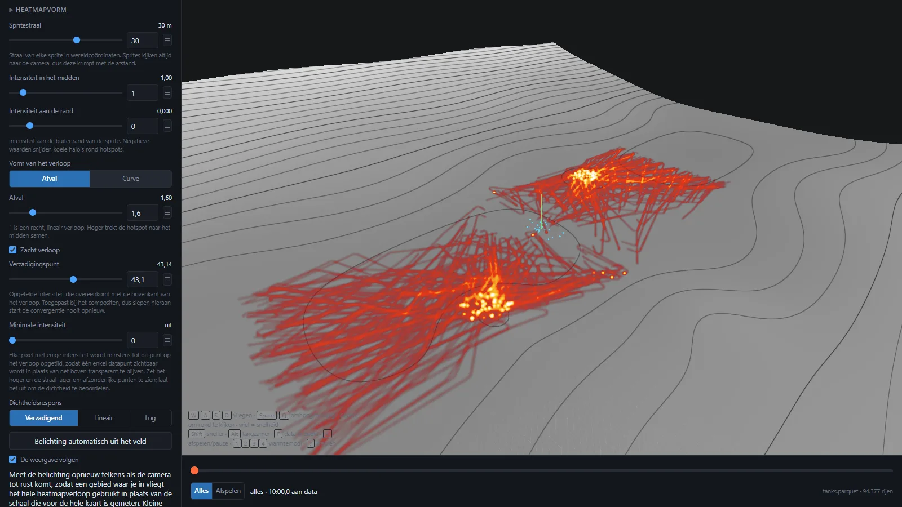
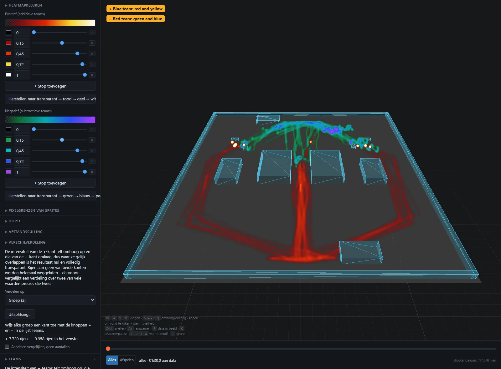
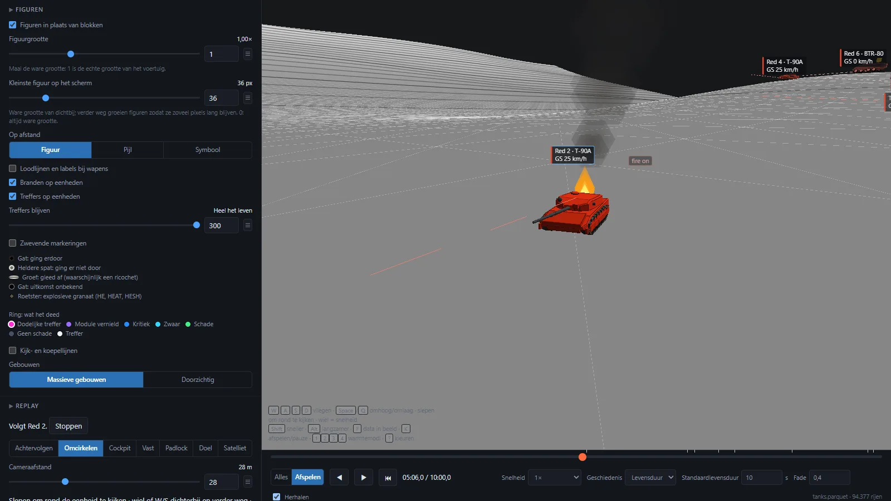
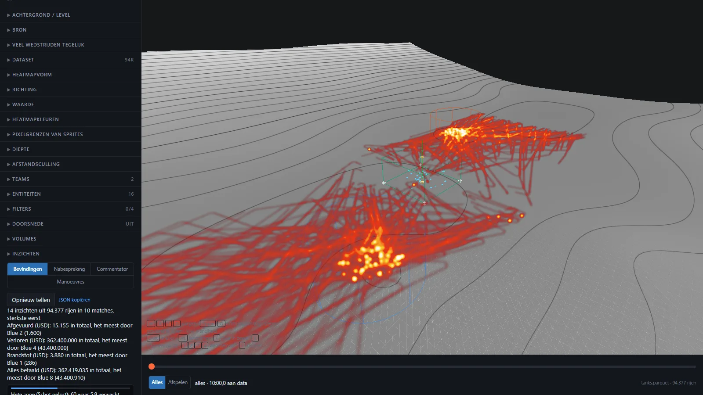
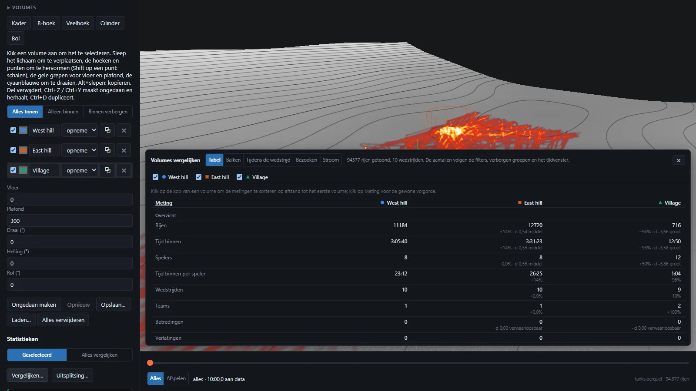
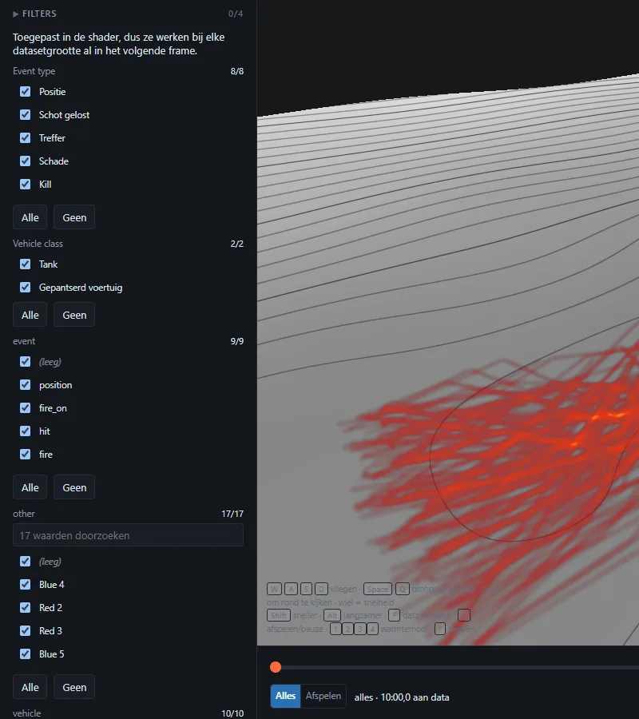
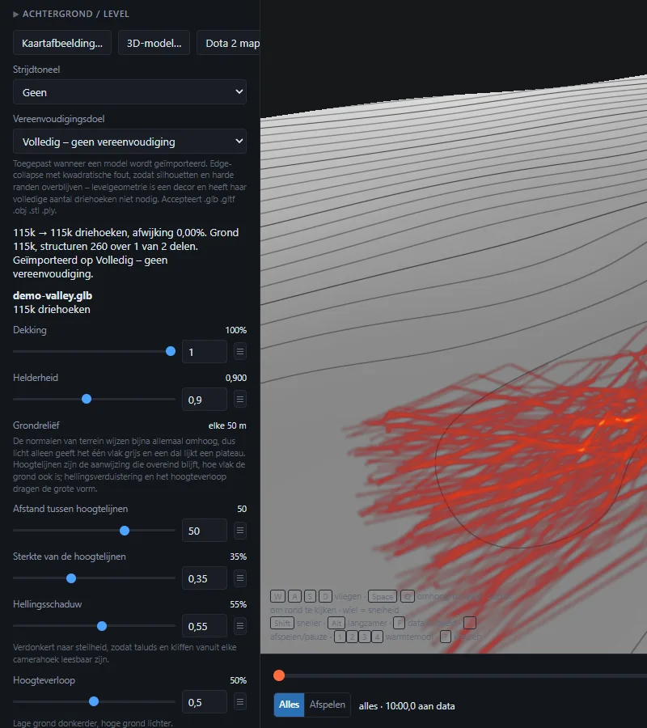

# 3DHeat

3DHeat laat zien waar dingen in een spel gebeurden - waar spelers heen gingen, vochten en vielen - als gloeiende kleuren waar je doorheen kunt vliegen, of als kleine 3D-figuurtjes die de wedstrijd opnieuw afspelen.

Laad posities in - CSV, Parquet, Tacview-opnamen, omgezette replays, een enkel bestand, een map of duizenden wedstrijden - en bekijk ze als een **heatmap waar je doorheen kunt vliegen**, als **figuren die de wedstrijd opnieuw afspelen**, als lijnen langs de routes die mensen namen, of als de ene groep tegenover de andere. Het vindt zelf wat opvalt, en het draait volledig in je browser: er wordt niets ergens naartoe geüpload.



**Nieuw hier?** Maak de [demodata](demo-data.md) en volg de zeven stappen. Elke afbeelding op deze site is ermee gemaakt.

## Wat het doet {#what-it-does}

| | |
|---|---|
|  | **[Warmtemodi](heat-modes.md)** - warmte, [verschil](difference.md) (rood waar de ene kant vaker was, groenblauw waar de andere kant vaker was), [teamwarmte](team-heat.md), [lijnwarmte](line-heat.md); [richtingswarmte](directional-heat.md) met wiggen, pijlvelden en poolgrafieken; warmte [gewogen naar waarde](value-weighting.md): wat wapens, voertuigen en brandstof kosten. |
|  | **[Wedstrijdreplay](match-replay.md)** - elke eenheid als de [figuur](figures.md) van wat het is, NAVO- of Russische symbolen op afstand, raketten en tracers, treffermarkeringen, wrakken, branden, torentjes, doelen en camera's in Tacview-stijl en een tactische weergave; [veel wedstrijden tegelijk](many-matches.md). |
|  | **[Inzichten](insights.md)** - sterke posities, dodelijke grond, spawnvallen, knelpunten en opvallende spelers, gevonden en gerangschikt met het bewijs; een geschreven nabespreking, optioneel door een AI naar keuze; een caster voor één wedstrijd; de [kennislens](knowledge.md). |
|  | **[Volumes](volumes.md)** - teken dozen, prisma's, cilinders en bollen, filter erop, tel wat erin gebeurt, exporteer het en vergelijk plaatsen naast elkaar; een [uitsplitsing](breakdown.md) van wie en wat het best doet op een plek. |
|  | **[Filters](filters.md)** - op gebeurtenistype, speler of AI, voertuigklasse, waarde, elke kolom, in de videokaart bij elke datagrootte. |
|  | **[Niveaus](levels.md)** - kaartafbeeldingen, 3D-niveaus gemaakt met de [datatools](#related-repositories), vereenvoudiging, de [wereldachtergrond](world-backdrop.md) met echt terrein voor vluchtdata. |

Verder: het tabblad [Race-analyse](race-analysis.md) voor rondes van racespellen, het tabblad [Match](match-analysis.md) voor samenvattingen van Counter-Strike 2, het [Tactiekbord](tactics-board.md) voor plannen op een niveau, [trefferanalyse](hit-analysis.md) per voertuig, [massa-analyse](mass-analysis.md) van duizenden wedstrijden, [camerapaden en video](camera-path-and-video.md), [40 talen](languages.md), [metrische of imperiale eenheden](settings.md).

## De tabbladen {#the-tabs}

De tabbladen staan bovenaan de zijbalk, onder de naam, de eenheden en het taalmenu.

| Tabblad | Waarvoor het is |
|---|---|
| **Heatmap** | Elke positionele tabel: de warmtemodi, de figurenoverlay, filters, volumes, inzichten, niveaus, meten en video. |
| **Race-analyse** | Twee of meer rondes van één baan: waar tijd verloren gaat, waarom, en wat je moet veranderen. |
| **Match** | De figuurreplay van een wedstrijd, en samenvattingen van Counter-Strike 2-wedstrijden. |
| **Tactiek** | Plannen op een niveau: figuren, routes, gegooide hulpmiddelen, gebieden en notities in stappen die afspelen. |
| **Voertuigen** | Waar elke eenheid is geraakt, door wie en met wat. |

## Installeren en starten {#install-and-run}

### Windows, de makkelijke manier {#windows-the-easy-way}

De hoofdmap van de repository bevat drie batchbestanden.

| Bestand | Wat het doet |
|---|---|
| `start.bat` | Start de viewer. Vindt Node.js ook als het niet op `PATH` staat (het zoekt in `%ProgramFiles%\nodejs`, `%ProgramFiles(x86)%\nodejs` en `%LOCALAPPDATA%\Programs\nodejs`), en als Node.js ontbreekt, biedt het aan de LTS-versie te installeren met `winget install -e --id OpenJS.NodeJS.LTS`. Bij de eerste keer vraagt het of de afhankelijkheden gedownload mogen worden (ongeveer 300 MB in `node_modules\` binnen de map, niets systeembreed). Het weigert te starten als er al iets op poort 5273 luistert, en verwijst dan naar `restart.bat`. Als de map een git-checkout is zonder lokale wijzigingen en er is een nieuwere versie, vraagt het of je wilt bijwerken (J/N; zonder antwoord binnen 60 s blijft deze versie; zie [Updates](updates.md)). Daarna draait het de dev-server op `http://127.0.0.1:5273/` en opent de browser. **Het venster is de server**: laat het open, sluit het of druk op Ctrl+C om te stoppen. |
| `restart.bat` | Draait `stop.bat quiet` en daarna `start.bat`. Alleen nodig na een wijziging in `vite.config.ts`, na het toevoegen van een afhankelijkheid, of als de server is vastgelopen - bronwijzigingen worden direct ingeladen. |
| `stop.bat` | Stopt wat op poort 5273 luistert, via het proces-id dat met `netstat` wordt gevonden, nooit op naam van het programma, zodat andere Node.js-processen op de computer met rust gelaten worden. Wacht ongeveer twee seconden tot de socket vrijkomt. Met het argument `quiet` pauzeert het niet aan het eind. |

### Met de hand (elk besturingssysteem) {#by-hand-any-os}


```bash
git clone --recursive https://github.com/Holdi601/3DHeat.git
cd 3DHeat
npm install
npm run dev      # http://127.0.0.1:5273
```

De map `exporters/` bevat de aparte datatools als git-submodules, elk een eigen repository; voer na een gewone kloon `git submodule update --init` uit. De viewer zelf heeft ze niet nodig om te draaien. `exporters/ext/` bevat de optionele converters (War Thunder, World of Tanks, World of Warships, Squad-replays; DCS- en IL-2-kaarten), apart gehouden zodat een probleem met de ene niets met de andere te maken heeft.

Er komt geen spelgegeven mee: niveaus, kaarten en opnamen worden op je eigen computer gemaakt met de tools, uit spellen die je bezit.

### npm-scripts {#npm-scripts}

| Script | Wat het draait |
|---|---|
| `npm run dev` | De Vite-dev-server op poort 5273, gebonden aan `127.0.0.1`. |
| `npm run build` | Typecontrole (`tsc --noEmit`) en een productiebundel in `dist/`. |
| `npm run preview` | Serveert de productiebundel. |
| `npm run typecheck` | Alleen de typecontrole. |
| `npm test` / `npm run test:watch` | Unit- en integratietests (vitest). |
| `npm run smoke` | Bestuurt de echte app in headless Chromium en controleert of het canvas datakleurige pixels heeft; schermafbeeldingen gaan naar `tools/.smoke/`. Verwacht dat de dev-server draait. |
| `npm run smoke:f16` | Dezelfde suite met `?heat=f16`, die het half-float-accumulatiepad forceert (zie [Half-float-accumulatie](half-float-accumulation.md)). |
| `npm run bench` | Inlees-benchmark, schrijft `tools/.smoke/ingest-bench.json`. |
| `npm run test:heavy` | Tests die grote echte databestanden nodig hebben; ze slaan zichzelf over als de bestanden ontbreken. |
| `npm run inspect -- <file.parquet>` | Print het schema van een Parquet-bestand en een paar rijen (`tools/inspect-parquet.mjs`). |

### Wat de dev-server toevoegt {#what-the-dev-server-adds}

De viewer is een statische webpagina, maar de dev-server (zie `vite.config.ts`) voegt twee lokale routes toe die een statische publicatie van `dist/` niet heeft:

- `/__host/memory` meldt het geïnstalleerde en vrije RAM van de computer en, waar het dat kan lezen, het geheugen van de videokaart (van `nvidia-smi`, of op Windows uit het register van de beeldschermadapter). Daardoor kunnen de [geheugenbudgetten](memory-and-budgets.md) echte cijfers gebruiken in plaats van de begrensde schattingen van de browser.
- `/__heat3d/update` controleert of de checkout achterloopt en kan hem met fast-forward bijwerken ([Updates](updates.md)).

De server bindt alleen aan `127.0.0.1`, dus geen van beide routes is vanuit het netwerk te bereiken. Open hem als `http://127.0.0.1:5273`: `localhost` kan naar de IPv6-loopback `::1` wijzen, waar niets luistert. Hij stuurt geen cross-origin-isolatiekoppen (COOP/COEP): niets in de viewer gebruikt `SharedArrayBuffer`, en de workers geven hun data over door overdracht, waarvoor het niet nodig is.

## Eisen aan browser en GPU {#browser-and-gpu-requirements}

- **Een browser met WebGPU of WebGL2.** WebGPU wordt eerst geprobeerd (Chrome en Edge hebben het); zonder WebGPU wordt het WebGL2-backend gebruikt. WebGL2 moet `EXT_color_buffer_float` aanbieden (renderen naar float-texturen), anders toont de viewer "Kan de renderer niet initialiseren." Zie [De twee backends](backends.md). De viewer wordt ontwikkeld en getest in Chromium; andere browsers zijn niet geverifieerd.
- **Hardwareversnelling ingeschakeld.** Wanneer de browser op de CPU tekent (SwiftShader, llvmpipe, de Microsoft Basic Render Driver en dergelijke) staat er een rode balk bovenaan de zijbalk die dat zegt en hoe het op te lossen. Zie [Detectie van softwarerendering](software-rendering.md).
- **Een aparte GPU helpt, maar is niet verplicht.** Beide backends vragen om de adapter met hoge prestaties. De hoeveelheid data die op de GPU past is een budget dat je kunt zien en wijzigen ([Geheugen en budgetten](memory-and-budgets.md)).
- **Optionele functies** gebruiken nog meer browser-API's: video-rendering heeft WebCodecs `VideoEncoder` met VP9 of VP8 nodig ([Camerapad en video](camera-path-and-video.md)); het vereenvoudigen van niveau-meshes heeft WebAssembly nodig; mappen slepen gebruikt de File and Directory Entries API; de niveaubibliotheek gebruikt IndexedDB; gamepads gebruiken de Gamepad API.

## Overzicht van de documentatie {#documentation-map}

**Begin**: [Demodata](demo-data.md) · [Gegevens binnenhalen](getting-data-in.md) ([bestanden laden](loading-files.md), [kolomtoewijzing](column-mapping.md), [assen, eenheden en tijd](axes-units-and-time.md), [sessies, personen en groepen](sessions-persons-groups.md), [Tacview](tacview-acmi.md), [converters](converters.md), [.3dheat](container.md), [geheugen en budgetten](memory-and-budgets.md))

**Bekijken**: [Warmtemodi](heat-modes.md) ([warmte](heat.md), [vorm van sprite](sprite-shape.md), [kleur en belichting](colour-and-exposure.md), [diepte en culling](depth-and-culling.md), [verschil](difference.md), [teamwarmte](team-heat.md), [lijnwarmte](line-heat.md), [box-replay](box-replay.md), [richtingswarmte](directional-heat.md), [waardeweging](value-weighting.md)) · [Tijdlijn](timeline.md) · [Niveaus](levels.md) ([kaartafbeeldingen](map-images.md), [3D-niveaus](model-levels.md), [uiterlijk](level-appearance.md), [bibliotheek](level-library.md), [wereldachtergrond](world-backdrop.md), [bronnen ervan](world-backdrop-sources.md)) · [Camera](camera.md) ([gamepad](gamepad.md), [toetsen](keyboard-reference.md)) · [Camerapad en video](camera-path-and-video.md)

**Analyseren**: [Filters en hulpmiddelen](filters-and-tools.md) ([filters](filters.md), [teams](teams-list.md), [entiteiten](entities.md), [snede](slice.md), [meten](measure.md), [volumes](volumes.md), [uitsplitsing](breakdown.md)) · [Inzichten](insights.md) ([kennislens](knowledge.md)) · [Massa-analyse](mass-analysis.md)

**Replay**: [Wedstrijdreplay](match-replay.md) · [Veel wedstrijden tegelijk](many-matches.md) · [Figuren](figures.md) ([in de figurenoverlay](figure-replay.md), [credits](figure-credits.md)) · [Tacview-gelijkwaardigheid](tacview-parity.md) · [Trefferanalyse](hit-analysis.md)

**Andere tabbladen**: [Race-analyse](race-analysis.md) ([de methode](race-analytics.md), [andere spellen](other-games.md)) · [Wedstrijdanalyse](match-analysis.md) · [Tactiekbord](tactics-board.md) ([snelheden](tactics-speeds.md))

**De viewer**: [Woordenlijst](glossary.md) · [Instellingen, eenheden en toetsen](settings.md) · [Talen](languages.md) · [Updates](updates.md) · [Renderinginterne werking](rendering-internals.md) ([backends](backends.md), [accumulatie](accumulation.md), [bemonstering en budgetten](sampling-and-budgets.md), [half-float](half-float-accumulation.md), [GPU-geheugen](gpu-memory.md), [softwarerendering](software-rendering.md), [prestaties en statistieken](performance-and-stats.md)) · [Gegevensformaten](data-formats.md) · [Referentie](reference.md) · [De documentatie onderhouden](maintaining.md)

## Gerelateerde repositories {#related-repositories}

De viewer leest data; deze tools maken ze. Elk is een eigen openbare repository (MIT) met eigen documentatie. Geen van hen levert spelgegevens mee: niveaus, kaarten en opnamen worden op je eigen computer gemaakt, uit spellen die je bezit.

| Repository | Wat het doet | Handig voor |
|---|---|---|
| [3DHeat-GameFiles](https://github.com/Holdi601/3DHeat-GameFiles) | Leest banen en niveaus uit de archieven die spellen meeleveren (Forza Horizon, BeamNG, Assetto Corsa Rally; lezers voor Unreal, Unity, Frostbite en Source 2) als glTF | een 3D-niveau onder je warmte of replay |
| [3DHeat-GameCapture](https://github.com/Holdi601/3DHeat-GameCapture) | Legt rondetelemetrie vast uit de interfaces die racespellen publiceren, en bouwt niveaus opnieuw op uit gameplayvideo | rondes voor Race-analyse; een niveau waar geen bestanden gelezen kunnen worden |
| [3DHeat-UnrealExporter](https://github.com/Holdi601/3DHeat-UnrealExporter) | Unreal Editor-plug-in die een niveau exporteert als één glTF-bestand | niveaus van je eigen Unreal-projecten |
| [3DHeat-CS2](https://github.com/Holdi601/3DHeat-CS2) | Counter-Strike 2-demo's naar warmtetabellen en wedstrijdsamenvattingen, CS2-kaarten naar geometrie | CS2-warmte, replays en het tabblad Match |
| [3DHeat-Watcher](https://github.com/Holdi601/3DHeat-Watcher) | Legt je spel op de achtergrond vast uit wat spellen publiceren: telemetrie, game-state-integraties, logs, replays | je eigen statistieken zonder iets met de hand te doen |
| [3DHeat-Ext-WarThunder](https://github.com/Holdi601/3DHeat-Ext-WarThunder) | War Thunder-replays (`.wrpl`) naar tabellen: lucht- en grondroutes, schoten, treffers, kills, torentjes, doelen | War Thunder-replays, trefferen en inzichten |
| [3DHeat-Ext-WoT](https://github.com/Holdi601/3DHeat-Ext-WoT) | World of Tanks-replays naar tabellen: de positie van elk voertuig, sterfgevallen en kills | World of Tanks-warmte en -replays |
| [3DHeat-Ext-WoWs](https://github.com/Holdi601/3DHeat-Ext-WoWs) | World of Warships-replays naar tabellen: de positie van elk schip en zinkingen | World of Warships-warmte en -replays |
| [3DHeat-Ext-Squad](https://github.com/Holdi601/3DHeat-Ext-Squad) | Squad-serverdemo's naar tabellen: de positie, het team en de squad van elke speler | Squad-warmte en -replays |
| [3DHeat-Ext-DCS](https://github.com/Holdi601/3DHeat-Ext-DCS) | DCS World-terreinen uit je eigen installatie naar niveaus: grond, wegen, steden, vliegvelden, velden, water | DCS- en Tacview-opnamen op hun echte terrein |
| [3DHeat-Ext-IL2](https://github.com/Holdi601/3DHeat-Ext-IL2) | IL-2 Great Battles-kaarten naar niveaus | IL-2-opnamen op hun kaart |

## Kort over de broncode-indeling {#source-layout-briefly}

| Map | Inhoud |
|---|---|
| [`src/data/`](https://github.com/Holdi601/3DHeat/tree/main/src/data) | Bestandskeuze, CSV- en Parquet-inlezen, automatisch toewijzen, validatie, geheugenmodel, datasetbouwer, modelverwerking, classificatie, vereenvoudiging, niveaubibliotheek |
| [`src/render/`](https://github.com/Holdi601/3DHeat/tree/main/src/render) | De beeldlus (`engine.ts`), bemonstering, beide backends, camera, gamepad, meten, camerapad, videoopname |
| [`src/state/`](https://github.com/Holdi601/3DHeat/tree/main/src/state) | De applicatiestatus (`store.ts`) met elke standaardwaarde, de domeintypen (`types.ts`), de spritecurve |
| [`src/ui/`](https://github.com/Holdi601/3DHeat/tree/main/src/ui) | De zijbalkpanelen, tijdlijn, lagen |
| [`src/race/`](https://github.com/Holdi601/3DHeat/tree/main/src/race), [`src/match/`](https://github.com/Holdi601/3DHeat/tree/main/src/match) | De tabbladen Race-analyse en Match |
| [`src/i18n/`](https://github.com/Holdi601/3DHeat/tree/main/src/i18n) | Vertalingen |
| [`src/insights/`](https://github.com/Holdi601/3DHeat/tree/main/src/insights) | Inzichten: detectoren, nabespreking, caster, AI-providers, de kennislens |
| [`src/mass/`](https://github.com/Holdi601/3DHeat/tree/main/src/mass) | Massa-analyse over veel wedstrijden |
| [`src/volumes/`](https://github.com/Holdi601/3DHeat/tree/main/src/volumes) | Volumes, hun statistieken, export en vergelijking |
| [`src/breakdown/`](https://github.com/Holdi601/3DHeat/tree/main/src/breakdown) | Uitsplitsing en factoren |
| [`src/overlay/`](https://github.com/Holdi601/3DHeat/tree/main/src/overlay) | De overlay voor veel wedstrijden |
| [`src/figures/`](https://github.com/Holdi601/3DHeat/tree/main/src/figures) | De figuurcatalogus en de bouwer ervan |
| [`src/vehicle/`](https://github.com/Holdi601/3DHeat/tree/main/src/vehicle) | Trefferanalyse (tabblad Voertuigen) |
| [`src/tactics/`](https://github.com/Holdi601/3DHeat/tree/main/src/tactics) | Het tactiekbord |
| [`src/world/`](https://github.com/Holdi601/3DHeat/tree/main/src/world) | De wereldachtergrond |
| [`src/units/`](https://github.com/Holdi601/3DHeat/tree/main/src/units) | Meeteenheden |
