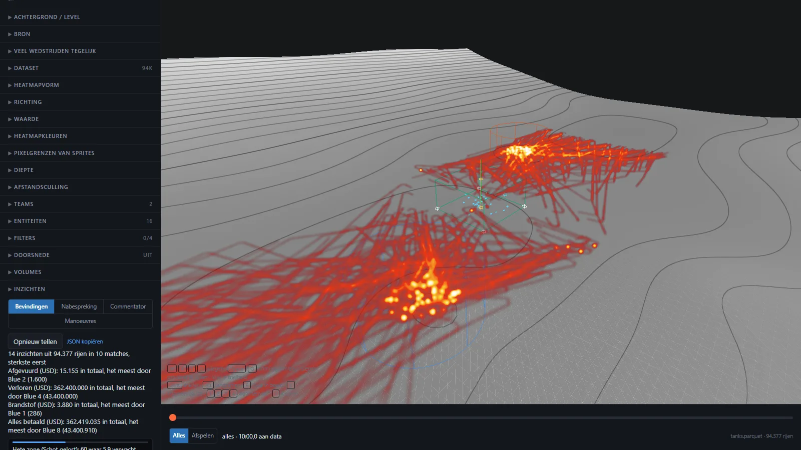
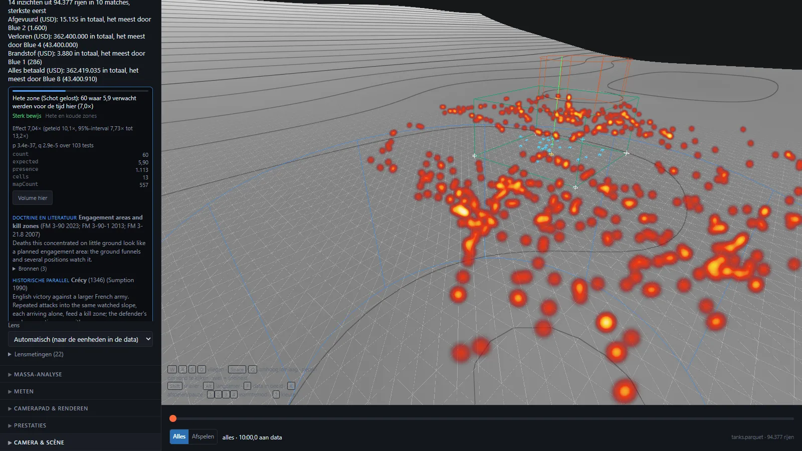
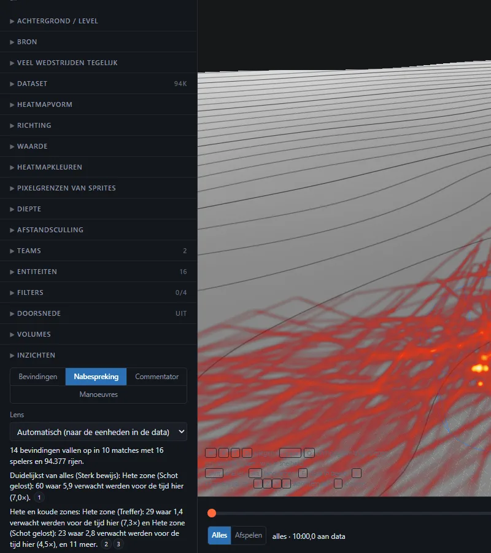
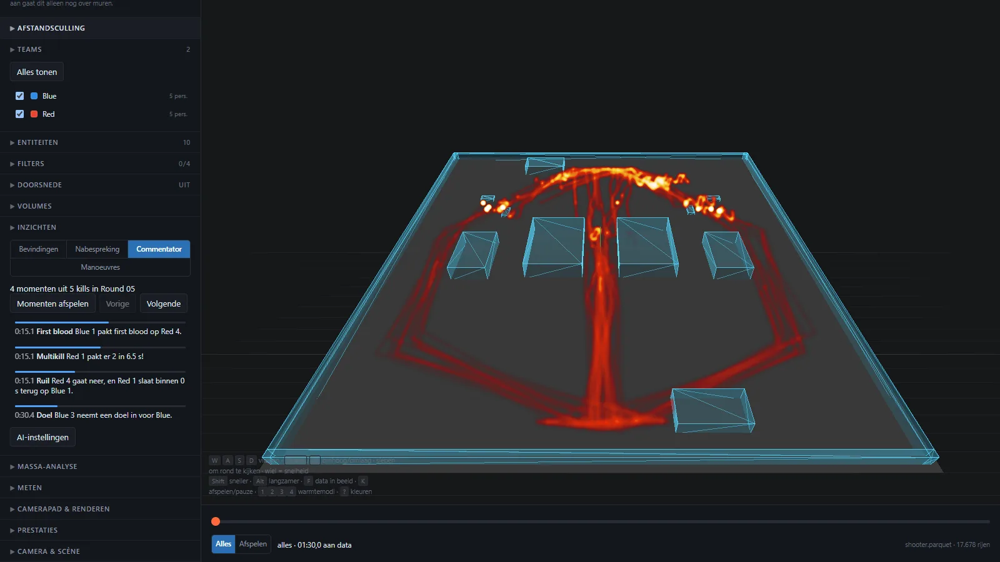

# Inzichten

**Inzichten** zoekt in de geladen data naar wat opvalt - sterke posities, dodelijke grond, spawnvallen, knelpunten, spelers die ver boven hun leeftijdsgenoten uitsteken - en vertelt het je, het sterkste eerst, met het bewijs. Gebruik het om in een minuut te leren waar een wedstrijd gewonnen of verloren werd. Daarna kan het een nabespreking schrijven, en bij één replay kan het optreden als commentator die naar de grote momenten springt.

Alles wordt in je browser geteld. Niets verlaat je computer tenzij je een externe AI aanzet (zie [Externe AI](#external-ai)).

Het gedeelte **Inzichten** staat in de zijbalk van de tabbladen Heatmap en Match. Het heeft drie tabbladen: **Bevindingen**, **Nabespreking** en **Commentator**.

## Bevindingen {#findings}

1. Laad data en open **Inzichten**. Druk op **Inzichten zoeken** (de voortgang toont "Tellen… n%").
2. Lees de lijst. Elke bevinding heeft een sterkte-balk, een zin, hoe goed het bewijs is (*Sterk bewijs*, *Goed bewijs* of *Enig bewijs*), welke detector hem vond, en de voertuigklasse waar dat ertoe doet.
3. **Klik op een bevinding**: de viewer past de filters toe, vliegt de camera naar de plek en springt naar het tijdstip, en opent de details: het effect met zijn interval van 95%, de p- en q-waarden, het geteld bewijs, en **Volume hier**, dat een [volume](volumes.md) rond de plek tekent.
4. **Filters herstellen** zet je filters terug. **JSON kopiëren** kopieert het volledige rapport.

Het tellen gebruikt de huidige filters, verborgen groepen en gekozen wedstrijd over het volledige tijdsbereik. Als je de filters daarna wijzigt, zegt een notitie dat; druk dan op **Opnieuw tellen**.

De regels bovenaan de lijst (bijvoorbeeld de geldtotalen) vatten de volledige data samen voor de bevindingen.

### De detectors {#the-detectors}

| Detector | Wat het vindt | Nodig in de data |
|---|---|---|
| **Machtsposities** | Plekken met veel betere kill-tegen-dood-kansen dan de rest van de kaart, en *veilige grond* waar weinig sterven voor de tijd die er doorgebracht wordt | kill- en doodgebeurtenissen |
| **Hete en koude zones** | Plekken waar een soort gebeurtenis (schoten, treffers, veroveringen ...) veel vaker of minder vaak voorkomt dan de tijd die er doorgebracht wordt voorspelt | een gebeurteniskolom |
| **Open terrein en dekking** | Doden in het open tegen nabije geometrie van het niveau, en traag tegen snelle beweging | doden; een 3D-niveau voor het geometriedeel |
| **Spawns** | Sterke spawns, spawnvallen, veilige spawns, tijd tot het eerste contact | tijd en personen |
| **Klasse per plek** | Een voertuigklasse, of spelers tegen AI, die in een gebied veel beter of slechter doen | kills plus een voertuigklasse- of speler/AI-kolom |
| **Spelers** | Spelers die veel meer of minder doden of sterven dan anderen in dezelfde klasse | personen en kills |
| **Knelpunten en flanken** | Knelpunten (veel meer doorgangen dan de grond eromheen) en flankroutes (zelden gebruikt, maar leiden tot kills) | personen |
| **Waarde** | *Kostbare grond* en *Opbrengende grond* | [waardekolommen](value-weighting.md) |
| **Wat de rondes besliste** | Wat gewonnen van verloren rondes scheidde, en de spelers die de meeste winkans toevoegden of kostten (zie [Wie won](#who-won-what-decided-the-rounds)) | rondes, kills en doden, en de [uitkomstkolommen](data-formats.md#outcome-columns) (`won`) |

Detectors die niet op de data kunnen draaien staan onderaan met de reden.

### Hoe bevindingen gerangschikt worden {#how-findings-are-ranked}

Elke plek of groep wordt getoetst tegen de rest van de kaart (exacte binomiale of snelheidstoetsen). Het vals-ontdekkingspercentage wordt op 5% gehouden (Benjamini-Hochberg). Toeval kan op een patroon lijken; dit houdt valse alarmen laag: onder de getoonde bevindingen wordt verwacht dat hooguit ongeveer één op de twintig op toeval berust. Effecten uit weinig gebeurtenissen worden vóór het rangschikken naar "geen effect" toe getrokken. Er worden hoogstens 60 bevindingen getoond, en elke detector krijgt een paar plekken bovenaan.

### Wie won: wat de rondes besliste {#who-won-what-decided-the-rounds}

Waar de data zegt wie elke ronde won (de [uitkomstkolom](data-formats.md#outcome-columns) `won`: CS2, Rainbow Six Siege, War Thunder ...), draait Inzichten om de uitslag. Voor elke kant splitst het de rondes op naar wat er in gebeurde en vergelijkt het de winpercentages:

| Factor | De rondes van de kant mét | ... en zonder |
|---|---|---|
| Openingsduel | ze maakte de eerste kill | ze stierf als eerste |
| Aankoop | haar aankoop was beter dan die van de andere kant | slechter |
| Gewroken eerste dood | haar eerste dood werd binnen 5 s gewroken | niet gewroken |
| Plant | ze plantte | geen plant |
| Utility | meer granaten dan in haar gewone ronde | minder |
| Vroeg contact | het eerste duel kwam vóór de mediane tijd van de wedstrijd | later |
| Een vastgehouden plek | een speler stond 5 s of langer op de plek | niemand |
| Een vroeg bereikte plek | een speler kwam er in de eerste 25 s (de route) | niemand |

Elke vergelijking is een verschil van twee winpercentages met zijn 95%-interval (Newcombe), Fishers exacte p en een q over alle geprobeerde factoren (Benjamini-Hochberg). Een tak met minder dan 8 rondes krijgt het label *weinig rondes*. Wat onder de foutieve-ontdekkingsratio van 5% blijft, wordt een bevinding; de sterkste staan boven die van de andere detectors (een uitkomstbevinding weegt 1,35 keer zoveel als een met hetzelfde effect en bewijs).

Een verzonnen voorbeeld over 40 rondes:

> **T** won 79% van de 19 rondes waarin het **Mid** hield, tegen 24% van 21 zonder (55 punten, 95% 26 tot 74) - q 0,004.

Het volgt ook de **winkans** van de ronde - de kans die elke kant op elk moment had, uit de levende spelers, de plant en de klok: aangepast aan de rondes als het er 30 of meer zijn, anders een vast voorafmodel (en de tekst zegt welk). Daaruit komen de **kantelpunten** (de kills en plants die de kans het meest verschoven) en de **toegevoegde winkans** van elke speler: de kills en plants die hij maakte tellen voor hem, zijn doden tegen hem, in rondes over de wedstrijd, een ronde gemiddeld met zijn interval, getoetst tegen nul. De plekken krijgen dezelfde balans: welke kant het meest won in de duels die daar werden uitgevochten.

De data heeft rondes, kills en doden met beide kanten nodig, en de kolom `won`; benoemde plekken (`place`) voor vastgehouden plekken, een kolom `buy` voor de aankoop.

## Nabespreking {#debrief}

Het tabblad **Nabespreking** schrijft de bevindingen uit als korte tekst: een inleiding, de duidelijkste bevinding, één voor tactiek, één voor balans, dan - waar de data zegt wie won - wat de rondes besliste, de rest gegroepeerd per detector, en hoeveel er op zwakker bewijs rusten.

Wat de rondes besliste komt in vier alinea's: de stand en waar de winkansen vandaan komen; de sterkste factoren met hun getallen, interval en q (als er geen door de foutieve-ontdekkingsratio komt, zegt de tekst *niets daarvan is al zeker*, en noemt toch de sterkste); de drie grootste kantelpunten; en de spelers die de meeste winkans toevoegden en kostten, met de plekken die het meest wonnen. Een verzonnen voorbeeld:

> T won 23 en CT won 17 van 40 rondes met een bekende uitslag (T: 58%, 95% 42% tot 72%). De winkansen komen uit een model dat aan deze rondes is aangepast.
>
> Wat gewonnen van verloren rondes scheidde: T won 79% van de 19 rondes waarin het Mid hield, tegen 24% van 21 zonder (55 punten, 95% 26 tot 74) (q 0,004), ...
>
> Kantelpunten: ronde 17 op 48 s, een kill door CT bij B site verschoof zijn kans van 31% naar 58%, en het pakte de ronde, ...

Elke alinea heeft genummerde knoppen die de bevindingen tonen. **Tekst kopiëren** kopieert hem.

De ingebouwde verteller werkt offline, in jouw taal. De keuzelijst **Lens** erboven (zie [De kennislens](knowledge.md)) bepaalt welke literatuur de alinea's citeren.

### Externe AI {#external-ai}

**AI-instellingen** laat een AI-model naar keuze de nabespreking schrijven:

| Instelling | Betekenis |
|---|---|
| **Aanbieder** | Anthropic (Claude), OpenAI (ChatGPT), OpenRouter, Ollama (lokaal), LM Studio (lokaal), llama.cpp-server (lokaal), of elk OpenAI-compatibel eindpunt |
| **Basis-URL**, **Model** | Ingevuld door de aanbieder; **Modellen tonen** vraagt de server |
| **API-sleutel** | Wordt alleen naar de basis-URL gestuurd. Nooit gelogd, nooit bewaard in weergaven, exports of `.3dheat`-bestanden. De meeste lokale servers hebben er geen nodig. |
| **Sleutel onthouden in deze browser** | Standaard uit: de sleutel wordt vergeten zodra de pagina sluit |
| **Een externe AI gebruiken** | Standaard uit |
| **Spelersnamen meesturen** | Standaard uit: spelers worden als P1, P2 ... gestuurd |

Typ daarna eventueel een vraag en druk op **Schrijven met AI**. Alleen de bevindingen en hun getallen worden verstuurd - nooit de rijen van je data. Het antwoord komt binnen als stroom; genoemde bevindingen worden knoppen. Waar de data zegt wie won, krijgt het model de opdracht te beginnen met wat de rondes besliste, met het interval en de q van elk getal, en te zeggen wanneer een factor op weinig rondes rust of de winkansen uit het voorafmodel komen.

## Commentator {#caster}

Voor **één wedstrijd** (kies er één als er meerdere geladen zijn) zoekt de **Commentator** de momenten die het waard zijn om te bekijken: eerste bloed, multi-kills, ruilen, clutches, wendingen bij doelen, comebacks, opvallende spelers, lange schoten en **kantelpunten** - de kills die de kans van een kant om de ronde te winnen het meest verschoven (naar de spelers die aan elke kant nog leven, in rondes zonder respawns).

Waar de data zegt wie elke ronde won, zegt elk moment het: *"Anna schakelt Ben uit: de kans van T om de ronde te winnen gaat van 38% naar 62% - en ze pakken de ronde."* Een moment van de kant die daarna won telt zwaarder als de commentator kiest welke hij houdt, en een comeback wordt geteld in gewonnen rondes.

- Klik op een moment: de weergave schakelt naar de replay, springt naar even vóór het moment, vliegt erheen en volgt de speler.
- **Momenten afspelen** speelt elk moment tot het eind en gaat door; **Vorige** / **Volgende** lopen erdoorheen.
- Met een externe AI aan schrijft **Commentaar door AI** een commentaar uit de lijst met momenten (soorten, tijden, namen of pseudoniemen, teams, klassen, afstanden).

Er zijn personen en kill-/doodgebeurtenissen (of veroveringen) voor nodig; een kolom `other`/`victim` maakt ruilen en lange schoten mogelijk.

## De kennislens {#knowledge-lens}

Een bevinding kan door een **lens** van gevestigde kennis gelezen worden: militaire doctrine, lucht- en zeegevechten, stedelijke operaties, spelontwerp en e-sport (of *Auto*, gekozen door de eenheden in de data). Een geopende bevinding toont dan het dichtstbijzijnde **doctrine- en literatuurfragment** en een **historisch parallel**, met verwijzingen, en **Lensmetingen** berekent maten uit die literatuur op de data (Lanchester-fits, uitwisselingsverhoudingen, krachtverhoudingen, schootsvelden, sleutelterrein, wederzijdse verliezen, initiatief). De nabespreking en de AI-prompt nemen ze mee. Alles hierover: [De kennislens](knowledge.md).

De lensmetingen meten ook hoe de spelers zich gedragen als menigte en als groep - uitlijning en rondcirkelen, routes die kuddes vormen, banen en sporen, opeenhoping, leiders en volgers, achterblijvers, het breekpunt onder verliezen, risico na een verloren leven, reeksen, aankoopovereenstemming en de reactie op binnenkomend vuur - elk tegen zijn eigen nulmodel: [Collectief gedrag](collective-behaviour.md).

## Data die inzichten mogelijk maakt {#data-that-makes-insights-work}

- posities met **tijd**, een **persoon** en een **team**-kolom;
- een **gebeurtenis**kolom met kills en doden (`kill`, `death`), en andere (`hit`, `fire`, `capture` ...);
- een kolom **andere partij** (`other`, `victim`) voor ruilen en richtingen;
- een **voertuig**- of **type**kolom voor klassen; een kolom `ai` voor spelers tegen AI;
- een **sessie**-/**wedstrijd**-/**ronde**kolom als er meerdere wedstrijden zijn.

De [demodata](demo-data.md) heeft ze allemaal.
