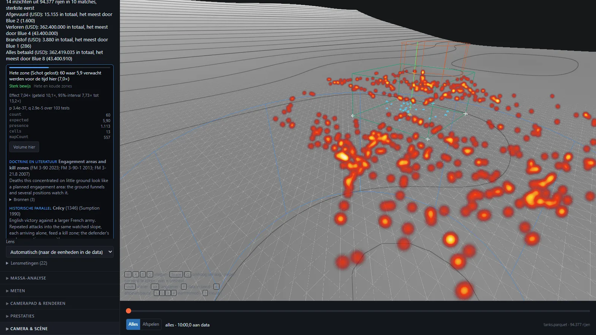

# De kennislens

Wanneer [Inzichten](insights.md) iets vindt, legt dit deel het uit met ideeën uit de militaire geschiedenis, spelontwerp en sportanalyse, en noemt het het boek of het artikel waar het vandaan komt. Gebruik het om te leren *waarom* een patroon telt, niet alleen dat het bestaat.

## Probeer het {#try-it}

1. Laad data en open **Inzichten**, en druk dan op **Inzichten zoeken**.
2. Klik op een bevinding om haar te openen.
3. Lees **Doctrine en literatuur** en **Historische parallel**; de volledige verwijzingen staan ingeklapt eronder.
4. Verander de **Lens** (bijvoorbeeld naar *Militaire doctrine*) om dezelfde bevinding door een andere literatuur te lezen.

## Hoe het werkt {#how-it-works}

Het paneel Inzichten beoordeelt zijn bevindingen zoals een beroepsanalist dat zou doen: via militaire doctrine en operationeel onderzoek, historische gevechten, en de literatuur over spelontwerp, leveldesign en analyse. Het doet dat offline, vanuit een samengestelde kennisbank in de viewer, en geeft hetzelfde materiaal aan een extern model wanneer dat de nabespreking schrijft.

## Wat het paneel toont {#what-the-panel-shows}

- **Lens** kiest de literatuur waardoor de bevindingen gelezen worden: *Auto* (gekozen op de soorten eenheden in de data: vliegtuigen, schepen, voertuigen op de grond, infanterie), *Militaire doctrine*, *Luchtgevecht*, *Marine*, *Stedelijk*, *Gamedesign en balans*, *Esports*. Items buiten de gekozen lens worden weggelaten.
- Elke geopende bevinding toont haar dichtstbijzijnde item uit **doctrine en literatuur** en haar dichtstbijzijnde **historische parallel**, met de volledige verwijzingen ingeklapt eronder.
- **Lensmetingen** somt de maten van operationele analyse op die over dezelfde rijen berekend zijn (hieronder), elk met wat het betekent en zijn literatuur.
- De **Nabespreking** voegt regels toe voor de belangrijkste bevindingen en de lensmetingen: "Doctrine en literatuur: ..." en "Historische parallel: ...", elk met citaten van auteur en jaar en de verwijzingen eronder ingeklapt.
- **Schrijven met AI** stuurt de meest relevante items (samenvatting, les, de bevindingen waarop ze slaan, volledige verwijzingen) mee met het rapport, en vraagt het model ze te citeren met hun id - `{concept.lanchester-square}` - en geen andere bronnen te gebruiken.

De labels zijn vertaald; de kennis zelf is Engels.

## Lensmetingen {#lens-metrics}

Berekend in de inzichtworker, in dezelfde doorloop over de rijen als de detectoren (`src/insights/lensMetrics.ts`). Elke wordt weggelaten als de data hem niet kan dragen.

| Meting | Wat het meet | Heeft nodig |
|---|---|---|
| Lanchester-fit | Het verlies van elke kant per 20 s, teruggeregresseerd op de levende sterktes van beide kanten (Poisson, quasi-aannemelijkheidsfouten); de exponenten voor vijandelijke en eigen sterkte, getoetst tegen de kwadratenwet (gericht vuur) en de lineaire wet (vlakvuur) | tijd, teams, kills en doden |
| Ruilverhouding | Kills per dood per kant en per plek; het aandeel doden op het gevaarlijkste terrein dat 5% van de bestede tijd beslaat, tegenover het aandeel dat alleen door toeval bij zoveel doden hoort; Gini van doden tegen de tijd; Moran's I van sterftecijfers | kills en doden |
| Lokale krachtsverhouding | Eigen en vijandelijke eenheden in leven binnen gevechtsafstand van elke kill (afstand uit de data: tweemaal de mediane afstand tot de dichtstbijzijnde vijand); het aandeel kills door de lokaal superieure kant, en de overschrijding daarvan boven wat alleen de aantallen voorspellen | tijd, teams, personen |
| Schootsvelden | Zichtvelden van de drukste killplekken op een 2,5D-oppervlak van obstructies (levelgeometrie tot wandhoogte, of het gelopen terrein) tegen de gemiddelde plek, en de rangcorrelatie van zicht en aandeel kills | posities; een geladen level maakt het scherper; niet voor de lucht |
| Energietoestand | Specifieke energie (hoogte plus de hoogte die snelheid kan kopen) van luchtdoders en luchtslachtoffers, vergeleken met de Mann-Whitney-statistiek | luchtvaartuigklassen, tijd, hoogte |
| Sleutelterrein | Hoe vaak elke plek bij de drie drukste killplekken van een match hoort | meerdere matches |
| Wederzijdse steun (trades) | Doden die beantwoord worden door een kill van een teamgenoot binnen de gevechtsafstand en 5 s | tijd, teams |
| Eerste slag | Gevechten - kills gegroepeerd per match, per 20 s rust en per drie gevechtsafstanden - gewonnen door de kant die als eerste scoorde | tijd, teams |
| Salvomodel | De salvovergelijking van Hughes, gefit op periodes van 20 s van schepen in contact: schepen buiten gevecht gesteld per aanvallend schip, en gered per verdedigend schip; een Lanchester-fit op schepen alleen | scheepsklassen, tijd, teams |
| Gevechtseffectiviteit | Kills per eenheid-uur in actie van elke kant en de verhouding van de twee grootste (een gevechtseffectiviteitswaarde in Dupuy's zin) met zijn 95%-interval, en het aandeel kills van elke kant bij gelijke lokale aantallen | tijd, teams |
| Gevechtsafstanden | Afstand tot de dichtstbijzijnde vijand bij kills, bij lanceringen en bij het eerste schot van elk leven (detectie tot betrokkenheid), per soort eenheid | tijd, teams; lanceringen waar de data die heeft |
| Killketen | Seconden van de laatste lancering van de doder tot de kill, en van zijn eerste schot in het gevecht tot de kill | tijd; lanceringen of vuurgebeurtenissen |
| Concentratie of spreiding | In elke periode van 20 s de spreiding van de twee grootste kanten en het aandeel kills van de dichtste | tijd, teams |
| Uitvliegingen | Per kant: uitvliegingen (opstijgingen, of spawns van vliegtuigen), landingen, verloren vliegtuigen en kills door vliegtuigen; verliesratio en kills per uitvliegning | vliegtuigklassen; opstijgingen of spawns |

Data met rondes voegt de maten voor nabije gevechten en esports toe - kans om de ronde te winnen, waarde van acties, openingsduels, trades, peeker tegen houder, mikken, kruisvuur, hulpmiddelen, mannenvoordeel, clutches, opstellingen, na de plant, fatale trechters en de invloed van spelers: zie [Nabije gevechten en rondes](close-quarters.md).

Tracks en teams voegen de maten van collectief gedrag toe uit de wetenschap van menigten, collectieve beweging, gedragseconomie en militaire psychologie - uitlijning en rondcirkelen, routes die kuddes vormen, banen en sporen, drukte, leiders en volgers, achterblijvers, het breekpunt, risico na verliezen, reeksen, aankoopovereenstemming en onderdrukking, elk tegen een eigen nulmodel: zie [Collectief gedrag](collective-behaviour.md).

Wapens, lokvogels en gebouwen tellen niet mee als eenheden. Waar wapenrijen hun lanceerende eenheid noemen (een kolom `Shooter` of `Launcher`, zoals data uit Tacview heeft), wordt de lancering aan die eenheid toegeschreven, herkend aan haar naam of object-id.

## Hoe bevindingen de literatuur ontmoeten {#how-findings-meet-the-literature}

Items en bevindingen komen samen via een **patroontaxonomie** (`src/insights/knowledge/patterns.ts`): concentratie, lokale overmacht, gericht en vlakvuur, knelpunten, killzones, schootsvelden, tegenhelling, flankeren, wederzijdse steun, energievoordeel, spawndruk, balans, enzovoort. Elke soort detector en elke lensmeting zegt welke patronen zijn cijfers tonen (`src/insights/lens.ts`); elk kennisitem zegt op welke patronen het ingaat, met een gewicht. De relevantie van een item voor een bevinding is de gewogen overlap, geschaald naar hoe goed het domein van het item (land, lucht, zee, stedelijk) bij de data past, en naar de eigen sterkte van de bevinding. De getoonde onderbouwing is de cijfers van de bevinding in één zin, gevolgd door de les van het item.

## Catalogus {#catalogue}

Elk patroon, concept, methode, historisch geval, ontwerpprincipe en studie, met de bibliografie: zie de [Kenniscatalogus](knowledge-catalogue.md).

## Voor ontwikkelaars {#for-developers}

### Items toevoegen {#adding-entries}

1. Kies het bestand naar type: `concepts.ts` en `concepts-more.ts`, `methods.ts`, `cases.ts`, `cases-land.ts`, `cases-air-sea.ts`, `cases-esports.ts`, `design.ts` (ontwerpprincipes) of `studies.ts` in `src/insights/knowledge/`.
2. Geef het een nieuwe id `<type>.<slug>` (gebruik er nooit een opnieuw), zijn lenzen, domeinen, en de patronen waar het op ingaat met gewichten 0..1. Voeg een patroon alleen aan `patterns.ts` toe als een bevinding het kan tonen, en koppel het vanuit een bevinding of meting in `lens.ts`.
3. Schrijf de samenvatting en de les **in je eigen woorden**. Citaten alleen uit werken in het publieke domein (`pd: true` in de verwijzing), en kort.
4. Citeer: voeg elk nieuw werk toe aan `refs.ts` met auteurs, jaar, titel en uitgever (tijdschrift met volume en pagina's); een URL of DOI waar er een openbare registratie is.
5. Draai `npx vitest run src/insights/lens.test.ts` (unieke id's, bekende patronen, verwijzingen die resolven, citaten uit het publieke domein, gevallen met datum en uitkomst) en `node tools/knowledge-doc.mjs` om de [catalogus](knowledge-catalogue.md) te vernieuwen.
