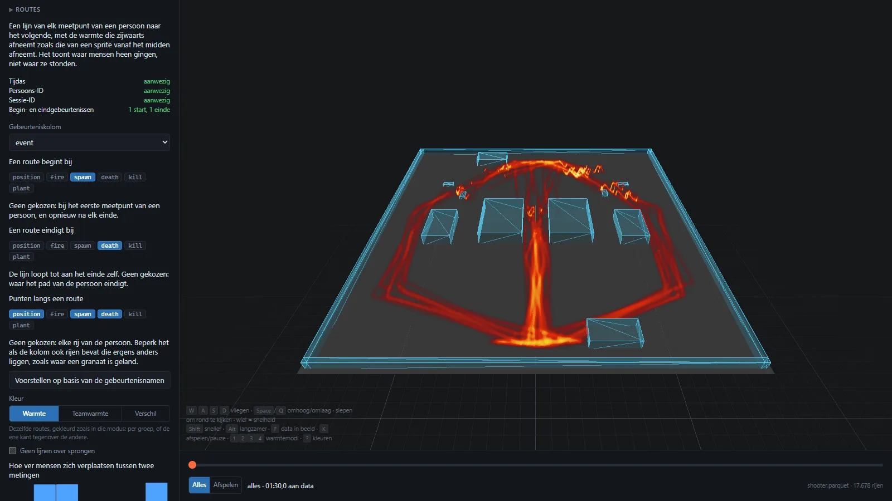

# Lijnwarmte

Warmte laat zien waar mensen stonden. Lijnen laat de paden zien die ze liepen.

**Lijnen** (toets 4) is lijnwarmte: een lijn van elk [persoonsmonster](glossary.md) naar het volgende, uitgesmeerd met dezelfde afvlakking die een [sprite](glossary.md) heeft - over de lijn in plaats van rond een punt. Het laat zien waar mensen *heen gingen* in plaats van waar ze stonden: een gang die één keer doorlopen is, is net zo zichtbaar als een kamer waar iemand gekampeerd heeft, en de schaarse monsters van een snelle speler sluiten aan tot een doorlopende route in plaats van een gestippeld spoor. Het heeft een persoonskolom en een tijdkolom nodig.

## Gebruik {#how-to-use-it}

1. Druk op `4` (of kies **Lijnen** in de modusbalk).
2. Open **Routes** en controleer de groene checklist: tijdas en persoons-id moeten aanwezig zijn.
3. Druk op **Voorstellen op basis van de gebeurtenisnamen** om in te vullen waar routes beginnen en eindigen.
4. Lees de statistiekregel: "N routes, M daarvan bereiken een einde".
5. Als lijnen over de kaart springen, pas dan **Langste stap** aan (zie [De sprongdrempel](#the-jump-limit)).

Een lijn heeft alleen zin tussen een begin en een einde, dus het paneel **Routes** zegt wat een route begrenst. Alles vanaf [De regels van een route](#the-rules-of-a-route) is detail dat je mag overslaan.

## Het paneel Routes {#the-routes-panel}

Het staat boven de warmtepanelen in de modus Lijnen.

### Wat de data heeft {#what-the-data-has}

Een checklist, groen als het er is, oranje als het ontbreekt:

| Regel | Staten |
|---|---|
| **Tijdas** | *aanwezig* / *ontbreekt - nodig* |
| **Persoons-ID** | *aanwezig* / *ontbreekt - nodig* |
| **Sessie-ID** | *aanwezig* / *geen - alle rijen zijn één sessie* |
| **Begin- en eindgebeurtenissen** | *N begin, M einde* / *niets gekozen - hele sporen* (groen alleen met een gebeurteniskolom en minstens één begin en één einde) |

### Bediening {#controls}

| Bediening | Betekenis |
|---|---|
| **Gebeurteniskolom** | Een categoriekolom waarvan de waarden gebeurtenissen zijn (spawn, dood, positie, ...). *Geen - hele sporen*: het spoor van elke persoon in elke sessie is één route, afgebroken waar het spoor een gat heeft. Alleen kolommen die bij het laden voor filteren bewaard zijn, worden aangeboden. |
| **Een route begint bij** | Gebeurteniswaarden die een route beginnen (spawn, herspawn, uitzetten). Niets gekozen: een route begint bij het eerste monster van een persoon, en opnieuw na elk einde. |
| **Een route eindigt bij** | Gebeurteniswaarden die een route beëindigen (dood, extractie, teleport). De lijn loopt tot de eindrij zelf. Niets gekozen: een route eindigt waar het spoor van de persoon eindigt. |
| **Punten langs een route** | Gebeurteniswaarden waarvan de rijen langs de route liggen. Niets gekozen: elke rij van de persoon. Versmal het als de kolom ook rijen bevat die ergens anders staan, zoals waar een granaat neerkwam. |
| **Voorstellen op basis van de gebeurtenisnamen** | Vult de drie lijsten in op basis van de namen van de waarden (hieronder). |
| **Kleur** | *Warmte*, *Teamwarmte* of *Verschil*. Dezelfde routes in de kleuring van die modus: elke groep in een eigen tint, of de ene kant tegenover de andere, met de groepslijst, de verdeling en de kleurbalken die werken zoals in die modi. Standaard *Warmte*. Teamwarmte en verschil hebben een groepskolom nodig. |
| **Geen lijnen over sprongen** / **Langste stap** | Een volgend monster van een persoon dat verder weg ligt dan dit, is een herspawn, een teleport of een val en geen plek waar ze heen liepen, dus er wordt geen lijn tussen beide getrokken. Wordt bij het laden ingevuld als de data een duidelijk gat toont (hieronder), en uit als dat niet zo is. Werkt met of zonder gebeurteniskolom. |
| Statistiekregel | `N routes, M daarvan bereiken een einde, K segmenten`, een paar keer per seconde bijgewerkt. |

Elke lijst is een rij schakelchips, één per waarde, het vaakst voorkomende eerst; als je met de muis over een chip zweeft, toont hij het aantal rijen. Er worden hoogstens 120 waarden aangeboden (*N meer waarden niet getoond*).

Als je een andere gebeurteniskolom kiest, past hij de suggestie toe wanneer de suggestie juist die kolom kiest, en begint hij anders met lege lijsten.

### De suggestie {#the-suggestion}

Bij elke load, en bij **Voorstellen op basis van de gebeurtenisnamen** ([`suggestLineSettings`](https://github.com/Holdi601/3DHeat/blob/main/src/data/lines.ts)):

- **Gebeurteniskolom:** de eerste bewaarde categoriekolom met de naam `event`, `eventname` of `eventtype`; anders `kind`, `type` of `action`; anders elke kolom met *event*, *kind*, *action* of *type* in de naam.
- **Begin:** waarden die *spawn, deploy, join, enter, start, begin, respawn, revive, land/landed/landing, drop* bevatten - tenzij ze ook een eindwoord bevatten.
- **Einde:** waarden die *death, died, dead, kill/killed, eliminat…, extract, evac, teleport, leave, left, disconnect, quit, exit, end, finish, downed* bevatten - behalve de waarden `kill` en `kills` (een kill is iets wat de doder doet, niet het einde van zijn route).
- **Punten:** waarden die precies *position, location, player location, move, movement, tick, sample* of *pos* zijn; als er een van die gevonden wordt, worden de begin- en eindpunten ook aan de punten toegevoegd. Als er geen gevonden wordt, blijven de punten leeg (elke rij).

### De sprongdrempel {#the-jump-limit}

Waar mensen springen, vallen de lengtes van de stappen in twee groepen met vrijwel niets ertussen: wat een persoon tussen twee monsters aflegt, en de breedte van de kaart. Bij het laden ([`suggestMaxJump`](https://github.com/Holdi601/3DHeat/blob/main/src/data/lines.ts)) worden de stappen geteld per verdubbeling van hun kwadraat, tot 16 miljoen, en de drempel komt in het midden van het eerste bereik boven de mediaan dat minstens één verdubbeling van lengte breed is, minder dan 0,02% van de stappen per bak bevat, en stappen erboven heeft. Zonder zo'n bereik wordt er niets afgesneden, want dan is een sprong niet van een snelle auto te onderscheiden; de drempel met de hand aanzetten begint dan bij een tiende van de diagonaal van de data.

De grafiek boven de drempel toont hoe lang de stappen echt zijn, met een lijn bij de drempel: de balken rechts ervan worden niet getekend. Beide assen zijn logaritmisch, omdat de sprongen een honderdste van de stappen kunnen zijn en duizend keer zo lang. Zweef over een balk voor zijn bereik en aandeel; klik op de grafiek om de drempel daarheen te zetten. Eronder staat het aandeel stappen boven de drempel.

## De regels van een route {#the-rules-of-a-route}

Rijen worden per persoon in tijdsvolgorde doorlopen ([`buildLines`](https://github.com/Holdi601/3DHeat/blob/main/src/data/lines.ts)):

1. Rijen van een [gedeelde naam](sessions-persons-groups.md#names-worn-by-several-things-at-once) worden helemaal overgeslagen.
2. Met punten gekozen wordt een rij die geen begin, eind of punt is, overgeslagen.
3. Rijen worden per persoon per sessie gevolgd, zodat een persoon wiens sessies in tijdsvolgorde door elkaar lopen, in elk een route heeft. Een route wordt gesloten als de vorige rij geen opvolger had (haar [levensduur](sessions-persons-groups.md#person) is "geen") - een route kruist nooit een sessiegrens of een gat dat de load heeft vastgesteld als zonder volgend monster. Op welke route een rij zit, wordt één keer berekend en bewaard, 4 bytes per rij, zodat het veranderen van de langste stap dat deel niet herhaalt.
4. Een **begin**-rij sluit elke open route en opent daar een nieuwe.
5. Met begin gekozen wordt een rij buiten een route genegeerd. Zonder begin opent elke niet-eindrij buiten een route er een.
6. Elke andere rij binnen een route voegt een **segment** toe van de vorige rij van de route naar deze.
7. Een **eind**-rij die een route verlengt, sluit haar na zijn segment; die route telt als *een einde bereikt*.
8. Een stap langer dan **Langste stap** sluit de route waar ze was, en een nieuwe route begint aan het verre einde, tenzij die rij een einde is. Er wordt geen lijn over getrokken, en de statistiekregel telt hem.

Elk segment wordt op zijn *eind*-rij bewaard, zodat segmenten in tijdsvolgorde blijven, en het [tijdlijnvenster](timeline.md), de sampler, de [filters](filters.md), de zichtbaarheid van groepen en het teken van het verschil werken er allemaal op als op punten. Een filter geldt dus voor de rij waar een segment eindigt.

## Afspelen {#playback}

In de modus **Alles** wordt elke route in zijn geheel getekend. In de modus **Afspelen** is elke persoon een punt dat tussen zijn monsters beweegt en achter zich zijn route tekent:

- een segment dat na de afspeelkop begint, wordt niet getekend;
- het segment waar de persoon midden in zit, wordt getekend tot zijn geïnterpoleerde positie, met een eindkap bij de kop;
- de warmte vervaagt over de **staart**: met de geschiedenis *Cumulatief* is de staart onbeperkt en blijft de hele route tot dan toe staan; met *Venster* vervaagt hij tot niets over de *Spanne* (standaard 30 s). Met *Levensduur* is de staart ook de *Spanne*, en in de modus Lijnen toont de tijdlijn het vak *Spanne* ook voor die geschiedenis (in plaats van *Terugvalduur* en *Vervagen*, die lijnwarmte niet gebruikt).

Tijdens het afspelen wordt elk beeld in zijn geheel getekend in plaats van opgeteld, omdat de koppen elk beeld bewegen en een voortschrijdend gemiddelde elk tot een streep zou uitsmeren.

## Voor ontwikkelaars {#for-developers}

### Geheugen {#memory}

De routes worden op de hoofdthread gebouwd wanneer de modus Lijnen wordt betreden (of de routeinstellingen veranderen) en worden vrijgegeven wanneer ze verlaten wordt: 5 bytes per rij in het geheugen en 8 bytes per rij op de GPU (de startpositie van elk segment, gekwantiseerd op 16 bits per as binnen het begrenzingsvak van de data, en zijn vlaggen).

### Hoe een lijn getekend wordt {#how-a-line-is-drawn}

Beide backends tekenen elk segment vanaf zijn eindrij als **18 hoekpunten** ([`lineHeatVs`](https://github.com/Holdi601/3DHeat/blob/main/src/render/webgl2/shaders.ts) en zijn WGSL-tegenhanger):

- De halve breedte aan elk einde is de [spritestraal](sprite-shape.md#sprite-radius) op de afstand van dat einde, met de pixelgrenzen toegepast. Een lijn die smaller is dan 2,5 px wordt 2,5 px breed getekend, met zijn warmte naar evenredigheid verlaagd, zodat dunne lijnen niet verdwijnen en ook niet oplichten.
- De warmte valt **dwars over** de lijn af met dezelfde curve als een sprite - afvlakking of kromme, midden- en randintensiteit.
- Ronde kappen worden **alleen** getekend waar een route begint of eindigt, zodat de verbindingen tussen opeenvolgende segmenten niet uitgroeien tot een snoer van parels.
- De geometrie wordt in schermruimte opgebouwd en daar lineair geïnterpoleerd, zodat de afvlakking op de lijn gecentreerd blijft, hoe de lijn ook de diepte in loopt. Een segment dat het nabije vlak kruist, wordt daar afgesneden in plaats van weggelaten.

Puntwarmte en lijnwarmte leggen per rij heel verschillende hoeveelheden warmte neer, dus de verzadiging wordt opnieuw gemeten wanneer je tussen beide wisselt ([Kleur en belichting](colour-and-exposure.md#auto-exposure)).
