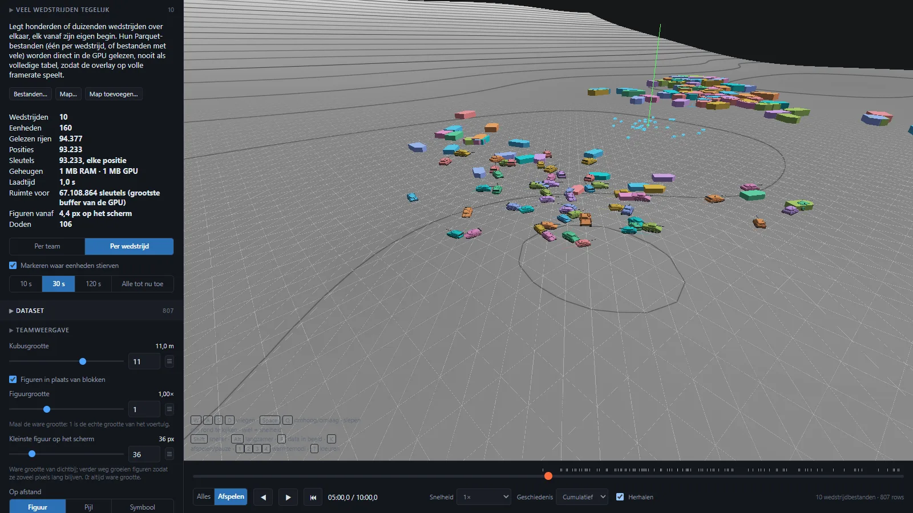

# Veel wedstrijden tegelijk

**Veel wedstrijden tegelijk** speelt veel wedstrijden bovenop elkaar af, zodat je ziet waar de spelers van elke wedstrijd meestal heen gaan. Gebruik het om honderden of duizenden wedstrijden in één beeld te vergelijken.

Elke wedstrijd begint bij zijn eigen begin en zijn eenheden bewegen als figuren. De bestanden gaan rechtstreeks de videokaart in en er wordt geen volledige tabel opgebouwd, dus het speelt soepel waar een gewone lading geheugen tekort zou komen.

## Zo gebruik je het {#how-to-use-it}

1. Open **Veel wedstrijden tegelijk** in de zijbalk van Heatmap.
2. Druk op **Bestanden…** (kies veel bestanden), **Map…** (een map en haar submappen) of **Map toevoegen…** (toevoegen aan wat geladen is).
3. De viewer schakelt naar de figurenoverlay en start bij het begin. Druk op **Afspelen**.

Elk bestand is één wedstrijd (of bevat er meerdere). Parquet-bestanden en [`.3dheat`](container.md)-containers werken. Een bestand heeft een positie-, tijd- en eenheidskolom nodig; naam-, type- en kantkolommen worden bewaard. Andere bestanden, en de zijbestanden van converters (vlucht, berichten, gebeurtenissen, chat, doelen), worden overgeslagen. Voor een gewone tabel, zie [Gegevens binnenhalen](getting-data-in.md).

## Instellingen {#settings}

| Instelling | Wat het doet |
|---|---|
| **Per team** / **Per wedstrijd** | Kleur op kant, of een kleur per wedstrijd. |
| **Markeren waar eenheden stierven** | Een markering waar elke eenheid stierf, 10 s, 30 s, 120 s, of alles tot nu toe. |

Het paneel toont hoeveel wedstrijden, eenheden, rijen en posities gelezen zijn, het gebruikte geheugen en de laadtijd. *Ruimte voor* is hoeveel extra posities de videokaart nog kan opnemen. *Figuren vanaf* is de grootte op het scherm waaronder een eenheid als klein pijltje getekend wordt in plaats van haar figuur.

Het uiterlijk van de figuren gebruikt dezelfde regelaars als de [wedstrijdreplay](match-replay.md#figures): **Figuurgrootte**, **Kleinste figuur op het scherm** en **Op afstand**.

## Tips {#tips}

- Wanneer alles niet in het geheugen past, worden posities uitgedund (alleen een positie per paar meter wordt bewaard) en het paneel zegt dat.
- De warmtemodi werken ook op de data van de overlay.
- Voor statistieken over duizenden wedstrijden zonder ze te tekenen, zie [Massa-analyse](mass-analysis.md).
