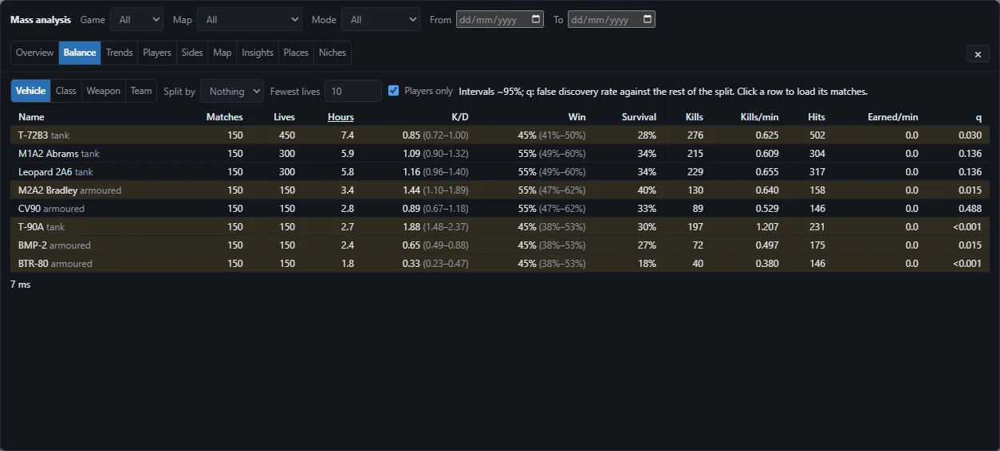

# Massa-analyse: duizenden matches tegelijk

**Massa-analyse** laat zien wat een hele map met matches oplevert: welk voertuig het vaakst wint, welke kant bevoordeeld is, en waar de actie zit. Gebruik het als je veel meer matches hebt dan je zou kunnen bekijken.

Het werkt met een kleine samenvatting van elke match, zodat duizend of tienduizend matches snel openen. Alleen voor de matches waarop je klikt, worden de volledige rijen geladen.

## Probeer het {#try-it}

1. Open **Massa-analyse** in de zijbalk van de Heatmap.
2. Druk op **Map…** (of **Bestanden…**) en kies je `.3dheat`-matches.
3. Wacht terwijl het paneel de samenvattingen leest ("Samenvattingen… n van N").
4. Druk op **Analyse openen**. Er opent een venster met tabbladen.
5. Stel de filters in (Spel, Kaart, Modus, Van, Naar) en lees een tabblad, bijvoorbeeld Balans.
6. Klik op een rij, een cel of een inzicht: de matches daarvan laden in de 3D-weergave, met de camera op de plek.



```
map met .3dheat -> samenvattingen -> venster (tabbladen) -> klik op een rij -> matches openen in 3D
```

Een `.3dheat`-bestand is één match ([Eén bestand per match](container.md)). Een *heatmap* en een *rij* staan uitgelegd in de [woordenlijst](glossary.md).

## De samenvattingen krijgen {#getting-the-summaries}

Voor de meeste mensen hoeft er niets: het paneel maakt ontbrekende samenvattingen zelf. Om een grote map één keer voor te bereiden, gebruik je het offline hulpmiddel hieronder.

Elke `.3dheat`-match krijgt een samenvatting (`src/mass/summarize.ts`), die in de container bewaard wordt als het onderdeel `<match>.summary.json` (rol `summary`, zie [Eén bestand per match](container.md)). Het offline hulpmiddel schrijft ze, en een index per map. Het is een hulpmiddel voor ontwikkelaars. Draai het op een grote map om het paneel het werk te besparen:

```
node tools/3dheat-summarize.mjs <map>... [--jobs N] [--force] [--no-write] [--no-index] [--limit N] [--settle MIN]
```

- Een match die al is samengevat (zelfde formaatversie), wordt alleen gelezen. `--force` rekent hem opnieuw uit. `--no-write` laat de containers ongemoeid.
- Een bestand dat in de laatste `--settle` minuten (10) is veranderd, wordt overgeslagen. Een converter schrijft het misschien nog.
- `<map>/3dheat-index.jsonl.gz`: één regel per match: het pad, de grootte, de tijd en de samenvatting zonder het raster. `<map>/3dheat-index.grids.jsonl.gz`: één regel per match met zijn raster.
- Draai het op de computer waar de bestanden staan, met lage prioriteit (bijvoorbeeld `nice -n 19 ionice -c3` op Linux).

Het paneel neemt voor elke match de eerste van de volgende beschikbare bronnen: de indexregel van de map (zelfde pad en grootte), de cache van de browser (IndexedDB, op naam, grootte en tijd), het onderdeel `summary` van de container, of een samenvatting die in een pool van workers wordt berekend en daarna gecachet. Een map zonder index werkt dus ook: de eerste keer in het tempo van het lezen van de tabellen, daarna vanuit de cache.

## Het paneel {#the-panel}

Kies een map (of bestanden; **Map toevoegen…** voegt er nog een toe). Het venster heeft de filters **Spel**, **Kaart**, **Modus**, **Van** en **Naar**, een keuze **Verdelen op**, **Minste levens** en **Alleen spelers**, en deze tabbladen. Elk getal komt uit de samenvattingen. Een klik op een rij, een cel of een inzicht laadt de bijbehorende matches in de weergave als de overlay voor veel matches, met de filters die ze tonen (voertuig, klasse, wapen, team, speler) en de camera op de plek:

| Tabblad | Wat |
|---|---|
| Overzicht | matches, uren, spelers, levens, rijen, datums; matches per dag; per spel, kaart, modus; totalen van gebeurtenissen; economie per valuta; wanneer in de match dingen gebeuren |
| Balans | per voertuig, klasse, wapen of team, verdeeld over kaart, modus, tier of spel: K/D met het ~95%-interval, winstpercentage (Wilson), overleven, kills en treffers per minuut, verdiensten per minuut, en q: de Benjamini-Hochberg-vondstfrequentie (false discovery rate) van K/D en winst ten opzichte van de rest van de verdeling. **Minste levens** verbergt rijen met te weinig levens om te vertrouwen; **Alleen spelers** laat weg wat de AI van de missie bestuurde |
| Trends | gebruik (aandeel van de aanwezigheid), K/D of winstpercentage van de belangrijkste voertuigen of klassen per dag, week of maand |
| Spelers | verschillende spelers, matches per speler, spelers per match, de vaakst voorkomende spelers |
| Kanten | elke kant van elke kaart: gewonnen matches tegenover een gelijke verdeling |
| Nabije gevechten | gegevens over rondes: openingsduels per kant en hun omzetting, trades, peeker tegenover holder, kruisvuur, geflitste intrede, aim, plants, manvoordeel en, **Per kaart**, de plekken die de spelers doden die ze betreden. Elk is een aandeel met zijn Wilson-interval, uit de `cqb`-tellingen van de samenvattingen ([Nabije gevechten en rondes](close-quarters.md)) |
| Kaart | de opgetelde raster van een kaart: aanwezigheid, kills, doden, K/D, elke gebeurtenis, stroming, en **heet in hoeveel matches** (stabiliteit); per team, bij 1, 2, 4 of 8 keer de cel |
| Plekken | plekken die in de cijfers opvallen maar niet in de warmte (een groot gebied dat als geheel druk is, corridors, hoogtebanden); **Plekken zoeken** |
| Niches | groepen die duidelijk beter of slechter doen dan de rest (een voertuig op één kaart, een sector op één hoogte); **Niches zoeken** |
| Inzichten | de massadetectoren en de kaartdetectoren (hieronder); **Rapport kopiëren (JSON)** geeft de JSON die een taalmodel leest |

## Inzichten over veel matches {#insights-over-many-matches}

Het tabblad **Plekken** vindt plekken die in de cijfers opvallen maar niet in de warmte: een groot gebied dat als geheel druk is, een corridor, een hoogteband, een plek die alleen in één deel van de match druk is. Het markeert de plekken die de gewone warmte niet laat zien als **verborgen**, en tekent ze om in de 3D-weergave. **Laden** vliegt er heen met de matches die het bevatte. Het tabblad **Niches** vindt groepen (een voertuig op één kaart en kant, een sector op één hoogte) die duidelijk beter of slechter doen dan de rest. Klik op een groep om zijn verfijningen te zien.

Het tabblad **Inzichten** vindt, over alle matches, voertuigen die beter of slechter ruilen of winnen dan de rest, plekken die in een stabiel aandeel van de matches heet zijn, kanten die vaker winnen dan een gelijke verdeling, voertuigen waarvan het gebruik met de datums verschuift, en delen van de match die meer kills bevatten dan een gelijkmatige spreiding. Elke bevinding heeft zijn tellingen, effect, interval en een false discovery rate (gehouden op 5%), en een klik laadt de matches. Details: [Voor ontwikkelaars](#for-developers).

## Schaal {#scale}

Je kunt zelf een kleine versie hiervan herhalen: `node tools/demo-data.mjs` schrijft 150 synthetische tankmatches naar `tools/.shots/demo/mass` (elk ongeveer 1.000 rijen). Gemeten op die 150 synthetische demo-matches van `tools/demo-data.mjs` op een desktop-pc (een echte match is veel groter):

- `tools/3dheat-summarize.mjs` met 4 workers: 2,6 tot 4,8 s voor alle 150, 8 tot 21 ms per match in een worker; een tweede run die alleen de samenvattingen leest, duurt ongeveer 2 s.
- De map openen in het paneel, met de index aanwezig, tot het venster getoond wordt: 0,9 tot 1,6 s (het eigen deel van de worker, het lezen van de 150 indexregels, is 20 tot 40 ms).
- Overschakelen naar een tabblad, tot de tabel getekend is: Overzicht 10 tot 30 ms, Balans 30 tot 70 ms, Trends 30 tot 45 ms, Spelers 15 tot 35 ms, Kanten 15 tot 20 ms, Kaart 55 tot 130 ms.
- De opslag houdt de 150 matches in ongeveer 0,5 MB.

Het openen van het venster kost één korte frame: de gekozen bestanden gaan 16 tegelijk naar de worker, en de datumvelden en het eerste tabblad komen een frame later.

De opslag houdt ongeveer 15 KB per match vast, dus 10.000 matches nemen ongeveer 150 MB in beslag in de worker. Rasters worden nooit langer vastgehouden dan het tabblad vraagt.

## Voor ontwikkelaars {#for-developers}

### Inzichten over veel matches {#insights-over-many-matches}

`src/mass/detect.ts`: elke bevinding met haar tellingen, effect en interval, p en q (Benjamini-Hochberg over alles wat de detector heeft geprobeerd, gehouden op 5%), de verdieping die de matches laadt, en een zinssleutel met zijn waarden. Het rapport (`heat3d.mass/1`) is wat `massReportForModel` aan een verteller geeft, in dezelfde vorm als het rapport van één match (`insights/seam.ts`).

| Detector | Vindt |
|---|---|
| `balance` | een spelersvoertuig dat beter of slechter ruilt of wint dan de rest, op een kaart of in een modus |
| `hotspot` | plekken die in een stabiel aandeel van de binnengekomen matches heet zijn (matches heet / matches gezien, tegen de andere cellen van de kaart), niet alleen heet in de som |
| `side` | een kant van een kaart die vaker wint dan een gelijke verdeling |
| `meta` | het aandeel van een voertuig in de levens van spelers of zijn K/D die tussen de eerste en de tweede helft van de datums verschuift, per kaart: groot genoeg om ertoe te doen, trend over de kwartalen, op dezelfde manier op de meeste kaarten (hieronder) |
| `phase` | een deel van de matchlengte met meer kills, treffers, lanceringen... dan een gelijkmatige spreiding |
| `place` | plekken die over veel matches opvallen (fase B, hieronder): het percentage of kill-aandeel van een regio tegenover dat van elke match zelf, cirkels, corridors, gegroeide zones, hoogtebanden, fasen; verborgen wanneer de gewone warmte ze niet toont |
| `niche` | groepen die duidelijk beter of slechter doen (fase B, hieronder) |
| `grid.*` | de detectoren voor één dataset (krachtposities, hete en stille zones, klasseplekken) op de opgetelde rasters van elke kaart: `GridMerge.toInsightJob` vult de rasters van de inzichtronde uit de samenvattingen; de detectoren die sporen nodig hebben, slaan over |

### De samenvatting {#the-summary}

Gewoon JSON (`src/mass/types.ts`), ongeveer 5-30 KB gecomprimeerd per match:

- de match: spel, kaart, modus, missie, start, lengte, rijen, levens, spelers, AI, teams (levens, spelers, aanwezigheid, kills, doden, gewonnen, geld), winnaar;
- per voertuig en team: klasse, tier, levens, spelerslevens, aanwezigheid, gebeurtenissen per canonieke soort, kills per klasse van het doel, winsten, geld;
- per speler (op gebruikers-id, anders op naam): team, levens, aanwezigheid, kills, doden, treffers, lanceringen, gewonnen, voertuigen; per wapen: gebeurtenissen per soort;
- de kolommen van de economie (`cost_*`, `earn_*`) en hun totalen;
- fasen: gebeurtenissen per soort in 20 banden van de matchlengte en per minuut;
- gedrag: de collectieve-gedragsmaten van de match (uitlijning, routekudden, banen, drukte, leiders, achterblijvers, breekpunt, risico na verliezen, reeksen, koopovereenstemming, onderdrukking), elk met zijn eigen nulmodel, p en q; zie [Collectief gedrag](collective-behaviour.md);
- het raster (hieronder).

Geteld zoals de viewer telt: kolommen gevonden zoals de lader voor veel matches ze vindt (`leanSpec`), gebeurtenissen via `data/canonical.ts`. Een kill met een Tacview-wapen telt voor de schutter; een dood die tegelijk twee keer is genoemd (`dead`, `death`), telt één keer.

#### Het raster: waar fase B op bouwt {#the-grid-what-stage-b-builds-on}

Het ruimtelijke deel is gemaakt voor scanstatistieken over regio's van elke grootte en vorm, niet alleen voor warmtebeelden:

- **Een piramide.** Cellen zijn uitgelijnde machten van twee in wereldeenheden (x, z zoals de viewer ze plaatst). Niveau `k` is de som van de cellen per `ix >> k, iz >> k`: exact, binnen een match en over matches met andere celgroottes heen. Elke regio (een box, een corridor langs een lijn, een ring) is een som van cellen. Het fijnste niveau past de robuuste omvang van de match (de cellen die 99% van de aanwezigheid bevatten) in 128 cellen; zwervers daarbuiten worden bewaard.
- **Blootstelling naast elke telling.** Seconden aanwezigheid per cel, per team (`pt`), per voertuigklasse (`pc`) en per hoogteband (`ph`), zodat het percentage, de verwachting en de verhouding van een regio voor elke subgroep berekend kunnen worden.
- **Hoogte.** Banden boven de vloer van de match (het 1e percentiel van de hoogte): onder 3 m, 3-10, 10-30, 30-100, 100-300, 300-1000, 1000-3000, boven; een bestand met een kolom `floor`/`storey`/`deck` deelt in op zijn verdiepingen. `y` is de gemiddelde hoogte van elke cel, `y0` de laagste (zijn verdieping, voor hoogte erboven).
- **Gebeurtenissen** als tupels `[cel, soort, team, klasse, band, aantal]`.
- **Tijdsneden** op een grof niveau (8 cellen per zijde), per minuut vanaf het begin van de match: `[cx, cz, minuut, soort, waarde]`, met de seconden aanwezigheid als soort `GRID_KINDS.length`; matchfasen zijn minuten over de lengte.
- Schaars, tellingen als gehele getallen, seconden op een tiende: begrensd door wat er gebeurd is.

### Fase B: plekken en niches {#stage-b-places-and-niches}

Fase B zoekt wat in de cijfers opvalt zonder het oog te trekken: een groot gebied dat als geheel druk is zonder een hete cel erin, een vreemde kill-doodverhouding bij weinig gebeurtenissen, een corridor, een hoogteband, een cluster dat alleen in één deel van de match bestaat. En groepen (een voertuig op één kaart aan één kant, een sector op één hoogte) die duidelijk beter of slechter doen dan de rest. Eén **Plekken zoeken** / **Niches zoeken** / **Inzichten zoeken** draait alle detectoren; de drie tabbladen delen het rapport.

#### Plekken (`src/mass/scan.ts`) {#places-srcmassscants}

De matches van elke kaart worden twee keer gelezen, één match tegelijk. Het geheugen houdt sommen bij op een raster van hooguit 64 cellen per zijde (16 voor de ruimte-tijdscan), nooit de matches zelf.

- **Maten.** De snelheid van een gebeurtenis per seconde aanwezigheid (kills, doden, treffers, lanceringen, veroveringen, voor alle eenheden, per klasse (de 4 met de meeste gebeurtenissen), per hoogteband) en het aandeel van de kills in kills en doden (alles, per kant, per band). Welke klassen en kanten meetellen, komt uit de koppen (`planOf`).
- **Verwachting per match.** De eigen snelheid van elke match, verdeeld over zijn eigen aanwezigheid in een cel, is de verwachting van die cel (een door covariaten gecorrigeerde Kulldorff-scan, gestratificeerd per match): een paar bloedige matches of één drukke server maken geen plek.
- **Spreiding.** Matches verschillen veel meer dan Poisson. De residuen van elke match worden opgeteld in blokken van 1, 2, 4, 8, 16 cellen; de spreiding van elke blokgrootte (gekwadrateerde residuen gedeeld door de nulvariantie, gepoold, de slechtste 5% van de blokken weggelaten) schaalt elke toets van een regio van die grootte: een quasi-likelihood-ratio, Poisson voor snelheden, binomiaal voor aandelen.
- **Regio's.** Cirkels van 0,75 tot 18 cellen; ellipsen onder zes hoeken, 3 en 6 keer zo lang als breed, 3 tot 18 cellen (corridors; de as is `place.path` van het inzicht); zones die cel voor cel groeien vanuit de sterkste lokale Getis-Ord Gi*-cellen zolang de z van de regio groeit (onregelmatige vormen). Ze groeien op de ene helft van de matches en worden op de andere getoetst, zodat de vrijheid van het groeien geen valse plekken oplevert. Elke hoogteband tegenover de andere banden van de match over de hele kaart (clusterrobuust). Ruimte-tijdcilinders: een cirkel in een of twee vijfde van de matchlengte, tegen de eigen spreiding van de gebeurtenissen van de match over plaats en tijd (de ruimte-tijdpermutatiescan).
- **Toetsen.** p uit de quasi-likelihood; Benjamini-Hochberg over elke regio die op elke kaart is geprobeerd (700.000 op drie kaarten is gebruikelijk), op 5%. Wat slaagt, wordt gesnoeid (een regio die grotendeels binnen een sterkere regio van dezelfde maat ligt, zegt hetzelfde), opnieuw gelezen op zijn **stabiliteit** (matches die hem zagen, matches waarin hij zat, zijn richting in vijf folds van de matches), en nog eens getoetst bij de spreiding die de matches zelf laten zien (clusterrobuust, matches als clusters, nooit onder Poisson), opnieuw BH. Stille plekken op een basis (2% of meer van de spawns, opstijgingen en landingen van de kaart) worden weggelaten.
- **Effect.** De verhouding van snelheden (of kansen), geschrompeld door empirisch Bayes (een gamma-prior, gepast op de 2x2-blokken van de kaart), met een ~95%-interval bij de spreiding; Gi* bij 1, 2 en 4 cellen en lokale Moran in het midden.
- **Visuele opvallendheid.** Hoeveel de regio al toont in de gewone warmte van zijn gebeurtenis (logschaal tot de helderste cel, zoals de weergaven tekenen): het contrast met een ring eromheen (een tiende van het palet is moeilijk te zien, twee vijfde gewoon) en een heldere piek die het overschot draagt; een verhouding wordt nooit door de warmte getekend, dus die telt half. Onder 35% is het **verborgen**. De rangorde: sterkte (effect dat verzadigt bij 4 keer, stille plekken bij 0,7) × `1 - 0,7 × opvallendheid` × de overeenstemming van de folds.

Het tabblad **Plekken** toont ze (standaard alleen verborgen; op kaart, vorm, richting). Een klik tekent de plekken van de kaart om in de 3D-weergave (`placeLines.ts`: de bovenlijnen van de motor, eenmaal gebouwd: magenta verborgen, amber gewoon, cyaan stil, de gekozen volledig; een band als een doos van zijn vloer tot zijn plafond), en op het canvas van het tabblad Kaart. **Laden** vliegt er heen en laadt de 60 matches waarin hij het vaakst zat, gefilterd op zijn gebeurtenis (en klasse).

#### Niches (`src/mass/niche.ts`) {#niches-srcmassnichets}

Bundelzoeken (breedte 24, diepte 3) over drie tabellen: **levens** (levens van spelers: spel, kaart, modus, klasse, voertuig, kant, tier, kwartaal van de datums, derde van de matchlengtes; K/D, winst, dood per leven, kills per uur, verdiensten per minuut), **plekken** (kills en doden per kaart, modus, datums, sector van de kaart 4 x 4, klasse, kant, band) en **fasen** (sector en vijfde van de match: K/D, doden per uur aanwezigheid). Een groep wordt getoetst tegen het geheel, met matches als clusters (de sandwich-variantie van zijn residuen per match). Het effect is een odds- of snelheidsverhouding, geschrompeld door een prior van 20 uitkomsten. Er zijn 30 uitkomsten in 8 matches nodig; een verfijning moet 10% sterker zijn dan zijn ouder; groepen waarin de uitkomst nooit of altijd voorkomt (niet voor hen geregistreerd), vallen af. Bewaard: BH onder 5% over elke geëvalueerde groep, een geschrompelde verhouding van minstens 1,25 (of 1/1,25), vier van de vijf folds die het eens zijn, en geen verfijning die alleen zijn ouder herhaalt. Het tabblad **Niches** toont ze; een klik toont elke verfijning met één voorwaarde van de groep (de verkenner), **Laden** laadt zijn matches. Uitrustingen staan nog niet in de samenvattingen.

#### Metaverschuivingen met praktische betekenis {#meta-shifts-with-practical-significance}

Bij gemengde datums noemde de binomiale toets op levens bijna elke verandering significant. `meta` toetst nu clusterrobuust (de levens van elke match een cluster), houdt een gebruiksverschuiving alleen aan als ze minstens 2 punten en 25% is, een K/D-verschuiving van 1,3 keer, de kwartalen van de datums die dezelfde kant op trenden (Kendall's tau van minstens 0,5), en voor een voertuig op meerdere kaarten dezelfde richting op de meeste ervan. Dat laat op een testset waarop de gewone toets bijna alles aanmerkte, nog maar enkele verschuivingen over.

#### Voor een model {#for-a-model}

`massReportForModel` geeft elke plek zijn `region` (vorm, verborgen, opvallendheid, hoogten, fase) en elke niche zijn `conditions`, plus hoeveel regio's en groepen zijn geprobeerd. De kennislens kan plekken lezen als doodszones en aanvalsrichtingen: hun soorten zijn `place.*` en `niche.*`.

#### Controles {#checks}

`scan.test.ts` plant een verspreid gebied (1,6 keer het sterftecijfer over een cirkel van 22 cellen, in elke cel zwak), een corridor, een hoogteband en een cluster dat alleen in een fase zit, in 240 synthetische overgedispergeerde matches. Alles wordt gevonden, het verspreide gebied verborgen, en acht nulsets van 60 matches draaien: geen plek. `niche.test.ts` vindt een geplante groep voertuig x kaart x kant en niets in vijf nultabellen.
