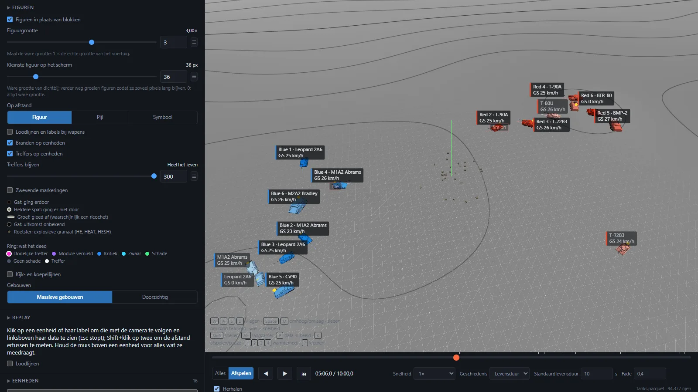
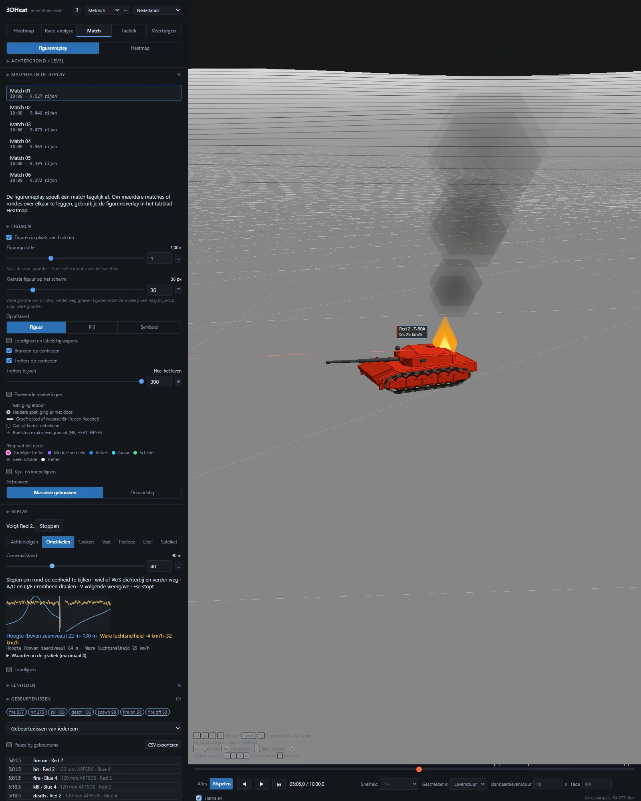
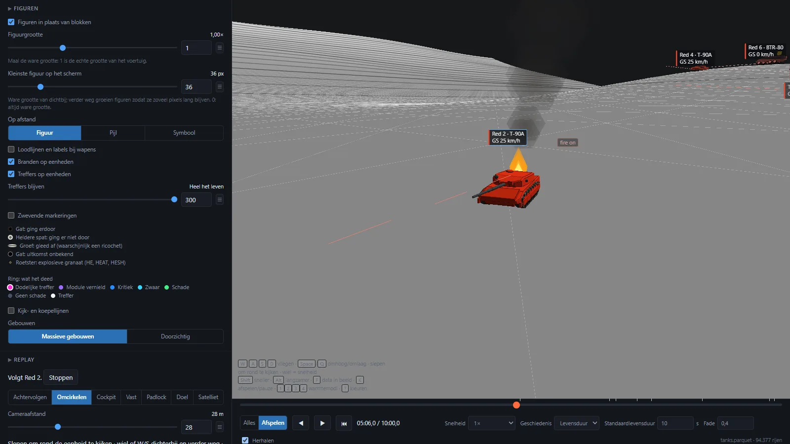
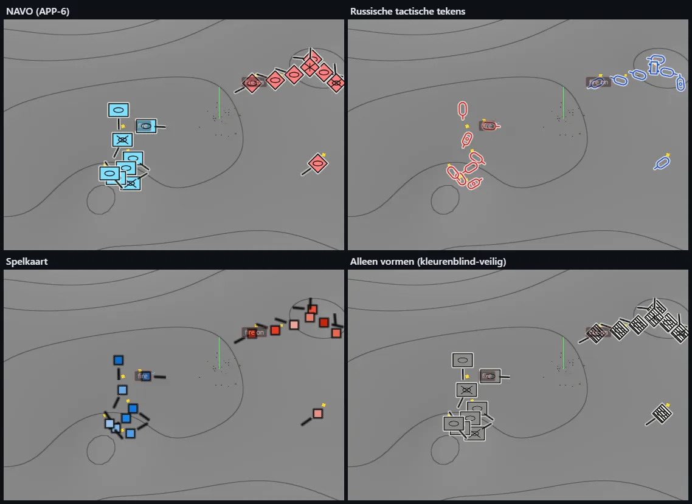
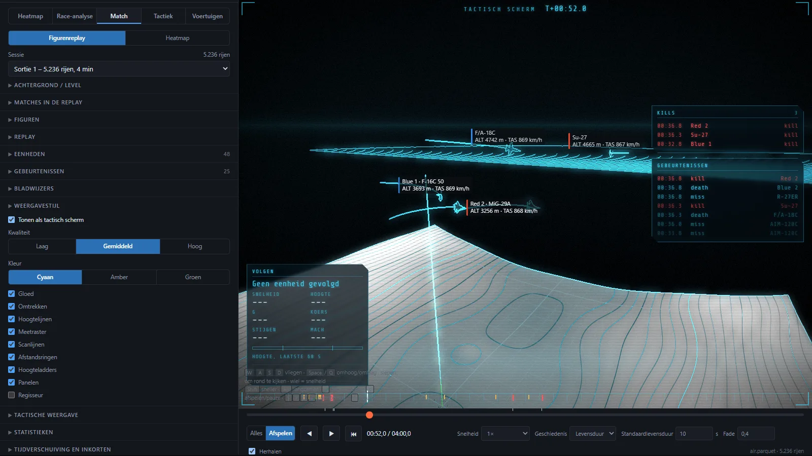
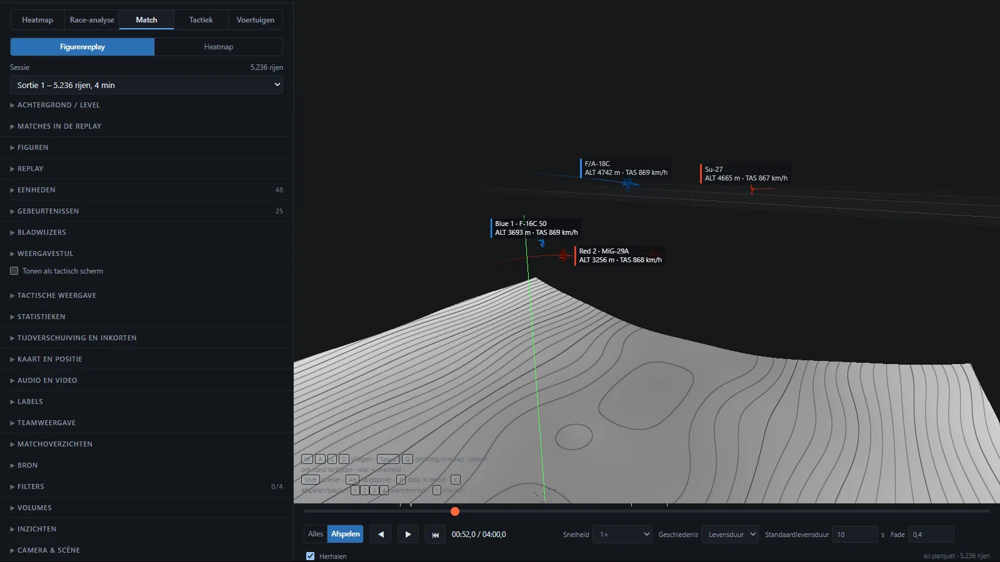

# Wedstrijdreplay

De replay is een film van de wedstrijd, waarin elke speler wordt getekend als het ding dat hij bestuurde. Gebruik hem om een gevecht opnieuw te bekijken, een eenheid te volgen en te zien wie wie heeft geraakt.

Schoten, treffers, branden en wrakken worden getekend op de eenheden en doelen op het niveau. Camera's, labels en een tactische weergave helpen je het gevecht te lezen. Ken je Tacview? [Tacview-gelijkheid](tacview-parity.md) laat zien waar elk van zijn hulpmiddelen staat.

## Een replay starten {#start-a-replay}

1. Laad een opname met **Bron → Bestanden…** of door hem op het bronpaneel te slepen (elke tabel met een kolom **persoon** en een kolom **tijd**, een Tacview-bestand, een geconverteerde replay, een [`.3dheat`](container.md)-wedstrijd). Zie [Data laden](getting-data-in.md).
2. Open het tabblad **Match** en kies **Figurenreplay**, of kies **Figurenoverlay** in de modusbalk van het tabblad Heatmap.
3. Kies onder **Matches in de replay** één match, alle tegelijk, of meerdere.
4. Druk op **Afspelen** op de tijdlijn (of `K`). Sleep op de tijdlijn om ergens anders te springen.

Figuren vervangen blokken voor elke eenheid waarvan de naam of het type bekend is (zie [Figuren](figures.md)). Data zonder kolom voor naam of type wordt als soldaten getekend.

## Figuren {#figures}

| Instelling (gedeelte **Figuren**) | Standaard | Wat het doet |
|---|---|---|
| **Figuren in plaats van blokken** | aan | Uit tekent gewone blokken. |
| **Figuurgrootte** (keer de echte grootte) | 1 | 1 is echte grootte; 0,25 tot 20 keer (logaritmische schaal). Groter helpt op afstand. |
| **Kleinste figuur op het scherm** | 36 px | Verre figuren worden zo groot dat ze deze lengte houden, 0 tot 200 px; 0 houdt de echte grootte. |
| **Op afstand**: Figuur, Pijl, Symbool | Figuur | Wat een verre eenheid wordt. |
| **Symbolen** | NATO (APP-6) | NATO (APP-6), Russische tactische tekens, pictogrammen van de **Spelkaart**, of **Alleen vormen (kleurenblind-veilig)**. |
| **Symboolgrootte**, **Mijn kant**, **Vijandig / Neutraal**, **Koersstreepjes** | 28 px (12 tot 64), automatisch, vijandig, aan | Hoe symbolen eruitzien en welke kant de vriendelijke is. |
| **Loodlijnen** | aan | Een lijn van elke eenheid recht omlaag naar de grond, zodat hoogtes in 3D te lezen zijn. |
| **Loodlijnen en labels bij wapens** | uit | Lijnen naar de grond en labels bij raketten en bommen. |
| **Branden op eenheden** | aan | Vlammen vanaf het moment dat een eenheid vuur vat tot het gebluscht is. |
| **Treffers op eenheden** | aan | Markeringen waar schoten raakten (hieronder). **Treffers blijven**: 1 tot 300 seconden, of **Heel het leven**. **Zwevende markeringen**: markeringen die boven het oppervlak worden getekend. |
| **Kijk- en koepellijnen** | uit | Gestreept: waar de speler kijkt; doorgetrokken: waar het kanon op richt. |
| **Gebouwen** | massief | Massieve of doorzichtige gebouwen, wanneer het niveau ze tekent. |

### Symbolen op afstand {#symbols-at-a-distance}

Wanneer een eenheid kleiner zou zijn dan **Kleinste figuur op het scherm**, kan ze een symbool worden dat leesbaar blijft. De vorm vertelt de soort (bijvoorbeeld een afgerond blok met een rupsbandstreep voor pantserwagens); de kleur vertelt de kant. Open het menu **Symbolen** om de stijl te wijzigen.

### Treffermarkeringen, wrakken en branden {#hit-marks-wrecks-and-fires}

- **Treffermarkeringen** zitten op het oppervlak waar het schot raakte, op de schaal van de figuur. Hun uiterlijk vertelt wat er gebeurde: een gat (door de pantser heen), een heldere spatting (niet door de pantser), een groef (afgeketst), een roetster (explosieve granaat). Een gekleurde ring zegt wat het deed: dodelijk schot, module vernietigd, kritiek, zwaar, schade, geen schade, treffer. Houd de muis op een markering voor de naam van de granaat.
- Een vernietigde eenheid wordt **verkoold** getekend als wrak vanaf haar dood tot ze herleeft of wordt verwijderd; haar symbool is doorgekruist.
- **Branden** woeden op een eenheid vanaf het moment dat ze vuur vat tot het gebluscht is.
- **Torens** draaien naar waar de data zegt dat het kanon op richt (of, zonder die data, waar de speler kijkt).

### Wapens, lokkers en tracers {#weapons-decoys-and-tracers}

Met **Wapens, schoten en treffers** aan (gedeelte Teamweergave): raketten, bommen en torpedo's vliegen als eigen figuren met een rookspoor; kogels en granaten zijn tracers; inslagen en explosies flitsen. Een tracer die **gestreept** wordt getekend, is afgeleid uit een treffer, omdat de data geen schot bevatte. Flares en chaff worden als lokkers getekend; ze zijn uit de eenhedenlijst verborgen, tenzij *Lokmiddelen en granaten* is aangevinkt.

## Camera's {#cameras}

Klik op een eenheid of haar label om haar te **volgen**; het gedeelte **Replay** biedt **Achtervolgen**, **Omcirkelen**, **Cockpit** (met een head-up display, `H`), **Vast**, **Padlock**, **Doel** en **Satelliet**. Met `V` wissel je ertussen, **Cameraafstand** bepaalt hoe ver. Esc stopt.

- **Weergave van twee eenheden**: kies een **Doel** (of Ctrl/Alt-klik een eenheid) om haar te bekijken vanuit de gevolgde eenheid; **Wisselen** ruilt ze om.
- **Meten**: Shift-klik op twee eenheden voor de peiling, het bereik en het hoogteverschil tussen hen.
- **2D-kaart** (`M`): hoek- of volledige weergave, met sporen en namen.
- **Bladwijzers** (`B`): bewaar het moment en de camera; de eigen kills, doden en markeringen van de opname staan er ook in.
- **Gebeurtenissen**: elke gebeurtenis in tijdsvolgorde; een klik springt er naartoe. `Page Up` / `Page Down` springen tussen gebeurtenissen; **Pauze bij gebeurtenis** stopt bij elke gebeurtenis.

## Tactische weergave {#tactical-display}

Het gedeelte **Tactische weergave** tekent, voor geen enkele eenheid, de geselecteerde, alle, of één soort (vliegtuigen, grond, schepen, wapens): snelheidsvectoren en het pad vooruit, neus- en liftlijnen, radarkegels, vergrendelingen, datalinks, betrokkenheidszones en -lijnen, zichtlijnen, waar spelers kijken (kijkkegels), de richting van torens en de opgenomen camera.

### Weergavestijl {#display-style}

`T` (of de schakelaar **Tonen als tactisch scherm**) zet de weergave om naar een radarschermstijl: gloed, omtrekken, hoogtelijnen, een meetraster, scanlijnen, bereikcirkels, hoogteladders, panelen met kills en gebeurtenissen, en een **Regisseur** die de camera zelf naar gebeurtenissen verplaatst.

## Doelen {#objectives}

Als een match met zijn doelen komt, tekent het gedeelte **Doelen** ze op het niveau: veroveringszones (met eigenaar en voortgang van de verovering), spawns, vliegvelden, gebieden en bommendoelen, elke laag schakelbaar, met labels. Ze zijn door de grond heen zichtbaar. Met meerdere geladen speltypes filtert **Modus** de matches op speltype. Doelen komen uit het matchbestand van een converter naast de opname of in een [`.3dheat`](container.md)-container.

Rainbow Six Siege-wedstrijden brengen hun bomlocaties mee: de twee kamers van elke locatie worden als omtrekken met hun namen op hun vloer getekend, afgeleid uit waar de spelers stonden terwijl het spel de kamer noemde; een locatie van de kaart die in de wedstrijd niet gespeeld werd, komt als cirkel uit de locatietabel van de converter. In de replay licht de locatie van de ronde bij de afspeelkop amber op, de andere blijven grijs. Ze horen bij de laag met veroveringszones.

## Labels en statistieken {#labels-and-statistics}

- **Labels**: regels per soort (**Geselecteerd**, **Vliegtuigen**, **Grond**, **Schepen**, **Wapens**, **AI**): wel of niet getoond, welke waarden, en een **Prioriteit** voor wie de ruimte krijgt als labels overlappen. **Labels uit elkaar houden** zet een label naast zijn eenheid wanneer het een andere zou bedekken, en laat het weg waar geen ruimte is. **Labelgrootte** is 60 tot 250 %. **Terug naar naam, voertuig, hoogte en snelheid** zet de regels terug.
  - Grondeenheden beginnen met naam, voertuig en snelheid.
  - Vliegtuigen beginnen met naam, voertuig, hoogte en snelheid.
  - Schepen beginnen met naam, voertuig, snelheid en koers.
  - Houd de muis op een eenheid om elke waarde te zien die zij heeft.
- **Statistieken**: per team en eenheid: kills, doden, schoten, treffers, trefferpercentage, opstijgingen, landingen, tijd in de lucht, topsnelheid, hoogte en G, afstand. Export naar CSV.
- **Grafieken**: de waarden van een eenheid in de tijd, twee eenheden naast elkaar, of de ene waarde tegen de andere.

## Veel matches tegelijk {#many-matches-at-once}

Om honderden of duizenden matches over elkaar te leggen, zie [Veel matches tegelijk](many-matches.md). Details van figuren (rook, vuur, andere tijdgebonden effecten): [Figuren in de figuuroverlay](figure-replay.md). Lijst van Tacview-functies: [Tacview-gelijkheid](tacview-parity.md), een onderpagina van deze.
