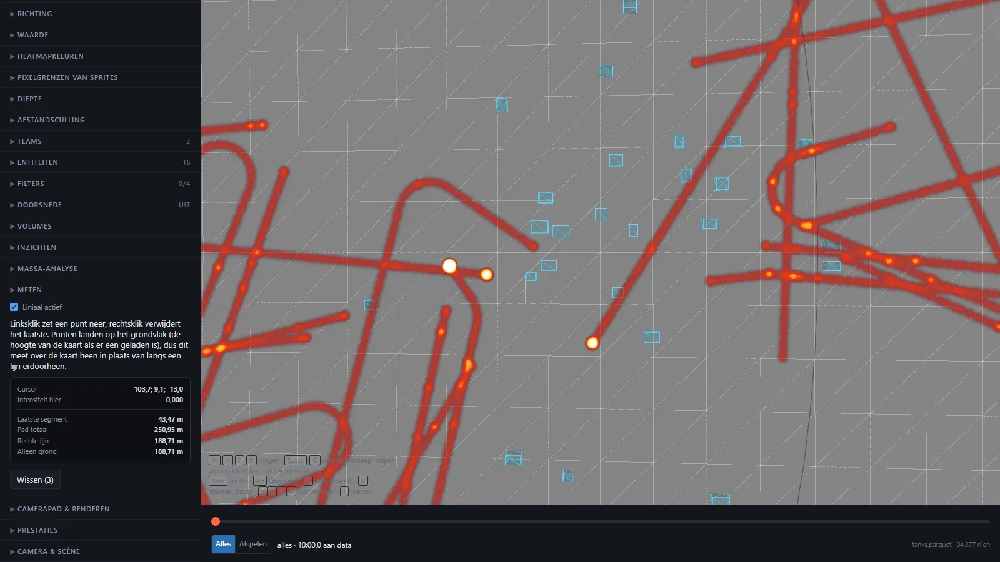

# Meten

**Meten** maakt van de muis een liniaal en vertelt je hoe druk de plek onder de cursor is. Gebruik het om te zien hoe ver twee plaatsen uit elkaar liggen, of hoeveel verkeer er op één plek is.

## Probeer het {#try-it}

1. Open **Meten** in de zijbalk en vink **Liniaal actief** aan.
2. Klik met de linkermuisknop op drie plekken op de kaart. Elke klik zet een punt.
3. Lees **Pad totaal** (de lengte van het hele pad) en **Laatste segment** (het laatste stuk).
4. Klik met de rechtermuisknop om het laatste punt te verwijderen, of druk op **Wissen (3)** om alles te verwijderen.

| Actie | Effect |
|---|---|
| Linksklik | Zet een punt waar de cursor het grondvlak raakt. Een klik die tussen indrukken en loslaten meer dan 4 pixels bewoog, is een cameraslepen, geen punt. |
| Rechtsklik | Verwijdert het laatste punt. |
| Bewegen | De positie van de cursor en de warmte eronder worden live bijgewerkt. |

De camera blijft werken terwijl de liniaal aan staat: slepen kijkt nog steeds rond, toetsen vliegen nog steeds. Terwijl de liniaal aan staat, neemt hij elke klik over, dus [klikken om te kiezen](camera.md#click-to-pick) wacht tot hij uit staat.

**Het grondvlak** is de hoogte van de [kaartafbeelding](map-images.md) wanneer een kaartafbeelding is geladen, anders de laagste Y van de dataset (0 zonder). Punten komen daarop te liggen, dus de liniaal meet over de kaart, niet langs een lijn erdoorheen. Bij een 3D-niveau is het vlak nog steeds de laagste Y van de dataset, niet het oppervlak van het niveau - voor een punt op het echte oppervlak zet je de liniaal uit en klik je erop ([klikken om te kiezen](camera.md#click-to-pick)), wat de coördinaten uit de eigen driehoeken van het niveau leest.

## Uitlezingen {#readouts}

| Regel | Betekenis |
|---|---|
| **Cursor** | Wereld-X, Y, Z van het punt onder de cursor, op het vlak. |
| **Intensiteit hier** | Hoeveel warmte er bij de cursorpixel is. Een groter getal betekent meer verkeer op die plek. Het is de waarde die het kleurverloop krijgt voordat het verzadigingspunt deelt, dus je kunt hem vergelijken met het [Verzadigingspunt](colour-and-exposure.md#saturation-point). |
| **Laatste segment** | Afstand van het laatste punt tot de cursor (of tussen de laatste twee punten). |
| **Pad totaal** | Lengte van de polylijn door elk punt en de cursor. |
| **Rechte lijn** | 3D-afstand van het eerste punt tot de cursor (of het laatste punt). |
| **Alleen grond** | Hetzelfde, alleen op X en Z. |
| **Wissen (N)** | Verwijdert alle punten. |

Afstanden worden onder 1 eenheid in centimeters getoond, onder 1.000 in meters, erboven in kilometers - uitgaande van één wereldeenheid per meter ([Assen, eenheden en tijd](axes-units-and-time.md#unit-scale)). Coördinaten zijn wereldcoördinaten, ook wanneer een as [voor de weergave is omgekeerd](camera.md#invert-world-axis).

De punten en de lijn ertussen worden als overlay in de weergave getekend, met een grootte die van de rasterafstand is afgeleid. De punten van de liniaal worden niet in weergaven opgeslagen; ze blijven staan wanneer je andere data laadt.

## Voor ontwikkelaars {#for-developers}

**Intensiteit hier** wordt hooguit elke 120 ms van de GPU gelezen, omdat een uitlezing van één pixel de pijplijn laat stilvallen. Het gebruikt hetzelfde pad als `engine.readHeatProbe()`: gedeeld door de versterking waarmee het frame werd geschreven, dus op het half-float-opbouwpad (`?heat=f16`) staat het in dezelfde eenheden als op een 32-bit-doel ([Half-float-accumulatie](half-float-accumulation.md)).
