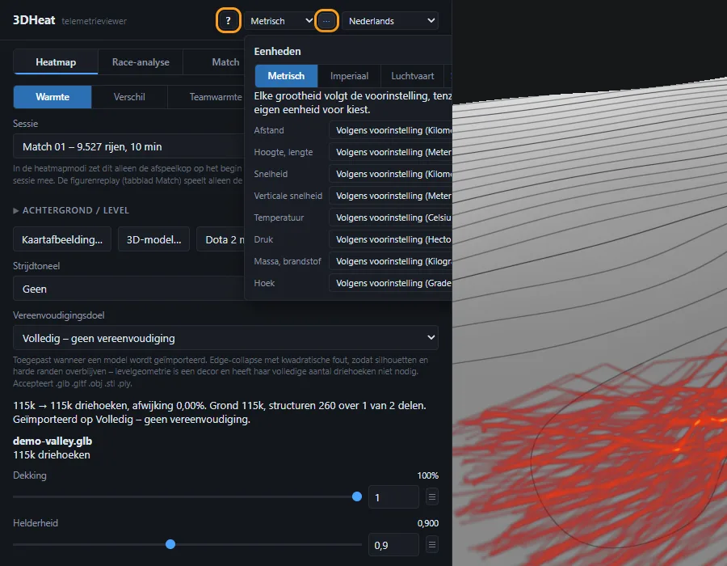
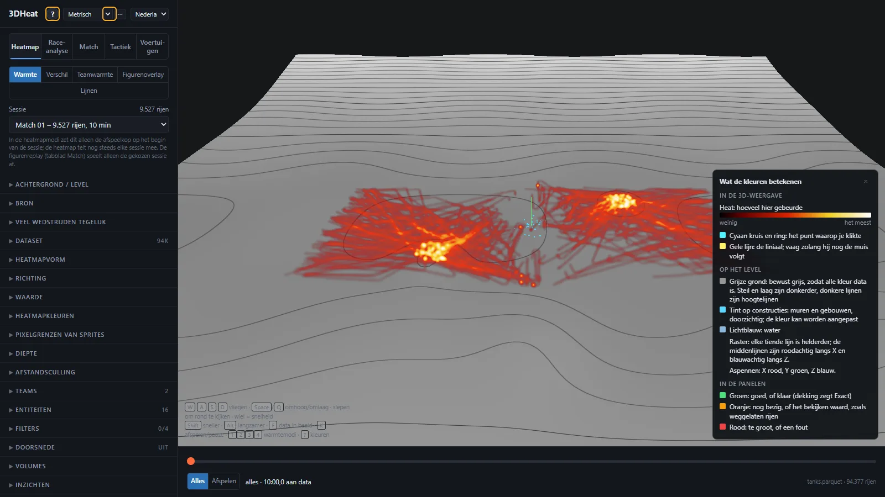
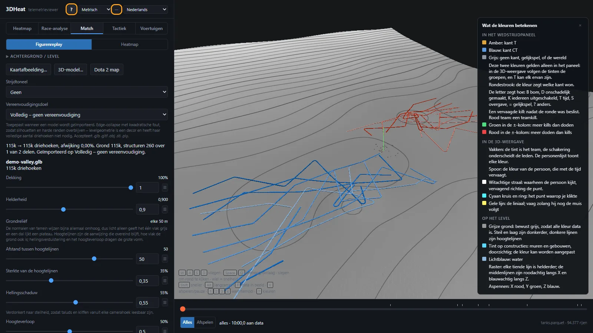

# Instellingen, eenheden en toetsen

De kleine regelaars bovenaan de zijbalk bepalen hoe de viewer met je praat: de taal, de eenheden (meters of voet, km/u of knopen) en een hulpmodus die de kleuren uitlegt. Je keuzes worden in je browser onthouden.

## De kop {#the-header}

Bovenaan de zijbalk:

| Regelaar | Wat het doet |
|---|---|
| **?** | Hulpmodus: wat elke kleur betekent (ook `?` of `F1`) |
| Menu **Eenheden** | Metrisch, Imperiaal, Luchtvaart of Nautisch |
| Knop **...** naast **Eenheden** | Opent "Kies een eenheid per grootheid": één keuzelijst per grootheid |
| Menu **Taal** | De taal van de viewer: [40 talen](languages.md), of die van de browser |

Getallen die je in een vak typt mogen een punt of een komma gebruiken (`0.35` of `0,35`). De viewer leest beide en toont getallen zoals de taal van de viewer ze schrijft.

## Eenheden {#units}

1. Kies een voorinstelling in het menu **Eenheden**. Alle grootheden schakelen samen.
2. Om maar één grootheid te wijzigen, klik je op de knop **...** ernaast en kies je een eenheid voor die grootheid. Het menu toont daarna een `*` na de voorinstelling.
3. Een grootheid die je niet hebt ingesteld volgt de voorinstelling. Kies "Zoals voorinstelling" om terug te gaan.

| Grootheid | Metrisch (standaard) | Imperiaal | Luchtvaart | Nautisch |
|---|---|---|---|---|
| Afstand | km | mi | NM | NM |
| Hoogte, lengte | m | ft | ft | m |
| Snelheid | km/u | mph | kt | kt |
| Verticale snelheid | m/s | ft/min | ft/min | m/s |
| Temperatuur | °C | °F | °C | °C |
| Druk | hPa | inHg | hPa | hPa |
| Massa, brandstof | kg, l | lb, gal | lb, gal | t, m³ |
| Hoek | graden | graden | graden | graden |

Andere eenheden die je voor één grootheid kunt kiezen: afstand km, mi, NM; snelheid km/u, m/s, kt, mph; verticale snelheid m/s, ft/min, m/min; temperatuur °C, °F, K; druk hPa, inHg, mmHg, psi; massa kg, lb, t; hoek graden of NAVO-mils (6400 op de cirkel). De eenheden zijn overal in de viewer hetzelfde: labels, kaarten, grafieken, statistieken.

## Hulpmodus {#help-mode}

Druk op `?` of `F1`, of klik op de knop **?**. Die toont *Wat de kleuren betekenen*: legenda's voor de 3D-weergave, de warmteramp, teamkleuren, de kleuren van het niveau, de statuskleuren van de panelen, het paneel van het tabblad Match en de racweergave. Hij blijft aan tot je hem uitzet. In het tabblad Match legt hij ook de kleuren van het wedstrijdpaneel uit.

## Wat de browser onthoudt {#what-the-browser-remembers}

Deze instellingen worden tussen bezoeken in je browser bewaard (er wordt niets ergens naartoe gestuurd):

- de taal, de eenheden en de hulpmodus;
- de instellingen van de replay voor figuur, symbool, label, camera en tactische weergave;
- de afspeelsnelheid en spiegeling;
- bladwijzers per opname, volumes per dataset, lagen van doelen;
- de instellingen voor externe AI (de sleutel alleen als je *Onthouden* aanvinkt).

Warmte-instellingen, filters en de modus beginnen bij elke lading opnieuw. De volledige, gegenereerde lijst: [Opgeslagen instellingen](ref-settings-storage.md).

## Toetsen die de viewer van de browser houdt {#keys-the-viewer-keeps-from-the-browser}

Een sessie met grote data kost tijd om te laden, dus de viewer zorgt dat de browser die niet per ongeluk weggooit:

- `Ctrl`/`Cmd` + letters die zouden afdrukken, opslaan, openen, herladen, sluiten of nieuwe vensters openen doen niets buiten tekstvakken; `F1`, `F3`, `F5`, `F6` en `F7` doen niets.
- Het sluiten of herladen van het tabblad met geladen data of een niveau vraagt eerst om bevestiging.
- In volledig scherm vergrendelt de viewer de toetsen die hij gebruikt (W, T, N, S, R, P, Q, Esc), zodat de browser ze niet overneemt.

De exacte lijst: [Sneltoetsen van de browser](ref-browser-keys.md). Alle eigen toetsen van de viewer: [Referentie toetsenbord en muis](keyboard-reference.md).
