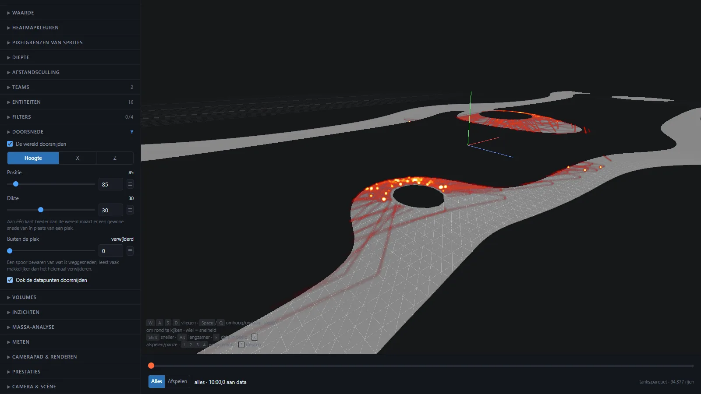

# Doorsnede

**Doorsnede** snijdt de wereld als een plak taart, zodat je in gebouwen kunt kijken. Gebruik hem wanneer muren de interessante warmte verbergen, bijvoorbeeld om één verdieping van een gebouw te zien.

## Probeer het {#try-it}

1. Laad een niveau en wat data, en open **Doorsnede**.
2. Vink **De wereld doorsnijden** aan. De as is **Hoogte**.
3. Sleep **Positie** omhoog en omlaag: de plak beweegt door het niveau.
4. Maak **Dikte** dun voor een plattegrond, of breed voor "alles hier beneden".
5. Houd **Buiten de plak** op 0 om de rest te verwijderen, of verhoog het om een zwakke sporen te behouden.



De plak snijdt **niveaugeometrie en datapunten samen** - alleen het niveau doorsnijden zou warmte laten zweven waar het gebouw eens was. Het is de tegenhanger van [dieptebedekking](depth-and-culling.md): als het niveau correct verbergt wat erachter ligt, is het binnenste van een gebouw ook verborgen. Het paneel wordt getoond wanneer er iets te snijden is (een dataset of een 3D-niveau); de kop toont de as wanneer het aan staat, anders *uit*.

```
zijaanzicht       Positie = waar de plak is
 ----------       Dikte = hoe hoog de plak is
 | verdieping 3 |
 |=========|  <--- plak (behouden)
 | verdieping 2 |  <--- erbuiten: verwijderd (of zwak)
 | verdieping 1 |
 ----------
```

## Bediening {#controls}

| Bediening | Standaard | Betekenis |
|---|---|---|
| **De wereld doorsnijden** | uit | Zet de plak aan. Zolang de positie nog op de beginwaarde 0 staat en de dikte op de beginwaarde 500, verplaatst het aanzetten ze naar het midden van de as en 15% van haar spanne. |
| As | **Hoogte** | *Hoogte* (Y), *X* of *Z*. Het wisselen van de as verplaatst de plak naar het midden van de nieuwe as. |
| **Positie** | het midden | Midden van de plak, in wereldeenheden, over de spanne van de as (500 stappen). |
| **Dikte** | 15% van de spanne | Van 1/500 van de spanne tot twee keer de spanne, in logaritmische stappen. Toont *voorbij de wereld* zodra hij even breed is als de spanne: dan reikt de ene kant voorbij de wereld en is het een gewone snede in plaats van een plak. |
| **Buiten de plak** | 0, *verwijderd* | Hoeveel van wat erbuiten ligt zichtbaar blijft, 0-100%. Een zwak spoor van wat weggesneden is, is vaak makkelijker te lezen dan het helemaal te verwijderen. |
| **Ook de datapunten doorsnijden** | aan | Uit laat de warmte heel, zodat ze door de snede heen zichtbaar is - handig om te zien wat boven en onder de plak ligt. |

De spanne van een as is die van het 3D-niveau wanneer er één is geladen, anders die van de dataset.

Doorsnede staat los van [afstandsculling](depth-and-culling.md#distance-culling), dat langs de kijkrichting snijdt in plaats van langs een wereldas; de twee werken samen. Elke wijziging aan een doorsnede-instelling start de warmteopbouw opnieuw.

## Voor ontwikkelaars {#for-developers}

De plak wordt getest op de wereldpositie van elke rij in de vertexshader: een rij buiten de plak heeft zijn bijdrage vermenigvuldigd met de waarde *Buiten*, dus bij 0 wordt hij verworpen voordat een fragment wordt getekend. De shaders van het niveau passen dezelfde test toe op elk fragment van de grond, de structuren en het water.
