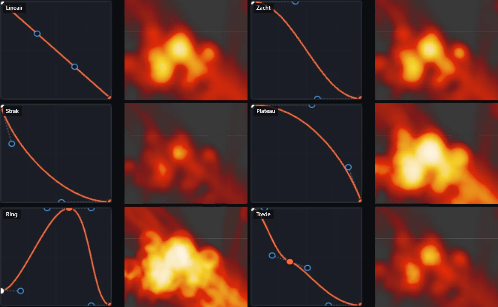

# Vorm van sprite

Elke rij wordt getekend als een ronde sprite die altijd naar de camera gericht is. De grootte en het profiel van het midden naar de rand - het **verloop** - bepalen of een hotspot leest als een strakke stip, een zachte wolk, een schijf of een ring. Deze instellingen staan in de gedeelten **Heatmapvorm** en **Pixelgrenzen van sprites** van de zijbalk, en gelden voor [Warmte](heat.md), [Verschil](difference.md), [Teamwarmte](team-heat.md) en, als halve breedte van een lijn, [Lijnwarmte](line-heat.md).

Als je een van deze wijzigt, begint de accumulatie opnieuw (het veld moet met de nieuwe vorm worden getekend).

Zie elke stip als een zacht vlekje licht. Een klein vlekje toont losse plekken; een groot vlekje voegt buren samen tot een wolk. De vorm bepaalt hoe zacht de rand is.



## Spriteradius {#sprite-radius}

De straal van de sprite in **wereldeenheden** (aangeduid in meters). Standaard 6, en bij elke keer dat je laadt de horizontale omvang van de data / 120 - groot genoeg dat naburige monsters langs een pad samensmelten tot een band in plaats van als een haarlijn te lezen. Logaritmische schuifregelaar van 0,05 tot 2000, het handvat sleep je tot 50.000.


Dingen die ver weg zijn, lijken kleiner, dus een sprite krimpt op het scherm met de afstand. Bij de parallelle projectie is hij overal even groot, en dat is deels de reden dat de parallelle weergave de juiste is om hotspots te vergelijken ([Camera](camera.md#projection)).

## Pixelgrenzen {#pixel-clamps}

**Pixelgrenzen van sprites** (standaard dicht) begrenzen de straal op het scherm na de omzetting hierboven.

| Regelaar | Standaard | Bereik (schuifregelaar) | Waarom |
|---|---|---|---|
| **Min. pixelstraal** | 1 px | 0-16 (512) | Houdt verre data boven één pixel, zodat ze niet verdwijnt. |
| **Max. pixelstraal** | 96 px | 2-1024, logaritmisch (8192) | De bescherming tegen overtekenen. Een sprite die N pixels bedekt, kost N mengbewerkingen; een ongeklemde straal dicht bij de camera is wat een snel beeld tot een traag beeld maakt. Boven de hoogte van het beeld klemt hij niets meer. |

**Gelijke dichtheid bij elke zoom** (in het gedeelte Heatmapvorm, standaard aan) werkt samen met de grenzen. Een sprite die een grens groter maakt (ver weg) of kleiner (van dichtbij), houdt de warmte die zijn echte grootte zou toevoegen, zodat een kleur bij elke zoom hetzelfde aantal rijen per oppervlak grond betekent. Staat het uit, dan voegt een geklemde sprite zijn volle gewicht toe op zijn geklemde grootte, en verandert het beeld zodra je naar binnen vliegt.

## Intensiteit in het midden en aan de rand {#centre-and-edge-intensity}

De warmte die een sprite toevoegt precies in het midden (**Intensiteit in het midden**, standaard 1, 0-10, schuifregelaar 1000) en aan de rand (**Intensiteit aan de rand**, standaard 0, -2-10, schuifregelaar 1000). De verloopwaarde *t* (1 in het midden, 0 aan de rand, gevormd door de afval of de curve hieronder) mengt tussen beide (de formule staat onder [Voor ontwikkelaars](#for-developers)).

Een **negatieve intensiteit aan de rand** laat de rand aftrekken, wat een koele gloed rond elke hotspot uitsnijdt en clusters scherper van elkaar scheidt. Zichtbaarheid omvat [occlusie](depth-and-culling.md) en de [doorsnede](slice.md); vervagen is de [Levensduur](timeline.md#history)-vervaging; het teken is ±1 in [Verschil](difference.md).

## Vorm van het verloop: Afval of Curve {#ramp-shape-falloff-or-curve}

**Vorm van het verloop** schakelt tussen twee manieren om *t* over de sprite te vormen. Met *d* de afstand van het midden (0) tot de rand (1):

### Afval {#falloff}

Wordt getoond als *Afval* is gekozen (de standaard).

- **Afval** (standaard 1,6, 0,1-8, schuifregelaar 64): `t = (1 - d) ^ afval`. 1 is een rechte lineaire helling; hoger trekt de warmte naar het midden en maakt de hotspot strakker; onder 1 wordt hij tot een schijf afgevlakt.
- **Zacht verloop** (standaard aan): past een smoothstep-S-curve op *t* toe, zodat de sprite aan zijn rand uitdooft in plaats van op een zichtbare rand te eindigen.

### De curve-editor {#the-curve-editor}

Wordt getoond als *Curve* is gekozen. Een letterlijke doorsnede van een sprite: afstand van het midden over de breedte (*midden* links, *rand* rechts), warmte omhoog. De curve is een stuksgewijs kubieke Bézier door controlepunten, elk met twee handvatten.

| Actie | Effect |
|---|---|
| Dubbelklik op de grafiek | Voegt een punt toe op die afstand (blijft tussen 0,02 en 0,98), op de curve en met de helling van de curve daar, dus het toevoegen verandert niets tot je het sleept. |
| Een punt slepen | Verplaatst het. Hoogtes blijven tussen 0 en 1. |
| Een klein rondje slepen | Buigt het segment naast het rondje (verplaatst dat handvat). |
| Alt-klik of rechtsklik op een punt | Verwijdert het. De twee eindpunten kunnen niet worden verwijderd. |
| Een presetknop | Vervangt de curve door de preset. |

De eindpunten staan vast in het midden en aan de rand; hun hoogte bepaal je nog steeds zelf.

**Presets** ([`curve.ts`](https://github.com/Holdi601/3DHeat/blob/main/src/state/curve.ts)):

| Preset | Vorm | Gebruik |
|---|---|---|
| **Lineair** | Recht van 1 naar 0 | Hetzelfde als *Afval* 1 met *Zacht verloop* uit. |
| **Zacht** | S-curve | De standaardcurve; wat *Zacht verloop* geeft bij afval 1. |
| **Strak** | Een steile kern, een lange zwakke rok | Schaarse data. |
| **Plateau** | Vlak, dan een snelle afloop | Leest als een schijf in plaats van een vlekje. |
| **Ring** | 0,15 in het midden, 1 op 62% van de straal, 0 aan de rand | Een holle sprite: toont waar paden langs gaan in plaats van waar ze stoppen. |
| **Trede** | Afloop in twee trappen, 0,45 op 35% | Scheidt een dichte kern van zijn omgeving. |

## Plat op het grondvlak {#flatten-onto-ground-plane}

**Plat op het grondvlak** (standaard uit) negeert de hoogte van elke rij en tekent alle warmte op één hoogte - de laagste Y van de dataset - de klassieke 2D-kaartwarmtekaart. Staat het aan, dan zijn dieptebedekking en *Verbergen achter terrein* uit (elk punt zou precies op het oppervlak liggen waartegen het wordt getest), en het gedeelte Diepte zegt dat ook.

## Voor ontwikkelaars {#for-developers}

### Formules {#formulas}

Straal op het scherm in pixels: `straal × P[1][1] / w × hoogte van het beeld / 2`, waarbij `P` de projectiematrix is en `w` de diepte van het punt in het beeld.

De warmte die een sprite toevoegt:

```
toegevoegde warmte = mix(rand, midden, t) × monstergewicht × teken × vervaging × zichtbaarheid
```

### De curve {#the-curve}

Handvatten worden horizontaal begrensd tot hun eigen segment, zodat de curve altijd een functie van de afstand is: een handvat ver voorbij het volgende punt slepen, vlakt hem tegen dat punt af in plaats van de curve terug te vouwen, wat het resultaat zou laten afhangen van welke wortel een solver toevallig vond.

### Hoe de curve wordt getekend {#how-the-curve-is-drawn}

De curve wordt bij elke wijziging in een tabel van 256 items gebakken, geüpload als een 16-bits float-textuur, en per fragment bemonsterd met lineaire filtering en een inspringing van een half texel, zodat beide uiteinden exact blijven. Een Bézier voor x oplossen vraagt om iteratie, wat niet thuishoort in de heetste shader van het programma, en een tabelopzoeking is ook goedkoper dan de `pow()` die de afval gebruikt. 16 bits in plaats van 8 omdat 8 bits als banding zichtbaar wordt zodra duizenden sprites zijn opgeteld; 16-bits half float is filterbaar in core WebGL2, waar 32 bits een extensie nodig heeft.
