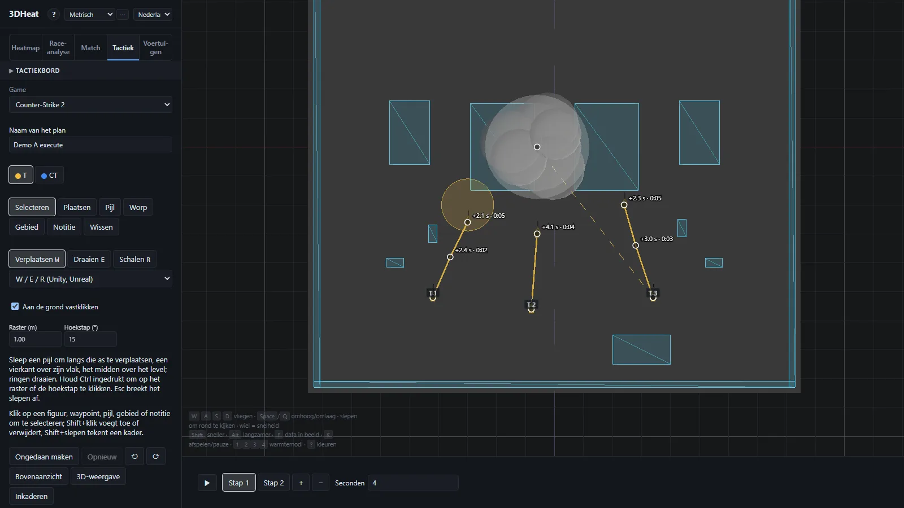

# Tactiekbord

Het tabblad **Tactiek** is een tekenbord voor een teamplan: je zet kleine figuurtjes op een kaart, tekent pijlen voor waar ze heen gaan, en drukt op afspelen om te zien hoe het gaat. Gebruik het om een ronde of aanval te plannen voordat je speelt. Het deelt het canvas, de camera en het [niveau](levels.md) met de andere tabbladen en verder niets; een plan is geen data en tekent geen warmte.

## Je eerste plan {#your-first-plan}

1. Open het tabblad **Tactiek**. Kies het **Spel** (bijvoorbeeld Counter-Strike 2) en, voor Valorant, druk op **Valorant-kaarten laden** en kies een **Kaart**. Of laad eerst een [niveau](levels.md).
2. Kies een **Kant** (die bepaalt de kleur) en druk op **Bovenaanzicht**.
3. Kies **Plek**, kies een figuur in **Figuren** (gebruik **Figuren zoeken** om er één te vinden) en klik op de kaart. Zet er twee of drie neer.
4. Kies **Pijl**, klik op een figuur, klik langs de weg die ze moet gaan, en druk op **Enter** om de pijl af te maken.
5. Druk op **+** onder de weergave om stap 2 toe te voegen. Elke figuur begint waar haar pijl eindigde. Teken daar meer pijlen.
6. Druk op **▶** (of `K`) om het plan vanaf de getoonde stap tot het einde af te spelen.
7. Geef het plan een naam in **Naam van het plan** en druk op **Opslaan**.

## Een plan beginnen {#starting-a-plan}

| Regelaar | Wat het doet |
|---|---|
| **Spel** | Kiest de kanten en de figuren die het palet biedt: Counter-Strike 2 (T, CT; spelers en hulpmiddelen), Valorant (Aanval, Verdediging; spelers en generieke vaardigheden), Battlefield, Squad, Arma (infanterie, voertuigen op de grond, luchtvaartuigen, boten), DCS / War Thunder / IL-2 (straaljagers, propellervliegtuigen, helikopters, luchtverdediging, grond, schepen, wapens), en Overig. Een plan dat al figuren heeft behoudt zijn kanten als het spel verandert. |
| **Naam van het plan** | De naam waaronder het plan wordt opgeslagen. |
| **Kaart**, **Valorant-kaarten laden** | Met Valorant gekozen: **Valorant-kaarten laden** haalt de lijst met kaarten van [valorant-api.com](https://valorant-api.com); **Kaart** zet dan de minimap van de gekozen kaart als niveau neer, van bovenaf in beeld gebracht. De afbeelding wordt bij het kiezen opgehaald en nooit meegeleverd. Riots kennisgeving wordt getoond zolang hij op het scherm staat (zie hieronder). |
| **Kant** | De kant waartoe de volgende figuur, pijl of het volgende gebied hoort; het krijgt de kleur van de kant. |

Zonder niveau is het bord het platte grondvlak. Laad een niveau onder **Level** om op een echte kaart te plannen: een CS2-kaart geëxporteerd met de CS2-tool, een niveau uit de bibliotheek, of een kaartafbeelding.

## Gereedschappen {#tools}

| Gereedschap | Klik | Opmerkingen |
|---|---|---|
| **Selecteren** | Een figuur, een routepunt, een pijl, een gebied of een notitie selecteert het. | Shift+klik voegt toe of haalt weg; Shift+slepen tekent een kader om wat toegevoegd moet worden. De selectie krijgt een transformatiehandvat (zie hieronder); `Delete` of `Backspace` verwijdert het. `M` verplaatst de geselecteerde figuur naar de volgende klik. |
| **Plek** | Zet de gekozen figuur neer. | Een figuur wordt gekozen in het palet **Figuren** (met **Figuren zoeken**). Met niets geselecteerd draait `R` de volgende figuur 15° voordat ze geplaatst wordt (`Shift+R` de andere kant op). |
| **Pijl** | Elke klik voegt een punt toe; Enter, een dubbelklik of een rechterklik maakt hem af, Esc gooit hem weg. | **Verschuiven**, **Aanval** (bredere punt) of **Bewaken** (een dunne lijn op ooghoogte). Een pijl die op een figuur begint is de route van die figuur in deze stap: afgespeeld loopt de figuur hem, en begint de volgende stap waar hij eindigde. |
| **Worp** | De werper, en dan waar het terechtkomt. | Een gestippelde boog van de een naar de ander, en het gekozen hulpmiddel (rook, flits, molotov, ...) verschijnt waar het terechtkomt en blijft vanaf deze stap. |
| **Gebied** | Het midden, dan de rand. | Een schijf in de kleur van de kant. |
| **Notitie** | Waar de notitie komt; vraagt om de tekst. | Getoond als een speld, met de tekst erboven. |
| **Wissen** | Een figuur, pijl, gebied of notitie. | Verwijdert het vanaf deze stap; in zijn eerste stap verwijdert het het volledig. |

**Ongedaan maken** en **Opnieuw** (`Ctrl+Z`; `Ctrl+Y` of `Ctrl+Shift+Z`) lopen door elke wijziging. Een regel onder het plan toont hoeveel figuren, pijlen en stappen het heeft. **Bovenaanzicht** kijkt recht naar beneden (orthografisch), **3D-weergave** keert terug naar perspectief, **Frame** past het plan in beeld, of het niveau als het plan leeg is.

**Figuurgrootte** schaalt elke figuur op het bord; 1× is ware grootte, wat van ver boven een paar pixels is voor een persoon.

## Verschuiven, draaien en schalen {#moving-turning-and-scaling}

Alles op het bord kan verplaatst worden zoals in een 3D-editor: figuren, hulpmiddelen, markeringen, losse routepunten en hele pijlen, gebieden en notities. Wat geselecteerd is krijgt een handvat in het midden:

| Modus | Toetsen | Handvatten |
|---|---|---|
| **Verschuiven** | W (of G) | Een pijl per as (X rood, Y groen en omhoog, Z blauw) verplaatst langs die as; een vierkant verplaatst in zijn vlak; het midden verplaatst over het niveau onder de aanwijzer. |
| **Draaien** | E (of R) | Een ring per as draait om die as. De ringen van een enkele figuur zijn haar eigen gier, helling en rol; een groep draait om de assen van de wereld rond haar midden. |
| **Schalen** | R (of S) | Spreidt of verzamelt de selectie vanuit het midden langs een as of op alle manieren; de straal van een gebied groeit mee. |

**Sneltoetsen** schakelt tussen W / E / R (Unity, Unreal) en G / R / S (Blender); de toetsen kiezen de modus alleen terwijl er iets geselecteerd is, en vliegen anders de camera. Dus `R` betekent **Schalen** met de W / E / R-toetsen en **Draaien** met de G / R / S-toetsen als er iets geselecteerd is, en draait de volgende figuur die geplaatst wordt als niets geselecteerd is. Alle toetsen van het bord staan in de [toetsenreferentie](keyboard-reference.md#tactics-board). Houd **Ctrl** ingedrukt tijdens het slepen om een verplaatsing aan het **Raster** (meters) of een draaiing aan de **Hoekstap** vast te laten klikken. **Aan de grond vastklikken** (standaard aan) zet verplaatste mensen, voertuigen, markeringen, routepunten en gebieden op het oppervlak van het niveau; luchtvaartuigen en helikopters behouden hun hoogte, en slepen langs de Y-pijl klikt nooit vast. Het slepen van een handvat verplaatst nooit de camera. **Esc** annuleert een sleep, en elke wijziging is één stap Ongedaan maken.

Routepunten tonen zich als stippen op de pijlen van de getoonde stap: klik er één aan om hem te selecteren, sleep hem om hem te verplaatsen, Delete om hem te verwijderen. Het gedeelte **Geselecteerd** toont de plaats van de selectie in meters, de gier, helling en rol van een figuur in graden en de straal van een gebied, elk in te typen.

## Tijdmeting {#timing}

De route van een figuur is getimed: elk segment kost zijn lengte over het niveau - op het oppervlak bemonsterd elke paar meter, zodat een heuvel of trap tussen twee punten meetelt - tegen de snelheid van de bewegingsmodus van die figuur in dat spel, plus eventueel **wachten** bij een routepunt. Infanterie kruipt, hurkt, loopt (stil), rent of sprint; voertuigen en boten kruipen, gaan voorzichtig, normaal of haasten zich; luchtvaartuigen en helikopters vliegen langzaam, op kruissnelheid, in gevechtssnelheid of op maximum. Een modus die het spel niet heeft (CS2 heeft geen sprint) neemt de dichtstbijzijnde die het wel heeft. Hoe een helling vertraagt hangt van het spel af: in CS2 en Valorant telt alleen de horizontale afstand, zoals in de spellen; militaire simulaties vertragen infanterie bergop (de wandelfunctie van Tobler) en voertuigen naar gelang de helling.

De snelheden komen uit tabellen per spel met hun bronnen (zie [Bewegingssnelheden](tactics-speeds.md)): CS2 per vast wapen, uit de wapendefinities van het spel; Valorant per wapen; Battlefield, Squad, Arma en de luchtspellen per voertuigtype en klasse. **Beweegt als** kiest het profiel van een figuur (een wapen, een voertuigtype); **Eigen (m/s)** overschrijft elke modus voor die figuur. Modi worden genoemd zoals het bord ze toont: *Kruipen*, *Hurken*, *Lopen (stil)*, *Rennen*, *Sprinten*; *Voorzichtig*, *Normaal*, *Haasten*; *Langzaam*, *Kruissnelheid*, *Gevecht*, *Maximum*.

Elk routepunt toont de tijd sinds het vorige en de tijd sinds het begin van het plan ("+3,9 s · 0:12"). De route van de geselecteerde figuur somt elk segment op met zijn modus, lengte en tijd, het wachten en de aankomst. **Aankomsten** onder **Tijdmeting** zet elke geroute figuur op één tijdlijn, eerste aankomst bovenaan. Met **Afspelen in echte tijd** (standaard aan) duurt een stap tot de traagste route aankomt en beweegt elke figuur met haar eigen snelheid; **Seconden** is dan de kortste lengte van de stap. **Level-eenheden per meter** zegt in welke eenheid het niveau is: 39,37 voor CS2-kaarten (spel-eenheden), 1 voor kaarten in meters.

## Vergelijken met wedstrijddata {#compare-with-match-data}

**Matchbestanden laden…** leest CS2-wedstrijdtabellen van de kaart (de Parquet-bestanden van de CS2-tool, zoveel als gewenst; alleen de nodige kolommen, op de achtergrond); **Geladen data gebruiken** neemt de data die in de viewer is geladen. Daarna:

- **Vroegste aankomst op de kaart** kleurt de kaart naar de tijd sinds het begin van de ronde waarop een speler elke plek voor het eerst bereikte - de knop **Snelste** toont de snelste over alle rondes, **Typisch (mediaan)** de middelste ronde - van groen vroeg tot rood laat, voor één kant of beide. Het toont wat mogelijk is en wanneer.
- De gekozen route wordt vergeleken met wat spelers vanaf het begin ervan (of vanaf het begin van de ronde) tot het einde bereikten, elk einde een schijf met de ingestelde straal: "Snelste waargenomen 14,2 s, p10 15,0 s, mediaan 18,3 s over 41 runs; jouw plan 15,1 s".
- De snelheden waarmee spelers werkelijk bewogen - rennen, lopen, hurken, uit de loop- en bukkolommen van de tabellen - in m/s.

## Stappen {#steps}

De balk onder de weergave bevat de stappen. Een plan begint met één; **+** voegt er één toe, en elke figuur begint hem waar haar route in de laatste stap eindigde; **−** verwijdert de getoonde. **Seconden** is hoe lang de getoonde stap duurt bij afspelen. **▶** (K) speelt vanaf de getoonde stap tot het einde: figuren met een route lopen hem, figuren die in de volgende stap naar een nieuwe plek verplaatst zijn schuiven daarheen, de rest staat stil. Terwijl een stap getoond wordt, wordt de plek van elke figuur in de volgende stap als een zwak spookbeeld getekend, en de pijlen van de laatste stap zwak onder die van deze.

## Opslaan {#saving}

Het gedeelte **Bestand** bevat **Opslaan**, **Open** en **Wissen**. **Opslaan** schrijft het plan als `<name>.h3dplan.json` (gewone JSON: kanten, stappen, figuren met een plek per stap, pijlen, gebieden, notities); **Open** leest er een terug. Een bestand van een andere versie, of een dat geen plan is, wordt geweigerd met de reden. **Wissen** leegt het plan; Ongedaan maken haalt het terug.

## Figuren {#figures}

Elke figuur wordt door de viewer zelf gebouwd: eenvoudige vormen op de gepubliceerde grootte van een type, met de kenmerken die ze van haar buren onderscheiden - de wielen en de toren van een tank, de kanonnen, missiles en radars van een luchtverdedigingsvoertuig, de vleugelvorm, staart en motoren van een vliegtuig, de rotors en stompe vleugels van een helikopter. Niets is van een spel overgenomen. Een ontwerp dat een spel heeft bedacht wordt getoond als de generieke figuur van zijn klasse. Zie [Figuren](figures.md#which-figure-a-unit-gets) voor hoe data zijn figuur vindt.

## Kennisgeving van Riot {#riots-notice}

Valorant-kaarten worden getoond onder het beleid "Legal Jibber Jabber" van Riot Games, dat vrije gemeenschapsprojecten toestaat ze te gebruiken en vraagt om deze kennisgeving waar ze verschijnen. De kennisgeving staat hieronder ongewijzigd in het Engels: *3DHeat was created under Riot Games' "Legal Jibber Jabber" policy using assets owned by Riot Games. Riot Games does not endorse or sponsor this project.* De vaardigheden op het bord zijn generieke vormen, niet de kunst van Riot.
