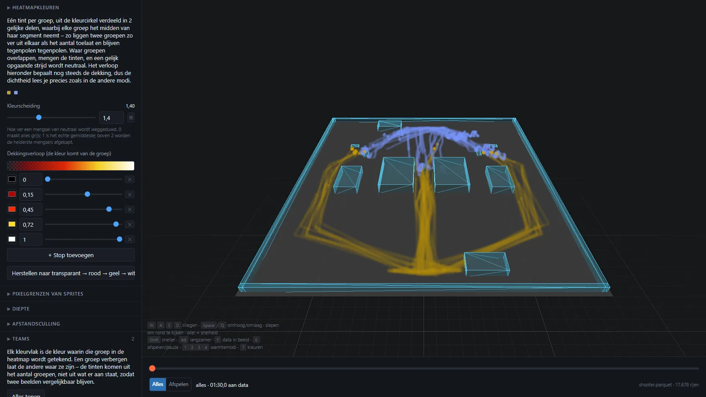

# Teamwarmte

Teamwarmte laat zien waar elk team was, elk team in zijn eigen kleur. Waar teams elkaar overlappen, mengen de kleuren.

**Teamwarmte** (toets 3) is het dichtheidsveld van [Warmte](heat.md) met elke [groep](glossary.md) een eigen tint. Waar groepen overlappen, mengen hun tinten; een gelijke strijd komt neutraal uit. Dekking geeft de dichtheid nog precies zoals in de andere modi, dus het beeld antwoordt tegelijk op *hoeveel* en *van wie*. Het heeft een groepskolom nodig.

Het is niet de [figurenoverlay](box-replay.md): die tekent één figuur per persoon; dit is een warmteveld gekleurd door dezelfde kolom.

## Zo gebruik je het {#how-to-use-it}

1. Druk op `3` (of kies **Teamwarmte** in de modusbalk).
2. Open **Heatmapkleuren**. De staaltjes tonen de kleur van elke groep; wijs een staaltje aan voor de naam van het team.
3. Als alles grijs lijkt, verhoog dan **Kleurscheiding**.
4. Haal het vinkje weg bij een groep in de [Teamlijst](teams-list.md) om hem eruit te halen; de andere kleuren blijven waar ze waren.

## Bediening {#controls}

In de sectie **Heatmapkleuren**:

| Bediening | Standaard | Betekenis |
|---|---|---|
| Staaltjes | | De kleur van elke groep, voor de eerste 12 groepen, daarna *+N meer*. Wijs aan voor de naam van de groep en de kleur. |
| **Kleurscheiding** | 1,4 | Hoe ver een mengsel van neutraal wordt weggeduwd, 0-4. 0 maakt alles grijs; 1 is het echte gemiddelde; boven ongeveer 2 verlaten de helderste mengsels het weergeefbare bereik en worden per kanaal afgekapt, wat hun tint verschuift. |
| **Dekkingsverloop (de kleur komt van de groep)** | het standaard warmteverloop | Hier wordt alleen het **alfa**-deel van het verloop gebruikt: transparant waar niets is, ondoorzichtig bovenaan. De kleuren ervan worden genegeerd. |

Een groep waarvan het label "geen groep" betekent (`0`, leeg, `none`, `unknown`, `null` of `-1`) wordt grijs getekend.

Alle andere warmtebedieningen - vorm, verzadiging, reactie, minimale warmte, diepte, wegsnijden - werken zoals in [Warmte](heat.md).

De [Teamlijst](teams-list.md) toont de teamwarmtekleur van elke groep als staaltje in deze modus. Een groep verbergen laat de kleur van elke andere groep waar ze was: tinten komen uit het totale aantal groepen, niet uit wat aan staat, dus twee beelden blijven vergelijkbaar.

## Voor ontwikkelaars {#for-developers}

### Het palet {#the-palette}

Uit [`colors.ts`](https://github.com/Holdi601/3DHeat/blob/main/src/render/colors.ts):

- Kleuren leven op het **Oklab**-kleurvlak bij een vaste helderheid (0,7) en chroma (0,115), zodat elke groep even helder is en een rode groep niet warmer oogt dan een blauwe.
- Bij *n* groepen wordt de tintencirkel in *n* gelijke delen verdeeld, en krijgt groep *i* het **midden** van zijn deel, `(i + 0,5) / n` van een omwenteling. Elke twee groepen liggen zo ver uit elkaar als het aantal toelaat, en tegenovergestelden blijven tegenovergesteld, wat het aantal ook is.
- Er worden hooguit **16** verschillende tinten gebruikt. Bij meer groepen worden id's geplaatst door herhaald halveren (bitomgekeerde id's: 0, ½, ¼, ¾, ⅛, …), zodat naburige id's geen tint delen; groepen boven 16 delen noodzakelijk een tint.
- Een groep waarvan het label "geen groep" betekent - `0`, leeg, `none`, `unknown`, `null` of `-1`, hoofdletters negerend - wordt **neutraal grijs** getekend in plaats van een stuk van de cirkel te krijgen. Alleen het eerste zo'n label in de groepslijst wordt zo behandeld.

De standaard scheiding is 1,4 in plaats van 1, omdat bij 1 een mengsel van vijf gelijkmatig verspreide tinten *wel* grijs is: correct en onleesbaar. Iets boven 1 houdt gelijke stand eerlijk en maakt een verdeling van 60/40 zichtbaar.

### Hoe het werkt {#how-it-works}

Het warmtedoel heeft in deze modus vier kanalen. Elke sprite telt zijn dichtheid *v* op bij het eerste kanaal en *v* × de Oklab-coördinaten *a* en *b* van de groep bij het tweede en derde. Bij het samenzetten is het mengsel van de pixel het dichtheidsgewogen gemiddelde: *a* = G / R, *b* = B / R, geschaald met de kleurscheiding en omgezet naar sRGB bij de helderheid van het palet. Delen door de opgebouwde dichtheid houdt de tint onafhankelijk van hoeveel data er is, en daarom blijft elke dichtheidsbediening alleen de dekking beïnvloeden.

Het doel met vier kanalen kost bij dezelfde resolutie vier keer zoveel GPU-geheugen als het doel van warmte met één kanaal.
