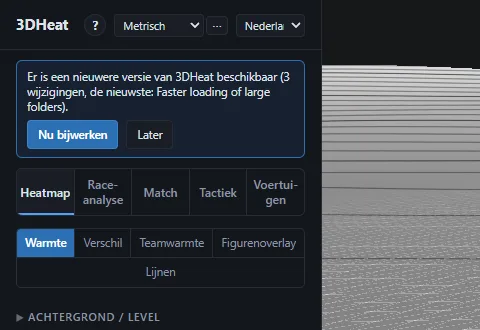

# Updates

De viewer laat je weten wanneer er een nieuwere versie bestaat, en werkt zichzelf alleen bij als je ja zegt. Er wordt niets op je computer veranderd zonder je antwoord.

## De viewer bijwerken {#update-the-viewer}

1. **In de pagina.** Wanneer er een nieuwere versie bestaat, verschijnt er een vak onder de naam bovenaan de zijbalk: "Er is een nieuwere versie van 3DHeat beschikbaar". Klik op **Nu bijwerken**. De pagina laadt zichzelf opnieuw als het klaar is. **Later** verbergt het vak tot je de pagina herlaadt.
2. **Als er staat dat je restart.bat moet draaien**, sluit je het servervenster (het zwarte venster dat `start.bat` opende) en dubbelklik je op `restart.bat`.
3. **Bij het starten van de viewer.** `start.bat` controleert ook. Als er een nieuwere versie bestaat, vraagt het **Update now? [Y/N]**. Druk op `Y` om bij te werken. Druk op `N`, of wacht 60 seconden zonder antwoord, om de versie die je hebt te starten.



Een kopie met eigen wijzigingen wordt nooit voor je bijgewerkt; het vak vertelt alleen dat er een update klaarstaat, en zegt dat je je wijzigingen moet committen of stashen en `git pull` moet draaien. Een kopie die niet met git is geïnstalleerd (bijvoorbeeld een zipbestand) toont niets.

Hoe de controle werkt, stap voor stap:

```
pagina ---(na 4 s, daarna elke 6 u)---> dev-server ---> git fetch
   achter?  nee -> er wordt niets getoond
            ja  -> eigen wijzigingen of commits?  ja -> alleen melden
                                                  nee -> [Nu bijwerken] -> git pull
                                                        -> herladen, of "draai restart.bat"
```

## De veiligheidsregels {#the-safety-rules}

- **Alleen fast-forward** (`git pull --ff-only`): een update voegt nooit samen,
  rebaset nooit en herschrijft niets.
- **Geen lokale wijzigingen**: een checkout met niet-gecommitte wijzigingen in
  gevolgde bestanden (`git status --porcelain --untracked-files=no` is niet
  leeg) wordt nooit automatisch bijgewerkt - andermans eigen werk is niet aan
  een update om te overschrijven. Er wordt alleen verteld dat er een update
  klaarstaat. Niet-gevolgde bestanden (data, exports) tellen niet als wijzigingen.
- **Geen lokale commits**: een checkout met commits die de upstream niet heeft
  ("gedivergeerd") wordt niet bijgewerkt - een fast-forward kan dat niet
  brengen, en samenvoegen is voor `git pull` met de hand. De pagina en
  `start.bat` zeggen dat in dezelfde woorden, en `start.bat` start de versie
  die er is.
- **Alleen vanaf de pagina zelf**: het updateverzoek van de dev-server moet een
  eigen header meesturen en, als de browser een `Origin` meestuurt, van de
  eigen host van de server komen (hieronder).
- Alleen een git-checkout met een upstream-branch wordt ooit bijgewerkt; al het
  andere (een kopie zonder `.git`, geen git geïnstalleerd, een statische build)
  wordt met rust gelaten en zegt niets.

## Wat start.bat doet {#what-startbat-does}

`start.bat` (dubbelklik erop; het venster is de server) doet, in deze volgorde:

1. Vindt Node.js - op `PATH`, anders in `%ProgramFiles%\nodejs`,
   `%ProgramFiles(x86)%\nodejs` of `%LOCALAPPDATA%\Programs\nodejs` - en biedt
   aan het te installeren met `winget install -e --id OpenJS.NodeJS.LTS` als
   het ontbreekt (gevraagd, Y/N; daarna moet het venster opnieuw geopend worden
   zodat Windows de nieuwe `PATH` oppakt).
2. **Updates**, als git geïnstalleerd is en de map `.git` heeft:
   - `git fetch --quiet` (geen netwerk of geen upstream: stilzwijgend overgeslagen);
   - telt `git rev-list --count HEAD..@{u}`; niets achter: er wordt niets gezegd;
   - lokale wijzigingen: "A newer version of 3DHeat is available (N changes), but this copy has local changes, so it is not updated. Commit or stash them, then run git pull." - en hij start de versie die er is;
   - eigen commits (`git rev-list --count @{u}..HEAD` is niet 0): "A newer version of 3DHeat is available (N changes), but this copy has commits of its own that the newest version does not, so it is not updated. Update it with git pull." - en hij start de versie die er is;
   - anders "A newer version of 3DHeat is available (N changes)." en de vraag **Update now? [Y/N]**. `N`, of geen antwoord binnen 60 seconden, drukt "Not updated; starting the version you have." af en start de versie die er is. Bij `Y` drukt het "Updating..." af, meldt of `package.json` of `package-lock.json` veranderen, draait `git pull --ff-only` (lukt dat niet, bijvoorbeeld door het netwerk, dan volgt "The update did not go through; starting the version you have."), daarna `git submodule update --init` (de vastgepinde tools, zie [De documentatie onderhouden](maintaining.md#the-tools-under-exporters)), daarna `npm install` als de pakketbestanden veranderden en `node_modules` bestaat, en "Updated."
4. Bij de eerste keer (geen `node_modules`) vraagt het of de afhankelijkheden
   gedownload mogen worden (ongeveer 300 MB in `node_modules\`, niets
   systeembreed).
5. Start de dev-server op `127.0.0.1:5273` (`--strictPort`) en opent de browser
   zodra die klaar is.

`restart.bat` stopt de server (op poort) en draait `start.bat` opnieuw, dus het stelt dezelfde vraag. `stop.bat` stopt alleen.

## Voor ontwikkelaars {#for-developers}

### Terwijl het draait: de updateroute {#while-it-runs-the-update-route}

De dev-server (Vite-plugin `heat3d-self-update` in `vite.config.ts`) levert `/__heat3d/update`. Die bestaat alleen op de dev-server - niet in een statische build en niet in `vite preview`.

**`GET /__heat3d/update`** antwoordt of de checkout achterloopt:

```json
{ "checkout": true, "upstream": "origin/main", "behind": 3, "ahead": 0, "dirty": false, "latest": "the newest commit's subject" }
```

- `checkout: false` als de map geen git-checkout is;
- hij draait `git fetch --quiet` **hoogstens elke 30 minuten** (vragen daartussen krijgen het antwoord uit wat het laatst is opgehaald);
- `behind` / `ahead` komen uit `git rev-list --count HEAD..@{u}` / `@{u}..HEAD`, `dirty` uit `git status --porcelain --untracked-files=no`, `latest` is het onderwerp van de nieuwste commit van de upstream;
- zonder upstream-branch: `upstream: null` en `behind: 0`.

**`POST /__heat3d/update/apply`** brengt de checkout bij:

1. Geweigerd met `403 { ok: false, reason: "forbidden" }`, tenzij het verzoek de header `X-Heat3d-Update: 1` heeft en, als het een `Origin` meestuurt, de host van die origin gelijk is aan de `Host` van het verzoek. Een formulier van een andere site kan geen eigen header meesturen zonder een CORS-preflight, en die verleent deze server nooit.
2. Niets te doen (geen checkout, geen upstream, niet achter): `{ ok: true, updated: false }`.
3. Lokale wijzigingen: `{ ok: false, reason: "dirty" }`; lokale commits: `{ ok: false, reason: "diverged" }`.
4. Anders: noteert welke bestanden veranderen (`git diff --name-only HEAD @{u}`), draait `git pull --ff-only` (time-out 2 min), `git submodule update --init` (fout genegeerd), `npm install` als `package.json` of `package-lock.json` veranderd is (time-out 15 min), en antwoordt `{ ok: true, updated: true, restart }`. `restart` zegt waarom de draaiende server de update niet kan oppakken: `"dependencies"` als de afhankelijkheden opnieuw zijn geïnstalleerd, `"config"` als alleen een `vite.config`-bestand veranderde, `false` als er geen herstart nodig is.
5. Een mislukt git- of npm-commando antwoordt `{ ok: false, reason: "<de fout, tot 300 tekens>" }`.

Antwoorden zijn JSON met `Cache-Control: no-store`. De server luistert alleen op `127.0.0.1`, dus de route is niet vanuit het netwerk te bereiken.

### De melding in de pagina {#the-notice-in-the-page}

`UpdateBanner`, onder de naam bovenaan de zijbalk:

- Hij vraagt de route **4 seconden** nadat de pagina is geladen (niet in de eerste seconden: de pagina moet een dataset laden en een GPU starten) en daarna **elke 6 uur** zolang de pagina open blijft.
- Hij toont **niets** als de route er niet is (een statische build), de map geen checkout is, of er niets nieuwer is - een melding bij elke start is er een die mensen leren negeren.
- Achter, zonder lokale wijzigingen: "Er is een nieuwere versie van 3DHeat beschikbaar (N wijzigingen, de nieuwste: <onderwerp>)." met **Nu bijwerken** en **Later** (*Later* verbergt hem tot de pagina opnieuw wordt geladen).
- Achter, met lokale wijzigingen: dezelfde zin en "Deze kopie heeft lokale wijzigingen, dus hij wordt niet automatisch bijgewerkt; commit of stash ze, en draai daarna git pull." - zonder knop.
- **Nu bijwerken** stuurt een verzoek naar `/apply` ("Bijwerken…"). Daarna:
  - "Bijgewerkt. De pagina wordt opnieuw geladen." - en hij laadt 1,5 s later opnieuw (de server levert de nieuwe bestanden al);
  - als de afhankelijkheden opnieuw zijn geïnstalleerd: "Bijgewerkt. De afhankelijkheden zijn veranderd: sluit het servervenster en draai **restart.bat** om af te ronden.";
  - als alleen de serverinstellingen zijn veranderd: "Bijgewerkt. De serverinstellingen zijn veranderd: sluit het servervenster en draai **restart.bat** om af te ronden.";
  - niets meer om binnen te halen (`updated: false` - de kopie is intussen bijgewerkt, bijvoorbeeld door `start.bat`): "Niets om bij te werken: deze kopie is al de nieuwste versie." - en er wordt niet opnieuw geladen;
  - geweigerd: de zin over lokale wijzigingen, of "Deze kopie heeft eigen commits die de nieuwste versie niet heeft; werk hem bij met git pull.", of "De update is niet gelukt: <reden>".
