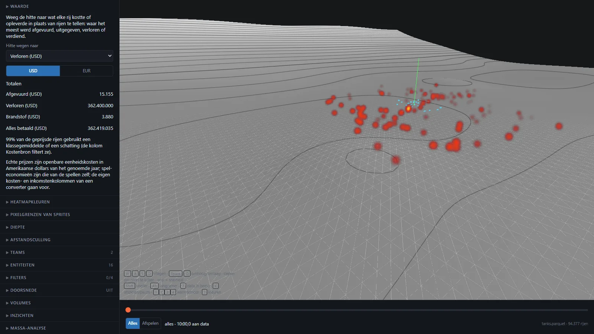

# Waardeweging

Elk schot, elke munitie, elk verloren voertuig en elke liter brandstof heeft een prijs. De viewer berekent wat elke rij kostte of opleverde en kan de warmte daarop wegen, zodat de kaart laat zien **waar het geld naartoe ging** in plaats van waar de rijen liggen.

## Zo gebruik je het {#how-to-use-it}

1. Laad data met gebeurtenissen (schoten, kills, doden) en voertuig- of wapennamen.
2. Open **Waarde** in de zijbalk Warmte.
3. Kies **Warmte wegen naar**, bijvoorbeeld *Verloren (USD)*. De warmte telt nu de prijs van elke rij op in plaats van 1.
4. Lees **Totalen**: de som van elke waardekolom voor wat er getoond wordt (filters en het tijdvenster gelden).
5. Waar de prijzen echt geld zijn, verschijnt een schakelaar **USD / EUR**.

Kies het lege eerste item van het menu om de rijen weer te tellen.

## Wat er gewogen kan worden {#what-can-be-weighed}

De waardekolommen worden bij het laden toegevoegd, één per soort en valuta:

| Soort | Rijen waarop het valt | Hoe het geprijsd wordt |
|---|---|---|
| **Afgevuurd** | schoten en lanceringen | het wapen, anders een gemiddelde voor de soort munitie |
| **Uitgegeven** | kopen, spawnen | geldkolommen van het spel (bijvoorbeeld het koopmenu van een shooter) |
| **Verloren** | doden, vernietigd | het eigen voertuig, anders het gemiddelde van zijn klasse |
| **Vernietigd** | kills | het doelvoertuig |
| **Aangerichte schade** | treffers | een deel van de waarde van het doel |
| **Brandstof** | posities | verbruikte brandstof, uit een brandstofkolom of geschat uit de klasse en de tijd |
| **Alles betaald** | | afgevuurd + uitgegeven + verloren + brandstof |
| **Verdiend** | beloningen | de eigen beloningskolommen van het spel (`earn_…`) |
| **Netto** | | verdiend min betaald; getekend als gerichte warmte (positief verloop waar meer verdiend is, negatief waar meer betaald is) |

De kolomnamen zijn `cost_<soort>_<valuta>`, `earn_<valuta>` en `net_<valuta>`. Een converter die de eigen valuta van het spel kent (bijvoorbeeld een replayconverter die in in-game-credits schrijft), wint het van de ingebouwde prijstabellen.

## De prijstabellen {#the-price-tables}

| Tabel | Valuta |
|---|---|
| Echte militaire zaken: raketten, bommen, munitie, tegenmaatregelen, vliegtuigen, helikopters, voertuigen op de grond, schepen, brandstof | USD (EUR = USD × 0,92, de vaste `EUR_PER_USD` in [`cost.ts`](https://github.com/Holdi601/3DHeat/blob/main/src/data/cost.ts); het is geen live koers) |
| Koopmenu's van shooters en killbeloningen | de credits van het spel |
| Tank- en scheepsspellen | de credits van het spel |
| Strategiespellen (meerdere grondstoffen) | één kolom per grondstof plus een gecombineerde |
| Wargames | punten |

Het spel wordt herkend aan de namen in de data. Echte prijzen komen uit openbare bronnen (begrotingsdocumenten, encyclopedieën) of zijn als schatting gemarkeerd; ze zijn niet aangepast voor inflatie. De gegenereerde lijst van tabellen staat op [Waardetabellen](ref-value-tables.md).

## Schattingen {#estimates}

De extra categoriekolom **Kostenbron** zegt hoe elke rij geprijsd is: `table`, `class average`, `estimate` of `none`. De sectie Waarde toont welk deel van de geprijsde rijen gemiddelden of schattingen zijn. Om alleen exact geprijsde rijen te houden, haal je onder **Kostenbron** op [Filters](filters.md) het vinkje weg bij *estimate* en *class average*.

## Waar waarde nog meer verschijnt {#where-else-value-shows}

- [Inzichten](insights.md): de bevindingen *Kostbaar terrein* en *Verdienend terrein*.
- [Uitsplitsing](breakdown.md): verdiend, verloren en netto geld per team, speler of wapen.
- [Volumes](volumes.md): waardekolommen in de statistieken en de vergelijking.
