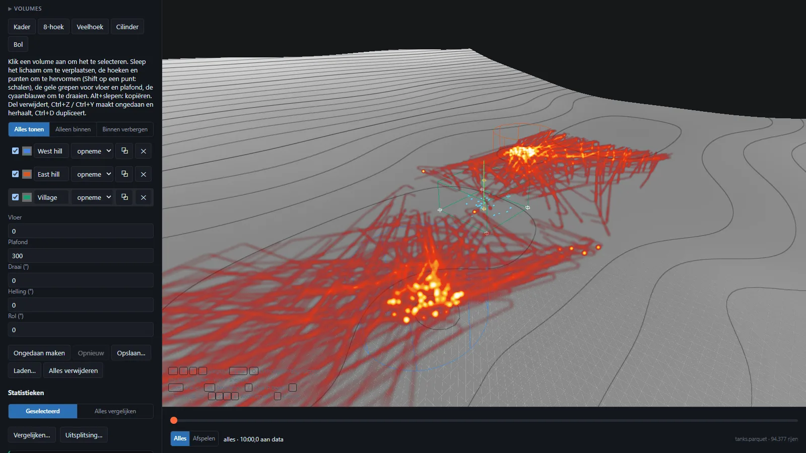
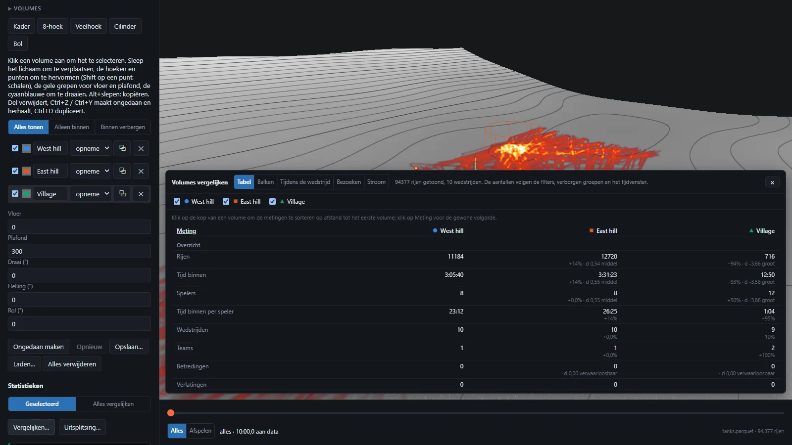
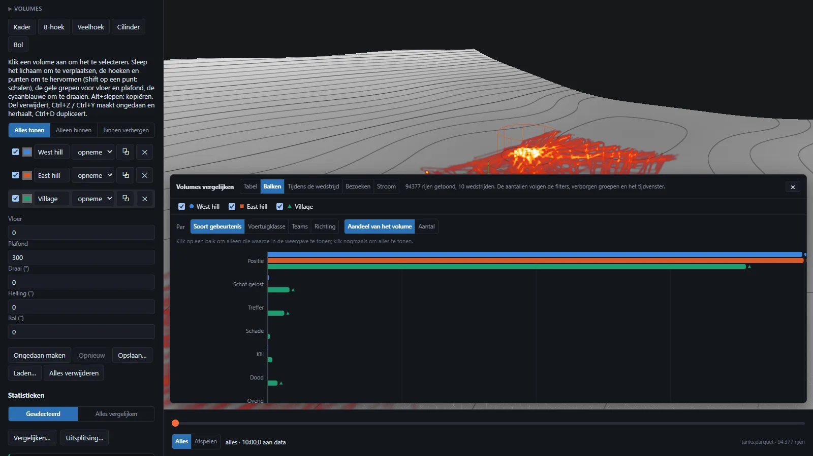

# Volumes en vergelijking

Een **volume** is een onzichtbare doos (of cilinder, of bol) die je rond een plek tekent, om te vragen: wat gebeurde hier binnen? Gebruik het om kills bij een brug te tellen, om twee heuvels te vergelijken, of om alleen de activiteit in één gebied te tonen.

```
 top view                 You draw a shape ->  the viewer counts
 +------------+           what is inside:
 |   ( A )    |            rows, players, kills, time ...
 |        [B] |           Compare A with B, side by side.
 +------------+
```



Volumes meten wat erin gebeurt, filteren de weergave tot hen, exporteren hun rijen, en kunnen naast elkaar vergeleken worden. Zie ook de [woordenlijst](glossary.md) voor rij, persoon en wedstrijd.

## Teken een volume {#draw-a-volume}

1. Open **Volumes** in de zijbalk.
2. Kies een gereedschap en teken in de 3D-weergave of op de 2D-kaart. Vloer en plafond beginnen bij de data eronder. Esc annuleert.
3. Klik op het volume om het te selecteren; de **Statistieken** verschijnen.

| Gereedschap | Hoe te tekenen |
|---|---|
| **Kader** | Sleep een rechthoek (Shift: een vierkant). Een klik plaatst een standaardkader. |
| **n-hoek** | Sleep vanuit het midden (Shift houdt het regelmatig). *Hoeken* stelt n in, van 3 tot 64 (standaard 8, dus de knop toont **8-hoek**). |
| **Veelhoek** | Klik de hoeken aan; sluit af met een dubbelklik, Enter of een klik op de eerste hoek. Backspace verwijdert de laatste hoek. |
| **Cilinder** | Sleep de straal. |
| **Bol** | Sleep de straal; hij rust op de grond. |

## Bewerken {#edit}

- Klik op een volume om het te selecteren. Sleep het lichaam om het te verplaatsen, de hoeken om het van vorm te veranderen (Shift op een hoek schaalt).
- De **gele** handvatten stellen vloer en plafond in, het **cyaan** handvat draait het.
- Alt+slepen kopieert, Del verwijdert, Ctrl+Z / Ctrl+Y maakt ongedaan en opnieuw, Ctrl+D dupliceert. **Alles verwijderen** verwijdert elk volume.
- Exacte waarden: Vloer, Plafond, Draaien / Helling / Rollen (kaders), Straal (bollen, cilinders).

Elke volumerij heeft een selectievakje voor tonen, een kleur, een naam, **opnemen** of **uitsluiten**, dupliceren en verwijderen. Volumes worden per dataset in de browser bewaard, en **Opslaan...** / **Laden...** schrijven en lezen een bestand `volumes.json`.

## Filter de weergave {#filter-the-view}

| Filter | Effect |
|---|---|
| **Alles tonen** (standaard) | Volumes meten alleen. |
| **Alleen binnen** | Warmte, replay en [trefferanalyse](hit-analysis.md) tekenen alleen wat binnen de opgenomen volumes ligt en buiten de uitgesloten. |
| **Binnen verbergen** | Het omgekeerde. |

Het GPU-filter neemt tot 8 volumes met in totaal 64 contourpunten; een "!" markeert een volume daarboven. Statistieken en export tellen het nog wel mee.

## Statistieken {#statistics}

Het gebied **Statistieken** volgt de filters, het tijdvenster en de verborgen groepen. *Geselecteerd* toont het geselecteerde volume, *Alles vergelijken* zet elk volume naast elkaar. Het toont:

- **Rijen binnen (getoond)** en **Rijen binnen (alle gegevens)**, **Spelers**, **Teams**, **Wedstrijden**, **Tijd binnen**, **Ingangen / uitgangen**, **Piekhitte**, **Gemiddelde hitte**, **Volume / voetafdruk** en een histogram **Wanneer**;
- **Winstpercentage**, als de gegevens zeggen wie won ([uitslagkolommen](data-formats.md#outcome-columns)): van de rondes met een speler binnen, de ronde van elke speler één keer geteld, het aandeel dat zijn kant won, met 4 rondes getrokken naar het percentage over alles wat getoond wordt, zoals de [uitsplitsing](breakdown.md) doet, met de gewonnen en gespeelde rondes en dat totale percentage;
- per kolom: categorieën met **Lift** (aandeel binnen gedeeld door aandeel in alle getoonde data), en getallen met bereik, mediaan en de 5e-95e percentielen.

**Statistieken als CSV / JSON** slaat ze op. **Gegevens binnen exporteren** schrijft de rijen binnen als CSV of Parquet (*Alleen de getoonde rijen* standaard aan), één volume of alle, met een kolom die zegt welk volume elke rij bevat.

## Vergelijk volumes {#compare-volumes}

Met twee of meer zichtbare volumes drukt je op **Vergelijken...**.

1. Teken drie volumes, bijvoorbeeld Westelijke heuvel, Oostelijke heuvel en Dorp.
2. Druk op **Vergelijken...** onder Statistieken.
3. Lees in **Tabel** het verschil van elke waarde met het eerste volume.
4. Schakel naar **Balken** om de aandelen als balken te zien.



| Weergave | Toont |
|---|---|
| **Tabel** | Rijen, tijd binnen, spelers, wedstrijden, teams, ingangen, uitgangen, bezoeken, lengte van bezoeken, kills, doden, kills per dood, kills per minuut, tijd per speler, waardekolommen; gegroepeerd op gebeurtenissen, voertuigklasse, speler of AI, team en richting. Elke waarde toont zijn verschil met het eerste volume en een effectgrootte (verwaarloosbaar, klein, middel, groot). Klik op de kop van een volume om op afstand tot het eerste te sorteren. |
| **Balken** | Aantallen of aandelen per gebeurtenis, klasse, acteur, team of richting. Klik op een balk om de weergave daartoe te filteren. |
| **Tijdens de wedstrijd** | Een grafiek per volume over de minuten van de wedstrijd: aanwezigheid, rijen of kills. Klik om daarheen te springen. |
| **Bezoeken** | Doos- en vioolplots van hoe lang bezoeken duren (logschaal). |
| **Stroom** | Waar sporen heen gaan nadat ze elk volume verlaten: een overgangsmatrix of stroomlinten. |



## Tips {#tips}

- Begin bij een bevinding: in [Inzichten](insights.md) voegt **Volume hier** een cilinder toe rond de plek van de bevinding.
- **Uitsplitsing...** opent de [Uitsplitsing](breakdown.md) voor het geselecteerde volume: wie en wat het best doet erbinnen.
- [Richtingswarmte](directional-heat.md) kan de richtingen binnen het geselecteerde volume in een grafiek zetten.
- Het [tabblad Voertuigen](hit-analysis.md#restrict-to-an-area) gebruikt dezelfde volumes als gebiedsfilter.
