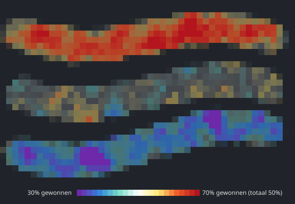

# Winstpercentage: hoe vaak een plek, een route of een actie wint

Waar een speler staat, welke weg hij neemt, waar hij zijn granaten gooit, en hoe vaak zijn kant daarna de ronde wint. De **winstpercentagekaart** kleurt elke plek naar het aandeel van de rijen daar dat hoort bij rondes die de kant van de rij won. Ze vergelijkt dat met het aandeel over alles wat getoond wordt: warm waar het hoger is, koel waar het lager is, niets waar het gelijk is.

*De afbeelding toont verzonnen gegevens: drie routes op een leeg level, met 68%, 50% en 33% van hun rijen in gewonnen rondes.*

Er zijn gegevens nodig die zeggen wie won: de [uitslagkolommen](data-formats.md#outcome-columns) (`won`, `matchWon`, `roundEndReason`). De converters voor CS2 en War Thunder schrijven ze, de Tacview-converter voor de campagnes van een DCS-server ([DCS-servers](tacview-acmi.md#dcs-servers-who-won-and-how-each-sortie-ended)); elk bestand kan ze hebben.

## Probeer het {#try-it}

1. Laad wedstrijden met een uitslagkolom en druk op `2` (**Verschil**).
2. Druk in **Verschilverdeling** op **Winstpercentage per ronde** (of **Winstpercentage per wedstrijd**). Dat zet de gewonnen rondes op **+** en de verloren rondes op **−**, en schakelt het paneel naar **Aandeel +**.
3. Lees de kleuren. Het paneel noemt het totale aandeel: *In totaal staan 52,0% van 1.200.000 rijen op +.*
4. Beperk het met de [filters](filters.md): één kant (T of CT), één gebeurtenistype (*Positie* voor waar mensen stonden, *Schot gelost* of *Lancering* voor waar ze vandaan schoten of gooiden), één aankoop, één kaart.

Een plek die warm is met *Positie*-rijen is een plek waarvan de bezetters vaak de ronde wonnen. Met *Kill*-rijen is het een plek waar de gemaakte kills tot gewonnen rondes leidden.

## De instellingen {#the-settings}

| Instelling | Wat het doet | Standaard |
|---|---|---|
| **Verschil** / **Aandeel +** | het verschil zelf, of het aandeel van de +-kant in de rijen van beide kanten | Verschil |
| **Volle kleur bij** | hoe ver boven of onder het totale aandeel een plek in volle kleur wordt getoond, in punten | ± 20 punten |
| **Minste rijen om een plek te kleuren** | een plek met minder rijen wordt niet gekleurd; vanaf de helft daarvan komt hij geleidelijk in beeld | 12 |
| **Trek naar het totale aandeel (rijen)** | elke plek begint met zoveel rijen op het totale aandeel, zodat een plek met 3 rijen, allemaal gewonnen, niet als 100% wordt getoond | 12 |

Alle drie werken op het afgewerkte beeld: als je ze versleept, begint het optellen nooit opnieuw.

Het aandeel geldt voor elke verdeling, niet alleen voor winst: *Aandeel +* met een verdeling per kant toont waar de T's het grootste deel van de aanwezigheid waren, en met een verdeling per bestanden van twee kaarten, waar de rijen van het ene bestand zwaarder wegen dan die van het andere.

## Rijen, geen rondes {#rows-not-rounds}

De kaart telt rijen. Een speler die twintig seconden op één plek staat, voegt bij elke meting een rij toe, allemaal uit één ronde. Het bewijs op een plek zijn dus de rijen in de buurt, niet de rondes. Daarom staan het minimum en de trek in rijen, en daarom zijn ze groter dan wat één ronde oplevert.

Voor de rondes zelf:

- **[Uitsplitsing](breakdown.md)** op een plek, de weergave of een volume: *Winst %* telt de ronde van elke speler één keer, op dezelfde manier naar het totale percentage van de plek getrokken (4 rondes).
- Statistieken van **[Volumes](volumes.md)**: *Winstpercentage*, de rondes met een speler binnen het volume, elk één keer, getrokken naar het percentage over alles wat getoond wordt, met de aantallen.

## Uitslagfilters {#outcome-filters}

Het paneel [Filters](filters.md) toont de uitslagkolommen direct na de eigen kolommen van de viewer: **Rondeuitslag** en **Wedstrijduitslag** (*Alle*, *Gewonnen*, *Verloren*) en **Hoe de ronde eindigde** (Eliminatie, Bom ontploft, Bom onschadelijk gemaakt, Tijd voorbij, Overgave, Gelijkspel, Doel, Zones vastgehouden, Tickets verloren, Alle voertuigen verloren), in de taal van de viewer.

## Voor ontwikkelaars {#for-developers}

De warmtepass schrijft drie sommen in het vierkanaalsdoel dat teamwarmte gebruikt: de warmte `R = Σ|v|`, de warmte van de +-kant `P` en `S = Σ v²/w`, met `w` het gewicht van de pass (steekproefgewicht maal framewinst). De compositie leest het aandeel `P/R` (een met de kernel gewogen gemiddelde) en de rijen waarop het rust, `n = R²/S` (de effectieve steekproefgrootte van Kish). Ze trekt het aandeel naar het totale aandeel, `p = (n·P/R + m·r0)/(n + m)`, en kleurt `p - r0` over het bereik op de verschilkleurverlopen.

`n` deelt elke factor weg die alle rijen op een pixel gemeen hebben: de framewinst, het steekproefgewicht, het oppervlaktegewicht van een begrensde sprite. Zo is het beeld bij elke zoom en steekproefdichtheid hetzelfde, en voegen frames van elke k-de rij zich samen tot het geheel zonder dat de kleuren verspringen. Het totale aandeel komt uit de tellingen per kant op de CPU, tot op een tiende procent; niets wordt van de GPU teruggelezen. De berekening en de controles: [`render/rateMap.ts`](https://github.com/Holdi601/3DHeat/blob/main/src/render/rateMap.ts) en de test ervan.

Het kost wat teamwarmte kost: het vierkanaalsdoel verviervoudigt de blendbandbreedte van de warmtepass, alleen zolang *Aandeel +* aan staat.
