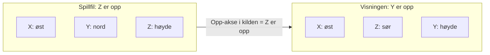

# Akser, enheter og tid

Spill og kart er ikke enige om hvilken vei som er opp, hvor lang en enhet er, eller hvordan tid skrives. Denne siden viser de tre innstillingene som får dataene dine til å stå, skalere og spille riktig.

Hvis kartet ditt står som en vegg i stedet for å ligge som et gulv, bytt **Opp-akse i kilden**.

Med feil **Opp-akse i kilden** står kartet som en vegg; med riktig en ligger det som et gulv.

## Verdenen visningen tegner i {#the-world-the-viewer-draws-in}

Visningens verden er **Y-opp**: X og Z er bakkeplanet, Y er høyden. De fleste spillmotorer er **Z-opp**: for dem er X og Y bakken og Z er høyden. Noen motorer er også speilvendt (venstrehåndet). Kartleggingen sier hvordan filens akser skal gjøres om til visningens. (Teknisk sett er visningen høyrehåndet, three.js-konvensjonen.)

### Opp-akse {#up-axis}

**Opp-akse i kilden** i [Kolonnekartleggingen](column-mapping.md):

| Innstilling | Fil (x, y, z) blir verden (X, Y, Z) |
|---|---|
| *Z er opp (de fleste spillmotorer)* – standard | (x, **z**, **y**): filens Z blir høyde, og filens Y blir verdenens Z |
| *Y er opp (grafikkonvensjon)* | (x, y, z) uendret |

For Z-opp-data blir de tre tabellene gitt nye navn i stedet for å kopieres ([`remapAxesInPlace`](https://github.com/Holdi601/3DHeat/blob/main/src/data/ingest.ts)), noe som sparer hundrevis av megabyte ved store innlastinger. Gjettingen gjøres ut fra utvalget: hvilken av Y- og Z-kolonnene som har minst spredning, er opp.

### Speilvending {#flips}

**Snu X**, **Snu Y** og **Snu Z** negerer *filens* akse med det navnet, før omdøpingen – så med Z-opp negerer *Snu Y* det som ender opp som verdenens Z. En speilvending endrer de innlastede dataene: koordinatene som vises av [linjalen](measure.md), skiven og kameraposisjonen er de speilvendte.

For å tegne en speilvendt verden riktig vei **uten** å endre dataene, bruk **Kamera og scene → Inverter verdensakse** i stedet ([Kamera](camera.md#invert-world-axis)). Det er det bedre valget for spill der verdenen er venstrehåndet, fordi hver koordinat verktøyene viser, forblir spillets egen.

### Enhetsskala {#unit-scale}

**Enhetsskala** ganger hver posisjon. *1 (m)* setter 1, *0,01 (cm→m)* setter 0,01 (enheter i Unreal Engine er centimeter, så bruk 0,01; enheter i Source-motoren er tommer, så bruk 0,0254; ingen av dem er meter), og boksen tar imot en hvilken som helst verdi. Et skrevet 0 eller en verdi som ikke er et tall, erstattes med 1.

Visningen merker avstander i meter (sprite-radius, avskjæringsavstander, linjalen, flyfart), noe som bare stemmer når den skalerte verdenenheten er en meter. Ingenting ødelegges når den ikke er det; etikettene bare står «m» for hva enheten enn er.

## Tid {#time}

### Tidsenheter {#time-units}

Tommelfingerregel: verdier som 17000000000 (ti eller flere siffer) er et Unix-tidsstempel; verdier som 0, 0,25, 0,5 er sekunder fra starten.

| Tidsenhet (menyetikett) | Leses som | Vist klokkeslett |
|---|---|---|
| *Sekunder (relativ)* | verdi × 1 s | nei |
| *Millisekunder (relativ)* | verdi × 0,001 s | nei |
| *Mikrosekunder (relativ)* | verdi × 10^-6 s | nei |
| *Nanosekunder (relativ)* | verdi × 10^-9 s | nei |
| *Unix-tidsstempel (s)* | sekunder siden 1970-01-01 UTC | ja |
| *Unix-tidsstempel (ms)* | millisekunder siden 1970-01-01 UTC | ja |
| *ISO-8601-datostreng* | tekst som `2026-03-14T18:02:11.250Z`, tolket med nettleserens `Date.parse` | ja |

Med en absolutt enhet (de tre siste) beholder datasettet veggklokkens øyeblikk for sin tidligste rad, og tidslinjen viser gjeldende UTC-klokkeslett (`HH:MM:SSZ`) ved siden av spillehodet.

**Parquet-kolonnene `TIMESTAMP` og `DATE`** blir til ekte øyeblikk, så enhetsinnstillingen deres ignoreres, og panelet sier det. En `DATE`-kolonne er en hel dag: hver rad i en dag deler ett øyeblikk, og avspillingen hopper en dag om gangen, noe panelet advarer om.

**ISO-8601-strenger fungerer like godt i CSV og Parquet.** En tekstkolonne for tid med ISO-enheten blir tolket én gang for hver ulik streng; hvis ingen tolkes, mislykkes innlastingen med *Ingen tolkbare ISO-8601-tidsstempler i den kartlagte tidskolonnen.* – og kartleggingen nekter allerede å starte når ingen av de testede verdiene kan tolkes. En Parquet-kolonne av typen `TIMESTAMP` leses som et tidsstempel uansett hvilken enhet som er satt, og en numerisk Parquet-kolonne med ISO-enheten leses som Unix-millisekunder. En tekstkolonne for tid med en numerisk enhet blir avvist før innlasting: hver verdi ville lest som NaN.

### Hvordan tid lagres {#how-time-is-stored}

Mens filene slås sammen, er tider 64-bit sekunder, så et absolutt epoke beholder sine brøkdeler av sekunder. Når alle filene er inne, blir den tidligste tiden i hele utvalget 0, og hver rad lagrer 32-bit sekunder fra den. Et 32-bit flyttall har 24 bit mantissa: spenn på opptil omtrent ett og et halvt døgn oppløses til bedre enn 1/100 s, spenn på et halvt år til omtrent ett sekund. En rad der tiden mangler eller ikke er et tall, plasseres i 0, starten.

Radene blir så sortert etter tid, og det er det som gjør tidslinjen billig: et tidsvindu finnes med to binærsøk (se [Utvalg og budsjetter](sampling-and-budgets.md)).

### Forløpt tid mot veggklokke {#elapsed-time-versus-wall-clock}

En tidskolonne som `match_time` eller `round_time` teller fra hver kamps egen start. Å velge den plasserer hver kamp på én felles akse – godt for å sammenligne hva som skjer i minutt 3 i hver kamp – og panelet peker på dette. En veggklokkekolonne viser kampene i den rekkefølgen de virkelig skjedde, overlappende der de overlappet.

## Blikkretning {#look-direction}

Blikkretningen brukes bare av [boksreprise](box-replay.md) (strålene fra hver boks). Den lagres som to vinkler, gir og stigning, i radianer.

- **Kolonner for gir / stigning** leses slik de er, og omregnes fra grader når *Grader* er valgt. De justeres ikke for opp-aksen eller speilvendingene.
- **Kolonner for retningsvektor** går gjennom samme omdøping og speilvendinger som posisjonene, og blir så gir = atan2(x, -z) og stigning = atan2(y, √(x² + z²)) i verdensakser, slik at strålen også peker dit boksen vender i en speilvendt kildeverden.

Hvis kolonnene for gir/stigning peker feil vei etter en speilvending, en retningsvektor, eller justerte vinkler, er det rettelsen.
