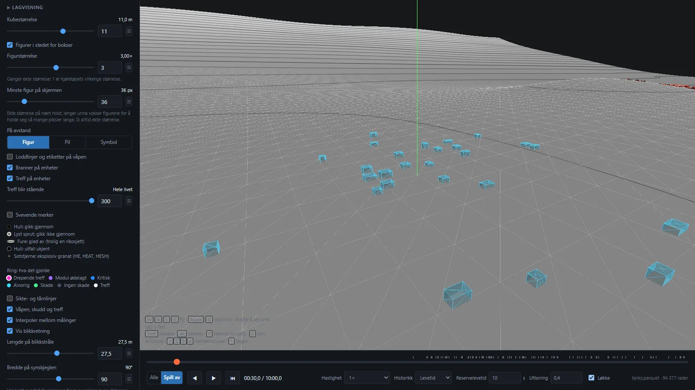

# Figuroverlegg (boksreprise)

En liten film: én figur for hver person, som beveger seg mens tiden går, med en hale bak seg.

Modusen heter **Figuroverlegg** i modusraden. Denne siden het tidligere «boksreprise», fordi hver person var en boks før figurer fantes; «figurreprise» og «boksreprise» betyr det samme. **Figuroverlegg** har ingen tallknapp: velg den i modusraden. Den tegner én figur (eller boks) per [person](glossary.md), som beveger seg langs [tidslinjen](timeline.md), med valgfrie blikkstråler og haler. Det er avspilling og ikke tetthet: *hvem var hvor, når*. Det krever en personkolonne; uten tidskolonne blir alle prøver tegnet på én gang.

## Slik bruker du den {#how-to-use-it}

1. Last inn data med en personkolonne og en tidskolonne.
2. Velg **Figuroverlegg** i modusraden.
3. Bytt tidslinjen til **Spill av** og trykk avspill (`K`).
4. Åpne **Lagvisning** for å endre **Halelengde**, figurstørrelsen eller blikkstrålene.

Ingen varme tegnes i denne modusen, og det adaptive sprite-budsjettet er inaktivt.

Som standard tegnes hver person som figuren for det de er, ikke som en boks – se [Figurer](figures.md) for hvilken figur en enhet får, og [Kampreplay](match-replay.md) for etiketter, kameraet som følger, måling mellom to enheter og hendelseslisten.

## Lagvisningspanelet {#the-team-viewer-panel}

Vises i stedet for varmepanelene i denne modusen.

| Kontroll | Standard | Område (jog) | Betydning |
|---|---|---|---|
| **Figurer i stedet for bokser** | på | | Hver person som figuren for det de er: en soldat til fots, stridsvognen eller flyet dataene nevner. Det dataene ikke sier noe om, blir en boks. |
| **Figurstørrelse** | 1× | | 1× er ekte størrelse. |
| **Minste figur på skjermen** | 36 px | 0 = alltid ekte størrelse | Ekte størrelse på nært hold; lenger unna vokser figurene for å være så mange piksler lange. |
| **Våpen, skudd og treff** | på | | Våpen i flukt med røyk, sporlys, nedslag, treff og drap. Sporlys utledet fra et treff er stiplet. |
| **Kubestørrelse** | enhetsstørrelse, eller utstrekning / 500, ved innlasting | 0,05–200 m, logaritmisk (5000) | Kantlengden på hver boks. Se [enhetsstørrelse](sessions-persons-groups.md#entity-size). |
| **Interpoler mellom målinger** | på | | Mellom to målinger av samme person i samme økt plasseres boksen forholdsmessig mellom dem. Aldri over en øktgrense. |
| **Vis blikkretning** | på | | En stråle fra hver boks langs personens blikkretning (krever [blikkolonner](axes-units-and-time.md#look-direction)). |
| **Lengde på blikkstråle** | enhetsstørrelse × 4, eller utstrekning / 200, ved innlasting | 0,5–500 m, logaritmisk (20 000) | Vises mens blikkretning er på. |
| **Halelengde** | 8 s | 0–300 s (86 400); 0 = av | Sekunder med historikk tegnet bak hver person. |
| **Tegn hver rå måling** | av | | En boks per lagret måling i vinduet i stedet for én interpolert boks per person. Undersamplet for å holde det interaktivt. |

Hint i panelet forklarer at interpolasjon og haler bare forbinder målinger innen én økt, og, når innlastingen har [delte navn](sessions-persons-groups.md#names-worn-by-several-things-at-once), hvor mange navn som tegnes som enkeltmålinger.

## Økten som spilles av {#the-session-being-played}

Med en øktkolonne bestemmer **Økt**-velgeren øverst i sidepanelet ([Økter](sessions-persons-groups.md#the-session-picker)) hvilken kamp som spilles av. Den travleste velges ved innlasting. Bare rader fra den økten blir bokser og haler, og tidslinjen går over den øktens spenn i stedet for hele datasettets. *Alle økter* spiller av alle øktene samtidig, og forbinder fortsatt aldri målinger over øktgrenser.

## Hva som tegnes når {#what-is-drawn-when}

Fra [`TrackCursor`](https://github.com/Holdi601/3DHeat/blob/main/src/data/tracks.ts):

**Levende bokser** (Spill av-modus, rå målinger av). For hver synlige person, deres siste måling ved eller før spillehodet:

- Hvis personen har en neste måling, er den i samme økt, og navnet ikke er delt, plasseres boksen mellom de to målingene i forhold til tiden, med gir interpolert den korte veien rundt og stigningen lineært (når *Interpoler* er på).
- Ellers blir boksen stående på siste måling i tidslinjens **Reservelevetid** (standard 10 s) og fjernes så, slik at eliminerte spillere ikke henger igjen.

**Alle-modus** ignorerer spillehodet og tegner hver måling i området som en boks.

**Rå målinger** tegner en boks per lagret måling i vinduet: *Spennet* med *Vindu*-historikken, ellers alt opp til spillehodet. Høyst 65 536 bokser; med flere målinger tegnes hver *k*-te.

**Haler** (når halelengden er over 0 og rå målinger ikke tegnes): en linje mellom hvert par av etterfølgende målinger for en person innen de siste *halelengde*-sekundene opp til spillehodet, og blekner fra 80 % opasitet til gjennomsiktig med alderen. En hale stopper ved en øktendring og tegnes ikke for delte navn. Høyst 131 072 toppunkter; med flere hoppes rader over jevnt.

**Hvem som er synlig:** en person er skjult når gruppen deres er fjernet i [Lagliste](teams-list.md) (gruppen er den for deres første rad), når et gruppefilter utelater dem, eller når [Enheter](entities.md)-panelet har et utvalg som ikke inkluderer dem. [Kolonnefiltre](filters.md) gjelder ikke for bokser.

## Farger {#colours}

Én fargefamilie per gruppe og én nyanse per medlem, slik at et raskt blikk forteller deg hvilken side noen er på ([`teamMemberColor`](https://github.com/Holdi601/3DHeat/blob/main/src/render/colors.ts)). Gruppefargene går i ring gjennom en fast liste med ti – blå, rød, grønn, rav, fiolett, cyan, magenta, lime, oransje, indigo – og medlemmene i en gruppe spres over lysstyrke 42–76 % og metning 90–65 %.

## Merknader {#notes}

- Figuroverlegget bygger figurene på nytt bare når noe endres; et stille bilde tegner de siste på nytt.
- Linjen *Kuber* i [statistikkoverlegget](performance-and-stats.md) teller boksene på skjermen.
- Figuroverlegget tegnes i samme scene som nivået, så [dybdeskarphet](camera.md#depth-of-field) gjør boksene uskarpe, men aldri varmen.
