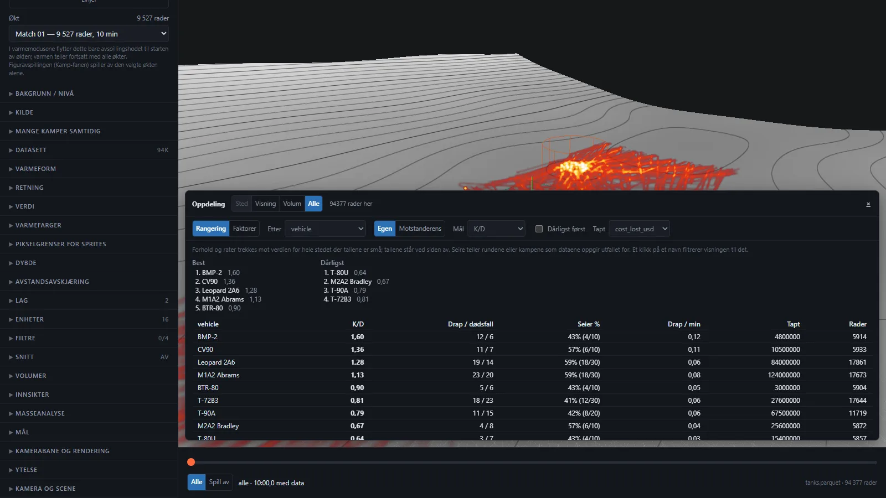
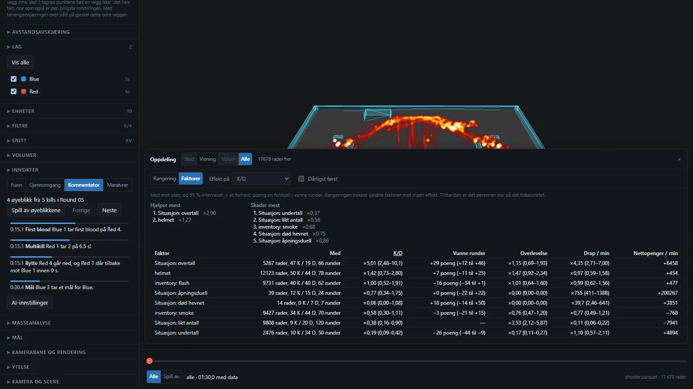

# Oppdeling: hvem og hva gjør det best hvor

**Oppdelingen** svarer på ett spørsmål: på dette stedet, hvilket kjøretøy, hvilken spiller eller hvilket våpen gjør det best? Bruk den til å finne stridsvognen som vinner ved broen, eller se om det virkelig hjelper å ha hjelm.

Den rangerer det som skjer på ett sted (et valgt punkt, visningen, et volum eller alt som vises) etter en hvilken som helst kategori, og måler hver tilstandsfaktor med mot uten.

## Prøv det {#try-it}

1. Last inn en kamp med drap og dødsfall, og åpne **Volumer**.
2. Tegn et volum rundt stedet du bryr deg om, og velg det.
3. Trykk **Oppdeling…** under Statistikk.
4. Under **Etter**, velg *Kjøretøy*, og velg målet *K/D* (drap per død).
5. Les listen, best først. Trykk **Dårligst først** for å snu den. Klikk på et navn for å filtrere visningen til det; klikk igjen for å slippe det.

## Åpne den {#open-it}

| Fra | Området den starter med |
| --- | --- |
| **Oppdeling…** i [Volumer](volumes.md) (Statistikk) | det valgte volumet |
| **Oppdeling her** på valgkortet, etter at du har klikket på et punkt | en kule rundt det punktet (**Radius**, standard 3 % av datasettets størrelse) |
| delt-panelet for **Differanse** | visningen |

Overskriften bytter området: **Sted**, **Visning** (det kameraet så ved forrige telling; **Tell på nytt** etter å ha flyttet det), **Volum** (velg ett) eller **Alle**. Den teller i bakgrunnen; statuslinjen sier hvor mange rader som er i området.

## Rangering {#ranking}

Velg hva som skal rangeres, og et mål:

| Mål | Hva det er |
| --- | --- |
| A, B | rader på hver side av differansekartet, delt slik varmen deler dem |
| A / B, A - B, A / (A + B) | de to lagene mot hverandre |
| K/D | drap mot dødsfall |
| Seiersprosent | runder (eller kamper) vunnet, der dataene sier hvem som vant |
| Drap / min | drap per minutt til stede (hull i bevegelsesmålingene) |
| Tjent, Tapt, Netto penger | summer av kolonnene `earn_*` og `cost_*`; en velger bestemmer valutaen |

Drap, dødsfall, tilstedeværelse, seire og penger teller hver rad visningen viser på stedet, på begge sider av delingen eller ingen.

Forhold og rater trekkes mot hele stedets verdi der tellingene er små, så 2 drap på 1 liv topper ikke listen. Tellingene vises ved siden av dem.

Du kan rangere etter gruppene, spillerne og kampene, hvilken som helst kategorikolonne (et kjøretøy, et våpen, en side, en kjøpstype, en agent eller et utstyrssett), hvilken som helst tallkolonne i områder (panser, verdien av en utrustning), en våpenkolonnes **klasse** (rifle, snikskytter, SMG, pistol ...) og hvor mange stykker **verktøy** en listekolonne som `inventory` har.

**Egen** rangerer etter radens egen verdi. **Motstanderens** rangerer etter den andre partens verdi: offerets våpen ved et drap, morderens ved en død (krever en `other`- / `victim`-kolonne som navngir dem).

## Tilstand på tidspunktet {#state-at-the-time}

En rads verdi er dens egen med mindre raden ikke logger noen (en hendelsesrad uten utstyr) eller det er en død (der våpenkolonnen kan navngi morderens våpen); da er den det samme personen sist bar tidligere i kampen.

## Faktorer: med mot uten {#factors-with-against-without}

Bytt fra **Rangering** til **Faktorer**, velg **Effekt på**, og les *Hjelper mest* og *Skader mest*:

Hver faktors effekt på K/D, vunne runder, overlevelse (minutter per død), drap per minutt og netto penger per minutt, med et 95 % konfidensintervall: forhold som x, vunne runder som en forskjell i poeng. Rangeringen trekker hvert estimat mot ingen effekt etter sin egen usikkerhet, så en sjelden faktor trenger en tydelig effekt for å rangere høyt; intervallet som vises, er det ikke-trukne.

Data med runder legger til **situasjonene** i nærkamp ([Nærkamp og runder](close-quarters.md)), regnet ut en gang per datasett: *blendet* (radens `state_flashed`, eller en fiendtlig blits innen 15 m de siste 3 s), *dødsfall byttet*, *åpningsduell*, og *mann opp*, *like mange* eller *mann ned* (spillere i live på radens side mot fienden). Et dødsfall teller i situasjonen offeret var i like før det.

Høyst 256 faktorer måles i ett gjennomløp.

## For utviklere {#for-developers}

### Trekke små utvalg {#pulling-small-samples}

Rangeringsverdien er `(n + m*r0) / (d + m)`: `n` og `d` er tellingene, `r0` er hele stedets forhold og `m` er vekten på den prior-verdien.

### For konverterforfattere: navngi faktorkolonner {#for-converter-authors-naming-factor-columns}

En konverter legger til en faktor ved å navngi kolonnen sin:

| Kolonne | Faktor |
| --- | --- |
| `state_<navn>` tall | på mens den ikke er null (`state_scoped`, `state_suppressor`) |
| `state_<navn>` kategori | én faktor per verdi (`state_ammo` = AP, HE ...) |
| `active_<navn>` | det samme, for noe som er slått på eller brukt nylig: en evne, en ultimate, en innretning, en buff (`active_ult`, `active_stim`) |
| listekolonne (`inventory`, `loadout`, `perks`, `abilities`, `attachments`, `modules`, `buffs`, `debuffs`, `upgrades`, eller et `state_`/`active_`-navn som slutter på `s`) | én faktor per gjenstand i en `a\|b\|c`-verdi |
| utstyrsflagg som allerede er vanlige (`helmet`, `defuser`, `armor`, `scoped`, `airborne`, `duck`, `flashed` ...) | på mens den ikke er null |
| `ammoType`, `shellType`, `ammoName` | runden sist avfyrt |

Resultater: en 0/1-kolonne `won` (radens side vant runden eller kampen) og en kolonne `round` - [resultatkolonnene](data-formats.md#outcome-columns); der en fil har både `won` og `matchWon`, teller *Seier %* runder. Penger: `earn_<valuta>` og `cost_<type>_<valuta>`; en inntekt etter type alene (`earn_round_cs2`, en konverters eksakte rundebelønninger) erstatter bare kostnadsmodellens inntekt av den typen (`round` dekker også plantinger og avmontering), og modellen priser resten.

Kartleggingen laster disse kolonnene selv, ved siden av filens egen liste: hver `state_*`-, `active_*`-, `won`-, `round`- og listekolonne, unntatt dem en Parquet-fils statistikk viser har én verdi gjennom hele (hver innlastet kolonne koster 4 byte per rad).
