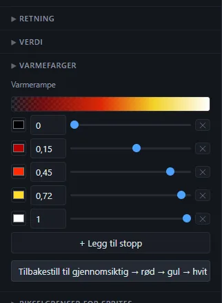

# Farge og eksponering

Disse kontrollene bestemmer hvor mye varme som får hvilken farge. **Metningspunkt** er hvor mye varme som regnes som hvitglødende.

## Raske løsninger {#quick-fixes}

- Alt er hvitt: øk **Metningspunkt**, eller trykk **Autoeksponer fra feltet**.
- Ingenting er synlig: senk **Metningspunkt**, eller trykk **Autoeksponer fra feltet**.
- Bare noen få enkeltprikker vises: skru opp **Minste varme**.

Alle kontrollene på denne siden virker når varmen blir til en farge, så når du drar i en av dem, tegnes bildet om med en gang, og det **starter aldri akkumuleringen på nytt**.

## Metningspunkt {#saturation-point}

**Metningspunkt** (seksjonen Varmeform): den akkumulerte varmen som tilsvarer toppen av fargeskalaen (med responsen *Lineær*; se under for de andre). Logaritmisk skyveknapp fra 0,1 til 4000, og håndtaket kan dras opp til 10 000 000, fordi akkumulert varme vokser med antall rader. Standard er 24. Ved hver innlasting blir det først satt et **analytisk anslag**, og deretter **målt** fra bildet.

Å få dette feil er forskjellen mellom et varmekart og en tom (eller hvit) skjerm. Verdien kan ikke regnes ut pålitelig, fordi telemetri samler seg så tett – en start, en dør, et flaskehals – at forholdet mellom toppetthet og gjennomsnittlig tetthet varierer med en størrelsesorden mellom datasett og mellom kameravinkler.

## Autoeksponering {#auto-exposure}

**Autoeksponer fra feltet** måler feltet som skyggeleggingen faktisk ga. Den ser bort fra tomme piksler, tar 98. persentil av de lyste pikslene og setter den til 85 % av veien opp til metningspunktet. Slik beholdes toppen av skalaen for de virkelige toppene.

Panelet viser da *målt X % av bildet; 98. persentil R plassert nær toppen av skalaen*. Med responsen *Mettende* havner en verdi på 85 % av metningspunktet på omtrent 69 % av skalaen i stedet for 85 %.

Den kjører også **automatisk**:

- 8 gjengitte bilder etter at et datasett er lastet inn;
- 8 bilder etter at [filtrene](filters.md) endres (hvis du filtrerer hver posisjon ned til hundre hendelser, endres tettheten med flere størrelsesordener);
- 8 bilder etter at du bytter mellom punktvarme og [linjevarme](line-heat.md), eller endrer hvilke ruter linjevarmen tegner, fordi en linje legger mye mindre varme per måling enn en sprite gjør.

Når ingenting er lyst, lar den automatiske kjøringen metningen være i fred. Knappen går da tilbake til det analytiske anslaget og sier *ingenting lyst å måle – brukte det analytiske anslaget*.

### Følg visningen {#follow-the-view}

**Følg visningen** (seksjonen Varmeform, på som standard) måler på nytt hver gang kameraet står stille, slik at et område du flyr inn i bruker hele fargeskalaen i stedet for skalaen som er målt for hele kartet. Små endringer ignoreres, og skalaen glir i stedet for å hoppe. Den kjører i de fire varmemodusene, ikke i figuroverlegget.

Fjern haken for å låse skalaen og sammenligne steder på én skala. Hvis du drar i **Metningspunkt** selv, låses den også.

## Tetthetsrespons {#density-response}

**Tetthetsrespons** – hvordan *k* (varme / metning) avbildes på skalaen:

| Respons | Formel | Bruk |
|---|---|---|
| **Mettende** (standard) | t = 1 - e^(-k) | Nærmer seg toppen av skalaen gradvis, slik stablede gjennomsiktige sprites gjør. Ingenting blir klippet til flat hvit, og det gjør den til et trygt standardvalg på ukjente data. |
| **Lineær** | t = k | Den eneste avbildningen der lik farge betyr likt antall. Bruk den til å sammenligne to datasett eller to tidsrom. |
| **Log** | t = log₂(1 + 7k) / 3 | Presser sammen en lang hale, så ett ekstremt varmepunkt slutter å flate ut alt annet nederst på skalaen. Løfter fram tynt befolkede områder. |

## Minste varme {#minimum-heat}

**Minste varme** (standard av, 0–100 %): hver piksel som har noen varme i det hele tatt, løftes opp til minst dette punktet på skalaen. Skru den opp, og senk sprite-radiusen, for å se *hvor noe noen gang skjedde* – enkeltdatapunkter blir tydelig synlige i stedet for å ligge bare litt over det gjennomsiktige. La den være av når du vurderer tetthet, for den flater ut bunnen av skalaen med vilje. Terskelen (k > 0,0001) gjør at virkelig tomme piksler forblir tomme.

## Fargeskalaeditoren {#the-ramp-editor}

I seksjonen **Varmefarger**. Etiketten sier hva skalaen brukes til: *Varmerampe* i Varme og Linjer, *Positiv (additive lag)* i Differanse, *Opasitetsskala (fargen kommer fra gruppen)* i [Lagvarme](team-heat.md), der bare alfaverdien brukes.



Linjen øverst viser en forhåndsvisning av skalaen. Under den er det én rad per stopp:

| Del | Betydning |
|---|---|
| Fargeprøve | Stoppets farge (nettleserens fargevelger). |
| Tall | Stoppets plass langs skalaen, 0 til 1 (0 = ingen varme). |
| Skyveknapp | Stoppets opasitet, 0–100 %. |
| ✕ | Fjerner stoppet; deaktivert når bare to er igjen. |

**+ Legg til stopp** legger til et stopp midt mellom de to siste stoppene, med den siste fargen og opasiteten. **Tilbakestill til gjennomsiktig → rød → gul → hvit** setter standarden tilbake.

Stoppene kan oppgis i en hvilken som helst rekkefølge; de blir sortert når skalaen bygges. **Alfaverdien** er det som blander varmen inn i scenen, og derfor er null-enden av standardskalaen helt gjennomsiktig.

### Standardskalaene {#the-default-ramps}

| Posisjon | Positiv (Varme, Linjer, Differanse +) | Negativ (Differanse −) |
|---|---|---|
| 0,00 | svart, alfa 0 | svart, alfa 0 |
| 0,15 | rgb(180, 0, 0), alfa 0,55 | rgb(0, 170, 60), alfa 0,55 |
| 0,45 | rgb(255, 40, 0), alfa 0,85 | rgb(0, 190, 200), alfa 0,85 |
| 0,72 | rgb(255, 220, 40), alfa 0,95 | rgb(40, 80, 255), alfa 0,95 |
| 1,00 | hvit, alfa 1 | rgb(170, 60, 255), alfa 1 |

## Mens kameraet beveger seg {#while-the-camera-moves}

Når kameraet beveger seg, starter akkumuleringen på nytt for hvert bilde. Med **Tegn hver rad i hvert bilde** på (standard) er hvert bevegelsesbilde fortsatt nøyaktig. Med den av, viser et bevegelsesbilde et samplet anslag – lysere, vektet flekker – som konvergerer mot det jevnere, sanne bildet når du stopper. Det er forventet; se [Akkumulering](accumulation.md).

## For utviklere {#for-developers}

### Sammensetningspasset {#the-composite-pass}

Etter at varmen er akkumulert, blir hver piksels verdi gjort om til en farge i ett sammensetningspass ([`COMPOSITE_FS`](https://github.com/Holdi601/3DHeat/blob/main/src/render/webgl2/shaders.ts)). Stegene er:

```
k = |heat| / saturation point
t = response(k)                         clamped to 0..1
if minimum heat > 0 and k > 0.0001:  t = minimum + (1 - minimum) × t
colour, alpha = ramp(t)                  (the negative ramp when heat < 0, Difference only)
pixel = mix(scene, colour, alpha)
```

### Det analytiske anslaget {#the-analytic-estimate}

**Det analytiske anslaget** ([`estimateSaturation`](https://github.com/Holdi601/3DHeat/blob/main/src/data/calibrate.ts)) antar at radene er spredt over X-Z-avtrykket av dataene: gjennomsnittlig varme = rader × (π r² / avtrykkets areal) × 1/3 × intensitet i senter (1/3 er gjennomsnittet over en skive av en lineær rampe), ganget med et antatt topp-til-gjennomsnitt-forhold på 25, begrenset til 0,1–1 000 000. Det trenger bare å være innenfor en størrelsesorden.

### Måling {#metering}

[`exposure.ts`](https://github.com/Holdi601/3DHeat/blob/main/src/render/exposure.ts):

1. varmemålet leses tilbake fra GPU-en, med undersampling til høyst 40 000 verdier;
2. tomme piksler (varme ≤ 0,0001) kastes – mesteparten av et varmefelt er tomt, og å regne dem med ville gitt for lav eksponering overalt, slik en kameramåler rettet mot en svart bakgrunn ville gjort;
3. 98. persentil av de lyste pikslene er referansen;
4. metningspunktet blir referanse / 0,85, slik at referansen ligger 85 % av veien opp til metningspunktet og toppen av skalaen beholdes for de virkelige toppene.

### Fargetabellen {#the-colour-table}

Skalaen blir lagt inn i en RGBA-tabell på 256 × 2 (positiv skala i første rad, negativ i andre rad) ([`buildColorLut`](https://github.com/Holdi601/3DHeat/blob/main/src/render/colors.ts)). Farger interpoleres i lineært lys og lagres som sRGB; opasitet interpoleres lineært.
