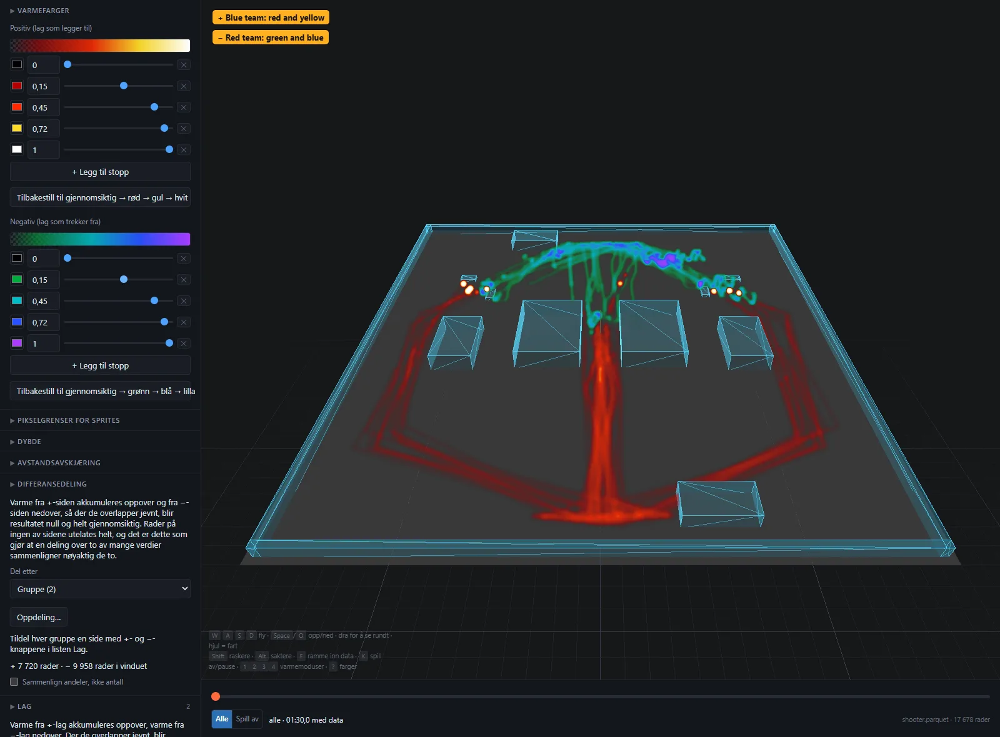

# Differanse

Rødt der lag A var mer, grønn-blått der lag B var det, ingenting der de var like.

**Differanse** (tast 2) er fortegnsvarme. Rader fra den ene populasjonen legger til varme; rader fra en annen trekker den fra. Der de to overlapper jevnt, blir resultatet null og helt gjennomsiktig; der den ene dominerer, vises det i den sidens farger – som standard varmt (gjennomsiktig → rødt → gult → hvitt) for **+**-siden og kjølig (gjennomsiktig → grønt → blått → lilla) for **−**-siden.

## Slik bruker du den {#how-to-use-it}

1. Trykk `2` (eller velg **Differanse** i modusraden).
2. Åpne **Differansedeling** i sidestolpen.
3. Velg hva du vil **Del etter**: vanligvis *Grupper*.
4. Sett én gruppe (eller verdi) på **+** og en annen på **−**.
5. Les fargene: varmt betyr +-siden, kjølig betyr −-siden. Panelet varsler hvis den ene siden ikke har noen rader (se [Meldinger du kan se](#messages-you-may-see)).

*Hvilke* to populasjoner det er, er hele spørsmålet, så delingen kan være enhver beholdt kolonne, ikke bare grupper. Rader som havner på **ingen** av sidene, **utelates**, de telles ikke som null: det er det som gjør at en deling over to av mange verdier sammenligner nettopp de to, og den settes sammen med [filtrene](filters.md) – filtrer ned til ett kart, og del deretter det etter bygg.

Modusen trenger to sider: en gruppekolonne med minst to grupper, eller en deling over en kolonne som beholdes for filtrering. På data med færre enn to grupper starter en innlasting med en kolonnedeling – *Source file*-kolonnen i en innlasting av flere filer først, ellers den første kategorikolonnen med to verdier, ellers den første numeriske kolonnen med et spenn – slik at *sammenlign to innlastinger* fungerer på data uten grupper. Bare data uten noe av dette gjør modusen utilgjengelig; det gjør også en kolonnedeling som står igjen med ingenting på den ene siden.

## Panelet Differansedeling {#the-difference-split-panel}

Vises i differansemodus, under varmepanelene.

**Del etter** tilbyr:

| Valg | Vist som | Delingsregel |
|---|---|---|
| Grupper | *Gruppe (N)* (når det finnes en gruppekolonne) | Hver gruppe på +, − eller ingen, satt i [Lagliste](teams-list.md) |
| En kategorikolonne | *kolonne (N verdier)* | Verdier på +, − eller ingen |
| En numerisk kolonne | *kolonne (numerisk)* | Et verdiområde for hver side |
| Filen den kom fra | *Source file – sammenlign to innlastinger* (når flere filer ble lastet) | Filer på +, − eller ingen |

Bare kolonner som beholdes under *Behold for filtrering* ved innlasting, tilbys.

### Sammenlign andeler, ikke antall {#compare-shares-not-counts}

**Sammenlign andeler, ikke antall** (standard av) vekter hver side med én delt på sitt eget radantall, så en side med fem ganger så mange rader ikke vinner bare på tall. Fargen viser da der hver side er forholdsmessig vanligere enn den andre. Bruk det når de to sidene har svært ulik mengde data, for eksempel to økter av ulik lengde.

### Meldinger du kan se {#messages-you-may-see}

Panelet varsler når bildet ikke er en ekte differanse:

| Melding | Betydning |
|---|---|
| *N + / M −* (eller *N + / M − / K ubrukt*) | Hvor mange verdier som er på hver side (og på ingen). |
| Ingen rad i vinduet er på **+**-siden | Bare **−**-siden tegnes. Flytt tidslinjevinduet eller endre delingen. |
| Ingen rad i vinduet er på **−**-siden | Bare **+**-siden tegnes. |
| Ingen verdi er på noen side | Differansen tegner ingenting. Sett minst én verdi på **+** eller **−**. |
| *kolonne* kan ikke deles slik | Den valgte kolonnen passer ikke til delingen. Velg kolonnen på nytt. |
| Delingskolonnen fikk ikke plass i grafikkortminnet for N av M biter | Disse radene tegnes ikke. Øk GPU-budsjettet under Ytelse → Ressursbudsjett, eller last inn færre rader. |

### Etter gruppe {#by-group}

Panelet peker bare på [Lagliste](teams-list.md), der hver gruppe har en knapp **+** og en **−**. Ved hver innlasting settes den første halvdelen av gruppene (avrundet opp) på +, resten på −; **Del jevnt** i Lagliste gjør det samme på nytt. En gruppe som er på ingen side, eller skjult med avkrysningsboksen, bidrar ingenting.

### Etter kategoriverdier {#by-category-values}

| Del | Betydning |
|---|---|
| `a + / b − / c ubrukt` | Hvor mange verdier som er på hver side og på ingen. |
| **Tøm** | Setter hver verdi på ingen side. |
| Verdiliste | Hver verdi med en knapp **+** og en **−** (klikk den aktive en gang til for å ta den av siden). En tom verdi listes som *(mangler)*. |
| Merknad om grense | Bare de første 200 verdiene listes: *Viser de første 200 av N verdier. En så bred kolonne er bedre å snevre inn med et filter først, eller dele etter område hvis verdiene er ordnet.* |

Å velge kolonnen setter dens første verdi på + og dens andre på −. Når ingen side har noen verdi, faller delingen tilbake til grupper i stedet for å vise en tom ramme. *Source file* fungerer på samme måte, én verdi per fil – slik sammenligner du to eksporter, to testkjøringer eller to bygg.

### Etter område {#by-range}

| Del | Betydning |
|---|---|
| Hint | Kolonnens minste og største verdi. |
| **Positivt område (+)**, **fra** / **til** | Rader med en verdi i dette området, inkludert i begge ender, legges til. |
| **Negativt område (−)**, **fra** / **til** | Rader i dette området trekkes fra. |
| **Del ved midtpunktet** | Setter + til [minimum, midten] og − til [midten, maksimum] – det som også skjer når du velger kolonnen. |

En verdi i begge områdene telles som +. Områdene behøver ikke dekke kolonnen; verdier i ingen av dem utelates. *De to første minuttene mot de to siste* er en områdedeling på en tidslignende kolonne.

## Andel +: seiersandelskartet {#share-of--the-win-rate-map}

**Differanse** / **Andel +** øverst i panelet velger hva som tegnes. *Andel +* farger hvert sted etter +-sidens andel av radene på begge sider der, sett mot den andelen over alt som vises: varmt over den, kaldt under, ingenting der den er den samme, og ingenting der et sted har for få rader. Med de vunne rundene på + og de tapte på − er det et seiersandelskart; **Seiersandel per runde** og **Seiersandel per kamp** setter det opp med ett trykk der dataene har [resultatkolonner](data-formats.md#outcome-columns). Se [Seiersandel](win-rate.md).

## Farger {#colours}

Delen **Varmefarger** viser to fargeskalaredigeringer i denne modusen: **Positiv (lag som legger til)** og **Negativ (lag som trekker fra)**, hver med sin egen tilbakestillingsknapp (*Tilbakestill til gjennomsiktig → rødt → gult → hvitt*, *Tilbakestill til gjennomsiktig → grønt → blått → lilla*). Det sammensatte bildet tar absoluttverdien av nettovarmen gjennom [metningspunktet og responsen](colour-and-exposure.md), og velger den negative skalaen der nettoen er under null. Se [Farge og eksponering](colour-and-exposure.md#the-ramp-editor).

Bruk den *lineære* tetthetsresponsen når størrelsen på differansen betyr noe: det er den eneste responsen der lik farge betyr likt antall.

## For utviklere {#for-developers}

Hver rad får et fortegn +1, -1 eller 0 i toppunkt-skyggeren ([`POINT_HEAT_VS`](https://github.com/Holdi601/3DHeat/blob/main/src/render/webgl2/shaders.ts)); en 0 forkaster raden før noe fragment tegnes.

- Etter gruppe kommer fortegnet fra en gruppetabell med 4 096 oppføringer, indeksert etter radens gruppe-ID (gruppe-ID-en ligger i fjerde kanal i radens posisjonsbit).
- Etter kategori kommer fortegnet fra en andre tabell med 4 096 oppføringer, fylt per kategoriverdi, og radens verdi leses fra kolonnens filterstruktur; en verdi forbi slutten av tabellen forkastes på begge backendene.
- Etter område sammenlignes radens verdi med de to områdene.

Å endre delingen starter akkumuleringen på nytt.

**Skjulte grupper forblir skjult med hver deling.** Under en deling etter en kolonne bærer ikke gruppetabellen lenger fortegn; den holder 1 for en vist gruppe og 0 for en skjult ([`frameSignTables`](https://github.com/Holdi601/3DHeat/blob/main/src/render/filterTables.ts)), og begge tabellene når skyggeren samtidig – to rader i én fortegnstekstur på WebGL2, to halvdeler av én lagringsbuffer på WebGPU. En rad tegnes bare når gruppen vises *og* kolonneverdien er på en side. Så en gruppe som er avkrysset bort i [Lagliste](teams-list.md), eller utelatt av fanen Kamp sitt fokus på side, bidrar ingenting uansett hvordan differansen deles.
