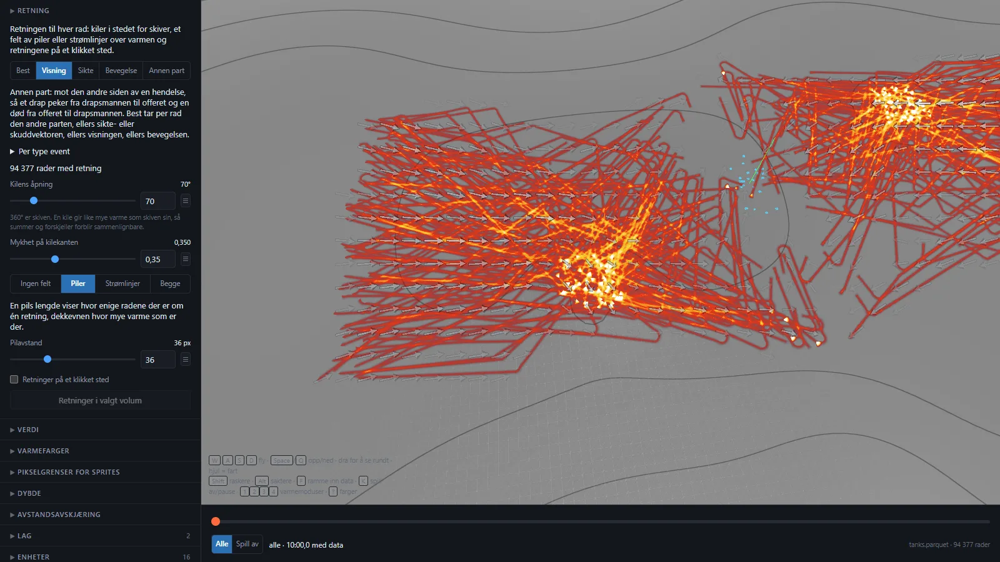

# Retningsvarme

Vanlig varme sier **hvor** ting skjer. Retningsvarme sier også **hvilken vei**: hvilken vei folk så, siktet, beveget seg, eller hvor den andre siden i en kamp var.

En vanlig sprite er en hel skive (360 grader). Med en **Kileåpning** på 70 grader blir den samme spriten en smal kile som peker i den veien raden vendte, og den legger til like mye varme totalt.

## Slik bruker du den {#how-to-use-it}

1. Last inn data som har en retning i seg (se [Hva gir en rad en retning](#what-gives-a-row-a-direction)).
2. Velg **Varme**, **Differanse** eller **Lagvarme** i modusraden.
3. Åpne seksjonen **Retning** i sidepanelet.
4. Velg en **kilde** (hvilken retning som skal brukes), og slå deretter på tegningen:
   - senk **Kileåpning** under 360° for å tegne hver rad som en kile som peker den veien, i stedet for en skive;
   - velg et **Felt** for å tegne piler eller strømlinjer over varmen;
   - kryss av for **Retninger på et klikket sted** og klikk på varmen for å få et polardiagram for det stedet.

Statuslinjen sier hvor mange rader som har en retning fra den valgte kilden.

## Innstillinger {#settings}

| Innstilling | Standard | Hva den gjør |
|---|---|---|
| Kilde: **Best**, **Visning**, **Sikte**, **Bevegelse**, **Annen part** | Best | Hvilken retning hver rad får. *Best* tar, per rad, den andre parten, ellers siktet, ellers visningen, ellers bevegelsen. |
| **Per type hendelse** | som over | En egen kilde for hver hendelsestype, for eksempel *Annen part* for drap og *Visning* for posisjoner. Vises når dataene har en hendelseskolonne med høyst 40 verdier. |
| **Kileåpning** | 360° | 360° er den vanlige skiven (av). Mindre er en smalere kile. En kile legger til like mye varme som skiven sin, så summer og forskjeller er fortsatt sammenlignbare. |
| **Mykhet på kilekanten** | 0,35 | 0 er en kile med skarpe kanter, 1 en myk vifte. |
| **Felt**: Ingen felt, Piler, Strømlinjer, Begge | Ingen felt | Piler: en pils lengde er hvor mye radene der er enige om én retning, og opasiteten viser hvor mye varme som er der. Piler vises bare der det er varme. |
| **Pilavstand** | 28 px | Avstanden mellom piler på skjermen. |
| **Animer strømlinjene** | på | Strømlinjene flyter når den er på. |
| **Retninger på et klikket sted** | av | Klikk på varmen for å se retningene der (nedenfor). |
| **Retninger i valgt volum** | | Det samme diagrammet for alt inne i det valgte [volumet](volumes.md). |

## Polardiagrammet for et sted {#the-polar-chart-at-a-spot}

Med **Retninger på et klikket sted** på, klikk på varmen. Radene nær det punktet (innen 1,5 sprite-radius) samles i en rose med 24 skiver på 15°:

- **oransje** kronblad: utgående retninger (dit radene peker);
- **blå** kronblad: innkommende retninger (dit de kom fra);
- et kronblads **areal** vokser med antallet; en pil viser hovedretningen;
- linjene under diagrammet gir hovedpeilingen, hvor sterkt radene er enige (R, 0 til 1), spredningen i grader, og antallet rader.

0° er opp i diagrammet, som er verdens −Z (nord for Tacview-opptak). Stedet er også merket i 3D-visningen med en pil og en ring.

## Hva som gir en rad en retning {#what-gives-a-row-a-direction}

| Kilde | Trenger i dataene |
|---|---|
| Visning | en gir-kolonne (kartlagt som blikkretning): `yaw`, `heading`, `azimuth`, `view_yaw`, `rot_z` |
| Sikte | tallpar som `aim_x`/`aim_y`, `shot_x`/`shot_y`, `fire_x`/`fire_y`, `hit_dir_x`/`hit_dir_y` (en valgfri `…_z`) |
| Bevegelse | ingenting ekstra: steget fra samme persons forrige måling (høyst 10 s tidligere, samme økt) |
| Annen part | en kolonne som navngir den andre siden i en hendelse (`other`, `victim`, `target`, `killer`, `attacker`, `shooter`, `other_player` ...) der verdiene er personnavn; et drap peker fra morderen til offeret, en død fra offeret til morderen |

## Tips {#tips}

- Kiler trenger en viss størrelse på skjermen; under noen få piksler tegnes de igjen som skiver.
- Bruk *Annen part* på drapsrader for å se **hvor fra** kamper ble vunnet, og *Visning* på posisjonsrader for å se **hvor folk ser**.
- Med **Differanse** peker kilene til de to sidene i sine egne retninger, slik at omstridte skuddlinjer skiller seg ut.
