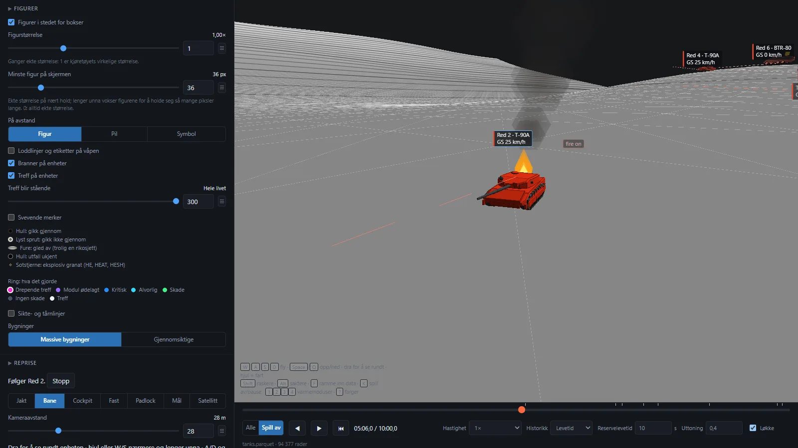

# Figurer

En **figur** er en liten 3D-modell av hva en enhet virkelig er: en stridsvogn, et jetfly, et skip, en soldat. [Avspillingen](match-replay.md) tegner hver enhet som sin figur i sann størrelse, i stedet for en vanlig boks.

Det finnes omtrent 2 000 navngitte kjøretøy, fly, skip, våpen og soldater, alle bygget av visningsprogrammet selv.

## Hva som finnes i katalogen {#what-is-in-the-catalogue}

| Område | Eksempler |
|---|---|
| Personer | soldat stående, kne, liggende; snikskytter, panservernmann, sanitet, mannskap |
| Bakke | stridsvogner, infanteri-kampvogner, luftvern, artilleri, lastebiler og biler, tog og trikker |
| Luft | jagerfly, angrepsfly, bombefly, transportfly, helikoptre, fra toplanssfly til moderne jetfly |
| Sjø | krigsskip etter klasse, hangarskip, ubåter, båter, handelsskip |
| Våpen | missiler, raketter, bomber, torpedoer, blinkbluss og aluminiumsstrimler |
| Markører | røyk-, blink- og branngranater, plasserte bomber, flagg, startpunkter, veipunkter |

## Slik lages figurene {#how-the-figures-are-made}

- **Bygget av publiserte mål.** De fleste figurer lages av visningsprogrammets egen figurbygger fra offentlige tall: lengde, bredde, høyde, veihjul, tårn og kanon, vinger og hale. Formen justeres deretter mot offentlige fotografier, tegninger og publiserte mål. Ingen spills modeller brukes.
- **Frie modeller.** Noen få figurer bruker frie 3D-modeller (CC0 eller CC BY) der de er mer riktige, noen ganger kombinert med det bygde skroget. Forfattere av CC BY-verk krediteres på [Kreditering av figurer](figure-credits.md); CC0-verk krever ingen kreditering og er ikke oppført der.
- Hver figur har en full, en grov og en fjern versjon (detaljnivåer, LOD), slik at tusenvis kan tegnes samtidig.

## Hvilken figur en enhet får {#which-figure-a-unit-gets}

Visningsprogrammet ser på dataens egne kolonner:

1. **Navn** - kolonner kalt *Name*, *Vehicle*, *Unit*, *Unit type*, *Model*, *Aircraft*, *Plane*, *Tank*, *Ship*, *Craft*, *Loadout*, *Kit* eller *Figure* - sammenlignes med katalogen: nøyaktig, gjennom omtrent 4 000 aliaser (spillenes enhets-id-er for flere spill), ved den lengste kjente starten (`F-16C_50` er F-16C), eller ved det korteste figurnavnet som starter med det.
2. Et navn hvis figur ikke passer til enhetens **type**, brukes ikke (en lastebil som heter *Typhoon* er ikke jagerflyet).
3. **Typer** - kolonner kalt *Type*, *Class*, *Kind*, *Category*, *Icon*, *Role* eller *Domain* - gir en klassefigur: Tacview-merker (`Air+FixedWing`, `Ground+Heavy+Armor+Vehicle+Tank`, `Sea+Watercraft+Warship`, `Weapon+Missile`), kartikoner, eller vanlige ord (tank, helikopter, infanteri).
4. Data med ingen av delene er data om personer: alle er soldater.

Den enkleste måten å få de riktige figurene på er derfor en `vehicle`-kolonne med de virkelige navnene, eller en `type`-kolonne med Tacview-merker.

**Enheten min vises som en boks eller en soldat.** Legg til en `vehicle`-kolonne med det virkelige navnet, eller en `type`-kolonne med et Tacview-merke. Hold musen over enheten for å se hvilket navn som ble matchet. Data som har slike kolonner, men ikke sier noe om en enhet, lar den bli en boks; data uten noen av dem tegnes som soldater.

## Innstillinger {#settings}

Delen **Figurer** i sidepanelet for avspillingen setter størrelsen, den minste størrelsen på skjermen, hva fjerne enheter blir (figur, pil, symbol), og effektene som tegnes på dem. Se [Kampreplay](match-replay.md#figures). Røyk, brann og andre tidsbestemte effekter: [Figurer i figuroverlegget](figure-replay.md).

## En valgfri lokal figurpakke {#an-optional-local-figure-pack}

Du kan beholde en valgfri pakke med egne figurer på din egen maskin. Figurene erstatter katalogfigurer med samme navn. Den er aldri en del av depotet eller en publisert versjon; uten en pakke endres ingenting.
