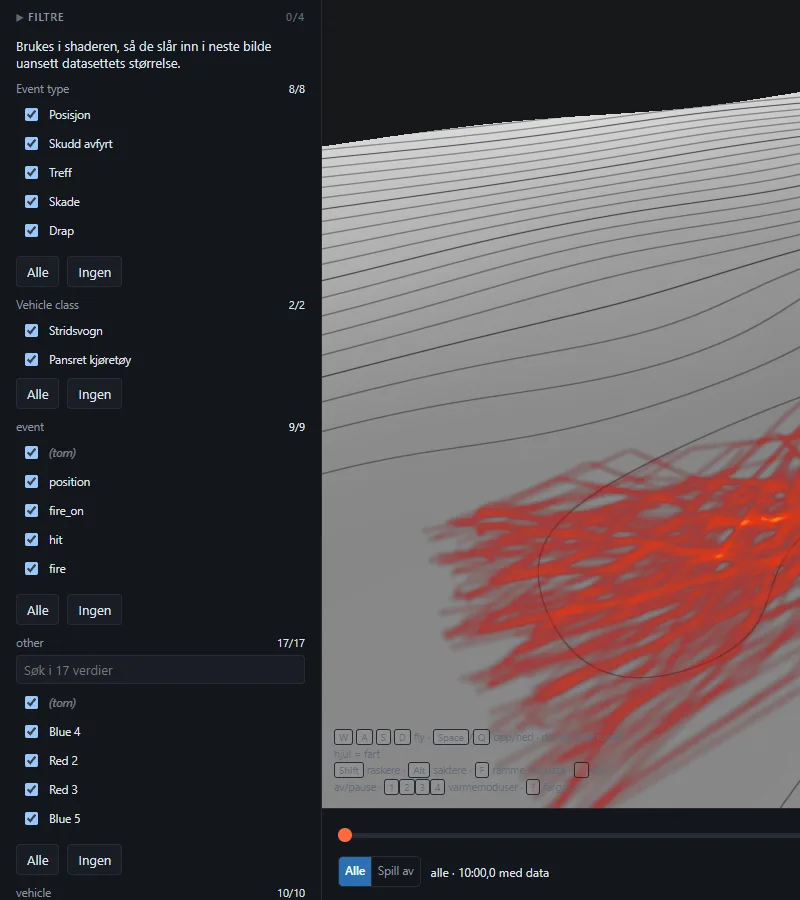
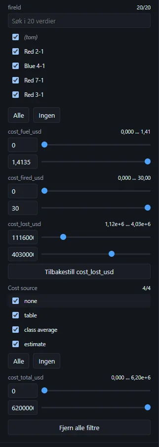

# Filtre

**Filtre** skjuler radene du ikke bryr deg om, for eksempel én kjøretøyklasse eller én hendelsestype, og bildet oppdateres med én gang. Panelet lister kolonnene som beholdes ved innlasting under *Behold for filtrering* ([Kolonnetilordning](column-mapping.md)), pluss *Kildefil* når flere filer er lastet inn.

## Prøv det {#try-it}

1. Last inn et datasett og åpne **Filtre** i sidepanelet.
2. Under **Kjøretøyklasse**, fjern avmerkingen for *Tank*. Bildet endres med én gang.
3. Trykk **Fjern alle filtre** for å angre.

De første radene er visningens egne kolonner (under). Radene etter dem kommer fra filen din.

## Kolonner visningen legger til {#columns-the-viewer-adds}

Ved innlasting finner visningen ut fire egne kolonner og lister dem **først**, med navn og verdier på ditt språk, slik at det samme filteret virker for hvert spill og hver datakilde:

| Kolonne | Verdier | Utledet fra |
|---|---|---|
| **Hendelsestype** | 23 typer: Posisjon, Skudd avfyrt, Oppskyting (missil, rakett, bombe), Treff, Bom (våpenet endte nær ingen mål), Eksplosjon, Skade, Drap, Død, Ødelagt, Krasj, Utkast / hoppe ut, Oppstart, Fjerning, Avgang, Landing, Bakkekontakt, Stopp på bakken, Ommunisjon / påfylling, Erobring / mål, Lokkemiddel, Melding, Annet | en kolonne som heter `event`, `events`, `event_type` eller `event_name`; hvert spills egne ord (`shot`, `burst`, `fired`, `struck`, `flare`, `plant` ...) knyttes til disse typene. Hele tabellen: [Hendelsestyper og klasser](ref-event-types.md). |
| **Spiller eller AI** | Spiller, AI | en kolonne `ai`, `is_ai`, `bot` eller `actor`; ellers `is_player` / `human`; ellers en konto-id (`user_id`, `steam_id`; tom eller 0 er AI); for Tacview-opptak, om objektet har en flyger |
| **Kjøretøyklasse** | 17 klasser: Jager, Angrepsfly, Bombefly, Annet fly, Helikopter, Tank, Pansret kjøretøy, Luftvern, Artilleri, Lastebil / bil, Skip, Ubåt, Infanteri, Våpen, Lokkemiddel, Konstruksjon, Annet | kjøretøyets eller enhetens navn (sammenlignet med [figurkatalogen](figures.md)) og typekolonner |
| **Målklasse** | de samme klassene | den andre partens kjøretøy (`other_vehicle`, `target_vehicle`, `victim_type` ...) |

Bare typene som finnes listes. Verdikolonner (`cost_*`, `earn_*`, `net_*` og *Kostnadskilde*, se [Verdivekting](value-weighting.md)) kan filtreres som alle tallkolonner: for eksempel fjern avmerkingen for *estimat* under *Kostnadskilde* for å beholde bare prissatte rader.

En kategoriliste med mer enn 12 verdier får en søkeboks (*Søk i n verdier*) og en knapp **Bare disse** som tillater nøyaktig de verdiene som passer.

Hvilke kolonner som kan filtreres, avgjøres ved innlasting, fordi de må leses da. Uten noen beholdt kolonne sier panelet det og peker på *Behold for filtrering*.

## Tallkolonner (område) {#numeric-columns-range}

| Del | Betydning |
|---|---|
| Navn, og `min ... max` | Kolonnen, og det gjeldende området (kolonnens hele område mens intet filter er satt). |
| Første rad: tallboks og glidebryter | Nedre grense. Drar du glidebryteren over den øvre grensen, dyttes den øvre grensen med. |
| Andre rad: tallboks og glidebryter | Øvre grense. Drar du under den nedre grensen, dyttes den også. |
| **Tilbakestill *kolonne***  | Fjerner dette filteret. |

Glidebryterne dekker kolonnens minste til største verdi i 1 000 steg; tallboksene tar imot en hvilken som helst verdi. En rad består når verdien ligger innenfor området, begge ender inkludert. Store verdier vises i eksponentform (`1,23e6`).

## Kategorikolonner {#category-columns}

| Del | Betydning |
|---|---|
| Navn, og `tillatt/totalt` | Kolonnen, og hvor mange av verdiene som er tillatt. |
| Verdiliste | En avkrysningsboks per verdi; en tom verdi vises som *(tom)*. |
| **Alle** / **Ingen** | Tillat hver verdi / ingen verdi. |

Å tillate hver verdi fjerner filteret.

## Regler {#rules}

- **Fire filtre samtidig.** Overskriften viser `aktive/4`. Et femte filter brukes ikke, og panelet sier det. Et valg i [Objekter](entities.md) (eller fanen Kamps spillerfokus) bruker også ett av de fire. Et filter som dekker hele kolonnen bruker ingen.
- **En kategorikolonne har høyst 4 096 verdier**; en bredere beholdes ikke ved innlasting.
- **Filtre kombineres med OG**, og med lagsynlighet, differansedelingen, tidsvinduet, avstandsutsorteringen og [snittet](slice.md).
- **Å endre et filter starter akkumuleringen på nytt og måler eksponeringen på nytt noen bilder senere**, fordi filtrering kan endre tettheten mye ([Farge og eksponering](colour-and-exposure.md#auto-exposure)).
- **Fjern alle filtre** fjerner hvert kolonnefilter. Lagsynlighet og spillervalg satt andre steder beholdes.
- Kolonnefiltre endrer varmemodiene. De endrer ikke figurene i [figurreplayet](box-replay.md), som følger lagsynligheten og valget i Objekter. Valget i Objekter endrer begge.
- I [linjevarme](line-heat.md) testes et filter på raden hvert segment *ender* ved.
- Ved hvert nytt datasett fjernes alle filtre.

## For utviklere {#for-developers}

**Plasser.** Hvert aktivt filter tar en av fire GPU-plasser ([`MAX_FILTER_SLOTS`](https://github.com/Holdi601/3DHeat/blob/main/src/render/types.ts)), en tekstur på 4 byte per rad. Plassene går til filtrene i den rekkefølgen de sist ble endret ([`filterSlots`](https://github.com/Holdi601/3DHeat/blob/main/src/render/filterTables.ts), delt av shaderen og begge panelene). Etter fire viser en feilmelding *Bare de første 4 filtrene brukes. Fjern ett — resten ignoreres, de kombineres ikke i det stille*, og navnene på de ekstra filtrene leses *kolonne (ikke brukt)*. Filtre kjøres per rad i vertex-shaderen, så å endre en terskel krever ingen ny analyse og ingen ny opplasting.

**Filtre panelet ikke viser.** Det finnes to typer til i programtilstanden ([`FilterSpec`](https://github.com/Holdi601/3DHeat/blob/main/src/state/types.ts)):

- et **gruppe**-filter, satt av fanen Kamp når den fokuserer på én side. Det skjuler de andre gruppene i hver modus, også en [differansedeling](difference.md) etter en kolonne.
- et **personer**-filter, satt av panelet [Objekter](entities.md) og av fanen Kamp når den fokuserer på én spiller. Det begrenser figurreplayet og varmemodiene. I varmen er det et kategorifilter over person-id-ene og tar en av de fire plassene. Masken har 65 536 id-er ([`FILTER_MASK_CAPACITY`](https://github.com/Holdi601/3DHeat/blob/main/src/render/types.ts)); en person utover det tegnes ikke i varmen mens filteret er aktivt, selv når den er valgt. Figurreplayet viser dem fortsatt.
