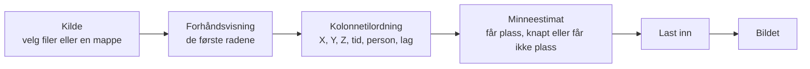

# Få inn data

Før 3DHeat kan tegne noe, trenger den en tabell: hver rad sier hvor noe var og, hvis du har det, når og hvem. Denne delen viser hvordan en fil blir til et bilde. Ingen data ennå? Prøv [demodataene](demo-data.md).

**Gjør dette nå:**

1. I sidepanelet for Varmekart åpner du **Kilde** og trykker **Filer…** (eller slipper en fil eller mappe på slippsonen).
2. Se på **Kolonnetilordning**: boksene er som regel allerede fylt ut.
3. Kontroller at **Minneestimat** sier *får plass*.
4. Trykk **Last inn**.

Alt fanen Varmekart viser kommer fra ett **datasett**: en tabell med rader, der hver har en posisjon og, valgfritt, et tidspunkt, en person, en gruppe, en økt, en siktretning og et hvilket som helst antall ekstra kolonner som beholdes for filtrering. Denne delen forklarer hvordan et datasett lages.

## Veien fra filer til bilde {#the-path-from-files-to-picture}

1. **Velg filer** i panelet **Kilde** – én fil, flere, et mappetre, eller ved å slippe dem. Parquet, CSV, Tacview, GPS-spor og mer godtas; den ene fullstendige listen står i [Dataformater](data-formats.md#files). Se [Laste inn filer](loading-files.md).
2. **Forhåndsvisning.** Den første filen i valget åpnes: kolonnenavnene, de første 50 radene, hvilke kolonner som ser ut som tall, og (for Parquet) hver kolonnes logiske type og filens egne leseinstruksjoner, oppføringen `heat3d` i footeren.
3. **Automatisk tilordning.** Kolonnene tilordnes roller – X, Y, Z, tid, person, økt, gruppe, siktretning – og noen få beholdes for filtrering. Hver gjetning vises i panelet **Kolonnetilordning** og kan endres. Se [Kolonnetilordning](column-mapping.md) og [Akser, enheter og tid](axes-units-and-time.md).
4. **Telling.** Antall rader i hver fil leses (eksakt fra Parquet-footere, anslått for CSV), slik at panelet kan si før noe lastes hvor mye minne innlastingen trenger og om det får plass. Får det ikke plass, foreslår det å laste hver *N*-te rad. Se [Minne og budsjetter](memory-and-budgets.md).
5. **Last inn.** En bakgrunnsarbeider leser bare de tilordnede kolonnene i hver fil – flere filer samtidig, opptil budsjettet for [parsertrådene](memory-and-budgets.md#parser-threads) – og slår dem sammen, i rekkefølgen valget har, til ett datasett: én felles ordbok over personer, grupper og økter for alle filene, ett felles tidsutgangspunkt, alle rader sortert etter tid. Se [Økter, personer og grupper](sessions-persons-groups.md).
6. **Opplasting.** Hovedtråden melder «Laster opp N rader til GPU-en» i ett bilde, og pakker deretter radene inn i GPU-minnet innenfor GPU-budsjettet. Se [GPU-minnebruk](gpu-memory.md).
7. **Første bilde.** Kameraet tilpasser rammen til dataene, sprite-radius og metning settes ut fra datasettets omfang og antall rader, og etter 8 tegnede bilder måles metningen fra selve bildet ([Farge og eksponering](colour-and-exposure.md)).

## Krav som sjekkes før en innlasting {#requirements-checked-before-a-load}

| Behov | Hva som skjer uten det |
|---|---|
| **Minst to av X / Y / Z** | Innlastingen avvises. Med nøyaktig to er den tredje aksen 0, og dataene tegnes som et flatt plan i 3D-scenen – det et kartvarmekart ovenfra trenger. |
| En tidskolonne | Valgfri. Uten den er tidslinjen slått av, visningen blir værende i **Alle**-modus, og sidepanelet sier det. |
| En personkolonne | Valgfri. Trengs for [figuroverlegget](box-replay.md) (en figur for hver person), [linjevarme](line-heat.md) (stien hver person gikk), interpolasjon, spor og historikken **Levetid**. |
| En gruppekolonne | Valgfri. Trengs for [lagvarme](team-heat.md) og for modusen [differanse](difference.md) (minst to grupper). |

En modus de innlastede dataene ikke støtter, er gråtonet i modusraden; holder du musepekeren over den, står det hvorfor.

## Uten egne data {#without-your-own-data}

Panelet **Datasett** (under **Kilde**) har en [syntetisk generator](synthetic-generator.md) som lager et datasett i form av en «battle royale» i hvilken som helst størrelse. Den er nyttig for å prøve visningsprogrammet og for å teste hva en maskin takler.

## Sider i denne delen {#pages-in-this-section}

- [Laste inn filer](loading-files.md) – filvalgere, mapper, dra og slipp, sammenslåing av flere filer, regelen for bevegelsesfiler, framdrift og avbryting
- [Kolonnetilordning](column-mapping.md) – hvert felt i tilordningspanelet, hvordan automatisk tilordning gjetter, `heat3d`-hintene
- [Akser, enheter og tid](axes-units-and-time.md) – opp-akse, speiling, enhetsskala, tidsenheter, siktretning
- [Økter, personer og grupper](sessions-persons-groups.md) – hva hver gjør, grensene, delte navn, enhetsstørrelse, panelet Datasett
- [Syntetisk generator](synthetic-generator.md)
- [Minne og budsjetter](memory-and-budgets.md) – minnemodellen, kontrollen av plass, nedsampling, sorteringsgrensen, ressursbudsjetter
