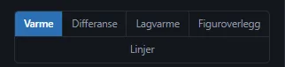

# Varmemodi

Hver prikk legger til en liten glød, gløden hopes opp, og haugen males med farger. Modiene er fem måter å male den på, og hver svarer på ett spørsmål.

Modusraden øverst i sidepanelet for fanen Varmekart velger hvordan [datasettet](glossary.md) tegnes. Tastene 1–4 velger Varme, Differanse, Lagvarme og Linjer. Figuroverlegg har ingen tast.

| Modus | Spørsmålet den svarer på |
|---|---|
| **Varme** | Hvor skjedde det, og hvor mye? |
| **Differanse** | Hvilken side gjorde det mest? |
| **Lagvarme** | Hvem var det? |
| **Linjer** | Hvilken vei gikk folk? |
| **Figuroverlegg** | Hvem var hvor, og når? |

| Modus (navn i modusraden) | Tast | Hva den tegner | Trenger |
|---|---|---|---|
| **Varme** | 1 | Additiv tetthet: hver synlig rad legger til en radial sprite som vender mot kameraet. [Varme](heat.md) | et datasett |
| **Differanse** | 2 | Fortegnet tetthet: én populasjon legger til, en annen trekker fra. [Differanse](difference.md) | to sider: minst to grupper, eller en deling over en beholdt kolonne |
| **Lagvarme** | 3 | Tetthet farget etter gruppe: en fargetone per gruppe, blandet der gruppene overlapper. [Lagvarme](team-heat.md) | en gruppekolonne |
| **Figuroverlegg** | – | En figur (eller boks) per person, som beveger seg langs tidslinjen: replayet. [Figuroverlegg](box-replay.md), [Kampreplay](match-replay.md) | en personkolonne |
| **Linjer** | 4 | Linjevarme: en linje fra hver prøve av en person til den neste, varmen avtar sideveis. [Linjevarme](line-heat.md) | en person- og en tidskolonne |

En modus dataene ikke støtter, er gråtonet, og verktøytipsen gir grunnen, for eksempel *Utilgjengelig – Differanse-modusen trenger to grupper eller en beholdt kolonne å dele på; disse dataene har én gruppe.* Når et nytt datasett ikke kan støtte den gjeldende modusen, faller visningen tilbake til **Varme**.

Tastene 1–4 kontrolleres mot dataene på samme måte: en tast for en gråtonet modus gjør ingenting.

## Hvilke paneler hver modus viser {#which-panels-each-mode-shows}

| Panel | Varme | Differanse | Lagvarme | Figuroverlegg | Linjer |
|---|---|---|---|---|---|
| Ruter ([linjevarme](line-heat.md)) | | | | | ja |
| Varmeform (med **Følg visningen** og **Samme tetthet ved all zoom**), Varmefarger, Pikselgrenser for sprite, Dybde, Avstandsutsortering | ja | ja | ja | | ja |
| Retning ([retningsbasert varme](directional-heat.md)), Verdi ([verdivekting](value-weighting.md)) | ja | ja | ja | | ja |
| Lagvisning ([figuroverlegg](box-replay.md)) | | | | ja | |
| Delingen for differanse ([differanse](difference.md)) | | ja | | | |
| [Lag](teams-list.md), [Objekter](entities.md), [Filtre](filters.md), Bakgrunn / nivå, [Snitt](slice.md), [Måling](measure.md), Kameravei og rendering, Ytelse, Kamera og scene | ja | ja | ja | ja | ja |

## Det alle varmemodiene har felles {#what-every-heat-mode-shares}

Alle fire varmemodiene (alt unntatt figuroverlegget) er den samme maskinen med ulike innganger ([`engine.ts`](https://github.com/Holdi601/3DHeat/blob/main/src/render/engine.ts)):

1. **Hvilke rader.** [Tidslinjens](timeline.md) vindu velger et sammenhengende utvalg av tidssorterte rader; [filtre](filters.md), synlighet for grupper, delingen for differanse, [avstandsutsortering](depth-and-culling.md#distance-culling) og [snittet](slice.md) avgjør per rad, i vertex-shaderen, om og hvor sterkt hver bidrar.
2. **Splatting.** Hver bidragende rad tegnes som en sprite (eller, i linjemodus, et segment) inn i et **varmemål** med flyttall, og legger til sin verdi fra fargeskalaen. Et stratifisert utvalg av radene tegnes når det er flere enn ett bilde har råd til, vektet for å kompensere. Se [Sampling og budsjetter](sampling-and-budgets.md).
3. **Akkumulering.** Så lenge ingenting endrer seg, slås bilder sammen til hver rad har bidratt nøyaktig én gang. Se [Akkumulering](accumulation.md).
4. **Sammensetning.** Den akkumulerte verdien i hver piksel deles på **metningspunktet**, formes av **tetthetsresponsen**, løftes av **minste varme** og slås opp i **fargeskalaen**, hvis alfa blander den over scenen. Se [Farge og eksponering](colour-and-exposure.md).

Alt i steg 4 brukes når bildet settes sammen, så å dra disse kontrollene starter aldri akkumuleringen på nytt; alt i steg 1–2 gjør det.

## Sider i denne delen {#pages-in-this-section}

- [Varme](heat.md) – den vanlige varmemodusen, og oversikten over panelene
  - [Sprite-form](sprite-shape.md) – radius, intensiteter, avtagning, kurveredigereren, pikselgrenser, flatutjevning
  - [Farge og eksponering](colour-and-exposure.md) – fargeskalaredigereren, metningspunktet, autoeksponering, minste varme, tetthetsrespons
  - [Dybde og utsortering](depth-and-culling.md) – skjuling av banen, skjul bak terreng, avstandsutsortering
- [Differanse](difference.md) – delingen for differanse
- [Lagvarme](team-heat.md)
- [Linjevarme](line-heat.md) – ruter
- [Figuroverlegg](box-replay.md) – replaymodusen (filen heter fortsatt box replay)
- [Retningsbasert varme](directional-heat.md)
- [Verdivekting](value-weighting.md)
